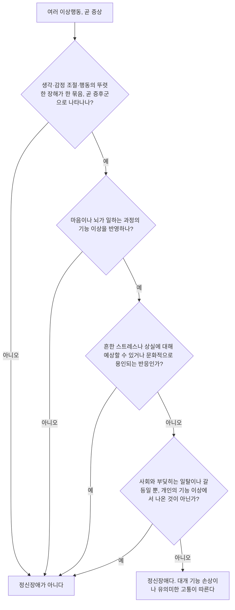



요약

이상행동이 증상 하나라면, 정신장애는 여러 증상이 한 덩어리로 함께 나타나는 묶음이다. 어떤 묶음을 어떤 장애라 부를지는 미국정신의학회가 만든 진단 편람(DSM)이 정하고, 세계 어디서나 이 목록을 공통 언어로 쓴다. 다만 목록은 판이 바뀔 때마다 달라지므로, 목록에 없다고 해서 문제가 없다는 뜻은 아니다.

## 예시로 보기

"잠을 못 잔다"는 이상행동 하나, 곧 증상 하나다. 불면만으로는 장애라 하지 않는다. 불면에 우울한 기분, 흥미 상실, 식욕 변화, 무가치감이 두 주 넘게 함께 나타나 학업을 망가뜨리면, 이 묶음을 주요우울장애라는 증후군(syndrome)으로 부른다[^s1].

반대로 증상이 여럿 있어도 장애가 아닌 경우가 있다. 굿을 하며 신이 내린 듯 행동하거나, 점집에서 점을 보거나, 예배 중에 방언이 터지는 것은 그 문화에서 받아들여지는 행동이다. 이 예들은 DSM 정의가 "문화적으로 용인되는 반응"을 정신장애에서 빼는 이유를 보여 준다.

## 정의

이상행동과 정신장애는 같은 말이 아니다.

- **이상행동:** 객관적으로 관찰하고 측정할 수 있는 개인의 부적응적 심리 특성. 인지, 정서, 동기, 행동, 생리 측면에서 나타난다.
- **정신장애(정신질환):** 이상행동을 포함하는 증후군의 집합.

진단 체계가 계속 바뀌므로, 여러 이상행동을 보이면서도 지금의 진단명에 해당하지 않는 사람이 있을 수 있다(DSM-6, DSM-7…?).

DSM-5의 정신장애 정의

정신장애는 다음을 모두 갖춘다[^s2].
1. 개인의 인지, 정서 조절, 행동에 임상적으로 유의미한 장해가 있는 **증후군**이다. 이 장해는 정신 기능의 바탕인 심리적·생물학적·발달적 과정의 **기능 이상**을 반영한다. 
   — 쉽게 말하면, 생각·감정 조절·행동이 치료가 필요할 만큼 흐트러져 있고(장해), 그 까닭이 마음이나 뇌가 일하는 과정의 고장에 있다.
2. 보통 사회적·직업적·그 밖의 중요한 활동에서의 **기능 손상**이나 **유의미한 고통**과 관련된다. 
   — 대개 본인이 많이 괴롭거나, 학교·직장·인간관계에서 제 몫을 못 한다.
3. 흔한 스트레스나 상실(예: 사랑하는 사람의 죽음)에 대해 **예상할 수 있거나 문화적으로 용인되는 반응**은 정신장애가 아니다. 
   — 누구나 겪을 일에 누구나 보일 만한 반응, 그 문화에서 받아들이는 반응은 장애로 보지 않는다.
4. 사회적으로 벗어난 행동(정치적·종교적·성적)과 주로 개인과 사회 사이의 갈등은, 그 일탈이나 갈등이 개인의 기능 이상에서 나온 것이 아니라면 정신장애가 아니다. 
   — 사회와 생각이 달라 부딪히는 것만으로는 장애가 아니다. 그 사람 안의 고장에서 나온 일탈일 때만 장애가 될 수 있다.

네 요소는 [이상행동의 기준](/Hongs_Blog/studies/abnormal-psychology/abnormality-criteria/)과 이렇게 이어진다. 1의 "기능 이상"은 개인 내부의 고장을, 2는 주관적 고통과 적응 기능의 저하를 가리킨다. 3과 4는 문화적 규범의 일탈만으로는 장애라 하지 않는다는 제한이다.

위에서부터 질문에 하나씩 답한다. 어느 질문에서든 "정신장애가 아니다" 칸으로 빠지면 장애로 보지 않는다. 고통과 기능 손상은 거르는 질문이 아니라 대개 함께 나타나는 특징이라 마지막 칸에 들어 있다.

### DSM과 ICD

- **DSM**은 Diagnostic and Statistical Manual of Mental Disorders(정신장애 진단 및 통계 편람)의 약자다. 미국정신의학회(American Psychiatric Association)가 펴낸다. 같은 약자를 쓰는 미국심리학회(American Psychological Association)와 헷갈리지 않는다.
- 세계에서 가장 널리 쓰는 진단 분류 체계라, 정신의학자에게는 "황금 기준이자 성경"으로 불린다.
- 세계보건기구(WHO)의 **국제질병분류**(ICD, International Classification of Diseases)도 정신장애를 분류한다.

판마다 진단 수가 늘었다.

| 판 | 발간 | 진단 수 |
|---|---|---|
| DSM-I | 1952 | 128 |
| DSM-II | 1968 | 193 |
| DSM-III | 1980 | 228 |
| DSM-III-R | 1987 | 253 |
| DSM-IV | 1994 | 383 |
| DSM-IV-TR | 2000 | 383 |
| DSM-5 | 2013 | 541 |

### DSM-5-TR

DSM-5-TR은 5판의 본문개정판(Text Revision)이다. 2022년에 나왔고, 정신장애를 22개 범주, 350개가 넘는 하위 장애로 나눈다. 범주적 분류와 차원적 분류를 섞어 쓴다.

22개 범주는 다음과 같다. 범주 하나하나를 외우기 전에 이 표로 큰 그림부터 잡아 둔다.

| 번호 | 범주 | 예 | 자세히 |
|---|---|---|---|
| 1 | 신경발달장애 | ADHD, 자폐 | [신경발달장애](/Hongs_Blog/studies/abnormal-psychology/neurodevelopmental-disorders/) |
| 2 | 조현병 스펙트럼 및 기타 정신병적 장애 |  | [정신증과 조현병 스펙트럼](/Hongs_Blog/studies/abnormal-psychology/psychosis-spectrum/) |
| 3 | 양극성 및 관련 장애 | 조울증 | [양극성장애](/Hongs_Blog/studies/abnormal-psychology/bipolar-disorder/) |
| 4 | 우울장애 |  | [기분장애](/Hongs_Blog/studies/abnormal-psychology/mood-disorders/) |
| 5 | 불안장애 |  | [불안과 공포](/Hongs_Blog/studies/abnormal-psychology/anxiety-and-fear/) |
| 6 | 강박 및 관련 장애 |  | [강박장애](/Hongs_Blog/studies/abnormal-psychology/ocd/) |
| 7 | 외상 및 스트레스 사건 관련 장애 | PTSD | [외상과 스트레스 관련 장애](/Hongs_Blog/studies/abnormal-psychology/trauma-and-stressor/) |
| 8 | 해리장애 | 다중 인격(해리성 정체감 장애)[^s5] | [해리](/Hongs_Blog/studies/abnormal-psychology/dissociation/) |
| 9 | 신체증상 및 관련 장애 |  | [신체증상 및 관련 장애](/Hongs_Blog/studies/abnormal-psychology/somatic-symptom-related/) |
| 10 | 급식 및 섭식장애 |  | [급식 및 섭식장애](/Hongs_Blog/studies/abnormal-psychology/feeding-eating-disorders/) |
| 11 | 배설장애 |  | [배설장애](/Hongs_Blog/studies/abnormal-psychology/elimination-disorders/) |
| 12 | 수면-각성 장애 |  | [수면-각성장애](/Hongs_Blog/studies/abnormal-psychology/sleep-wake-disorders/) |
| 13 | 성기능부전 |  | [성기능부전](/Hongs_Blog/studies/abnormal-psychology/sexual-dysfunctions/) |
| 14 | 성별 불쾌감 |  | [성별 불쾌감](/Hongs_Blog/studies/abnormal-psychology/gender-dysphoria/) |
| 15 | 파괴적, 충동통제 및 품행장애 |  | [파괴적, 충동조절 및 품행장애](/Hongs_Blog/studies/abnormal-psychology/disruptive-impulse-conduct/) |
| 16 | 물질관련 및 중독 장애 |  | [물질관련 및 중독 장애](/Hongs_Blog/studies/abnormal-psychology/substance-related-addictive/) |
| 17 | 신경인지장애 | 치매 | [신경인지장애](/Hongs_Blog/studies/abnormal-psychology/neurocognitive-disorders/) |
| 18 | 성격장애 |  | [성격장애](/Hongs_Blog/studies/abnormal-psychology/personality-disorders/) |
| 19 | 변태성욕장애(성도착장애) |  | [성도착장애](/Hongs_Blog/studies/abnormal-psychology/paraphilic-disorders/) |
| 20 | 기타 정신장애 |  | — |
| 21 | 약물치료로 유발된 운동장애 및 약물치료의 기타 부작용 |  | — |
| 22 | 임상적 주의의 초점이 될 수 있는 기타 상태 |  | — |

## 연결

- 무엇을 이상으로 보나: [이상행동의 기준](/Hongs_Blog/studies/abnormal-psychology/abnormality-criteria/)
- DSM이 섞어 쓰는 두 분류 방식: [범주적 분류와 차원적 분류 비교](/Hongs_Blog/studies/abnormal-psychology/categorical-vs-dimensional/)
- DSM의 쓸모와 비판: [진단 분류의 장단점](/Hongs_Blog/studies/abnormal-psychology/diagnostic-classification-evaluation/)

## 확인 문제

<b>C1</b> "이상행동"과 "정신장애"는 어떻게 다른가? 불면을 예로 들어 설명하라.

**답:** 이상행동은 관찰·측정할 수 있는 부적응적 특성 하나, 곧 증상 하나다. 정신장애는 이상행동들이 함께 묶여 나타나는 증후군이다. 불면은 이상행동이고, 불면이 우울한 기분·흥미 상실·무가치감과 함께 일정 기간 나타나 기능을 떨어뜨리면 주요우울장애 같은 정신장애가 된다. 
**흔한 오답:** "정신장애가 더 심한 이상행동"이라고 쓰는 경우. 차이는 심한 정도가 아니라 증상 하나냐 묶음이냐다.

<b>C2</b> 다음 중 DSM-5의 정의에 따르면 정신장애가 아닌 것을 고르고, 정의의 어느 요소 때문인지 쓰라. (a) 사별 뒤 두 주 동안 슬퍼하며 잠을 설침 (b) 정부 정책에 반대해 시위를 반복함 (c) 사람들이 자기 생각을 훔쳐 간다고 확신해 1년째 외출하지 못함

**답:** (a)와 (b)가 정신장애가 아니다. (a)는 흔한 상실에 대한 예상 가능한 반응이라 셋째 요소로 빠진다. (b)는 개인과 사회 사이의 갈등이고 개인의 기능 이상에서 나온 것이 아니라 넷째 요소로 빠진다. (c)는 증후군(망상), 기능 이상, 기능 손상을 모두 갖춰 정신장애 후보다.

<b>C3</b> DSM의 원래 이름, 펴내는 기관, 최신판의 이름과 발간 연도, 범주 수를 쓰라.

**답:** Diagnostic and Statistical Manual of Mental Disorders(정신장애 진단 및 통계 편람). 미국정신의학회(American Psychiatric Association). 최신판은 DSM-5-TR(2022). 22개 범주, 350개가 넘는 하위 장애. 
**흔한 오답:** 펴내는 기관을 미국심리학회(American Psychological Association)로 쓰는 경우. 약자가 같아 헷갈린다.

[^s1]: 주요우울장애의 증상 묶음은 [주요우울장애](/Hongs_Blog/studies/abnormal-psychology/major-depressive-disorder/)에서 자세히 다룬다. 여기서는 증상과 증후군의 차이를 보이는 예로만 썼다.
[^s2]: 네 요소의 근거는 DSM-5(American Psychiatric Association, 2013)의 정신장애 정의 절이다.
[^s5]: 다중 인격은 해리성 정체감 장애의 옛 이름이다.

