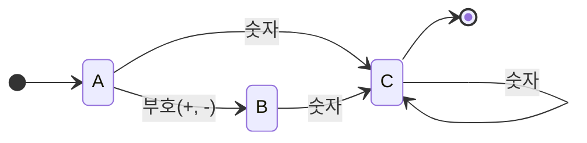
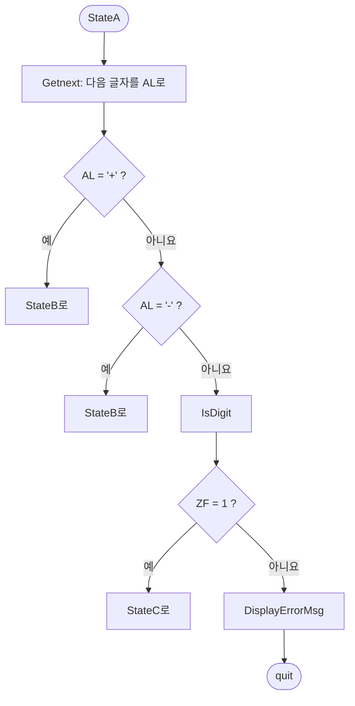


<div class="callout callout-summary" markdown="1">
<div class="callout-title callout-title--default" markdown="span">요약</div>

글자를 하나씩 받으면서 "지금 어디까지 왔는지"만 기억하는 검사기다. 보드게임 말판처럼 칸이 몇 개 있고, 들어온 글자에 따라 화살표를 따라 다음 칸으로 옮긴다. 글자가 끝났을 때 말이 "통과" 칸에 서 있으면 올바른 입력이다. 그림 한 장이 곧 프로그램이라 고치기 쉽고 어셈블리로 옮기기도 쉽지만, 칸의 수가 정해져 있어서 지금 있는 칸 말고는 아무것도 기억하지 못한다.

</div>


## 예시로 보기

키보드로 받은 글자들이 `+123`, `-5`, `42` 같은 부호 있는 정수인지 검사한다고 하자. 조건문만으로 짜면 "첫 글자가 부호인가, 부호 다음이 숫자인가, 숫자가 하나라도 있었나"를 변수 여러 개로 따로 적어야 한다. 조건이 하나 늘 때마다 어느 변수를 언제 고쳐야 하는지 헷갈린다.

그림으로 그리면 한눈에 보인다.



- 네모 하나하나를 **상태**라고 부른다. A는 아직 아무것도 못 읽은 곳, B는 부호만 읽은 곳, C는 숫자를 하나 이상 읽은 곳이다.
- 화살표는 "이 글자가 들어오면 저 상태로 간다"는 뜻이다.
- 화살표가 처음 들어오는 A가 시작 상태다. C가 통과 칸(받아들이는 상태)이다. 통과 칸은 굵은 테두리로 그리기도 하고, 위 그림처럼 끝 표시로 나가는 화살표를 달기도 한다.

`-40`을 넣으면 A → B → C → C로 가서 C에서 끝난다. 통과다. `+`만 넣으면 B에서 끝난다. B는 통과 칸이 아니므로 탈락이다. `12a`는 C에서 `a`를 만났는데 `a`가 적힌 화살표가 없다. 갈 곳이 없으면 그 자리에서 탈락이다.

같은 방법으로 `x`로 시작해서 `a`부터 `y`까지의 글자가 몇 개든 이어지고 `z`로 끝나는 문자열도 알아볼 수 있다. A에서 `x`를 읽으면 B로 가고, B에서 `a`..`y`를 읽으면 B에 머물고, `z`를 읽으면 통과 칸 C로 간다.

<div class="callout callout-check" markdown="1">
<div class="callout-title" markdown="span">검증: 두 그림을 길이 5 이하의 모든 문자열에 돌려 정규식 `[+-]?[0-9]+`, `x[a-y]*z`와 같은 판정인지 확인, IsDigit를 AL 256가지 전부에 대해 확인, 전체 코드의 흉내(파이썬으로 한 줄씩 옮긴 것), 상태 C의 `Getnext` 뒤에 `jz Quit`을 두면 `1a`·`+7x9`가 통과하는 것 — [36_asm-finite-state-machine_verify.py](/Hongs_Blog/studies/assembly-language/code/36_asm-finite-state-machine_verify/)</div>

</div>


## 정의

유한 상태 기계는 입력에 따라 상태를 바꾸는 그래프다. 상태 전이도(state-transition diagram)라고도 부른다.

- 네모나 동그라미를 노드, 그 사이의 화살표를 간선이라 부른다. 방향이 있는 그래프의 한 종류다.
- 노드는 세 가지다. 시작 상태(start state) 하나, 종료 상태(terminal state) 하나 이상, 그 밖의 상태(nonterminal state).
- 입력을 다 읽었을 때 종료 상태(받아들이는 상태)에 있으면 그 입력을 받아들인다.

글자들이 어떤 규칙을 따르는지 검사하는 데 쓴다. 이런 규칙을 적는 식을 정규 표현식이라고 부른다. 위 정수 그림이 받아들이는 문자열은 정규식 `[+-]?[0-9]+`와 정확히 같다[^s1].

## 어셈블리로 옮기기

옮기는 규칙은 두 줄이다.

1. 상태 하나 = 이름표 하나 (`StateA:`, `StateB:`, `StateC:`).
2. 화살표 하나 = 비교 한 번과 조건 점프 한 번. 맞는 화살표가 없으면 오류를 찍고 끝낸다.

"지금 어느 상태인가"를 변수에 적지 않는다. 프로그램이 지금 어느 이름표 아래를 실행하고 있는지가 곧 상태다[^s1].

상태 A의 코드다.

```asm
StateA:
    call Getnext          ; 다음 글자를 AL로 읽는다
    cmp  al,'+'           ; + 부호인가?
    je   StateB           ; 그러면 상태 B로
    cmp  al,'-'           ; - 부호인가?
    je   StateB           ; 그러면 상태 B로
    call IsDigit          ; AL이 숫자면 ZF = 1
    jz   StateC           ; 숫자면 상태 C로
    call DisplayErrorMsg  ; 맞는 화살표가 없다
    jmp  Quit
```

그림에서 A를 떠나는 화살표는 둘(부호, 숫자)인데 비교는 셋이다. 부호 화살표 하나가 `+`와 `-` 두 글자를 묶고 있기 때문이다. 상태 A의 흐름을 그림으로 그리면 이렇다.



**숫자인지 묻는 프로시저.** `IsDigit`는 AL의 글자가 `'0'`~`'9'`이면 ZF를 1로, 아니면 0으로 만들어 돌려준다.

```asm
IsDigit PROC
    cmp  al,'0'
    jb   ID1       ; '0'보다 작으면 나간다 (이때 ZF = 0)
    cmp  al,'9'
    ja   ID1       ; '9'보다 크면 나간다 (이때 ZF = 0)
    test ax,0      ; 여기까지 왔으면 숫자다. ZF = 1로 만든다
ID1: ret
IsDigit ENDP
```

두 `cmp`에서 빠져나갈 때는 두 값이 다르므로 ZF가 0이다. `test ax,0`은 AX와 0을 AND 한 결과(늘 0)로 플래그만 정하므로 ZF가 반드시 1이 된다. 값을 돌려줄 레지스터를 따로 쓰지 않고 플래그 하나로 "예/아니요"를 돌려주는 수법이다[^s1].

**전체 코드의 나머지.** 상태 B는 숫자만 받아 C로 간다. 상태 C는 숫자면 자기 자신으로 돌아가고, Enter(아스키 13)면 정상 종료하고, 그 밖의 글자면 오류다.

```asm
StateB:
    call Getnext
    call IsDigit
    jz   StateC
    call DisplayErrorMsg
    jmp  Quit

StateC:
    call Getnext
    call IsDigit
    jz   StateC           ; 숫자면 C에 머문다
    cmp  al,ENTER_KEY     ; Enter인가?
    je   Quit             ; 그러면 정상 종료
    call DisplayErrorMsg
    jmp  Quit
```


`-40`과 Enter를 넣었을 때 고친 코드가 지나가는 길이다[^s1].

| 읽은 글자 | 있던 상태 | 일어난 일 | 옮겨 간 곳 |
|---|---|---|---|
| `-` | A | `cmp al,'+'` 다르다 → `cmp al,'-'` 같다 → `je StateB` | B |
| `4` | B | IsDigit가 ZF = 1 → `jz StateC` | C |
| `0` | C | IsDigit가 ZF = 1 → `jz StateC` | C |
| Enter | C | IsDigit가 ZF = 0 → `cmp al,13` 같다 → `je Quit` | 정상 종료 |

## 활용

- 좋은 점은 셋이다. 프로그램의 흐름이 그림으로 보인다. 화살표를 더하거나 빼면 되므로 고치기 쉽다. 어셈블리로 옮기기 쉽다.
- 입력 검사(숫자, 날짜, 식별자)와 컴파일러가 소스 코드를 낱말로 자르는 단계가 같은 방법을 쓴다. 컴파일러 과목의 [유한 오토마타](/Hongs_Blog/studies/compilers/finite-automata/)는 이 그림을 표로 적어 놓고 표를 따라가며 돌린다. 여기서는 표 대신 점프로 바로 옮긴다.
- 한계: 상태 수가 정해져 있어 "여는 괄호를 몇 개 읽었는지"처럼 끝없이 커질 수 있는 수는 셀 수 없다[^s1].
- 흔한 실수: 통과 칸을 잘못 정하는 것. 상태 B(부호만 읽음)에서 입력이 끝나도 통과시키면 `+` 한 글자가 정수가 된다.
- 흔한 실수: 상태 C에서 `call Getnext` 바로 뒤에 `jz Quit`을 두고 Enter를 검사했다고 여기는 것. `Getnext`는 글자를 읽어 화면에 다시 찍을 뿐 Enter와 견주지 않는다. `Getnext`가 플래그를 건드리지 않는다면 이 `jz`는 상태 C로 오게 한 `IsDigit`의 ZF = 1을 그대로 본다. 그러면 글자를 읽자마자 검사 없이 끝나서 `1a`, `+7x9`도 오류 없이 통과한다. Enter는 위 코드처럼 `IsDigit` 다음에 `cmp al,ENTER_KEY`로 직접 견준다[^s1].
- 연습: [유한 상태 기계 연습](/Hongs_Blog/studies/assembly-language/fsm-practice/)

## 연결

- 화살표 하나를 옮기는 도구: [TEST와 CMP](/Hongs_Blog/studies/assembly-language/test-cmp/), [조건 점프](/Hongs_Blog/studies/assembly-language/conditional-jumps/). `Getnext`와 `IsDigit`를 부르는 법: [프로시저와 CALL·RET](/Hongs_Blog/studies/assembly-language/call-ret/). 글자를 읽고 찍는 ReadChar·WriteChar: [Irvine32 라이브러리](/Hongs_Blog/studies/assembly-language/irvine32-library/)
- 같은 그림을 수학으로 다듬은 것: [유한 오토마타](/Hongs_Blog/studies/compilers/finite-automata/). 그림이 받아들이는 문자열을 식으로 적는 법: [정규 표현식](/Hongs_Blog/studies/compilers/regular-expression/)
- 노드와 간선: [그래프의 기초](/Hongs_Blog/studies/discrete-math/graph-basics/)
- 점프 대신 표로 갈 곳을 고르는 방법: [표 기반 선택](/Hongs_Blog/studies/assembly-language/table-driven-selection/)

## 확인 문제

<details class="callout callout-question" markdown="1">
<summary class="callout-title" markdown="span">**C1** 유한 상태 기계의 그림을 어셈블리 코드로 옮기는 두 규칙을 쓰라. "지금 상태"는 어디에 적혀 있는가?</summary>

**답:** 상태 하나를 이름표 하나로, 화살표 하나를 비교(`cmp`나 `IsDigit` 호출) 한 번과 조건 점프 한 번으로 옮긴다. 맞는 화살표가 없으면 오류를 찍고 끝낸다. 지금 상태는 변수가 아니라 "지금 어느 이름표 아래를 실행하고 있는가"다.

</details>


<details class="callout callout-question" markdown="1">
<summary class="callout-title" markdown="span">**C2** 부호 있는 정수 그림에 `-40`, `+`, `7+`를 차례로 넣는다. 각각 지나가는 상태와 판정을 쓰라.</summary>

**답:** `-40`: A → B → C → C, 통과. `+`: A → B, B는 통과 칸이 아니라 탈락. `7+`: A → C, 그다음 `+`가 적힌 화살표가 C에 없어 탈락.

</details>


<details class="callout callout-question" markdown="1">
<summary class="callout-title" markdown="span">**C3** 상태를 A와 B 둘만 두고, A에서 부호나 숫자를 읽으면 B로, B에서 숫자를 읽으면 B에 머물게 그렸다(B가 통과 칸). 이 그림이 위의 상태 셋짜리보다 못한 이유는?</summary>

**답:** `+`나 `-` 한 글자만 넣어도 통과 칸 B에서 끝나므로 숫자가 하나도 없는 입력을 정수로 받아들인다.<br>
**이유:** "부호만 읽었다"와 "숫자를 하나 이상 읽었다"는 다음에 허락되는 일이 다르다(앞은 아직 끝낼 수 없다). 서로 다르게 다뤄야 하는 상황은 서로 다른 상태로 갈라야 한다. 길이 4 이하의 모든 입력에서 두 그림의 판정이 다른 것은 `+`와 `-` 둘뿐이다.

</details>


<details class="callout callout-question" markdown="1">
<summary class="callout-title" markdown="span">**C4** `IsDigit`의 `test ax,0` 한 줄이 하는 일을 한 문장으로 쓰라. 이 줄을 `cmp al,al`로 바꿔도 되는가?</summary>

**답:** AL이 숫자라고 확인된 자리에서 ZF를 1로 만들어 "숫자다"를 알린다. `cmp al,al`도 결과가 0이라 ZF가 1이 되므로 된다.<br>
**이유:** `test`와 `cmp`는 둘 다 결과를 버리고 플래그만 정한다. 앞의 두 `cmp`에서 빠져나간 경우에는 두 값이 달라 ZF가 0이다[^s1].

</details>


[^s1]: 실행 결과는 실제 어셈블러가 아니라 파이썬 흉내로 확인했다(검증 줄의 코드). 흔한 실수에 적은 `jz Quit`의 결과는 ReadChar·WriteChar가 ZF를 바꾸지 않는다고 놓고 흉내 낸 것이다[확인필요].

