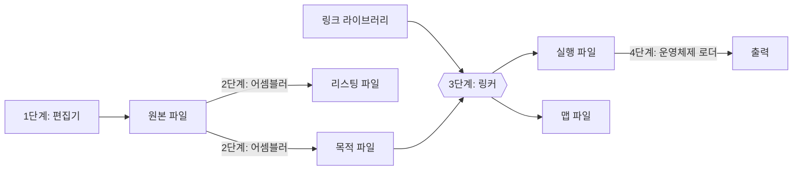


<div class="callout callout-summary" markdown="1">
<div class="callout-title callout-title--default" markdown="span">요약</div>

글자로 쓴 어셈블리어 파일은 그대로는 돌지 않는다. 원고가 책이 되려면 조판하고, 다른 원고와 묶어 제본하고, 독자의 손에 가야 하듯이, 프로그램도 기계어로 바꾸고, 남이 만들어 둔 코드와 합치고, 메모리에 올리는 세 걸음을 거친다. 걸음을 나눠 둔 덕에 남의 코드를 다시 번역하지 않고 가져다 쓸 수 있다. 대신 원본을 한 글자라도 고치면 세 걸음을 처음부터 다시 밟아야 한다.

</div>


## 예시로 보기

[프로그램 틀](/Hongs_Blog/studies/assembly-language/asm-program-template/)의 AddSub2는 `call DumpRegs`로 레지스터를 화면에 찍는다. 그런데 `DumpRegs`의 코드는 내 원본 파일에 없다. 다른 사람이 미리 만들어 둔 코드 모음에 있다. 내 코드를 기계어로 바꾸는 일과 그 코드 모음을 가져다 붙이는 일은 서로 다른 프로그램이 한다.



## 네 단계

| 단계 | 누가 | 받는 것 | 만드는 것 |
|---|---|---|---|
| 1 | 편집기 (사람이 쓴다) | — | 원본 파일 (source file) |
| 2 | 어셈블러 | 원본 파일 | 목적 파일 (object file), 리스팅 파일 (listing file) |
| 3 | 링커 | 목적 파일, 링크 라이브러리 | 실행 파일 (executable file), 맵 파일 (map file) |
| 4 | 운영체제의 로더 | 실행 파일 | 메모리에 올려 실행한다. 출력이 나온다 |

- **목적 파일**은 내 원본을 기계어로 바꾼 것이다. 아직 혼자서는 돌지 못한다. `DumpRegs`처럼 다른 곳에 있는 코드의 자리가 비어 있기 때문이다[^s1].
- **링크 라이브러리**는 미리 기계어로 바꿔 둔 프로시저의 모음이다. 링커가 여기서 필요한 프로시저를 꺼내 목적 파일과 합친다[^s1].
- **로더**는 실행 파일을 메모리에 올리고 프로세서가 그 첫 명령부터 실행하게 하는 운영체제의 한 부분이다[^s1].

원본을 고치면 2단계부터 4단계까지를 다시 해야 한다.

### 리스팅 파일

어셈블러가 원본을 어떻게 번역했는지 보여 주는 파일이다. 다음이 들어 있다.

- 원본 코드
- 주소
- 목적 코드 (기계어)
- 세그먼트 이름
- 기호 (변수, 프로시저, 상수)

리스팅 파일의 한 토막이다. 왼쪽부터 주소(오프셋), 기계어, 원본이다.

```
 오프셋     기계어         원본
00000000   66 B8 0000     mov ax,0
00000004   B9 00000005    mov ecx,5
00000009   66 03 C1       L1: add ax,cx
0000000C   E2 FB          loop L1
0000000E
```

오프셋은 코드 구역의 맨 앞에서 몇 바이트 떨어져 있는지다. 첫 명령의 기계어가 4바이트라서 둘째 명령은 `00000004h`에서 시작한다. 둘째가 5바이트라서 셋째는 `00000009h`, 셋째가 3바이트라서 넷째는 `0000000Ch`, 넷째가 2바이트라서 그다음은 `0000000Eh`다.

마지막 명령 `loop L1`의 기계어는 `E2 FB`다. `E2`가 "반복하라"이고 `FB`는 "어디로 돌아가는가"다. `FBh`는 8비트 부호 있는 수로 −5다. 이 명령 다음의 주소 `0000000Eh`에 −5를 더하면 `00000009h`, 곧 `L1`의 주소다. 어셈블러가 레이블 `L1`을 숫자로 바꿔 넣은 것이다.

<div class="callout callout-check" markdown="1">
<div class="callout-title" markdown="span">검증: 리스팅 파일의 오프셋 00·04·09·0C·0E가 기계어 바이트 수 4·5·3·2의 누적과 같음, `FBh` = −5, `0Eh` − 5 = `09h`, 이 반복을 흉내 내면 AX = 15, 카드의 값 — [11_assemble-link-execute_verify.py](/Hongs_Blog/studies/assembly-language/code/11_assemble-link-execute_verify/). 파이썬 흉내로 확인했다.</div>

</div>


### 맵 파일

링커가 실행 파일과 함께 만드는 파일이다. 합친 프로그램의 구역(세그먼트)들이 어디서 시작하고 얼마나 큰지 같은 배치 정보가 적힌다[^s1].

**이 과정이 약속하지 않는 것.** 어셈블러와 링커가 오류 없이 지나갔다고 프로그램이 맞게 도는 것은 아니다. 두 프로그램은 문법과 이름의 짝만 본다. 계산이 맞는지는 4단계에서 돌려 봐야 안다[^s1].

## 활용

- 리스팅 파일은 "이 명령이 몇 바이트인가", "이 변수의 오프셋이 얼마인가"를 확인할 때 본다. 점프와 반복 명령이 가는 곳이 어떻게 숫자로 바뀌는지는 [JMP와 LOOP](/Hongs_Blog/studies/assembly-language/jmp-loop/)에서 다시 나온다.
- 흔한 실수: 원본을 고치고 다시 어셈블하지 않은 채 옛 실행 파일을 돌리는 것.
- 링커가 "이름을 찾을 수 없다"고 하면 링크 라이브러리가 빠졌거나 프로시저 이름을 잘못 쓴 것이다[^s1]: [Irvine32 라이브러리](/Hongs_Blog/studies/assembly-language/irvine32-library/).

## 연결

- 선수: [프로그램 틀](/Hongs_Blog/studies/assembly-language/asm-program-template/)
- 2단계가 하는 일의 뜻(글자 한 줄 → 기계어 한 개): [어셈블리어와 기계어](/Hongs_Blog/studies/assembly-language/assembly-language/)
- 고급 언어에서는 이 앞에 컴파일러가 하나 더 있다: [컴파일러의 구조](/Hongs_Blog/studies/compilers/compiler-structure/)
- 4단계에서 메모리에 올라가 돌고 있는 프로그램을 운영체제는 프로세스라 부른다: [프로세스](/Hongs_Blog/studies/operating-systems/process/)

## 확인 문제

<details class="callout callout-question" markdown="1">
<summary class="callout-title" markdown="span">**C1** 원본 파일, 목적 파일, 리스팅 파일, 실행 파일, 맵 파일은 각각 누가 만드는가? 링커가 받는 것 두 가지는 무엇인가?</summary>

**답:** 원본 파일은 사람이 편집기로, 목적 파일과 리스팅 파일은 어셈블러가, 실행 파일과 맵 파일은 링커가 만든다. 링커는 목적 파일과 링크 라이브러리를 받는다.<br>
**흔한 오답:** 리스팅 파일을 링커가 만든다고 적는 것. 리스팅 파일은 번역 결과를 보여 주는 것이라 어셈블러에서 나온다.

</details>


<details class="callout callout-question" markdown="1">
<summary class="callout-title" markdown="span">**C2** 코드 구역의 `00000010h`부터 기계어가 3바이트, 2바이트, 5바이트인 명령 세 개가 차례로 놓인다. 리스팅 파일에 찍히는 세 명령의 오프셋과 그다음 명령의 오프셋을 쓰라.</summary>

**답:** `00000010h`, `00000013h`, `00000015h`, 그다음은 `0000001Ah`.<br>
**이유:** 앞 명령의 오프셋에 앞 명령의 바이트 수를 더한다. `15h` + 5 = `1Ah`다(10진수 21 + 5 = 26).

</details>


<details class="callout callout-question" markdown="1">
<summary class="callout-title" markdown="span">**C3** 어셈블러가 만든 목적 파일은 왜 바로 실행할 수 없는가? 그리고 원본을 고치면 왜 2단계부터 다시 해야 하는가?</summary>

**답:** 목적 파일에는 내 원본의 기계어만 있다. `call DumpRegs`처럼 다른 곳에 있는 프로시저의 코드와 그 주소가 아직 없다. 링커가 링크 라이브러리에서 그 코드를 가져와 합쳐야 실행 파일이 된다. 원본을 고치면 기계어와 오프셋이 달라지므로 목적 파일부터 다시 만들어야 하고, 그것으로 다시 합쳐 다시 올려야 한다.

</details>


[^s1]: 풀이는 교재 Irvine, *Assembly Language for x86 Processors* 7판, 3.3절을 따랐다. 오프셋 계산은 검증 코드로 확인했다.

