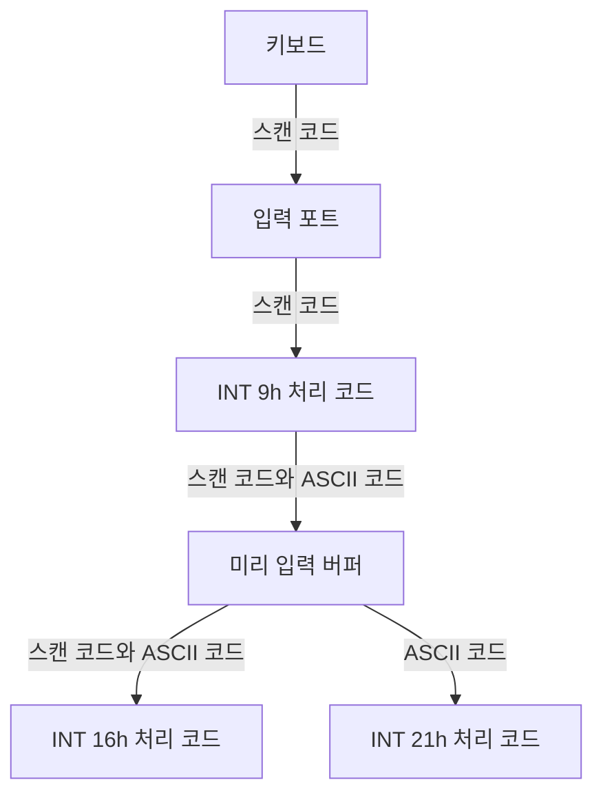


<div class="callout callout-summary" markdown="1">
<div class="callout-title callout-title--default" markdown="span">요약</div>

키를 누르면 그 글자가 곧장 프로그램으로 가는 것이 아니다. 우체부가 편지를 우편함에 넣어 두면 집주인이 나중에 꺼내 가듯, 누른 키는 먼저 작은 대기 줄에 쌓이고 프로그램이 필요할 때 꺼내 간다. 대기 줄에는 글자뿐 아니라 "자판의 몇 번째 단추였는지"도 함께 적혀 있어서, 글자가 없는 화살표 키나 F1 같은 키도 알아낼 수 있다. 다만 줄의 길이가 정해져 있어서 프로그램이 꺼내 가지 않으면 금방 찬다.

</div>


## 예시로 보기

[INT 21h](/Hongs_Blog/studies/assembly-language/int21h-io-functions/)의 글자 읽기는 글자의 ASCII 코드만 준다. 그런데 F1이나 왼쪽 화살표에는 ASCII 코드가 없다. 게임이나 편집기는 이런 키를 알아야 한다.

키보드는 눌린 단추마다 스캔 코드라는 번호를 보낸다. 글자가 아니라 단추의 번호다. 키 하나가 눌린 뒤 일어나는 일은 다음과 같다[^1].



1. 키보드가 스캔 코드를 입력 포트로 보낸다.
2. 하드웨어 인터럽트가 걸려 INT 9h의 처리 코드가 돈다.
3. 그 코드가 스캔 코드와 ASCII 코드 한 쌍을 미리 입력 버퍼(typeahead buffer)에 넣는다. 프로그램이 아직 읽지 않은 키가 쌓이는 대기 줄이다.
4. 프로그램이 INT 16h를 부르면 스캔 코드와 ASCII 코드를 둘 다 받는다. INT 21h를 부르면 ASCII 코드만 받는다.

<div class="callout callout-check" markdown="1">
<div class="callout-title" markdown="span">검증: 키보드 플래그의 비트 번호와 마스크, 0040:0017 → 00417h, 버퍼 32바이트 = 16쌍, `or al,1`이 늘 ZF를 0으로 만드는지(8비트 전수), 버퍼 비우기 코드의 두 가지 끝, 카드 C3 — [53_bios-keyboard-int16h_verify.py](/Hongs_Blog/studies/assembly-language/code/53_bios-keyboard-int16h_verify/). BIOS를 실제로 부르지 못해서 버퍼를 큐로 흉내 냈다. 함수의 동작은 슬라이드 근거다.</div>

</div>


## BIOS

BIOS(Basic Input-Output System)는 장치를 직접 다루는 낮은 수준의 코드 묶음이다. 16비트 프로그램이 부를 수 있다. MS-DOS 함수와 비교하면 색과 그래픽을 쓸 수 있고, 입출력이 빠르고, 마우스·직렬 포트·병렬 포트를 읽을 수 있고, 디스크를 낮은 수준에서 다룰 수 있다[^2]: [입출력 접근 수준](/Hongs_Blog/studies/assembly-language/io-access-levels/).

## 스캔 코드

기능 키와 화살표 키처럼 글자가 없는 키는 스캔 코드로 구별한다. 같은 키라도 Shift, Ctrl, Alt와 함께 누르면 다른 번호가 나온다. 값은 모두 16진수다[^3].

| 키 | 그냥 | Shift와 | Ctrl과 | Alt와 |
|---|---|---|---|---|
| F1 | 3B | 54 | 5E | 68 |
| F2 | 3C | 55 | 5F | 69 |
| F3 | 3D | 56 | 60 | 6A |
| F4 | 3E | 57 | 61 | 6B |
| F5 | 3F | 58 | 62 | 6C |
| F6 | 40 | 59 | 63 | 6D |
| F7 | 41 | 5A | 64 | 6E |
| F8 | 42 | 5B | 65 | 6F |
| F9 | 43 | 5C | 66 | 70 |
| F10 | 44 | 5D | 67 | 71 |
| F11 | 85 | 87 | 89 | 8B |
| F12 | 86 | 88 | 8A | 8C |

| 키 | 그냥 | Ctrl과 | | 키 | 그냥 | Ctrl과 |
|---|---|---|---|---|---|---|
| Home | 47 | 77 | | 위 화살표 | 48 | 8D |
| End | 4F | 75 | | 아래 화살표 | 50 | 91 |
| PgUp | 49 | 84 | | Ins | 52 | 92 |
| PgDn | 51 | 76 | | Del | 53 | 93 |
| PrtSc | 37 | 72 | | Back tab | 0F | 94 |
| 왼쪽 화살표 | 4B | 73 | | 회색 + | 4E | 90 |
| 오른쪽 화살표 | 4D | 74 | | 회색 − | 4A | 8E |

INT 21h로 이런 키를 읽으면 첫 번째 읽기가 0을 돌려준다. 한 번 더 읽어야 스캔 코드가 나온다[^3].

## 키보드 플래그

Shift, Ctrl, Alt, Caps Lock 같은 키는 글자를 만들지 않고 상태만 바꾼다. BIOS는 이 상태를 16비트에 적어 0040:0017h~0018h에 둔다[^4]. 비트가 1이면 그 줄의 내용이 참이다.

| 비트 | 뜻 | | 비트 | 뜻 |
|---|---|---|---|---|
| 0 | 오른쪽 Shift가 눌려 있다 | | 8 | 왼쪽 Ctrl이 눌려 있다 |
| 1 | 왼쪽 Shift가 눌려 있다 | | 9 | 왼쪽 Alt가 눌려 있다 |
| 2 | Ctrl(어느 쪽이든)이 눌려 있다 | | 10 | 오른쪽 Ctrl이 눌려 있다 |
| 3 | Alt(어느 쪽이든)가 눌려 있다 | | 11 | 오른쪽 Alt가 눌려 있다 |
| 4 | Scroll Lock이 켜져 있다 | | 12 | Scroll Lock 키가 눌려 있다 |
| 5 | Num Lock이 켜져 있다 | | 13 | Num Lock 키가 눌려 있다 |
| 6 | Caps Lock이 켜져 있다 | | 14 | Caps Lock 키가 눌려 있다 |
| 7 | Insert가 켜져 있다 | | 15 | SysReq 키가 눌려 있다 |

"켜져 있다"와 "눌려 있다"는 다르다. Caps Lock을 한 번 눌렀다 떼면 비트 6은 1로 남고 비트 14는 0으로 돌아간다[^s1].

## INT 16h 함수

함수 번호는 늘 AH에 넣는다. 중요한 함수는 자동 반복 속도 정하기, 버퍼에 키 밀어 넣기, 키 기다리기, 버퍼 들여다보기, 키보드 플래그 읽기다[^5]. 슬라이드가 코드를 보인 것은 세 개다. 실행해서 확인하지는 않았다.

| AH | 하는 일 | 돌아오는 값 |
|---|---|---|
| 10h | 키 하나를 꺼낸다. 버퍼에 키가 없으면 누를 때까지 프로그램이 멈춰 기다린다[^6] | AH = 스캔 코드, AL = ASCII 코드 |
| 11h | 버퍼를 들여다보기만 한다. 꺼내지 않는다[^7] | 키가 있으면 ZF = 0, 없으면 ZF = 1 |
| 12h | 키보드 플래그를 읽는다[^8] | AX = 플래그 16비트 |

```asm
mov ah,10h
int 16h
mov scanCode,ah
mov ASCIICode,al
```

## 예제

**버퍼 비우기.** 쌓여 있는 키를 모두 꺼내 버린다. 꺼내다가 정해 둔 키(`scanCode`)가 나오면 그 자리에서 끝낸다[^7].

```asm
L1: mov ah,11h          ; 버퍼에 키가 있나?
    int 16h
    jz  noKey           ; 없으면 끝
    mov ah,10h          ; 있으면 꺼낸다
    int 16h
    cmp ah,scanCode     ; 끝내는 키였나?
    je  quit            ; 그렇다 (ZF = 1)
    jmp L1              ; 아니면 다시

noKey:
    or  al,1            ; ZF를 0으로
quit:
```

끝났을 때 ZF로 두 경우가 갈린다.

| 끝난 이유 | 지나간 길 | ZF |
|---|---|---|
| 끝내는 키를 꺼냈다 | `cmp`가 같음 → `je quit` | 1 |
| 버퍼가 비었다 | `jz noKey` → `or al,1` | 0 |

`noKey`에 올 때는 ZF가 1이다(그래서 `jz`가 뛰었다). 이대로 두면 두 경우를 구별할 수 없다. `or al,1`은 결과의 맨 아랫비트가 늘 1이라 결과가 0이 될 수 없고, 그래서 ZF가 0이 된다: [비트 논리 명령](/Hongs_Blog/studies/assembly-language/bitwise-instructions/).

## 활용

- INT 16h는 화살표, 기능 키, Shift 상태가 필요할 때 쓴다. 글자만 필요하면 INT 21h로 충분하다.
- 11h로 먼저 들여다보고 10h로 꺼내면, 키가 없을 때 프로그램이 멈추지 않고 다른 일을 할 수 있다.
- 미리 입력 버퍼는 BIOS 데이터 영역의 001E~003D, 32바이트다. 키 하나가 2바이트(스캔 코드와 ASCII 코드)라 16쌍이 들어간다[^9][^s1].
- 16비트 프로그램에서만 쓸 수 있다[^2].

## 연결

- 버퍼에 키를 넣는 쪽(INT 9h): [하드웨어 인터럽트와 IRQ](/Hongs_Blog/studies/assembly-language/hardware-interrupt-irq/)
- INT 9h 처리 코드를 내 것으로 바꾸기: [인터럽트 핸들러 바꿔 끼우기](/Hongs_Blog/studies/assembly-language/custom-interrupt-handler/)
- 플래그의 비트 하나를 검사하는 법: [TEST와 CMP](/Hongs_Blog/studies/assembly-language/test-cmp/)
- 느린 장치와 프로그램 사이에 대기 줄을 두는 까닭: [입출력 버퍼링](/Hongs_Blog/studies/operating-systems/io-buffering/)

## 확인 문제

<details class="callout callout-question" markdown="1">
<summary class="callout-title" markdown="span">**C1** 키를 누른 뒤 프로그램이 그 키를 받기까지의 길을 순서대로 쓰라. INT 16h와 INT 21h는 각각 무엇을 받는가?</summary>

**답:** 키보드 → 입력 포트(스캔 코드) → INT 9h 처리 코드 → 미리 입력 버퍼(스캔 코드와 ASCII 코드) → 프로그램. INT 16h는 스캔 코드와 ASCII 코드를 둘 다, INT 21h는 ASCII 코드만 받는다.

</details>


<details class="callout callout-question" markdown="1">
<summary class="callout-title" markdown="span">**C2** INT 16h의 함수 10h와 11h는 무엇이 다른가? "키가 눌렸으면 처리하고, 안 눌렸으면 화면을 계속 그리는" 게임은 어느 것을 먼저 불러야 하는가?</summary>

**답:** 10h는 키를 꺼내고, 없으면 누를 때까지 멈춰 기다린다. 11h는 꺼내지 않고 있는지만 ZF로 알려 준다. 게임은 11h를 먼저 불러야 한다.<br>
**이유:** 10h를 바로 부르면 키를 누르기 전까지 프로그램이 멈춰 화면을 그리지 못한다. 11h로 ZF = 0(키 있음)을 확인한 뒤에만 10h로 꺼낸다.

</details>


<details class="callout callout-question" markdown="1">
<summary class="callout-title" markdown="span">**C3** 함수 12h가 AX = 0045h를 돌려주었다. 어떤 키 상태인가?</summary>

**답:** 오른쪽 Shift가 눌려 있고, Ctrl이 눌려 있고, Caps Lock이 켜져 있다.<br>
**이유:** 0045h = 0000 0000 0100 0101b라 비트 0, 2, 6이 1이다.

</details>


<details class="callout callout-question" markdown="1">
<summary class="callout-title" markdown="span">**C4** 버퍼 비우기 코드의 `noKey:` 아래에 `or al,1`이 없으면 무엇이 문제인가?</summary>

**답:** 버퍼가 비어서 끝났을 때도 ZF가 1로 남는다. 끝내는 키를 꺼내서 끝났을 때와 구별할 수 없다.<br>
**이유:** `jz noKey`는 ZF = 1일 때 뛴다. `or al,1`의 결과는 0이 될 수 없어서 ZF가 0으로 바뀐다.

</details>


[^1]: 어셈블리어 14회 강의 자료 「wk14-chapt_16-2-1」, p.11 (How the Keyboard Works와 그림: Keyboard → input port → INT 9h handler → typeahead buffer → INT 16h handler(sc, ac), INT 21h handler(ac))
[^2]: 같은 자료, p.3 (PC-BIOS)
[^3]: 같은 자료, p.9~10 (KEYBOARD SCAN CODES 표와 머리말: INT 16h로 읽거나 INT 21h로 두 번 읽는다, 첫 읽기는 0)
[^4]: 같은 자료, p.21 (Keyboard Flags: 16비트, 0040:0017h~0018h, 비트 표)
[^5]: 같은 자료, p.22 (INT 16h Functions)
[^6]: 같은 자료, p.23 (Function 10h: Wait for Key)
[^7]: 같은 자료, p.25 (Clearing the Keyboard Buffer: 함수 11h는 키가 기다리고 있으면 Zero 플래그를 0으로 한다)
[^8]: 같은 자료, p.24 (Function 12h: Get Keyboard Flags)
[^9]: 같은 자료, p.6 (BIOS Data Area 표: 001E~003D Keyboard typeahead buffer)
[^s1]: <span class="fn-tag" title="수업 자료에 없고 따로 보탠 내용">보충</span> "켜져 있다"와 "눌려 있다"의 차이를 든 예, 버퍼 32바이트가 16쌍이라는 계산, 버퍼 비우기 코드의 ZF 표와 `or al,1` 설명, 카드 C2~C4는 슬라이드에 없다. 계산과 코드 흐름은 검증 코드로 확인했다. 코드 블록의 한국어 주석은 슬라이드의 영어 주석을 옮긴 것이다.

