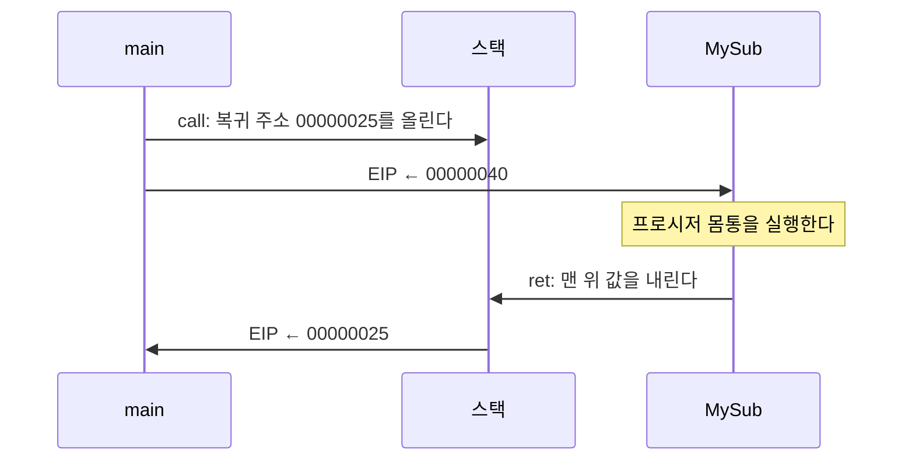


<div class="callout callout-summary" markdown="1">
<div class="callout-title callout-title--default" markdown="span">요약</div>

책을 읽다가 각주를 보러 뒤쪽으로 넘어갈 때는 읽던 자리에 손가락을 끼워 둔다. 다 보고 나면 손가락 자리로 돌아온다. 프로그램도 이름 붙인 코드 덩어리로 넘어갈 때 "돌아올 자리"를 스택 맨 위에 적어 두고, 덩어리가 끝나면 스택 맨 위에 적힌 자리로 돌아온다. 그래서 같은 코드를 여러 곳에서 부를 수 있고, 덩어리 안에서 또 다른 덩어리를 불러도 차례로 되돌아온다. 단, 덩어리가 끝나는 순간 스택 맨 위에 그 "돌아올 자리"가 놓여 있어야 한다. 중간에 올린 값을 안 치우면 엉뚱한 곳으로 간다.

</div>


## 예시로 보기

배열의 합을 구하는 코드가 프로그램 세 군데에서 필요하다고 하자. 세 번 복사해 넣으면 고칠 때도 세 번 고쳐야 한다. 한 번만 써 두고 [JMP](/Hongs_Blog/studies/assembly-language/jmp-loop/)로 뛰어가면 될까? 가는 것은 되지만 돌아오지 못한다. 어디서 왔는지에 따라 돌아갈 곳이 다른데, `JMP`의 목적지는 하나로 박혀 있기 때문이다. 떠나기 전에 돌아올 주소를 적어 두는 명령이 필요하다. 그것이 `CALL`이고, 적어 둔 주소로 돌아가는 명령이 `RET`이다.

`main`이 `MySub`를 부른다. 줄 앞의 숫자는 그 명령의 주소다[^1].

```asm
main PROC
    00000020  call MySub
    00000025  mov eax,ebx
    .
main ENDP

MySub PROC
    00000040  mov eax,edx
    .
    ret
MySub ENDP
```

00000025h는 `CALL` 바로 다음 명령의 주소다. 00000040h는 `MySub`의 첫 명령의 주소다. ESP가 00001000h에서 시작한다고 하고 따라가 본다[^2].

| 실행한 줄 | 스택에 일어난 일 | ESP | 다음에 읽을 주소(EIP) |
|---|---|---|---|
| (시작) | | 00001000h | 00000020h |
| `call MySub` | 00000025h를 올린다 | 00000FFCh | 00000040h |
| `mov eax,edx` | | 00000FFCh | 그다음 줄 |
| `ret` | 00000025h를 내린다 | 00001000h | 00000025h |
| `mov eax,ebx` | | 00001000h | 그다음 줄 |

```
 call MySub 직후                    ret 직후
 00001000  [        ]              00001000  [        ]←ESP
 00000FFC  [00000025]←ESP          00000FFC  [00000025]  (남아 있지만 빈 칸으로 친다)
            EIP = 00000040                    EIP = 00000025
```

<div class="callout callout-check" markdown="1">
<div class="callout-title" markdown="span">검증: 위 추적, 세 겹 호출에서 쌓이는 복귀 주소 셋, SumOf의 결과, POP을 빼먹었을 때 RET이 가는 곳, 카드 C2 — [26_call-ret_verify.py](/Hongs_Blog/studies/assembly-language/code/26_call-ret_verify/) (파이썬 흉내로 확인. 실제 MASM으로 돌린 것이 아니다. 주소는 슬라이드에 적힌 값을 넣어 줬다)</div>

</div>


## 정의

**프로시저.** 이름을 붙인 실행 코드 덩어리다[^3]. Java나 C++의 함수가 어셈블리어에서는 프로시저다. 큰 문제를 작은 일로 나눠 다루기 쉽게 한다[^4]. `PROC`과 `ENDP` 지시어 사이에 쓰고, 끝에 `ret`을 둔다[^4].

```asm
sample PROC
    .
    .
    ret
sample ENDP
```

**CALL.** 프로시저를 부른다. 두 일을 한다[^5].

1. 다음 명령의 주소(복귀 주소)를 스택에 올린다.
2. 부를 프로시저의 주소를 EIP에 넣는다.

**RET.** 프로시저에서 돌아온다. 스택 맨 위의 값을 내려 EIP에 넣는다[^5].

기호로 쓰면 다음과 같다. $$\text{메모리}[\text{ESP}]$$는 ESP에 적힌 주소의 4바이트다.

$$\text{CALL}: \quad \text{ESP} \leftarrow \text{ESP} - 4, \quad \text{메모리}[\text{ESP}] \leftarrow \text{다음 명령의 주소}, \quad \text{EIP} \leftarrow \text{프로시저의 주소}$$


$$\text{RET}: \quad \text{EIP} \leftarrow \text{메모리}[\text{ESP}], \quad \text{ESP} \leftarrow \text{ESP} + 4$$


`CALL`은 "`PUSH` 복귀 주소" 뒤에 "`JMP` 프로시저"를 한 것과 같고, `RET`은 "`POP`해서 EIP에 넣기"다[^s1].



### 겹쳐 부르기

프로시저가 다른 프로시저를 부르고, 그것이 또 다른 프로시저를 부를 수 있다. `main`이 `Sub1`을, `Sub1`이 `Sub2`를, `Sub2`가 `Sub3`을 부르면, `Sub3` 안에 들어선 순간 스택에는 복귀 주소 셋이 쌓여 있다[^6].

```
 높은 주소
   [ main으로 돌아갈 주소 ]   ← Sub1을 부를 때 올렸다
   [ Sub1으로 돌아갈 주소 ]   ← Sub2를 부를 때 올렸다
   [ Sub2로 돌아갈 주소  ]←ESP  ← Sub3을 부를 때 올렸다
   [                     ]
 낮은 주소
```

`Sub3`의 `ret`은 맨 위의 것을 내려 `Sub2`로 돌아가고, `Sub2`의 `ret`은 그다음 것을 내려 `Sub1`으로, `Sub1`의 `ret`은 마지막 것을 내려 `main`으로 돌아간다. 맨 나중에 부른 것이 맨 먼저 돌아온다. 스택이 맨 나중에 올린 것을 맨 먼저 내주기 때문이다([런타임 스택과 PUSH·POP](/Hongs_Blog/studies/assembly-language/runtime-stack/)).

### 지켜 주는 것과 지켜 주지 않는 것

**지켜 주는 것.** 프로시저가 끝날 때 ESP가 들어올 때와 같으면, `RET`은 그 프로시저를 부른 `CALL`의 바로 다음 명령으로 돌아간다. 몇 겹으로 불렀든 같다[^s1].

**지켜 주지 않는 것.**[^s1]

- 레지스터 값. `CALL`과 `RET`은 EIP와 ESP만 건드린다. 프로시저가 EAX나 ECX를 바꾸면 부른 쪽에서도 바뀌어 있다. 지키려면 직접 올려 두고 내려야 한다([레지스터 매개변수와 USES](/Hongs_Blog/studies/assembly-language/procedure-register-parameters/)).
- 플래그. 프로시저 안의 계산이 플래그를 바꾼 채 돌아온다.
- 스택 맨 위가 정말 복귀 주소인지. `RET`은 따지지 않고 맨 위 4바이트를 주소로 쓴다.

### 실패 시나리오

프로시저 안에서 값을 올리고 내리지 않은 채 `ret`을 만난다[^s1].

```asm
main PROC
    00000000  mov eax,1
    00000005  call Bad
    0000000A  exit
main ENDP

Bad PROC
    00000050  push eax        ; 올리고
    00000051  mov eax,0Ah
    00000056  ret             ; 내리지 않고 돌아가려 한다
Bad ENDP
```

| 실행한 줄 | ESP | 스택 맨 위 |
|---|---|---|
| `call Bad` | 00000FFCh | 0000000Ah (복귀 주소) |
| `push eax` | 00000FF8h | 00000001h (EAX의 값) |
| `mov eax,0Ah` | 00000FF8h | 00000001h |
| `ret` | 00000FFCh | EIP ← 00000001h |

`RET`이 꺼낸 것은 복귀 주소가 아니라 올려 둔 EAX의 값 1이다. CPU는 주소 00000001h에 있는 것을 명령이라 믿고 읽으려 한다. 진짜 복귀 주소 0000000Ah는 스택에 남는다. 처리 방법은 하나다. `ret` 앞에서 올린 만큼 내린다. `ret` 바로 앞에 `pop eax`를 넣으면 0000000Ah로 돌아온다.

### 프로시저에 붙이는 설명

프로시저마다 주석으로 다음을 적어 두라고 슬라이드는 권한다[^7].

| 항목 | 적는 것 |
|---|---|
| 하는 일 | 프로시저가 해내는 모든 일 |
| Receives | 받는 값의 목록과 쓰임, 지켜야 할 것 |
| Returns | 돌려주는 값 |
| Requires | 부르기 전에 갖춰져 있어야 하는 것(사전 조건). 없으면 생략 |

사전 조건을 갖추지 않고 부르면 기대한 결과가 나오지 않는다[^7]. 세 수의 합을 돌려주는 `SumOf`가 본보기다[^8].

```asm
;---------------------------------------------------------
SumOf PROC
;
; Calculates and returns the sum of three 32-bit integers.
; Receives: EAX, EBX, ECX, the three integers. May be
;           signed or unsigned.
; Returns:  EAX = sum, and the status flags (Carry,
;           Overflow, etc.) are changed.
; Requires: nothing
;---------------------------------------------------------
    add eax,ebx
    add eax,ecx
    ret
SumOf ENDP
```

EAX = 1, EBX = 2, ECX = 3으로 부르면 EAX = 6으로 돌아온다. 플래그가 바뀐다는 것까지 Returns에 적어 둔 것을 눈여겨본다.

### 스스로 설명해 보기

<details class="callout callout-question" markdown="1">
<summary class="callout-title" markdown="span">1. `CALL`이 올리는 주소는 왜 `CALL` 자신의 주소가 아니라 다음 명령의 주소인가</summary>

`CALL` 자신의 주소로 돌아오면 `CALL`을 다시 실행해 프로시저를 또 부른다. 끝나지 않는다. 돌아와서 할 일은 `CALL` 다음 줄이다.

</details>


<details class="callout callout-question" markdown="1">
<summary class="callout-title" markdown="span">2. 겹쳐 부를 때 복귀 주소가 뒤섞이지 않는 까닭</summary>

프로시저마다 "올린 만큼 내린다"를 지키면, 안쪽 프로시저가 끝났을 때 ESP는 그것을 부르기 직전과 같다. 그래서 바깥 프로시저의 `ret`이 볼 때 맨 위는 여전히 자기의 복귀 주소다. [런타임 스택](/Hongs_Blog/studies/assembly-language/runtime-stack/)의 "거꾸로 꺼내면 제자리" 증명과 같은 논증이다.

</details>


<details class="callout callout-question" markdown="1">
<summary class="callout-title" markdown="span">3. 실패 시나리오에서 `RET` 뒤 ESP가 00001000h가 아니라 00000FFCh인 까닭</summary>

`CALL`과 `PUSH`로 두 번 올렸는데 `RET`이 한 번만 내렸다. 4바이트가 남는다. 남은 칸에 든 것이 진짜 복귀 주소다.

</details>


<details class="callout callout-question" markdown="1">
<summary class="callout-title" markdown="span">이 모델의 핵심 아이디어는?</summary>

돌아올 자리를 코드에 박아 두지 않고, 부를 때마다 스택에 적는다. 그래서 같은 프로시저를 어디서 불러도 부른 곳으로 돌아오고, 겹쳐 불러도 차례가 맞는다.

</details>


<details class="callout callout-question" markdown="1">
<summary class="callout-title" markdown="span">이 방법을 쓸 수 있는 다른 상황은?</summary>

자기 자신을 부르는 프로시저([재귀 프로시저](/Hongs_Blog/studies/assembly-language/recursive-procedure/)). 부를 때마다 복귀 주소가 새로 쌓여, 같은 코드가 여러 겹으로 살아 있어도 각자 제자리로 돌아간다.

</details>


## 활용

- 프로시저에 값을 넘기고 받는 길: 레지스터([레지스터 매개변수와 USES](/Hongs_Blog/studies/assembly-language/procedure-register-parameters/)), 스택([스택 매개변수](/Hongs_Blog/studies/assembly-language/stack-parameters/)).
- 남이 만든 프로시저 부르기: [Irvine32 라이브러리](/Hongs_Blog/studies/assembly-language/irvine32-library/).
- 흔한 실수: 프로시저 끝에 `ret`을 빼먹는다. `ENDP`는 어셈블러에게 "여기까지"라고 알리는 지시어일 뿐 돌아가는 명령이 아니다. CPU는 그 아래에 놓인 다른 프로시저의 코드로 그대로 흘러 들어간다[^s1].
- 흔한 실수: `ret` 전에 올린 만큼 내리지 않는다(위 실패 시나리오).

## 연결

- 선수: [런타임 스택과 PUSH·POP](/Hongs_Blog/studies/assembly-language/runtime-stack/), [JMP와 LOOP](/Hongs_Blog/studies/assembly-language/jmp-loop/)
- 복귀 주소 옆에 매개변수와 지역 변수까지 쌓은 것: [스택 프레임](/Hongs_Blog/studies/assembly-language/stack-frame/), [호출 규약](/Hongs_Blog/studies/assembly-language/calling-convention/)
- 컴파일러가 함수 호출마다 스택에 만드는 묶음과, 호출 코드를 만들어 내는 법: [활성 레코드](/Hongs_Blog/studies/compilers/activation-record/), [함수 호출의 코드 생성](/Hongs_Blog/studies/compilers/codegen-function-call/), [활성 트리와 호출 스택](/Hongs_Blog/studies/compilers/activation-tree/)
- 연습: [스택 추적 예제 사다리](/Hongs_Blog/studies/assembly-language/stack-tracing-ladder/)

## 자주 하는 오해

<div class="callout callout-misconception" markdown="1">
<div class="callout-title" markdown="span">"RET은 자기를 부른 CALL이 어디였는지 알고 그리로 돌아간다"</div>

틀렸다. `RET`은 아무것도 기억하지 않는다. 그 순간 스택 맨 위에 있는 4바이트를 주소로 쓸 뿐이다. 평소에는 거기에 `CALL`이 올린 복귀 주소가 있어서 부른 곳으로 돌아가는 것처럼 보인다. 확인하는 법: 위 실패 시나리오처럼 `ret` 앞에 `push eax`만 넣으면 EAX의 값이 있는 주소로 간다.

</div>


## 확인 문제

<details class="callout callout-question" markdown="1">
<summary class="callout-title" markdown="span">**C1** `CALL`과 `RET`이 스택과 EIP에 하는 일을 쓰라.</summary>

**답:** `CALL`: 다음 명령의 주소를 스택에 올리고, 프로시저의 주소를 EIP에 넣는다. `RET`: 스택 맨 위의 값을 내려 EIP에 넣는다.<br>
**이유:** `CALL` 자신의 주소를 올린다고 쓰면 틀린다. 돌아와서 할 일은 그다음 명령이다.

</details>


<details class="callout callout-question" markdown="1">
<summary class="callout-title" markdown="span">**C2** ESP가 00002000h다. `00000100 call F` / `00000105 exit`가 있고, `F`는 `00000200 push ebx` / `00000201 pop ebx` / `00000202 ret`이다. `call`, `push`, `pop`, `ret` 직후의 ESP를 차례로 쓰고, `call` 직후 주소 00001FFCh에 든 값을 쓰라.</summary>

**답:** 00001FFCh, 00001FF8h, 00001FFCh, 00002000h. 00001FFCh에는 00000105h가 있다.<br>
**이유:** `call`이 4, `push`가 4를 줄이고 `pop`과 `ret`이 4씩 늘린다. 복귀 주소는 `call` 다음 명령의 주소다.

</details>


<details class="callout callout-question" markdown="1">
<summary class="callout-title" markdown="span">**C3** 프로시저로 가는 데 `JMP`를 쓰면 왜 안 되는가?</summary>

**답:** `JMP`는 돌아올 주소를 남기지 않는다. 프로시저를 두 곳 이상에서 부르면 끝난 뒤 어디로 돌아갈지 알 수 없다. `CALL`은 부를 때마다 돌아올 주소를 스택에 올려 두므로 `RET`이 부른 곳으로 돌아간다.

</details>


<details class="callout callout-question" markdown="1">
<summary class="callout-title" markdown="span">**C4** "프로시저 안에서 `PUSH`와 `POP`을 몇 번 하든 `RET`은 부른 곳으로 돌아간다"가 틀리는 프로시저를 하나 쓰고, `RET`이 어디로 가는지 말하라.</summary>

**답:** `Bad PROC` / `push eax` / `ret` / `Bad ENDP`. `RET`은 복귀 주소가 아니라 맨 위에 있는 EAX의 값을 주소로 삼아 그리로 간다.<br>
**이유:** `RET`은 맨 위 4바이트를 내릴 뿐이다. 올린 만큼 내려서 맨 위가 복귀 주소일 때만 부른 곳으로 돌아간다.

</details>


[^1]: 어셈블리어 6회 강의 자료 「wk06-chapt_05-3-3」, p.7 (CALL-RET 예제의 주소 00000020, 00000025, 00000040)
[^2]: 같은 자료, p.8 (CALL 직후와 RET 직전의 스택·EIP 그림)
[^3]: 어셈블리어 7회 강의 자료 「wk07-chapt_05-3-1」, p.15 (프로시저: 이름 붙인 실행 코드 덩어리)
[^4]: 어셈블리어 6회 강의 자료 「wk06-chapt_05-3-3」, p.3 (프로시저를 만드는 까닭, PROC·ENDP)
[^5]: 같은 자료, p.6 (CALL과 RET이 하는 일)
[^6]: 같은 자료, p.9 (겹쳐 부르기, 복귀 주소 셋이 쌓인 그림)
[^7]: 같은 자료, p.4 (프로시저 설명에 적을 것, 사전 조건)
[^8]: 같은 자료, p.5 (SumOf)
[^s1]: <span class="fn-tag" title="수업 자료에 없고 따로 보탠 내용">보충</span> 추적 표와 ESP 값(슬라이드 그림에는 스택 칸의 주소가 없어 00001000h에서 시작한다고 두었다), CALL = PUSH + JMP라는 풀이, 순서도, 지켜 주는 것과 지켜 주지 않는 것, 실패 시나리오, `ret`을 빼먹을 때의 동작, 스스로 설명해 보기, 오해, 카드 C1~C4는 원본에 없다. CALL과 RET의 동작은 원본 p.6을 따랐고, 값은 검증 코드의 파이썬 흉내로 확인했다.

