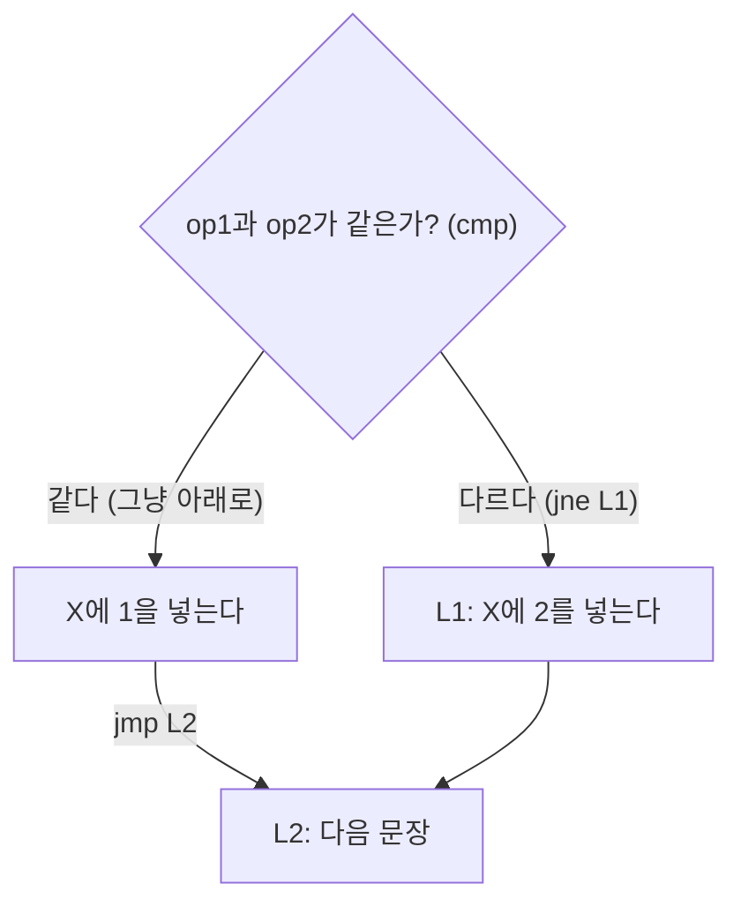
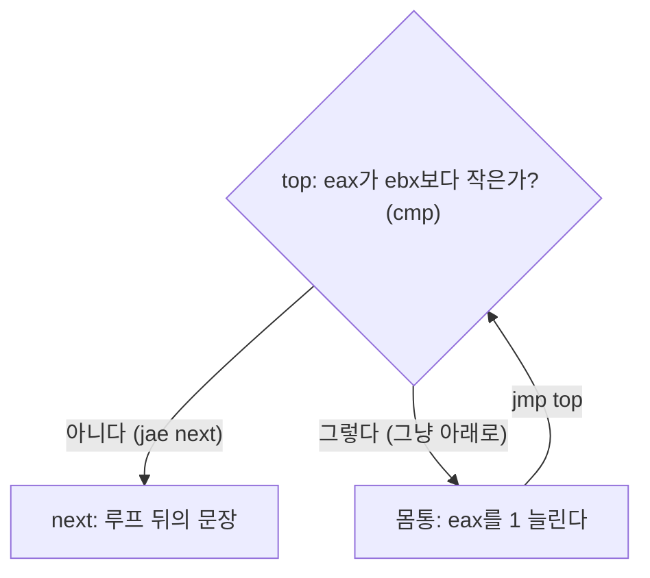


<div class="callout callout-summary" markdown="1">
<div class="callout-title callout-title--default" markdown="span">요약</div>

고급 언어의 "만약 ~이면 이 묶음을 해라"에는 묶음을 감싸는 괄호가 있다. 기계에게는 괄호가 없고 "저 줄로 가라"만 있다. 그래서 "~이면 해라"를 "~이 **아니면** 이 묶음을 건너뛰어라"로 뒤집어 쓴다. 이 한 가지 요령으로 갈림, 여러 조건의 묶음, 되풀이를 모두 옮길 수 있다. 조건을 뒤집을 때 "크다"의 반대를 "작다"로 쓰면 같을 때 틀리고, 수가 부호 있는지에 맞는 점프를 고르지 않으면 음수에서 틀린다.

</div>


## 예시로 보기

C++나 Java로는 이렇게 쓴다[^1].

```
if( op1 == op2 )
    X = 1;
else
    X = 2;
```

어셈블리어에는 `if`도 중괄호도 없다. 있는 것은 [CMP](/Hongs_Blog/studies/assembly-language/test-cmp/)와 [조건 점프](/Hongs_Blog/studies/assembly-language/conditional-jumps/), 그리고 레이블뿐이다. 코드는 위에서 아래로 흐르니, "참일 때 할 일"을 바로 아래에 두고 거짓이면 그것을 뛰어넘게 한다[^1].

```asm
    mov eax,op1
    cmp eax,op2
    jne L1          ; 다르면(조건이 거짓이면) else로
    mov X,1         ; 참일 때 할 일
    jmp L2          ; else를 건너뛴다
L1: mov X,2         ; 거짓일 때 할 일
L2:
```

`if`의 조건은 `==`인데 점프는 `jne`(다르면)다. 조건을 뒤집었다. 참일 때 할 일 끝에는 `jmp L2`가 있다. 없으면 `X = 1`을 한 뒤 아래로 흘러 `X = 2`까지 해 버린다.



<div class="callout callout-check" markdown="1">
<div class="callout-title" markdown="span">검증: 이 문서의 어셈블리 코드 여덟 개를 흉내기로 돌려 같은 뜻의 파이썬 `if`·`while`과 대조(경계값 9~10개의 모든 조합), AND 두 구현이 같은 답을 내고 명령 수가 7개와 5개인 것, 단락 평가에서 둘째 `CMP`가 실행되지 않는 것, 뒤집은 조건 표, 카드 C2·C4 — [34_conditional-structures_verify.py](/Hongs_Blog/studies/assembly-language/code/34_conditional-structures_verify/) (파이썬 흉내로 확인. 실제 MASM으로 돌린 것이 아니다)</div>

</div>


## 옮기는 법

### 조건 뒤집기

"조건이 거짓이면 건너뛰어라"를 쓰려면 조건의 반대로 뛰는 점프가 필요하다[^s1].

| 고급 언어의 조건 | 거짓일 때 뛰는 점프 (부호 없는 수) | 거짓일 때 뛰는 점프 (부호 있는 수) |
|---|---|---|
| `a == b` | `jne` | `jne` |
| `a != b` | `je` | `je` |
| `a > b` | `jbe` | `jle` |
| `a >= b` | `jb` | `jl` |
| `a < b` | `jae` | `jge` |
| `a <= b` | `ja` | `jg` |

`>`의 반대는 `<`가 아니라 `<=`다. 같을 때가 어느 쪽에 드는지가 달라진다. 어느 열을 쓸지는 [부호 있는 비교 점프와 부호 없는 비교 점프](/Hongs_Blog/studies/assembly-language/signed-vs-unsigned-jumps/)를 따른다.

### IF

else가 없는 `if`는 몸통을 건너뛰는 점프 하나면 된다. 값이 모두 부호 없는 수일 때다[^2].

```
if( ebx <= ecx )
{
    eax = 5;
    edx = 6;
}
```

```asm
    cmp ebx,ecx
    ja  next        ; ebx > ecx면(조건이 거짓이면) 건너뛴다
    mov eax,5
    mov edx,6
next:
```

else가 있으면 두 묶음 가운데 어느 것을 위에 둘지 고를 수 있다. 슬라이드의 풀이는 조건을 뒤집지 않고 "참이면 아래쪽 묶음으로 가라"로 썼다. 값이 32비트 부호 있는 정수일 때다[^3].

```
if( var1 <= var2 )
    var3 = 10;
else
{
    var3 = 6;
    var4 = 7;
}
```

```asm
    mov eax,var1
    cmp eax,var2
    jle L1          ; 참이면 L1으로
    mov var3,6      ; 거짓일 때 할 일(else)이 위에 왔다
    mov var4,7
    jmp L2
L1: mov var3,10     ; 참일 때 할 일
L2:
```

조건을 뒤집어(`jg L1`) 참일 때 할 일을 위에 두어도 같은 답이 나온다. 이런 문제에는 맞는 풀이가 여럿이다[^3]. `cmp var1,var2`라고 바로 쓰지 않고 EAX를 거치는 것은 `CMP`도 두 피연산자가 모두 메모리일 수는 없기 때문이다([데이터 전송 명령](/Hongs_Blog/studies/assembly-language/data-transfer-instructions/))[^s1].

### AND로 묶인 조건

고급 언어는 `A AND B`에서 A가 거짓이면 B를 아예 따지지 않는다. 이것을 단락 평가(short-circuit evaluation)라 부른다. 하나만 거짓이어도 전체가 거짓이기 때문이다[^4].

```
if (al > bl) AND (bl > cl)
    X = 1;
```

한 가지 구현은 조건을 뒤집지 않는다. 참이면 다음 검사로 가고, 아니면 `jmp`로 빠져나간다[^5].

```asm
    cmp al,bl       ; 첫째 조건
    ja  L1
    jmp next
L1:
    cmp bl,cl       ; 둘째 조건
    ja  L2
    jmp next
L2:                 ; 둘 다 참
    mov X,1
next:
```

첫째 조건을 뒤집으면 `ja L1` / `jmp next` 두 줄이 `jbe next` 한 줄이 된다. 참이면 아무 데도 안 뛰고 그대로 아래 검사로 흘러 내려간다(fall through)[^6].

```asm
    cmp al,bl       ; 첫째 조건
    jbe next        ; 거짓이면 끝
    cmp bl,cl       ; 둘째 조건
    jbe next        ; 거짓이면 끝
    mov X,1         ; 둘 다 참
next:
```

명령이 일곱 개에서 다섯 개로 줄었다. $$2 \div 7 \approx 0.29$$, 슬라이드가 말한 "29% 적은 코드"다[^6].

값이 부호 없는 수일 때의 Your turn[^7].

```
if( ebx <= ecx && ecx > edx )
{
    eax = 5;
    edx = 6;
}
```

<details class="callout callout-answer" markdown="1">
<summary class="callout-title" markdown="span">답</summary>

```asm
    cmp ebx,ecx
    ja  next        ; ebx <= ecx가 거짓이면 끝
    cmp ecx,edx
    jbe next        ; ecx > edx가 거짓이면 끝
    mov eax,5
    mov edx,6
next:
```

</details>


### OR로 묶인 조건

`A OR B`에서는 A가 참이면 B를 따지지 않는다. 하나만 참이어도 전체가 참이기 때문이다[^8].

```
if (al > bl) OR (bl > cl)
    X = 1;
```

```asm
    cmp al,bl       ; AL > BL인가?
    ja  L1          ; 그렇다: 바로 몸통으로
    cmp bl,cl       ; 아니다: BL > CL인가?
    jbe next        ; 아니다: 몸통을 건너뛴다
L1: mov X,1
next:
```

첫째 조건은 뒤집지 않고 "참이면 몸통으로" 뛴다. 마지막 조건만 뒤집어 "거짓이면 건너뛰어라"로 쓴다[^9].

AND와 OR의 규칙을 나란히 놓으면 이렇다[^s1].

| | 마지막이 아닌 조건 | 마지막 조건 |
|---|---|---|
| AND | 뒤집어서, 거짓이면 밖으로 | 뒤집어서, 거짓이면 밖으로 |
| OR | 그대로, 참이면 몸통으로 | 뒤집어서, 거짓이면 밖으로 |

### WHILE

`while`은 `if` 하나, 그 뒤의 몸통, 그 뒤에 맨 위로 돌아가는 무조건 점프다[^10].

```
while( eax < ebx)
    eax = eax + 1;
```

```asm
top: cmp eax,ebx    ; 조건 검사
     jae next       ; 거짓이면 루프를 나간다
     inc eax        ; 몸통
     jmp top        ; 되풀이
next:
```



부호 없는 32비트 정수의 Your turn[^11].

```
while( ebx <= val1)
{
    ebx = ebx + 5;
    val1 = val1 - 1
}
```

<details class="callout callout-answer" markdown="1">
<summary class="callout-title" markdown="span">답</summary>

```asm
top: cmp ebx,val1   ; 조건 검사
     ja  next       ; 거짓이면 루프를 나간다
     add ebx,5      ; 몸통
     dec val1
     jmp top        ; 되풀이
next:
```
EBX = 0, `val1` = 10으로 시작하면 (5, 9), (10, 8)을 거쳐 EBX = 10, `val1` = 8에서 멈춘다.

</details>


**경계 사례.** 위 루프를 EBX = 0, `val1` = 0으로 시작하면 한 바퀴 뒤 `val1`이 0에서 1 줄어 FFFFFFFFh가 된다. 부호 없는 수로는 가장 큰 값이라 조건이 계속 참이다. 고급 언어 코드를 그대로 옮긴 것이므로 틀린 번역은 아니지만, 부호 없는 수를 0 아래로 내리는 루프는 이렇게 된다[^s1].

### 뒤집어도 같은 프로그램인 까닭

**주장.** `if (C) { S }`를 "`C`의 반대 조건으로 `next`로 뛰는 점프, 그 아래 `S`, 그 아래 `next:`"로 옮기면, `C`가 참일 때만 `S`가 실행된다[^s1].

<details class="callout callout-proof" markdown="1">
<summary class="callout-title" markdown="span">증명 펼치기</summary>

`C`의 반대 조건으로 뛰는 점프를 `Jnot`이라 하자.
1. 위 표의 짝(`je`와 `jne`, `ja`와 `jbe`, `jae`와 `jb`, `jg`와 `jle`, `jge`와 `jl`)은 어떤 플래그 값에서도 정확히 하나만 뛴다. — 플래그 네 개의 16가지 조합을 모두 넣어 확인
2. `C`가 참이면 `Jnot`은 뛰지 않는다. 뛰지 않은 조건 점프는 바로 아래 명령으로 간다. 그 아래가 `S`이므로 `S`가 실행되고, 이어서 `next`에 닿는다. — 조건 점프의 정의
3. `C`가 거짓이면 `Jnot`이 `next`로 뛴다. `S`의 명령들은 점프와 `next` 사이에 있어 하나도 실행되지 않는다. — 점프는 EIP를 목적지로 바꾼다
4. 두 경우 모두 끝나면 `next`에 있다. 고급 언어의 `if`가 끝난 자리와 같다. ∎

</details>


### 스스로 설명해 보기

<details class="callout callout-question" markdown="1">
<summary class="callout-title" markdown="span">1. 1단계에서 `ja`와 `jbe`가 "정확히 하나만 뛴다"는 것은 두 명령의 플래그 조건에서 어떻게 나오는가</summary>

`ja`는 CF = 0이고 ZF = 0일 때, `jbe`는 CF = 1이거나 ZF = 1일 때 뛴다. 뒤의 것은 앞의 것의 부정이다("둘 다 0"의 반대는 "하나라도 1"). 그래서 어떤 플래그 값에서도 둘 중 하나만 참이다.

</details>


<details class="callout callout-question" markdown="1">
<summary class="callout-title" markdown="span">2. if-else에서는 왜 참일 때 할 일 끝에 `jmp`가 더 필요한가</summary>

2단계에서 `S`가 끝나면 그대로 아래로 흐른다. else가 없으면 아래가 `next`라 괜찮다. else가 있으면 아래가 else의 몸통이라, 건너뛰는 `jmp`가 없으면 두 묶음을 다 실행한다.

</details>


<details class="callout callout-question" markdown="1">
<summary class="callout-title" markdown="span">3. AND에서 조건마다 같은 `next`로 뛰어도 되는 까닭</summary>

조건 하나라도 거짓이면 전체가 거짓이고, 그때 할 일은 조건이 몇째였든 "몸통을 건너뛴다"로 같다. 그래서 목적지가 하나다.

</details>


<details class="callout callout-question" markdown="1">
<summary class="callout-title" markdown="span">이 기법의 핵심 아이디어는?</summary>

코드는 가만두면 아래로 흐른다. 이 흐름을 "참일 때의 길"로 삼고, 거짓일 때만 점프로 벗어난다. 그러면 조건마다 점프가 하나씩만 든다.

</details>


<details class="callout callout-question" markdown="1">
<summary class="callout-title" markdown="span">이 방법을 쓸 수 있는 다른 상황은?</summary>

`for`는 초기화 뒤의 `while`로, `do-while`은 조건 검사를 몸통 아래에 두고 참이면 위로 뛰는 것으로 옮긴다. 컴파일러가 `if`와 `while`에서 분기 명령을 만들어 내는 방식도 같다([단순 연산과 분기의 코드 생성](/Hongs_Blog/studies/compilers/codegen-simple-operations/)).

</details>


## 활용

- 이 기법을 쓸 조건: 조건식이 `CMP`나 `TEST` 한 번으로 플래그에 담기는 견주기들로 이루어져 있다.
- 이 기법을 떠올릴 신호: 고급 언어 코드나 의사코드를 주고 "어셈블리어로 구현하라"고 한다. 슬라이드의 Your turn이 모두 이 꼴이다.
- 대표 문제 둘: 복합 조건 `if`(AND, OR)를 가장 짧게 옮기기, `while`을 옮기고 몇 바퀴 도는지 따라가기.
- 선택지가 아주 많은 갈림(`switch`)은 `CMP`와 점프를 줄줄이 쓰는 대신 표로 바꾼다([표 기반 선택](/Hongs_Blog/studies/assembly-language/table-driven-selection/)).
- 컴파일러는 이 일을 두 단계로 한다. 먼저 `if`와 `while`을 "조건이면 어디로 가라"와 `goto`로 된 중간 코드로 풀고([3주소 코드](/Hongs_Blog/studies/compilers/three-address-code/)), 그것을 기계의 분기 명령으로 바꾼다. 이 문서의 코드를 점프 자리에서 끊으면 한 덩어리씩 떨어지는데, 그 덩어리가 [기본 블록](/Hongs_Blog/studies/compilers/basic-block-cfg/)이고 위의 순서도가 제어 흐름 그래프다[^s1].
- 흔한 실수: 조건을 뒤집지 않고 그대로의 점프를 쓴 뒤 몸통을 바로 아래에 둔다. 참일 때 몸통을 건너뛰는 정반대 코드가 된다.
- 흔한 실수: `>`를 뒤집어 `<`로 쓴다. 같을 때 틀린다.
- 흔한 실수: if-else에서 `jmp`를 빼먹는다. `while`에서 `jmp top`을 빼먹으면 한 번만 도는 `if`가 된다.

## 연결

- 선수: [조건 점프](/Hongs_Blog/studies/assembly-language/conditional-jumps/), [부호 있는 비교 점프와 부호 없는 비교 점프](/Hongs_Blog/studies/assembly-language/signed-vs-unsigned-jumps/)
- 고급 언어 쪽의 `if`, `while`, `&&`, <code>&#124;&#124;</code>: [제어문](/Hongs_Blog/studies/java/java-control-flow/)
- 횟수와 조건을 한 줄로 보는 반복: [조건부 반복 명령](/Hongs_Blog/studies/assembly-language/conditional-loop-instructions/)
- 갈림을 상태마다 늘어놓은 프로그램: [유한 상태 기계](/Hongs_Blog/studies/assembly-language/asm-finite-state-machine/)
- 연습: [조건 구조를 점프로 옮기기 예제 사다리](/Hongs_Blog/studies/assembly-language/conditional-structures-ladder/)

## 자주 하는 오해

<div class="callout callout-misconception" markdown="1">
<div class="callout-title" markdown="span">"if (a <= b)를 옮길 때는 '이하면 점프'인 jbe를 쓴다"</div>

몸통을 바로 아래에 두는 보통의 꼴에서는 틀렸다. 조건과 같은 이름의 점프를 쓰고 싶은 것은 고급 언어의 `if`가 "참이면 한다"로 읽히기 때문이다. 하지만 점프는 "참이면 **떠난다**"다. 몸통이 바로 아래에 있으면 참일 때 떠나면 안 되고, 거짓일 때 떠나야 한다. 그래서 `a <= b`의 반대인 `ja`를 쓴다. 확인하는 법: EBX = 1, ECX = 5에서 `cmp ebx,ecx` / `jbe next` / `mov eax,5` / `next:`를 따라가면, 조건이 참인데 `mov`를 건너뛴다. `jbe`를 그대로 쓰려면 슬라이드의 if-else 풀이처럼 뛰어간 곳에 참일 때 할 일을 둬야 한다.

</div>


## 확인 문제

<details class="callout callout-question" markdown="1">
<summary class="callout-title" markdown="span">**C1** 부호 없는 수의 조건 `a > b`, `a >= b`, `a < b`, `a <= b`, `a == b`가 거짓일 때 뛰는 점프를 차례로 쓰라.</summary>

**답:** `jbe`, `jb`, `jae`, `ja`, `jne`.<br>
**이유:** 조건의 반대로 뛴다. `>`의 반대는 `<=`, `>=`의 반대는 `<`다.

</details>


<details class="callout callout-question" markdown="1">
<summary class="callout-title" markdown="span">**C2** 부호 있는 수로 `if (eax > ebx) ecx = 1; else ecx = 2;`를 `cmp eax,ebx` / `jle L1` / `mov ecx,1` / `jmp L2` / `L1: mov ecx,2` / `L2:`로 옮겼다. EAX = FFFFFFFDh, EBX = 2일 때 ECX는? `jle`를 `jbe`로 잘못 쓰면 ECX는?</summary>

**답:** 2. `jbe`로 쓰면 1.<br>
**이유:** FFFFFFFDh는 부호 있게 −3이다. −3 > 2가 거짓이라 `jle`가 뛰어 ECX = 2다. `jbe`는 부호 없이 4,294,967,293과 2를 견줘 뛰지 않고, 참일 때의 길로 흘러 ECX = 1이 된다.

</details>


<details class="callout callout-question" markdown="1">
<summary class="callout-title" markdown="span">**C3** AND 조건의 두 구현(명령 7개, 명령 5개)은 무엇이 다른가? 짧은 쪽이 왜 같은 일을 하는가?</summary>

**답:** 긴 쪽은 조건이 참이면 다음 검사로 뛰고(`ja L1`), 그 아래의 `jmp next`가 거짓일 때 빠져나간다. 짧은 쪽은 조건을 뒤집어 거짓일 때 바로 빠져나가고(`jbe next`), 참이면 뛰지 않고 아래 검사로 흘러간다. `ja`가 안 뛰는 때와 `jbe`가 뛰는 때가 정확히 같아서 두 코드가 가는 길이 같다.

</details>


<details class="callout callout-question" markdown="1">
<summary class="callout-title" markdown="span">**C4** `top: cmp eax,ebx` / `jae next` / `inc eax` / `jmp top` / `next:`와 `top: inc eax` / `cmp eax,ebx` / `jb top`은 둘 다 "EAX가 EBX보다 작은 동안 1씩 늘린다"처럼 보인다. EAX = 9, EBX = 5(부호 없는 수)에서 각각 끝난 뒤 EAX는?</summary>

**답:** 앞의 것은 9, 뒤의 것은 10.<br>
**이유:** 앞의 것은 조건을 먼저 본다(`while`). 처음부터 거짓이라 몸통을 한 번도 안 돈다. 뒤의 것은 몸통을 먼저 돌고 조건을 본다(`do-while`). 적어도 한 번은 돈다.

</details>


[^1]: 어셈블리어 9회 강의 자료 「wk09-chapt_06-2-1」, p.10 (블록 구조 IF: op1 == op2)
[^2]: 같은 자료, p.11 (Your turn: 부호 없는 if( ebx <= ecx ))
[^3]: 같은 자료, p.12 (Your turn: 부호 있는 if-else, 맞는 풀이가 여럿이다)
[^4]: 같은 자료, p.13 (AND와 단락 평가)
[^5]: 같은 자료, p.14 (AND의 한 가지 구현)
[^6]: 같은 자료, p.15 (첫 관계 연산자를 뒤집어 29% 줄인 구현, fall through)
[^7]: 같은 자료, p.16 (Your turn: ebx <= ecx && ecx > edx)
[^8]: 같은 자료, p.17 (OR와 단락 평가)
[^9]: 같은 자료, p.18 (OR의 구현)
[^10]: 같은 자료, p.19 (WHILE 루프)
[^11]: 같은 자료, p.20 (Your turn: while( ebx <= val1 ))
[^s1]: <span class="fn-tag" title="수업 자료에 없고 따로 보탠 내용">보충</span> 뒤집은 조건 표, `cmp`가 EAX를 거치는 까닭, AND와 OR의 규칙을 모은 표, Your turn의 값 따라가기와 경계 사례, 증명과 스스로 설명해 보기, 순서도 두 개(원본 p.10, p.19의 코드를 근거로 그렸다), 활용 항목, 오해, 카드 C1~C4는 원본에 없다. 표의 짝이 서로 반대라는 것은 플래그 16가지 조합 전수로, 코드의 결과는 흉내기와 파이썬 `if`·`while`의 대조로 확인했다.

