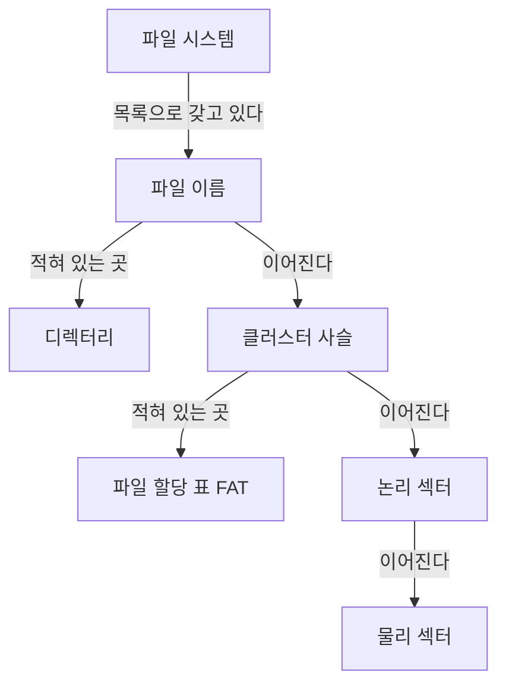


<div class="callout callout-summary" markdown="1">
<div class="callout-title callout-title--default" markdown="span">요약</div>

디스크는 같은 크기의 상자가 줄지어 놓인 창고와 같다. 파일은 상자 여러 개에 나눠 담기고, 창고 입구의 장부 한 권에 "이 상자 다음은 몇 번 상자"가 적혀 있다. 그래서 상자가 여기저기 흩어져 있어도 장부만 따라가면 파일을 끝까지 읽는다. 대신 상자를 통째로만 쓸 수 있어서 마지막 상자의 빈 자리는 버려지고, 파일의 뒷부분을 읽으려면 장부를 앞에서부터 따라가야 한다.

</div>


## 예시로 보기

파일 크기는 제각각인데 디스크의 빈 자리는 계속 생겼다 없어진다. 바이트 단위로 자리를 내주면 "어디가 비었고 어느 조각이 누구 것인지"를 적는 일이 감당이 안 된다. 그래서 파일 시스템은 디스크를 같은 크기의 덩어리로 잘라 덩어리 단위로만 내준다.

디스크에서 한 번에 읽고 쓰는 가장 작은 조각을 섹터라 부른다. 붙어 있는 섹터 한 개 이상을 묶은 것이 클러스터이고, 파일이 차지하는 공간의 가장 작은 단위다[^1]. 슬라이드 그림에서는 섹터 1~4가 클러스터 1, 섹터 5~8이 클러스터 2다.

```
섹터:      | 1 | 2 | 3 | 4 | --> | 5 | 6 | 7 | 8 |
           +---------------+     +---------------+
              클러스터 1            클러스터 2
```

파일은 아무리 작아도 클러스터 하나를 쓴다. 클러스터가 4,096바이트(4K)일 때 8,200바이트 파일을 넣어 보자[^2].

| 클러스터 | 담긴 양 | 빈 자리 |
|---|---|---|
| 1 | 4,096바이트 | 0 |
| 2 | 4,096바이트 | 0 |
| 3 | 8바이트 | 4,088바이트 |

두 개로는 8,192바이트까지만 들어가서 8바이트가 남는다. 이 8바이트 때문에 클러스터 하나를 더 쓰고, 그 안의 4,088바이트는 다른 파일이 쓸 수 없다.

<div class="callout callout-check" markdown="1">
<div class="callout-title" markdown="span">검증: 8,200바이트의 클러스터 수 3과 빈 자리 4,088, 슬라이드 그림의 두 사슬(7개, 5개), 빈 칸, 카드 C2·C3의 답 — [48_fat-file-system_verify.py](/Hongs_Blog/studies/assembly-language/code/48_fat-file-system_verify/). 실제 디스크를 읽은 것이 아니라 슬라이드 숫자를 파이썬으로 다시 센 것이다.</div>

</div>


## 파일 이름에서 섹터까지

파일 시스템은 세 가지 일을 한다. 쓴 공간과 빈 공간을 적어 두고, 디렉터리와 파일 이름을 관리하고, 파일과 디렉터리가 어느 섹터에 있는지 적어 둔다[^3]. 파일 이름 하나가 실제 섹터로 이어지는 길은 이렇다[^4].



디렉터리는 파일 이름을, FAT는 그 파일의 클러스터들이 어떤 순서로 이어지는지를 적는다. 클러스터 번호를 알면 그 안의 섹터 번호(논리 섹터)가 나오고, 디스크가 그것을 실제 위치(물리 섹터)로 바꾼다.

## 파일 할당 표

파일 할당 표(FAT)는 디스크의 모든 클러스터를 한 줄로 늘어놓은 표다. 칸 하나가 클러스터 하나다. 칸에는 "이 파일의 다음 클러스터 번호"가 적힌다. 마지막 클러스터의 칸에는 끝 표시(eof)가 적힌다. 이렇게 번호로 이어진 줄을 클러스터 사슬이라 부른다[^5].

슬라이드의 16칸짜리 표에는 파일 두 개가 들어 있다[^6]. File1은 클러스터 1에서 시작해 7개를 쓰고, File2는 5에서 시작해 5개를 쓴다. 두 그림을 한 표에 겹치면 다음과 같다.

| 클러스터 번호 | 1 | 2 | 3 | 4 | 5 | 6 | 7 | 8 | 9 | 10 | 11 | 12 | 13~16 |
|---|---|---|---|---|---|---|---|---|---|---|---|---|---|
| 칸에 적힌 값 | 2 | 3 | 4 | 8 | 6 | 7 | 11 | 9 | 10 | eof | 12 | eof | (빈 칸) |
| 주인 | File1 | File1 | File1 | File1 | File2 | File2 | File2 | File1 | File1 | File1 | File2 | File2 | 없음 |

- File1: 1 → 2 → 3 → 4 → 8 → 9 → 10 → 끝. 4번 칸에 8이 적혀 있어서 5, 6, 7을 건너뛴다.
- File2: 5 → 6 → 7 → 11 → 12 → 끝. 8, 9, 10은 File1이 쓰고 있어서 7번 칸에 11이 적혀 있다.

File1처럼 한 파일의 클러스터가 떨어져 있으면 읽는 동안 디스크의 읽기 머리가 건너뛰어야 한다. 이런 파일을 조각난 파일이라 부른다: [디스크 스케줄링](/Hongs_Blog/studies/operating-systems/disk-scheduling/).

칸 하나가 몇 비트인지에 따라 FAT-12, FAT-16, FAT-32 세 종류가 있다[^5]. 칸이 $$n$$비트면 적을 수 있는 번호가 $$2^n$$가지다. 12비트면 4,096가지, 16비트면 65,536가지다[^s1]. 클러스터 크기는 파일 시스템의 종류와 디스크 구역(파티션)의 크기에 따라 정해진다[^1].

## 활용

- 필요한 클러스터 수는 파일 크기를 클러스터 크기로 나눠 올림한 값이다. 버려지는 자리는 (클러스터 수 × 클러스터 크기) − 파일 크기다. 클러스터가 클수록 작은 파일이 버리는 자리가 커진다[^2].
- 사슬의 $$k$$번째 클러스터를 찾으려면 표를 $$k - 1$$번 따라가야 한다. 연결 리스트에서 $$k$$번째 원소를 찾는 것과 같다[^s1].
- 운영체제 과목은 같은 구조를 "연결 할당"이라는 이름으로 배운다. 다음 번호를 덩어리 안이 아니라 표 하나에 모아 둔 것이 FAT다: [파일 할당](/Hongs_Blog/studies/operating-systems/file-allocation/).

## 연결

- 사슬을 따라가는 방식: [연결 리스트](/Hongs_Blog/studies/algorithms/linked-list/)
- 다른 할당 방식과의 비교: [파일 할당](/Hongs_Blog/studies/operating-systems/file-allocation/)
- 섹터를 직접 읽거나 디렉터리를 만드는 MS-DOS 함수: [INT 21h 파일·디스크 함수](/Hongs_Blog/studies/assembly-language/int21h-file-disk-functions/)

## 확인 문제

<details class="callout callout-question" markdown="1">
<summary class="callout-title" markdown="span">**C1** 섹터, 클러스터, 클러스터 사슬, FAT가 각각 무엇인지 한 문장씩 쓰라.</summary>

**답:** 섹터는 디스크에서 읽고 쓰는 가장 작은 조각이다. 클러스터는 붙어 있는 섹터 한 개 이상을 묶은 것으로, 파일이 쓰는 공간의 가장 작은 단위다. 클러스터 사슬은 한 파일의 클러스터들이 "다음 번호"로 이어진 줄이다. FAT는 모든 클러스터마다 칸을 하나씩 두고 그 다음 번호를 적어 둔 표다.

</details>


<details class="callout callout-question" markdown="1">
<summary class="callout-title" markdown="span">**C2** 클러스터가 4,096바이트일 때 10,000바이트 파일은 클러스터를 몇 개 쓰고, 몇 바이트가 버려지는가?</summary>

**답:** 3개, 2,288바이트.<br>
**이유:** $$10000 \div 4096 \approx 2.44$$라서 올림하면 3이다. $$3 \times 4096 - 10000 = 2288$$.<br>
**흔한 오답:** 2개. 내림하면 뒤쪽 1,808바이트가 들어갈 곳이 없다.

</details>


<details class="callout callout-question" markdown="1">
<summary class="callout-title" markdown="span">**C3** 위 16칸 표에서 File2의 네 번째 클러스터는 몇 번인가? 표의 어느 칸들을 읽어서 알았는가?</summary>

**답:** 11번. 시작이 5이므로 5번 칸(6), 6번 칸(7), 7번 칸(11)을 차례로 읽는다.<br>
**이유:** 다음 번호는 앞 칸에만 적혀 있어서 세 번을 따라가야 네 번째가 나온다.

</details>


<details class="callout callout-question" markdown="1">
<summary class="callout-title" markdown="span">**C4** File1의 4번 칸에는 왜 5가 아니라 8이 적혀 있는가? 이렇게 되면 무엇이 나빠지는가?</summary>

**답:** File1이 다섯 번째 클러스터를 달라고 했을 때 5, 6, 7은 이미 File2가 쓰고 있었고, 그다음 빈 칸이 8이었다. 파일이 디스크의 떨어진 자리에 나뉘어 놓이므로 읽기 머리가 건너뛰어야 해서 읽기가 느려진다.

</details>


[^1]: 어셈블리어 12회 강의 자료 「wk12-chapt_15-1-1」, p.10 (Cluster 1 of 2: 가장 작은 공간 단위, 붙어 있는 섹터들, 크기를 정하는 것, 섹터 1~8과 클러스터 1·2 그림)
[^2]: 같은 자료, p.11 (Cluster 2 of 2: 8,200바이트 파일과 4K 클러스터 세 개 그림)
[^3]: 같은 자료, p.8 (File System)
[^4]: 같은 자료, p.9 (Directory, File, Cluster, Sector Relationships 그림)
[^5]: 같은 자료, p.13 (File Allocation Table 1 of 2: cluster chain, FAT-12·16·32)
[^6]: 같은 자료, p.14 (File Allocation Table 2 of 2: File1과 File2의 사슬 그림)
[^s1]: <span class="fn-tag" title="수업 자료에 없고 따로 보탠 내용">보충</span> 두 그림을 한 표로 겹친 것, $$2^n$$가지 계산, $$k$$번째 클러스터를 찾는 횟수, 카드 C2~C4는 슬라이드에 없다. 숫자는 검증 코드로 확인했다. 섹터의 뜻("가장 작은 조각")은 슬라이드 p.4의 "part of a track"을 풀어 쓴 것이다.

