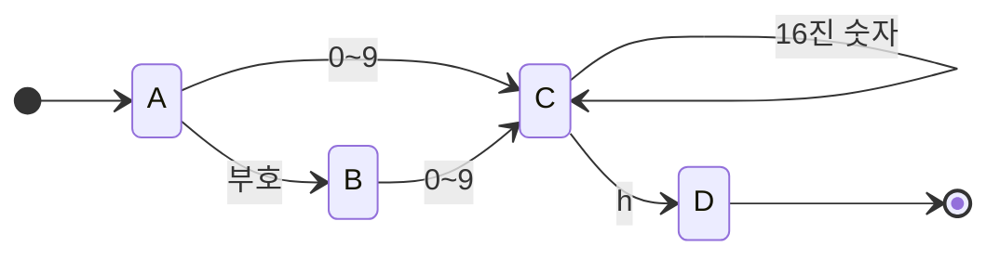


사용 개념: [유한 상태 기계](/Hongs_Blog/studies/assembly-language/asm-finite-state-machine/)의 그림 읽기와, 그림을 이름표·비교·조건 점프로 옮기는 두 규칙.

문제 1~2는 그림을 읽는 연습, 문제 3~4는 그림을 그리는 연습이다. 그릴 때는 "지금까지 읽은 것 가운데 앞으로의 판정에 영향을 주는 것이 무엇인가"를 먼저 적는다. 그 답이 다른 경우마다 상태를 하나씩 둔다[^s1].

부호 있는 정수를 알아보는 그림(슬라이드 p.5)을 표로 적으면 이렇다. 빈칸은 갈 곳이 없다는 뜻이고, 통과 칸은 C다[^1].

| 있던 상태 | 부호(`+`, `-`) | 숫자 | 그 밖 |
|---|---|---|---|
| A (시작) | B | C | |
| B | | C | |
| C (통과) | | C | |

## 문제 1 · 그림 따라가기

위 표에 `+12`, `-`, `3-4`, `007`, 빈 입력을 차례로 넣는다. 각각 지나가는 상태와 판정을 쓰라.

풀이 전략: 글자 하나마다 표에서 (있던 상태, 글자의 종류) 칸을 찾는다. 빈칸을 만나면 그 자리에서 탈락이다. 끝까지 읽었으면 마지막 상태가 통과 칸인지 본다.

<details class="callout callout-answer" markdown="1">
<summary class="callout-title" markdown="span">답</summary>

- `+12`: A → B → C → C. 통과.
- `-`: A → B. 끝까지 읽었지만 B는 통과 칸이 아니다. 탈락.
- `3-4`: A → C, 그다음 `-`는 C 줄의 부호 칸이 비어 있다. 탈락.
- `007`: A → C → C → C. 통과. 이 그림은 앞에 붙은 0을 막지 않는다.
- 빈 입력: A에 머문다. A는 통과 칸이 아니다. 탈락.

</details>


## 문제 2 · 그림의 흠 찾기

슬라이드 p.6의 Your turn이다. 상태를 A, B 둘만 두고 A에서 부호를 읽어도 B로, 숫자를 읽어도 B로 가며, B에서 숫자를 읽으면 B에 머문다. 통과 칸은 B다. 이 그림이 위 그림보다 못한 이유를 설명하고, 두 그림의 판정이 갈리는 입력을 모두 쓰라[^2].

풀이 전략: 두 그림에서 "통과 칸에 들어가는 가장 짧은 길"을 견준다.

<details class="callout callout-answer" markdown="1">
<summary class="callout-title" markdown="span">답</summary>

상태 둘짜리 그림에서는 `+` 한 글자로 A → B가 되고 B가 통과 칸이라 통과한다. 숫자가 하나도 없는 `+`, `-`를 정수로 받아들인다. 판정이 갈리는 입력은 이 둘뿐이다(길이 5 이하의 모든 입력으로 확인).

까닭: "부호만 읽었다"와 "숫자를 하나 이상 읽었다"는 지금 끝내도 되는지가 다르다. 서로 다르게 다뤄야 하는 두 상황을 상태 하나에 합치면 구별할 길이 없다. 한편 `+5`와 `5`가 모두 통과하는 것, `5+`가 탈락하는 것은 두 그림이 같다[^s1].

</details>


## 문제 3 · 16진 상수 그림 그리기와 코드로 옮기기

슬라이드 p.13의 Your turn이다. MASM 문법의 16진 정수 상수를 알아보는 유한 상태 기계를 (가) 그림으로 그리고 (나) 상태 하나의 흐름을 적고 (다) 어셈블리로 옮겨라. MASM의 16진 상수는 앞에 부호가 붙을 수 있고, `6Ah`처럼 16진 숫자 뒤에 `h`를 붙이며, 글자로 시작하는 값은 `0A5h`처럼 앞에 0을 붙인다[^3].

풀이 전략: 판정에 영향을 주는 것을 적는다. ① 아직 아무것도 못 읽었다 ② 부호만 읽었다 ③ 숫자로 시작해 16진 숫자를 읽는 중이다 ④ `h`까지 읽었다. 네 가지이므로 상태도 넷이다. "글자로 시작하면 안 된다"는 규칙은 ①과 ②에서 나가는 화살표에 0~9만 적는 것으로 지킨다.

<details class="callout callout-answer" markdown="1">
<summary class="callout-title" markdown="span">답 (가) 그림</summary>

| 있던 상태 | 부호 | `0`~`9` | `A`~`F`, `a`~`f` | `h`, `H` |
|---|---|---|---|---|
| A (시작) | B | C | | |
| B | | C | | |
| C | | C | C | D |
| D (통과) | | | | |



`0A5h`는 A → C → C → C → D로 통과한다. `A5h`는 A에서 `A`가 갈 곳이 없어 탈락한다. `42`는 C에서 끝나 탈락한다(`h`가 없다). 이 그림이 받아들이는 문자열은 정규식 `[+-]?[0-9][0-9A-Fa-f]*[hH]`와 같다.

</details>


<details class="callout callout-answer" markdown="1">
<summary class="callout-title" markdown="span">답 (나) 상태 C의 흐름</summary>

1. `Getnext`로 다음 글자를 AL에 읽는다.
2. 16진 숫자인가? 그러면 StateC로 돌아간다.
3. `h`나 `H`인가? 그러면 StateD로 간다.
4. 둘 다 아니면 오류를 찍고 끝낸다.

</details>


<details class="callout callout-answer" markdown="1">
<summary class="callout-title" markdown="span">답 (다) 코드</summary>

상태 A와 B는 슬라이드의 정수 코드와 같다(`IsDigit`로 0~9만 받는다). 달라지는 것은 C와 D, 그리고 16진 숫자인지 묻는 프로시저다.

```asm
StateC:
    call Getnext
    call IsHexDigit       ; 16진 숫자면 ZF = 1
    jz   StateC
    cmp  al,'h'
    je   StateD
    cmp  al,'H'
    je   StateD
    call DisplayErrorMsg
    jmp  Quit

StateD:
    call Getnext
    cmp  al,ENTER_KEY     ; h 다음에는 Enter만 올 수 있다
    je   Quit
    call DisplayErrorMsg
    jmp  Quit

IsHexDigit PROC
    cmp  al,'0'
    jb   NotHex           ; '0'보다 작다 (ZF = 0)
    cmp  al,'9'
    jbe  IsHex            ; '0'~'9'
    cmp  al,'A'
    jb   NotHex
    cmp  al,'F'
    jbe  IsHex            ; 'A'~'F'
    cmp  al,'a'
    jb   NotHex
    cmp  al,'f'
    ja   NotHex           ; 'f'보다 크다 (ZF = 0)
IsHex:
    test ax,0             ; ZF = 1
NotHex:
    ret
IsHexDigit ENDP
```

`NotHex`로 뛰는 네 곳은 모두 "작다"나 "크다"일 때라 두 값이 달라서 ZF가 0이다. `IsHex`로 온 경우에는 `test ax,0`이 ZF를 1로 만든다. AL 256가지 전부에서 16진 숫자일 때만 ZF = 1인 것을 확인했다.

</details>


<div class="callout callout-check" markdown="1">
<div class="callout-title" markdown="span">검증: 그림·정규식·코드 흉내가 길이 5 이하의 모든 입력에서 같은 판정 — [36_fsm-practice_p3.py](/Hongs_Blog/studies/assembly-language/code/36_fsm-practice_p3/) (실제 어셈블러가 아니라 파이썬 흉내로 확인)</div>

</div>


## 문제 4 · 변형: 앞에 붙은 0 막기

문제 1에서 `007`이 통과했다. 부호 없는 정수 가운데 `0` 하나이거나, 0이 아닌 숫자로 시작하는 것만 통과시키는 그림을 그려라. `0`, `7`, `700`은 통과, `007`, `00`, 빈 입력은 탈락이다.

<details class="callout callout-answer" markdown="1">
<summary class="callout-title" markdown="span">답</summary>

"0 하나만 읽었다"와 "0이 아닌 숫자로 시작했다"를 다른 상태로 가른다.

| 있던 상태 | `0` | `1`~`9` |
|---|---|---|
| A (시작) | Z | C |
| Z (통과) | | |
| C (통과) | C | C |

Z에서는 나가는 화살표가 없다. `0` 다음에 무엇이 오든 탈락이다. `007`은 A → Z에서 둘째 `0`의 갈 곳이 없어 탈락하고, `700`은 A → C → C → C로 통과한다. 통과 칸이 둘(Z, C)이다. 이 그림은 정규식 <code>0&#124;[1-9][0-9]*</code>와 같다.

</details>


<div class="callout callout-check" markdown="1">
<div class="callout-title" markdown="span">검증: 문제 1·2·4의 답 — [36_fsm-practice_p3.py](/Hongs_Blog/studies/assembly-language/code/36_fsm-practice_p3/)</div>

</div>


[^1]: 어셈블리어 9회 강의 자료 「wk09-chapt_06-2-2」, p.5 (부호 있는 정수 그림)
[^2]: 같은 자료, p.6 (Your turn: 상태 둘짜리 그림)
[^3]: 같은 자료, p.13 (Your turn: 16진 상수). MASM 정수 상수의 문법은 어셈블리어 4회 강의 자료 「wk04-chapt_03-4-1」, p.4
[^s1]: <span class="fn-tag" title="수업 자료에 없고 따로 보탠 내용">보충</span> 슬라이드에는 Your turn의 답이 없다. 이 문서의 표, 풀이 전략, 모든 답과 코드, 문제 1과 4의 입력은 원본에 없다. 문제 코드로 확인했다.

