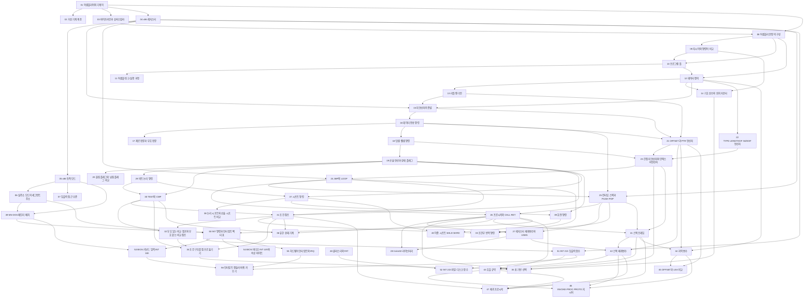


## 먼저 알아야 할 것
- [진법과 자릿수](/Hongs_Blog/studies/college-math/positional-notation/) (공학수학 대학수학): 2진수와 16진수 읽기. 문서의 `과목별 관점`에 16진 덧셈·뺄셈이 있다
- [정수의 2진 표현과 2의 보수](/Hongs_Blog/studies/data-and-information/twos-complement/), [부호와 부호화](/Hongs_Blog/studies/data-and-information/code-encoding/) (2-1학기 자료와 정보): 음수 적는 법과 ASCII
- [불 대수와 논리 회로](/Hongs_Blog/studies/discrete-math/boolean-algebra/) (공학수학 이산수학): AND·OR·NOT과 진리표
- 3장의 컴퓨터 구조 내용 일부는 운영체제 문서([컴퓨터의 기본 구성 요소](/Hongs_Blog/studies/operating-systems/computer-basic-elements/), [명령어 사이클](/Hongs_Blog/studies/operating-systems/instruction-cycle/))의 `과목별 관점`에 합쳤다. 번호 원칙으로는 먼저 배우는 이 과목이 번호를 가져야 하지만 이미 정리된 문서의 번호를 바꾸지 않았다.

> 자료 출처: Irvine, *Assembly Language for x86 Processors* 7판 강의 슬라이드(교재 1~8장, 14~17장). 8주차 자료는 없다(중간고사로 보인다). 슬라이드는 MASM·Irvine32 문법이다. 이 지식베이스의 실행 결과는 MASM이 아니라 파이썬으로 레지스터·플래그·스택을 흉내 내 확인했다. 12~14주차의 16비트 MS-DOS·BIOS 함수는 실행해 보지 못했고 계산만 확인했다. 곱셈·나눗셈 명령(MUL, DIV)은 슬라이드 목차에만 있어 문서가 없다.

## 1주차 · 어셈블리어 소개와 가상 기계

읽기 전에

1. C++ 한 줄 `cout << (A * B + C);`는 프로세서가 실행하는 명령 몇 개쯤이 될까? → [어셈블리어와 기계어](/Hongs_Blog/studies/assembly-language/assembly-language/)
2. 어셈블리어로 쓴 프로그램을 다른 종류의 프로세서에서 그대로 돌릴 수 있을까? → [어셈블리어와 기계어](/Hongs_Blog/studies/assembly-language/assembly-language/)
3. 사람이 쓰기 편한 말로 쓴 프로그램을 기계가 돌리는 방법 두 가지는? → [가상 기계 계층](/Hongs_Blog/studies/assembly-language/virtual-machine-levels/)

| 번호 | 개념 | 한 줄 | 개념 코드 | 연습 |
|---|---|---|---|---|
| 01 | [어셈블리어와 기계어](/Hongs_Blog/studies/assembly-language/assembly-language/) | 기계어 명령 하나에 이름 하나를 붙인 말. 한 줄이 기계어 한 개 | [verify](/Hongs_Blog/studies/assembly-language/code/01_assembly-language_verify/) | [16진 계산과 2의 보수 연습](/Hongs_Blog/studies/assembly-language/asm-hex-practice/) · [문제 코드](/Hongs_Blog/studies/assembly-language/code/01_asm-hex-practice_p1/) |
| 02 | [가상 기계 계층](/Hongs_Blog/studies/assembly-language/virtual-machine-levels/) | 고급 언어 → 어셈블리어 → 기계어 → 논리 회로로 내려가는 네 층 | [verify](/Hongs_Blog/studies/assembly-language/code/02_virtual-machine-levels_verify/) | — |

자료: Chapt_01-1
필기: 아직 없다.
떠올려 보기: 노트를 닫고 사람의 말, C++, 어셈블리어, 기계어 네 가지가 서로 어떻게 바뀌는지 그려 본다.

## 2주차 · 기계 단계, 수와 문자 표현, 불 연산

읽기 전에

1. C++ 프로그램과 논리 게이트 사이에 층이 몇 개 있을까? → [가상 기계 계층](/Hongs_Blog/studies/assembly-language/virtual-machine-levels/)
2. `6A + 4B`를 10진수로 바꾸지 않고 계산할 수 있을까? → [진법과 자릿수](/Hongs_Blog/studies/college-math/positional-notation/)
3. 16진수 `9D`가 음수인지 한 글자만 보고 알 수 있을까? → [정수의 2진 표현과 2의 보수](/Hongs_Blog/studies/data-and-information/twos-complement/)

개념: 이 주차의 진법·2의 보수·문자 부호·불 연산은 [진법과 자릿수](/Hongs_Blog/studies/college-math/positional-notation/), [정수의 2진 표현과 2의 보수](/Hongs_Blog/studies/data-and-information/twos-complement/), [부호와 부호화](/Hongs_Blog/studies/data-and-information/code-encoding/), [불 대수와 논리 회로](/Hongs_Blog/studies/discrete-math/boolean-algebra/) 문서의 `과목별 관점`에 합쳤다. 연습은 1주차 표의 16진 계산과 2의 보수 연습에 있다.
자료: wk02-chapt_01-2-1 · wk02-chapt_01-2-2
필기: 아직 없다.
떠올려 보기: 네 단계의 이름, 16진 덧셈의 올림 규칙, 2의 보수 만드는 두 단계를 적고 서로 어디서 만나는지 써 본다.

## 3주차 · x86 프로세서 구조

읽기 전에

1. 걸음이 6개인 프로세서가 명령어 100개를 겹쳐 처리하면 600사이클보다 얼마나 줄까? → [파이프라인과 슈퍼스칼라](/Hongs_Blog/studies/assembly-language/instruction-pipeline/)
2. EAX에 `12345678h`가 있을 때 AL에 `FFh`를 넣으면 EAX는 얼마가 될까? → [x86 레지스터](/Hongs_Blog/studies/assembly-language/x86-registers/)
3. 16비트 레지스터로 1MB 메모리의 주소를 어떻게 다 가리킬까? → [실주소 모드의 세그먼트 주소](/Hongs_Blog/studies/assembly-language/real-mode-segment-address/)

| 번호 | 개념 | 한 줄 | 개념 코드 | 연습 |
|---|---|---|---|---|
| 03 | [파이프라인과 슈퍼스칼라](/Hongs_Blog/studies/assembly-language/instruction-pipeline/) | 명령어를 걸음으로 나눠 겹쳐 처리한다. $$k + (n - 1)$$사이클 | [verify](/Hongs_Blog/studies/assembly-language/code/03_instruction-pipeline_verify/) | — |
| 04 | [x86 레지스터](/Hongs_Blog/studies/assembly-language/x86-registers/) | 프로세서 안의 이름 붙은 저장 칸. 범용 8개, 세그먼트 6개, EFLAGS, EIP | [verify](/Hongs_Blog/studies/assembly-language/code/04_x86-registers_verify/) | — |
| 05 | [x86 동작 모드](/Hongs_Blog/studies/assembly-language/x86-operating-modes/) | 실주소 모드(1MB, 보호 없음), 보호 모드(4GB, 프로그램마다 구역), 가상 8086 모드 | [verify](/Hongs_Blog/studies/assembly-language/code/05_x86-operating-modes_verify/) | — |
| 06 | [실주소 모드의 세그먼트 주소](/Hongs_Blog/studies/assembly-language/real-mode-segment-address/) | 선형 주소 = 세그먼트 × 16 + 오프셋 | [verify](/Hongs_Blog/studies/assembly-language/code/06_real-mode-segment-address_verify/) | — |
| 07 | [입출력 접근 수준](/Hongs_Blog/studies/assembly-language/io-access-levels/) | 입출력을 라이브러리·운영체제·BIOS·하드웨어 가운데 누구에게 부탁하나 | — | — |

자료: wk03-chapt_02-3-1 · wk03-chapt_02-3-2 · wk03-chapt_02-3-3
필기: 아직 없다.
떠올려 보기: 레지스터의 종류, 세 가지 동작 모드, 입출력의 네 단계를 적고 "보호 모드에서는 무엇이 막히는가"로 이어 본다.

## 4주차 · 어셈블리 문법, 데이터 정의, 데이터 전송

읽기 전에

1. 16진수 `A5`를 원본에 `A5h`라고 쓰면 어셈블러는 무엇으로 읽을까? → [어셈블리 문장의 구성](/Hongs_Blog/studies/assembly-language/asm-statement-elements/)
2. `.data`와 `mov eax,5` 가운데 프로세서가 실행하는 줄은 어느 쪽일까? → [지시어와 명령어 비교](/Hongs_Blog/studies/assembly-language/directive-vs-instruction/)
3. 내 원본에 없는 `DumpRegs`의 코드는 언제, 누가 내 프로그램에 붙일까? → [어셈블·링크·실행 과정](/Hongs_Blog/studies/assembly-language/assemble-link-execute/)

| 번호 | 개념 | 한 줄 | 개념 코드 | 연습 |
|---|---|---|---|---|
| 08 | [어셈블리 문장의 구성](/Hongs_Blog/studies/assembly-language/asm-statement-elements/) | 한 줄은 레이블, 니모닉, 피연산자, 주석 네 칸 | [verify](/Hongs_Blog/studies/assembly-language/code/08_asm-statement-elements_verify/) | — |
| 09 | [지시어와 명령어 비교](/Hongs_Blog/studies/assembly-language/directive-vs-instruction/) | 어셈블러가 따르는 줄과 프로세서가 실행하는 줄 | — | — |
| 10 | [프로그램 틀](/Hongs_Blog/studies/assembly-language/asm-program-template/) | 모든 프로그램이 올라타는 뼈대. `.data`, `.code`, `main PROC`, `END main` | [verify](/Hongs_Blog/studies/assembly-language/code/10_asm-program-template_verify/) | — |
| 11 | [어셈블·링크·실행 과정](/Hongs_Blog/studies/assembly-language/assemble-link-execute/) | 원본 → 목적 파일 → 실행 파일 → 메모리. 어셈블러, 링커, 로더 | [verify](/Hongs_Blog/studies/assembly-language/code/11_assemble-link-execute_verify/) | — |
| 12 | [데이터 정의](/Hongs_Blog/studies/assembly-language/asm-data-definition/) | 이름, 칸 크기, 처음 값을 적어 메모리에 변수를 잡는다 | [verify](/Hongs_Blog/studies/assembly-language/code/12_asm-data-definition_verify/) | — |
| 13 | [리틀 엔디언](/Hongs_Blog/studies/assembly-language/little-endian/) | 여러 바이트 값은 아랫자리 바이트가 낮은 주소에 온다 (강조)[^강조] | [verify](/Hongs_Blog/studies/assembly-language/code/13_little-endian_verify/) | — |
| 14 | [기호 상수와 위치 카운터](/Hongs_Blog/studies/assembly-language/symbolic-constants/) | 수에 이름을 붙이고, `$`로 배열 크기를 어셈블러가 세게 한다 | [verify](/Hongs_Blog/studies/assembly-language/code/14_symbolic-constants_verify/) | — |
| 15 | [피연산자의 종류](/Hongs_Blog/studies/assembly-language/operand-types/) | 명령의 재료는 즉시값, 레지스터, 메모리 셋이고 이름+수는 주소를 옮긴다 | [verify](/Hongs_Blog/studies/assembly-language/code/15_operand-types_verify/) | — |
| 16 | [데이터 전송 명령](/Hongs_Blog/studies/assembly-language/data-transfer-instructions/) | MOV는 복사, XCHG는 맞바꾸기. 크기가 같아야 하고 메모리끼리는 안 된다 | [verify](/Hongs_Blog/studies/assembly-language/code/16_data-transfer-instructions_verify/) | — |
| 17 | [제로 확장과 부호 확장](/Hongs_Blog/studies/assembly-language/zero-sign-extension/) | 작은 값을 넓힐 때 윗자리를 0으로 채우거나 부호 비트로 채운다 | [verify](/Hongs_Blog/studies/assembly-language/code/17_zero-sign-extension_verify/) | — |

자료: wk04-chapt_03-4-1 · wk04-chapt_03-4-2 · wk04-chapt_03-4-3 · wk04-chapt_04-4-4
필기: 아직 없다.
떠올려 보기: 노트를 닫고 "변수를 정의한다 → 메모리에 바이트로 놓인다 → 명령이 그 자리를 가져다 쓴다"의 세 단계를 `val1 DWORD 12345678h` 하나로 써 본다.

## 5주차 · 덧셈·뺄셈과 플래그, 데이터 연산자, 간접 주소, JMP·LOOP

읽기 전에

1. AL에 FFh를 넣고 1을 더하면 00h가 된다. 이 계산은 맞았을까 틀렸을까? CPU는 그것을 어떻게 알려 줄까? → [산술 연산과 상태 플래그](/Hongs_Blog/studies/assembly-language/x86-status-flags/)
2. `mov ax,00FFh` 뒤에 `inc ax`와 `inc al`을 각각 하면 AX는 같아질까? → [덧셈·뺄셈 명령](/Hongs_Blog/studies/assembly-language/add-sub-instructions/)
3. `myDouble DWORD 12345678h`에서 `mov ax,WORD PTR myDouble`은 1234h를 가져올까 5678h를 가져올까? → [OFFSET과 PTR 연산자](/Hongs_Blog/studies/assembly-language/offset-ptr-operators/)

| 번호 | 개념 | 한 줄 | 개념 코드 | 연습 |
|---|---|---|---|---|
| 18 | [덧셈·뺄셈 명령](/Hongs_Blog/studies/assembly-language/add-sub-instructions/) | INC·DEC·ADD·SUB·NEG. 계산은 적은 칸의 크기 안에서만 일어난다 | [verify](/Hongs_Blog/studies/assembly-language/code/18_add-sub-instructions_verify/) | [산술식을 어셈블리로 옮기기 연습](/Hongs_Blog/studies/assembly-language/arithmetic-expression-practice/) · [문제 코드](/Hongs_Blog/studies/assembly-language/code/18_arithmetic-expression-practice_p3/) |
| 19 | [산술 연산과 상태 플래그](/Hongs_Blog/studies/assembly-language/x86-status-flags/) | 계산마다 결과가 0인지, 음수인지, 넘쳤는지를 ZF·SF·CF·OF로 남긴다 (강조)[^강조] | [verify](/Hongs_Blog/studies/assembly-language/code/19_x86-status-flags_verify/) | [플래그 추적 예제 사다리](/Hongs_Blog/studies/assembly-language/flag-tracing-ladder/) · [문제 코드](/Hongs_Blog/studies/assembly-language/code/19_flag-tracing-ladder_p4/) |
| 20 | [올림 플래그와 넘침 플래그 비교](/Hongs_Blog/studies/assembly-language/carry-vs-overflow-flag/) | 부호 없는 수의 넘침은 CF, 부호 있는 수의 넘침은 OF로 본다 | — | — |
| 21 | [OFFSET과 PTR 연산자](/Hongs_Blog/studies/assembly-language/offset-ptr-operators/) | OFFSET은 변수의 주소를 주고, PTR은 정의와 다른 크기로 읽게 한다 | [verify](/Hongs_Blog/studies/assembly-language/code/21_offset-ptr-operators_verify/) | [PTR과 리틀 엔디언 예제 사다리](/Hongs_Blog/studies/assembly-language/ptr-little-endian-ladder/) · [문제 코드](/Hongs_Blog/studies/assembly-language/code/21_ptr-little-endian-ladder_p4/) |
| 22 | [TYPE·LENGTHOF·SIZEOF 연산자](/Hongs_Blog/studies/assembly-language/type-lengthof-sizeof/) | 원소 크기, 원소 개수, 전체 바이트 수. $$\text{SIZEOF} = \text{LENGTHOF} \times \text{TYPE}$$ | [verify](/Hongs_Blog/studies/assembly-language/code/22_type-lengthof-sizeof_verify/) | — |
| 23 | [간접 피연산자와 인덱스 피연산자](/Hongs_Blog/studies/assembly-language/indirect-addressing/) | 주소를 레지스터에 넣고 `[esi]`나 `배열[esi]`로 칸을 옮겨 가며 읽는다 | [verify](/Hongs_Blog/studies/assembly-language/code/23_indirect-addressing_verify/) | — |
| 24 | [JMP와 LOOP](/Hongs_Blog/studies/assembly-language/jmp-loop/) | `JMP`는 무조건 넘어가고 `LOOP`는 ECX를 먼저 줄인 뒤 0이 아니면 되돌아간다 | [verify](/Hongs_Blog/studies/assembly-language/code/24_jmp-loop_verify/) | [LOOP로 배열 돌기 예제 사다리](/Hongs_Blog/studies/assembly-language/array-loop-ladder/) · [문제 코드](/Hongs_Blog/studies/assembly-language/code/24_array-loop-ladder_p4/) |

자료: wk05-chapt_04-3-1 · wk05-chapt_04-3-2 · wk05-chapt_04-3-3
필기: 아직 없다.
떠올려 보기: 노트를 닫고 네 플래그(ZF, SF, CF, OF)가 켜지는 조건을 쓰고, CF와 OF가 서로 다른 값이 되는 8비트 덧셈을 하나씩 만들어 본다.

## 6주차 · 스택과 프로시저

읽기 전에

1. ESP가 00001000h일 때 32비트 값 하나를 올리면 ESP는 커질까 작아질까, 얼마가 될까? → [런타임 스택과 PUSH·POP](/Hongs_Blog/studies/assembly-language/runtime-stack/)
2. 프로시저가 끝났을 때 CPU는 어디로 돌아가야 하는지를 어떻게 알까? → [프로시저와 CALL·RET](/Hongs_Blog/studies/assembly-language/call-ret/)
3. 프로시저 안에서 `push`만 하고 `pop`을 빼먹은 채 `ret`을 만나면 어디로 갈까? → [프로시저와 CALL·RET](/Hongs_Blog/studies/assembly-language/call-ret/)

| 번호 | 개념 | 한 줄 | 개념 코드 | 연습 |
|---|---|---|---|---|
| 25 | [런타임 스택과 PUSH·POP](/Hongs_Blog/studies/assembly-language/runtime-stack/) | 올리면 ESP가 4 줄고 내리면 4 는다. 거꾸로 꺼내야 제자리 (강조)[^강조] | [verify](/Hongs_Blog/studies/assembly-language/code/25_runtime-stack_verify/) | — |
| 26 | [프로시저와 CALL·RET](/Hongs_Blog/studies/assembly-language/call-ret/) | `CALL`은 돌아올 주소를 스택에 올리고 `RET`은 맨 위 값을 EIP로 내린다 | [verify](/Hongs_Blog/studies/assembly-language/code/26_call-ret_verify/) | [스택 추적 예제 사다리](/Hongs_Blog/studies/assembly-language/stack-tracing-ladder/) · [문제 코드](/Hongs_Blog/studies/assembly-language/code/26_stack-tracing-ladder_p4/) |
| 27 | [레지스터 매개변수와 USES](/Hongs_Blog/studies/assembly-language/procedure-register-parameters/) | 자료 위치를 레지스터로 받고, 지킬 레지스터는 `USES`로 치웠다 되돌린다 | [verify](/Hongs_Blog/studies/assembly-language/code/27_procedure-register-parameters_verify/) | — |

자료: wk06-chapt_04-3-1 · wk06-chapt_05-3-2 · wk06-chapt_05-3-3
필기: 아직 없다.
떠올려 보기: 노트를 닫고 `PUSH`, `POP`, `CALL`, `RET`이 각각 ESP와 스택에 하는 일을 쓰고, 겹쳐 부른 프로시저 셋이 돌아오는 순서를 스택 그림으로 그려 본다.

## 7주차 · Irvine32 라이브러리, 비트 논리·비교, 조건 점프

읽기 전에

1. 소문자 `'a'`를 대문자로 바꾸는 데 뺄셈 말고 비트 하나만 건드리는 방법이 있을까? → [비트 논리 명령](/Hongs_Blog/studies/assembly-language/bitwise-instructions/)
2. `sub al,5`와 `cmp al,5`는 무엇이 같고 무엇이 다를까? → [TEST와 CMP](/Hongs_Blog/studies/assembly-language/test-cmp/)
3. AL = FFh, BL = 01h일 때 "AL이 더 크면 점프"는 점프할까? 답이 둘일 수 있다면 왜일까? → [조건 점프](/Hongs_Blog/studies/assembly-language/conditional-jumps/)

| 번호 | 개념 | 한 줄 | 개념 코드 | 연습 |
|---|---|---|---|---|
| 28 | [Irvine32 라이브러리](/Hongs_Blog/studies/assembly-language/irvine32-library/) | 약속된 레지스터에 값을 넣고 `call`로 부르는 입출력 도구 48개 | [verify](/Hongs_Blog/studies/assembly-language/code/28_irvine32-library_verify/) | — |
| 29 | [비트 논리 명령](/Hongs_Blog/studies/assembly-language/bitwise-instructions/) | `AND`로 끄고 `OR`로 켜고 `XOR`로 뒤집는다 | [verify](/Hongs_Blog/studies/assembly-language/code/29_bitwise-instructions_verify/) | — |
| 30 | [TEST와 CMP](/Hongs_Blog/studies/assembly-language/test-cmp/) | 값은 그대로 두고 플래그만 남기는 뺄셈(`CMP`)과 AND(`TEST`) | [verify](/Hongs_Blog/studies/assembly-language/code/30_test-cmp_verify/) | — |
| 31 | [조건 점프](/Hongs_Blog/studies/assembly-language/conditional-jumps/) | 플래그를 보고 갈라 가는 점프. 부호 있는 "작다"는 $$\text{SF} \ne \text{OF}$$ (강조)[^강조] | [verify](/Hongs_Blog/studies/assembly-language/code/31_conditional-jumps_verify/) | — |
| 32 | [부호 있는 비교 점프와 부호 없는 비교 점프](/Hongs_Blog/studies/assembly-language/signed-vs-unsigned-jumps/) | 같은 비트를 above·below는 부호 없이, greater·less는 부호 있게 읽는다 | [verify](/Hongs_Blog/studies/assembly-language/code/32_signed-vs-unsigned-jumps_verify/) | — |

자료: wk07-chapt_05-3-1 · wk07-chapt_06-3-2 · wk07-chapt_06-3-3
필기: 아직 없다.
떠올려 보기: 노트를 닫고 부호 없는 비교 점프 넷과 부호 있는 비교 점프 넷을 쓰고, 각각 어떤 플래그를 보는지와 `CMP`·`TEST`가 그 플래그를 어떻게 만드는지 이어 본다.

## 9주차 · 조건부 반복, 조건 구조, 유한 상태 기계

읽기 전에

1. 배열에서 첫 양수를 찾는 루프는 "찾았을 때"와 "끝까지 봤을 때" 두 가지로 멈춘다. 멈춘 뒤 어느 쪽인지 무엇으로 가릴까? → [조건부 반복 명령](/Hongs_Blog/studies/assembly-language/conditional-loop-instructions/)
2. `if (a <= b) { … }`를 옮길 때 `cmp` 뒤에 "이하면 점프"를 쓸까, "초과면 점프"를 쓸까? → [조건 구조를 점프로 옮기기](/Hongs_Blog/studies/assembly-language/conditional-structures/)
3. 글자에 따라 부를 프로시저가 스무 가지면 `cmp`·`je`를 스무 번 쓰는 것 말고 어떤 방법이 있을까? → [표 기반 선택](/Hongs_Blog/studies/assembly-language/table-driven-selection/)

| 번호 | 개념 | 한 줄 | 개념 코드 | 연습 |
|---|---|---|---|---|
| 33 | [조건부 반복 명령](/Hongs_Blog/studies/assembly-language/conditional-loop-instructions/) | 남은 횟수와 ZF를 함께 보고 되돌아가는 `LOOPZ`·`LOOPNZ` | [verify](/Hongs_Blog/studies/assembly-language/code/33_conditional-loop-instructions_verify/) | — |
| 34 | [조건 구조를 점프로 옮기기](/Hongs_Blog/studies/assembly-language/conditional-structures/) | 조건을 뒤집어 "거짓이면 건너뛰어라"로 `if`·`while`을 옮긴다 | [verify](/Hongs_Blog/studies/assembly-language/code/34_conditional-structures_verify/) | [조건 구조를 점프로 옮기기 예제 사다리](/Hongs_Blog/studies/assembly-language/conditional-structures-ladder/) · [문제 코드](/Hongs_Blog/studies/assembly-language/code/34_conditional-structures-ladder_p4/) |
| 35 | [표 기반 선택](/Hongs_Blog/studies/assembly-language/table-driven-selection/) | 값과 프로시저 주소를 짝지은 표를 훑어 갈림을 대신한다 | [verify](/Hongs_Blog/studies/assembly-language/code/35_table-driven-selection_verify/) | — |
| 36 | [유한 상태 기계](/Hongs_Blog/studies/assembly-language/asm-finite-state-machine/) | 상태마다 이름표, 화살표마다 비교와 조건 점프로 옮기는 입력 검사기 | [verify](/Hongs_Blog/studies/assembly-language/code/36_asm-finite-state-machine_verify/) | [유한 상태 기계 연습](/Hongs_Blog/studies/assembly-language/fsm-practice/) · [문제 코드](/Hongs_Blog/studies/assembly-language/code/36_fsm-practice_p3/) |

자료: wk09-chapt_06-2-1 · wk09-chapt_06-2-2
필기: 아직 없다.
떠올려 보기: 노트를 닫고 부호 있는 정수를 알아보는 상태 그림을 그린 뒤, 상태 A를 어셈블리 코드로 옮겨 본다.

## 10주차 · 시프트와 회전, 스택 프레임

읽기 전에

1. `00000101`을 왼쪽으로 한 칸 밀면 5가 얼마가 될까? −80을 오른쪽으로 밀어 −40을 얻으려면 맨 위 빈칸에 무엇을 채워야 할까? → [시프트 명령](/Hongs_Blog/studies/assembly-language/shift-instructions/)
2. 3Fh를 F3h로 바꾸려면 밀려난 비트가 어디로 가야 할까? → [회전 명령](/Hongs_Blog/studies/assembly-language/rotate-instructions/)
3. 프로시저 안에서 push를 할 때마다 ESP가 바뀐다. 스택에 넣어 넘긴 인수를 늘 같은 식으로 읽으려면 어떻게 해야 할까? → [스택 프레임](/Hongs_Blog/studies/assembly-language/stack-frame/)

| 번호 | 개념 | 한 줄 | 개념 코드 | 연습 |
|---|---|---|---|---|
| 37 | [시프트 명령](/Hongs_Blog/studies/assembly-language/shift-instructions/) | 비트를 한쪽으로 밀어 $$2^n$$을 곱하거나 나누고, 밀려난 비트는 CF에 남긴다 | [verify](/Hongs_Blog/studies/assembly-language/code/37_shift-instructions_verify/) | — |
| 38 | [논리 시프트와 산술 시프트 비교](/Hongs_Blog/studies/assembly-language/logical-vs-arithmetic-shift/) | 오른쪽으로 밀 때 빈칸을 0으로 채우면 부호 없는 수, 부호 비트로 채우면 부호 있는 수 | — | — |
| 39 | [회전 명령](/Hongs_Blog/studies/assembly-language/rotate-instructions/) | 밀려난 비트가 반대쪽으로 돌아오는 밀기, RCL·RCR은 CF까지 한 고리 | [verify](/Hongs_Blog/studies/assembly-language/code/39_rotate-instructions_verify/) | — |
| 40 | [이중 시프트 SHLD·SHRD](/Hongs_Blog/studies/assembly-language/double-shift/) | 빈칸을 다른 레지스터의 비트로 채워 두 레지스터에 걸친 수를 민다 | [verify](/Hongs_Blog/studies/assembly-language/code/40_double-shift_verify/) | [시프트와 회전 예제 사다리](/Hongs_Blog/studies/assembly-language/shift-rotate-ladder/) · [문제 코드](/Hongs_Blog/studies/assembly-language/code/40_shift-rotate-ladder_p4/) |
| 41 | [스택 프레임](/Hongs_Blog/studies/assembly-language/stack-frame/) | 호출 하나가 스택에 차지하는 구역, EBP를 고정해 $$[\mathrm{EBP}+8]$$부터 매개변수를 읽는다 (강조)[^강조] | [verify](/Hongs_Blog/studies/assembly-language/code/41_stack-frame_verify/) | — |
| 42 | [스택 매개변수](/Hongs_Blog/studies/assembly-language/stack-parameters/) | 인수를 스택에 넣어 넘긴다. 값을 넣으면 사본, 주소를 넣으면 원본을 고친다 | [verify](/Hongs_Blog/studies/assembly-language/code/42_stack-parameters_verify/) | — |

자료: wk10-chapt_07-3-1 · wk10-chapt_07-3-2 · wk10-chapt_08-3-3
필기: 아직 없다.
떠올려 보기: 노트를 닫고 시프트·회전 명령 여덟 개가 빈칸을 무엇으로 채우는지 표로 쓰고, `push 6`, `push 5`, `call AddTwo` 뒤의 스택을 주소와 함께 그려 본다.

## 11주차 · 호출 규약, 지역 변수, 재귀

읽기 전에

1. 스택에 쌓은 인수는 프로시저가 끝난 뒤 누가 치울까? 양쪽이 서로 미루면 어떻게 될까? → [호출 규약](/Hongs_Blog/studies/assembly-language/calling-convention/)
2. 지역 변수의 주소는 왜 `OFFSET`으로 구할 수 없을까? → [OFFSET과 LEA 비교](/Hongs_Blog/studies/assembly-language/offset-vs-lea/)
3. Factorial의 코드는 한 벌인데, 3!을 구하는 동안 $$n$$ = 3, 2, 1, 0은 각각 어디에 들어 있을까? → [재귀 프로시저](/Hongs_Blog/studies/assembly-language/recursive-procedure/)

| 번호 | 개념 | 한 줄 | 개념 코드 | 연습 |
|---|---|---|---|---|
| 43 | [호출 규약](/Hongs_Blog/studies/assembly-language/calling-convention/) | 쌓은 인수를 부른 쪽이 치우는가(C, `add esp,n`) 불린 쪽이 치우는가(STDCALL, `ret n`) | [verify](/Hongs_Blog/studies/assembly-language/code/43_calling-convention_verify/) | — |
| 44 | [지역 변수](/Hongs_Blog/studies/assembly-language/local-variables/) | `sub esp,n`으로 만들고 `mov esp,ebp`로 없애는 $$[\mathrm{EBP}-4]$$ 아래의 임시 칸 | [verify](/Hongs_Blog/studies/assembly-language/code/44_local-variables_verify/) | [스택 프레임 그리기 예제 사다리](/Hongs_Blog/studies/assembly-language/stack-frame-ladder/) · [문제 코드](/Hongs_Blog/studies/assembly-language/code/44_stack-frame-ladder_p4/) |
| 45 | [OFFSET과 LEA 비교](/Hongs_Blog/studies/assembly-language/offset-vs-lea/) | 번역할 때 정해지는 주소는 OFFSET, 실행해 봐야 아는 주소는 LEA | [verify](/Hongs_Blog/studies/assembly-language/code/45_offset-vs-lea_verify/) | — |
| 46 | [INVOKE·PROC·PROTO 지시어](/Hongs_Blog/studies/assembly-language/invoke-proc-proto/) | push·call·$$[\mathrm{EBP}+8]$$을 어셈블러가 대신 써 주는 지시어 | [verify](/Hongs_Blog/studies/assembly-language/code/46_invoke-proc-proto_verify/) | — |
| 47 | [재귀 프로시저](/Hongs_Blog/studies/assembly-language/recursive-procedure/) | 자기를 다시 부르는 프로시저, 호출마다 12바이트 프레임에 $$n$$을 따로 둔다 (강조)[^강조] | [impl](/Hongs_Blog/studies/assembly-language/code/47_recursive-procedure_impl/) | [재귀 호출 스택 추적 연습](/Hongs_Blog/studies/assembly-language/recursion-stack-practice/) · [문제 코드](/Hongs_Blog/studies/assembly-language/code/47_recursion-stack-practice_p3/) |

자료: wk11-chapt_08-2-1 · wk11-chapt_08-2-2
필기: 아직 없다.
떠올려 보기: 노트를 닫고 Factorial(3)이 가장 깊이 들어갔을 때의 스택 열두 칸을 그리고, 돌아오면서 EAX가 바뀌는 순서를 써 본다.

## 12주차 · 디스크 구조와 FAT

읽기 전에

1. 4,096바이트 단위로만 자리를 내주는 디스크에 8,200바이트 파일을 넣으면 몇 바이트가 버려질까? → [클러스터와 FAT](/Hongs_Blog/studies/assembly-language/fat-file-system/)
2. 파일 조각이 디스크 여기저기에 흩어져 있으면 운영체제는 다음 조각이 어디인지 어떻게 알까? → [클러스터와 FAT](/Hongs_Blog/studies/assembly-language/fat-file-system/)
3. 파일 이름 없이 디스크의 섹터를 번호로 바로 읽는 함수는 왜 요즘 Windows에서 막혀 있을까? → [INT 21h 파일·디스크 함수](/Hongs_Blog/studies/assembly-language/int21h-file-disk-functions/)

| 번호 | 개념 | 한 줄 | 개념 코드 | 연습 |
|---|---|---|---|---|
| 48 | [클러스터와 FAT](/Hongs_Blog/studies/assembly-language/fat-file-system/) | 파일은 클러스터 단위로 나뉘고 FAT에 적힌 "다음 번호"를 따라 이어진다 | [verify](/Hongs_Blog/studies/assembly-language/code/48_fat-file-system_verify/) | — |
| 52 | [INT 21h 파일·디스크 함수](/Hongs_Blog/studies/assembly-language/int21h-file-disk-functions/) | 파일은 핸들로 다루고 실패는 올림 플래그로 알며, 섹터 직접 읽기는 실주소 모드에서만 된다 | [verify](/Hongs_Blog/studies/assembly-language/code/52_int21h-file-disk-functions_verify/) | — |

52번은 12주차 내용이지만 13주차의 INT 21h가 선수라 번호가 뒤에 있다. 트랙·섹터·실린더는 운영체제의 [디스크 스케줄링](/Hongs_Blog/studies/operating-systems/disk-scheduling/) 문서의 `과목별 관점`에 합쳤다.
자료: wk12-chapt_15-1-1
필기: 아직 없다.
떠올려 보기: 노트를 닫고 섹터, 클러스터, 클러스터 사슬, FAT, 디렉터리가 파일 이름에서 섹터까지 어떻게 이어지는지 그려 본다.

## 13주차 · 16비트 MS-DOS와 INT 21h

읽기 전에

1. 1MB 메모리의 맨 아래 1,024바이트에는 무엇이 들어 있을까? → [MS-DOS 메모리 배치](/Hongs_Blog/studies/assembly-language/msdos-memory-map/)
2. BIOS의 화면 코드는 컴퓨터마다 다른 주소에 있는데, 같은 프로그램이 어떻게 어디서나 그 코드를 부를까? → [INT 명령과 인터럽트 벡터 표](/Hongs_Blog/studies/assembly-language/interrupt-vector-table/)
3. 글자 찍기와 날짜 읽기가 둘 다 `int 21h`라면 MS-DOS는 무엇을 보고 둘을 구별할까? → [INT 21h 입출력 함수](/Hongs_Blog/studies/assembly-language/int21h-io-functions/)

| 번호 | 개념 | 한 줄 | 개념 코드 | 연습 |
|---|---|---|---|---|
| 49 | [MS-DOS 메모리 배치](/Hongs_Blog/studies/assembly-language/msdos-memory-map/) | 1MB 주소 공간에 벡터 표, DOS, 프로그램, 화면 메모리, ROM BIOS가 정해진 주소로 놓인다 | [verify](/Hongs_Blog/studies/assembly-language/code/49_msdos-memory-map_verify/) | — |
| 50 | [INT 명령과 인터럽트 벡터 표](/Hongs_Blog/studies/assembly-language/interrupt-vector-table/) | `INT n`은 주소 $$n \times 4$$의 칸에서 처리 코드 주소를 찾아 갔다가 `IRET`로 돌아온다 | [verify](/Hongs_Blog/studies/assembly-language/code/50_interrupt-vector-table_verify/) | — |
| 51 | [INT 21h 입출력 함수](/Hongs_Blog/studies/assembly-language/int21h-io-functions/) | AH에 함수 번호를 넣고 `INT 21h`를 불러 글자·문자열·날짜를 읽고 쓴다 | [verify](/Hongs_Blog/studies/assembly-language/code/51_int21h-io-functions_verify/) | — |

자료: wk13-chapt_14-2-1 · wk13-chapt_14-2-2
필기: 아직 없다.
떠올려 보기: 노트를 닫고 `int 21h`를 부르는 세 단계와, `int` 명령을 만난 프로세서가 처리 코드까지 가서 돌아오는 네 걸음을 써 본다.

## 14주차 · BIOS 키보드·비디오, 인터럽트 핸들러

읽기 전에

1. F1이나 화살표 키에는 ASCII 코드가 없다. 프로그램은 이런 키를 어떻게 알아볼까? → [BIOS 키보드 입력 INT 16h](/Hongs_Blog/studies/assembly-language/bios-keyboard-int16h/)
2. 파란 바탕에 밝은 회색 글자를 1바이트로 적으면 얼마일까? → [BIOS 비디오 INT 10h와 속성 바이트](/Hongs_Blog/studies/assembly-language/bios-video-int10h/)
3. 키보드와 타이머가 동시에 프로세서를 부르면 누가 먼저 처리될까? 누가 정할까? → [하드웨어 인터럽트와 IRQ](/Hongs_Blog/studies/assembly-language/hardware-interrupt-irq/)

| 번호 | 개념 | 한 줄 | 개념 코드 | 연습 |
|---|---|---|---|---|
| 53 | [BIOS 키보드 입력 INT 16h](/Hongs_Blog/studies/assembly-language/bios-keyboard-int16h/) | 누른 키는 스캔 코드와 ASCII 쌍으로 버퍼에 쌓이고 `INT 16h`로 꺼낸다 | [verify](/Hongs_Blog/studies/assembly-language/code/53_bios-keyboard-int16h_verify/) | — |
| 54 | [BIOS 비디오 INT 10h와 속성 바이트](/Hongs_Blog/studies/assembly-language/bios-video-int10h/) | 속성 바이트 = (바탕 SHL 4) OR 글자색, `INT 10h`로 색 글자를 쓰고 화면을 지운다 | [verify](/Hongs_Blog/studies/assembly-language/code/54_bios-video-int10h_verify/) | — |
| 55 | [하드웨어 인터럽트와 IRQ](/Hongs_Blog/studies/assembly-language/hardware-interrupt-irq/) | 장치의 요청은 8259가 IRQ 우선순위로 걸러 보내고 `CLI`·`STI`로 막고 연다 | [verify](/Hongs_Blog/studies/assembly-language/code/55_hardware-interrupt-irq_verify/) | — |
| 56 | [인터럽트 핸들러 바꿔 끼우기](/Hongs_Blog/studies/assembly-language/custom-interrupt-handler/) | 벡터 표의 칸을 내 코드 주소로 바꾸고, 일을 마치면 원래 핸들러로 넘긴다 | [verify](/Hongs_Blog/studies/assembly-language/code/56_custom-interrupt-handler_verify/) | — |

자료: wk14-chapt_16-2-1 · wk14-chapt_17-2-2
필기: 아직 없다.
떠올려 보기: 노트를 닫고 키 하나가 눌린 뒤 프로그램이 받기까지의 길(포트, 8259, 벡터 표, INT 9h, 버퍼, INT 16h)과, 그 길에 내 핸들러를 끼우는 네 단계를 써 본다.

## 다른 과목과의 연결
- [스택 프레임](/Hongs_Blog/studies/assembly-language/stack-frame/), [호출 규약](/Hongs_Blog/studies/assembly-language/calling-convention/) ↔ [활성 레코드](/Hongs_Blog/studies/compilers/activation-record/), [함수 호출의 코드 생성](/Hongs_Blog/studies/compilers/codegen-function-call/) (3-2학기 컴파일러): 사람이 손으로 짜는 호출 코드와 컴파일러가 만들어 내는 호출 코드
- [유한 상태 기계](/Hongs_Blog/studies/assembly-language/asm-finite-state-machine/) ↔ [유한 오토마타](/Hongs_Blog/studies/compilers/finite-automata/) (3-2학기 컴파일러): 같은 상태 그림을 점프로 옮기느냐 표로 돌리느냐
- [조건 구조를 점프로 옮기기](/Hongs_Blog/studies/assembly-language/conditional-structures/) ↔ [3주소 코드](/Hongs_Blog/studies/compilers/three-address-code/) (3-2학기 컴파일러): if와 while을 레이블과 점프로 편다
- [산술 연산과 상태 플래그](/Hongs_Blog/studies/assembly-language/x86-status-flags/) ↔ [연산자와 오버플로](/Hongs_Blog/studies/java/java-operators/) (2-1학기 소프트웨어 프로젝트): Java는 넘쳐도 말이 없고 CPU는 CF·OF로 남긴다
- [INT 명령과 인터럽트 벡터 표](/Hongs_Blog/studies/assembly-language/interrupt-vector-table/), [클러스터와 FAT](/Hongs_Blog/studies/assembly-language/fat-file-system/) ↔ [인터럽트](/Hongs_Blog/studies/operating-systems/interrupt/), [파일 할당](/Hongs_Blog/studies/operating-systems/file-allocation/) (3-1학기 운영체제): 운영체제 원리의 x86·MS-DOS 사례

## 흐름

[^강조]: 원본에서 강조된 개념. 리틀 엔디언: 4주차와 5주차에 두 번 나온다. 상태 플래그: 3·5·7주차에 되풀이되고 "YOU, the programmer"로 부호 구분의 책임을 짚는다. 런타임 스택: 6주차 스택 그림 네 쪽. 조건 점프: 7주차 표 네 장. 스택 프레임과 재귀 프로시저: 10~11주차의 스택 그림.

