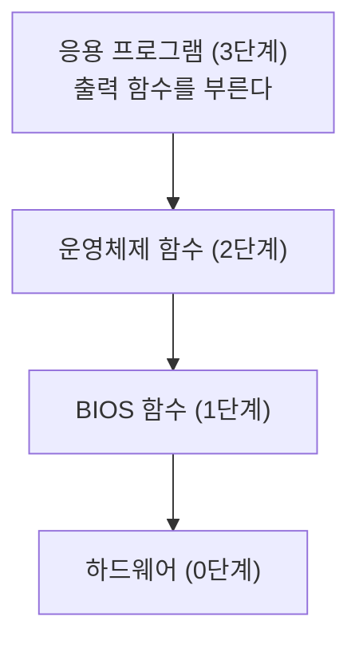
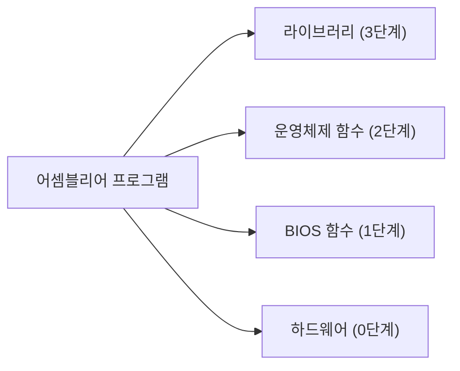



요약

프로그램이 화면에 글자를 찍거나 키보드를 읽을 때는 누군가에게 부탁한다. 손님이 식당 종업원에게 주문하면 종업원이 주방에 전하고 주방이 불을 쓰는 것처럼, 부탁은 여러 단계를 거쳐 하드웨어에 닿는다. 위 단계에 부탁할수록 쓰기 쉽고 어느 컴퓨터에서나 통한다. 아래 단계로 내려갈수록 빠르고 세밀하게 다룰 수 있지만, 알아야 할 것이 늘고 다른 컴퓨터에서는 안 돌 수 있으며 운영체제가 막기도 한다.

## 예시로 보기

C++의 `cout << "Hello";` 한 줄로 글자가 화면에 나온다. 이 한 줄이 그래픽 카드를 직접 움직이는 것은 아니다. 고급 언어 프로그램이 글자열을 찍을 때는 다음 단계를 차례로 거친다[^1].

BIOS(basic input-output system)는 컴퓨터의 칩에 들어 있는 작은 프로그램 모음으로, 장치와 직접 이야기하는 코드(드라이버)가 담겨 있다[^s1].

어셈블리어 프로그램은 이 네 단계 가운데 어느 단계에든 직접 부탁할 수 있다[^2]. 고급 언어 프로그램은 보통 맨 위로만 들어간다.

## 단계마다 얻는 것과 잃는 것

| 단계 | 누구에게 부탁하나 | 얻는 것 | 잃는 것 |
|---|---|---|---|
| 3 | 고급 언어의 함수. C++, Java의 입출력 함수. 어셈블리어에서는 라이브러리 | 다른 컴퓨터로 옮기기 쉽고 쓰기 편하다 | 늘 가장 빠르지는 않다 |
| 2 | 운영체제. 운영체제가 내놓은 함수 목록(API)을 부른다 | 할 수 있는 일이 더 많다 | 익혀야 할 세부 사항이 많다 |
| 1 | BIOS. 장치와 직접 이야기하는 드라이버 | 장치를 더 가까이에서 다룬다 | 운영체제의 보안이 응용 프로그램의 이 단계 코드를 막을 수 있다 |
| 0 | 하드웨어 자체 | 가장 빠르다 | 그 하드웨어에서만 돈다 |

3~1단계는 슬라이드의 설명이다[^3]. 0단계 줄은 아래 화면 출력의 예와 같은 이야기다[^s1].

**화면 출력의 세 길.** 16비트 MS-DOS 프로그램이 화면에 글자를 찍는 방법 셋이 이 단계와 그대로 맞는다[^4].

| 방법 | 속도 | 어디서 도나 |
|---|---|---|
| MS-DOS 함수를 부른다 (2단계) | 느리다 | MS-DOS가 도는 어떤 컴퓨터에서든 |
| BIOS 함수를 부른다 (1단계) | 중간 | MS-DOS 기반 컴퓨터 거의 모두에서 |
| 화면 내용이 들어 있는 메모리에 직접 쓴다 (0단계) | 빠르다 | IBM PC와 100% 호환되는 컴퓨터에서만 |

**이 그림이 약속하지 않는 것.** 아래 단계로 내려가면 늘 된다는 보장이 없다. 보호 모드 운영체제는 응용 프로그램이 BIOS나 하드웨어를 직접 만지는 것을 막을 수 있다[^3]. 실주소 모드의 MS-DOS에서는 막는 것이 없어서 세 길을 모두 쓸 수 있다[^s1]: [x86 동작 모드](/Hongs_Blog/studies/assembly-language/x86-operating-modes/).

## 활용

- 이 과목에서 쓰는 단계: 앞부분의 32비트 프로그램은 3단계인 [Irvine32 라이브러리](/Hongs_Blog/studies/assembly-language/irvine32-library/)를 부른다. 뒷부분의 16비트 프로그램은 2단계인 [INT 21h 입출력 함수](/Hongs_Blog/studies/assembly-language/int21h-io-functions/)와 1단계인 [BIOS 키보드 입력 INT 16h](/Hongs_Blog/studies/assembly-language/bios-keyboard-int16h/), [BIOS 비디오 INT 10h와 속성 바이트](/Hongs_Blog/studies/assembly-language/bios-video-int10h/)를 부른다.
- 고르는 기준: 어디서나 돌아야 하면 위 단계, 속도나 세밀한 제어가 꼭 필요하면 아래 단계다.
- 흔한 실수: 이 단계 번호를 [가상 기계 계층](/Hongs_Blog/studies/assembly-language/virtual-machine-levels/)의 번호와 섞는 것. 저쪽의 3단계는 어셈블리어 자체이고, 여기의 3단계는 입출력을 부탁하는 가장 위쪽 창구다.

## 연결

- 선수: [x86 동작 모드](/Hongs_Blog/studies/assembly-language/x86-operating-modes/)
- 운영체제가 하드웨어와 프로그램 사이에 서는 까닭: [운영체제의 역할](/Hongs_Blog/studies/operating-systems/os-role/)

## 확인 문제

**C1** 고급 언어 프로그램이 글자열을 화면에 찍을 때 거치는 네 단계를 위에서부터 쓰라.

**답:** 응용 프로그램(3단계) → 운영체제 함수(2단계) → BIOS 함수(1단계) → 하드웨어(0단계).

**C2** 16비트 MS-DOS용 프로그램을 만든다. (가) 어떤 MS-DOS 컴퓨터에서든 돌아야 하는 설치 안내문 출력 (나) 화면 전체를 1초에 수십 번 다시 그려야 하는 게임. 각각 화면 출력의 세 길 가운데 무엇이 맞는가?

**답:** (가) MS-DOS 함수 호출. 느리지만 어떤 MS-DOS 컴퓨터에서든 돈다. (나) 화면 메모리에 직접 쓰기. 빠르지만 IBM PC와 100% 호환되는 컴퓨터에서만 돈다. 
**이유:** 가르는 질문은 "어디서나 돌아야 하는가, 빨라야 하는가"다. BIOS 함수는 그 중간이다.

**C3** 아래 단계로 내려갈수록 왜 빨라지고, 왜 옮겨 쓰기 어려워지는가?

**답:** 위 단계의 부탁은 아래 단계들을 차례로 거쳐 하드웨어에 닿는다. 아래 단계에 바로 부탁하면 거치는 단계가 줄어 빠르다. 대신 위 단계가 가려 주던 차이(운영체제 종류, BIOS 종류, 하드웨어 종류)를 프로그램이 직접 떠안으므로, 그것이 다른 컴퓨터에서는 안 돈다.

[^1]: 어셈블리어 3회 강의 자료 「wk03-chapt_02-3-3」, p.15 (Displaying a String of Characters: Application Program Level 3 → OS Function Level 2 → BIOS Function Level 1 → Hardware Level 0)
[^2]: 어셈블리어 3회 강의 자료 「wk03-chapt_02-3-3」, p.16 (Programming levels: ASM Program → Library Level 3, OS Function Level 2, BIOS Function Level 1, Hardware Level 0)
[^3]: 어셈블리어 3회 강의 자료 「wk03-chapt_02-3-3」, p.14 (Levels of Input-Output: Level 3 High-level language function, Level 2 Operating system, Level 1 BIOS)
[^4]: 어셈블리어 14회 강의 자료 「wk14-chapt_16-2-1」, p.27 (Three Levels of Video Access: MS-DOS function calls, BIOS function calls, Direct memory-mapped video)
[^s1]: 보충 식당 비유, BIOS가 칩에 들어 있는 프로그램 모음이라는 풀이, 표의 0단계 줄, 화면 출력의 세 길에 붙인 단계 번호, 실주소 모드에서는 막는 것이 없다는 설명, 카드 C2의 상황과 C3의 풀이는 슬라이드에 없다. 0단계 줄은 14주차 p.27의 "Direct memory-mapped video: fast – works only on 100% IBM-compatible computers"에서, 실주소 모드 이야기는 3주차 3-3 p.8의 "Application programs can access any area of memory"에서 읽었다. BIOS의 풀이는 교재 Irvine, *Assembly Language for x86 Processors* 7판, 2.5절을 따랐다. 이 문서에는 계산이 없어 검증 코드를 두지 않았다.

