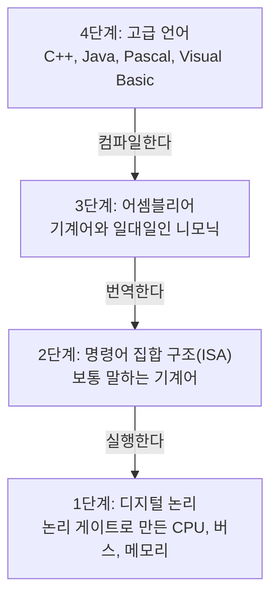



요약

컴퓨터는 여러 층으로 쌓은 건물과 같다. 맨 아래층에는 전기 신호로 움직이는 회로가 있고, 한 층 올라갈 때마다 사람이 쓰기 편한 말이 하나씩 생긴다. 위층의 말로 쓴 프로그램은 바로 아래층의 말로 바뀌어야 움직인다. 덕분에 각 층에서는 바로 아래층만 알면 일할 수 있다. 다만 맨 위층에서 쓴 한 줄이 아래로 내려가며 무엇으로 바뀌는지는 위층에서 보이지 않는다.

## 예시로 보기

프로세서의 회로는 숫자로 된 명령만 알아듣는다. 사람이 숫자 명령을 직접 쓰기는 너무 힘들다. 그래서 사람이 쓰기 편한 말을 새로 만들고, 그 말을 숫자 명령으로 바꿔 줄 방법을 마련한다.

기계가 원래 알아듣는 말을 L0, 그 위에 만든 사람에게 편한 말을 L1이라 하자. L1로 쓴 프로그램을 돌리는 방법은 둘이다[^1].

- **해석 (interpretation).** L0로 쓴 프로그램이 L1 문장을 하나 읽고, 그 문장대로 하고, 다음 문장을 읽는다. 외국어 연설을 통역사가 한 문장씩 옮겨 주는 것과 같다.
- **번역 (translation).** L1 프로그램 전체를 먼저 L0 프로그램으로 바꿔 놓는다. 그 뒤에는 바꿔 놓은 L0 프로그램이 기계에서 바로 돈다. 책 한 권을 통째로 번역해 두는 것과 같다.

"A × B + C를 계산해 찍는다"는 L1 문장 네 줄을 100번 되풀이해 돌려 보면 차이가 보인다. 두 방법 모두 답은 같다. 그런데 해석은 L1 문장을 400번 읽고, 번역은 처음에 4번만 읽는다[^s1].

L1도 쓰기 불편하면 그 위에 L2를 또 만든다. 이렇게 층이 쌓인다. 각 층을 "이 층의 말을 바로 알아듣는 기계가 있다"고 치고 그 기계를 가상 기계라 부른다[^s2]. 진짜 기계는 맨 아래 하나뿐이고, 위층의 기계는 아래층이 해석하거나 번역해 주어서 있는 것처럼 보일 뿐이다.

검증: 같은 L1 프로그램을 해석으로 돌린 결과와 번역해서 돌린 결과가 같음(17), L1 문장을 읽은 횟수 400번 대 4번, 4 → 3 → 2 → 1 순서, 슬라이드의 진리표 세 개 — [02_virtual-machine-levels_verify.py](/Hongs_Blog/studies/assembly-language/code/02_virtual-machine-levels_verify/)

## 네 단계

슬라이드는 실제 컴퓨터를 네 단계로 나눈다[^2].

| 단계 | 이름 | 무엇인가 | 아래로 어떻게 넘어가나 |
|---|---|---|---|
| 4 | 고급 언어 | 응용 프로그램을 짜기 좋은 말. C++, Java, Pascal, Visual Basic | 프로그램을 3단계 어셈블리어로 컴파일한다 |
| 3 | 어셈블리어 | 기계어 명령과 일대일로 짝지은 니모닉 | 2단계 기계어로 번역한다 |
| 2 | 명령어 집합 구조 (ISA) | 프로세서가 알아듣는 명령의 목록. 보통 말하는 기계어(conventional machine language) | 1단계가 실행한다 |
| 1 | 디지털 논리 | 논리 게이트로 만든 CPU, 시스템 버스, 메모리. 그 밑에는 트랜지스터가 있다 | — |

원본 오류 의심

원문: "High-Level Language: Level 4 … Programs compile into assembly language (Level 4)" (2주차 2-1, p.2) / 문제점: 고급 언어 자신이 4단계인데 컴파일한 결과도 4단계라고 적었다. / 수정안: "assembly language (Level 3)". / 근거: 같은 자료 p.1의 그림과 p.3이 어셈블리어를 Level 3으로 적는다. p.3은 같은 꼴의 문장에서 한 단계 아래인 "(Level 2)"를 적는다.

2단계의 이름이 낯설다. 명령어 집합 구조는 "이 프로세서는 이런 명령들을 알아듣는다"는 약속이다. 같은 약속을 지키는 프로세서끼리는 안쪽 회로가 달라도 같은 기계어 프로그램을 돌린다[^s2].

1단계의 부품은 논리 게이트다. 예를 들어 선택 신호 S가 거짓이면 X를, 참이면 Y를 내보내는 부품(2입력 멀티플렉서)은 AND, OR, NOT 게이트로 만든다. 식으로는 $$(Y \wedge S) \vee (X \wedge \neg S)$$다[^3]. 자세한 것은 [불 대수와 논리 회로](/Hongs_Blog/studies/discrete-math/boolean-algebra/)에 있다.

층은 하드웨어일 수도 있고 소프트웨어일 수도 있다[^4]. 1단계는 하드웨어이고, 4단계를 3단계로 바꾸는 컴파일러는 소프트웨어다.

**이 그림이 말해 주지 않는 것.** 모든 고급 언어가 꼭 번역으로만 내려가는 것은 아니다. Java는 실제 프로세서의 기계어가 아니라 가상의 기계를 위한 명령으로 먼저 바뀌고, 그 명령을 다른 프로그램이 해석하거나 번역한다[^s2]: [JVM과 바이트코드](/Hongs_Blog/studies/java/jvm-bytecode/).

## 활용

- 어셈블리어 과목은 3단계에서 일한다. 한 층 위(C++ 문장이 어떤 명령이 되는가)와 한 층 아래(명령이 몇 바이트의 기계어가 되는가)를 함께 본다.
- 흔한 실수: 여기의 단계 번호를 입출력의 단계 번호와 섞는 것. [입출력 접근 수준](/Hongs_Blog/studies/assembly-language/io-access-levels/)도 0~3의 번호를 쓰지만 세는 대상이 다르다. 저쪽은 "화면에 글자를 찍을 때 누구에게 부탁하는가"의 단계다.

## 연결

- 선수: [어셈블리어와 기계어](/Hongs_Blog/studies/assembly-language/assembly-language/)
- 해석과 번역을 프로그래밍 언어 처리기의 눈으로 견준 것: [컴파일과 인터프리트 비교](/Hongs_Blog/studies/compilers/compilation-vs-interpretation/). 4단계에서 3단계로 내려가는 프로그램의 속: [컴파일러의 구조](/Hongs_Blog/studies/compilers/compiler-structure/)
- 3단계에서 2단계로 내려가는 길: [어셈블·링크·실행 과정](/Hongs_Blog/studies/assembly-language/assemble-link-execute/)

## 확인 문제

**C1** 슬라이드의 네 단계를 위에서부터 이름과 함께 쓰고, 각 단계가 바로 아래 단계로 어떻게 넘어가는지 쓰라.

**답:** 4단계 고급 언어 → (컴파일) → 3단계 어셈블리어 → (번역) → 2단계 명령어 집합 구조(기계어) → (실행) → 1단계 디지털 논리. 
**흔한 오답:** 고급 언어가 곧바로 기계어가 된다고 적는 것. 이 그림에서는 어셈블리어를 거친다.

**C2** (가) 프로그램을 돌릴 때마다 원본 문장을 한 줄씩 읽어 그 자리에서 한다. (나) 원본 전체를 미리 아래층의 말로 바꿔 두고, 돌릴 때는 바꿔 둔 것만 쓴다. 각각 해석과 번역 중 무엇인가? 같은 문장을 1,000번 되풀이하는 프로그램에서 원본 문장을 읽는 횟수는 어떻게 다른가?

**답:** (가) 해석, (나) 번역. 해석은 되풀이할 때마다 문장을 다시 읽으므로 1,000번(문장 수만큼 곱해서) 읽는다. 번역은 처음 한 번만 읽는다. 
**이유:** 번역은 바꾸는 일과 돌리는 일을 떼어 놓는다. 해석은 둘을 문장마다 붙여서 한다.

**C3** 층을 여러 개로 나누면 무엇이 편해지는가? 대신 무엇이 가려지는가?

**답:** 각 층에서는 바로 아래층의 말만 알면 된다. C++ 프로그래머는 게이트를 몰라도 되고, 프로세서 설계자는 C++을 몰라도 된다. 대신 위층의 한 줄이 아래에서 몇 개의 명령이 되고 얼마나 걸리는지는 위층에서 보이지 않는다. 그것을 보려고 한 층 내려와 어셈블리어를 읽는다.

[^1]: 어셈블리어 1회 강의 자료 「Chapt_01-1」, p.9 (Virtual Machines: Tanenbaum, language L0·L1, Interpretation, Translation)
[^2]: 어셈블리어 2회 강의 자료 「wk02-chapt_01-2-1」, p.1~5 (Specific Machine Levels 그림, High-Level Language, Assembly Language, Instruction Set Architecture, Digital Logic)
[^3]: 어셈블리어 2회 강의 자료 「wk02-chapt_01-2-2」, p.21 (Truth Tables 3 of 3: Two-input multiplexer)
[^4]: 어셈블리어 2회 강의 자료 「wk02-chapt_01-2-2」, p.22 (Summary: Each layer in a computer's architecture is an abstraction of a machine, layers can be hardware or software)
[^s1]: 보충 통역과 책 번역의 비유, 100번 되풀이 실험과 400번·4번이라는 수, 카드 C2는 슬라이드에 없다. 작은 가상 언어를 파이썬으로 만들어 두 방법을 돌려 확인했다.
[^s2]: 보충 가상 기계라는 말의 풀이, 명령어 집합 구조의 풀이, Java의 예, 그림은 슬라이드에 없다. 슬라이드는 "Tanenbaum: Virtual machine concept"라는 이름과 네 단계의 목록만 적는다. 가상 기계의 풀이는 교재 Irvine, *Assembly Language for x86 Processors* 7판, 1.2절을 따랐다.

