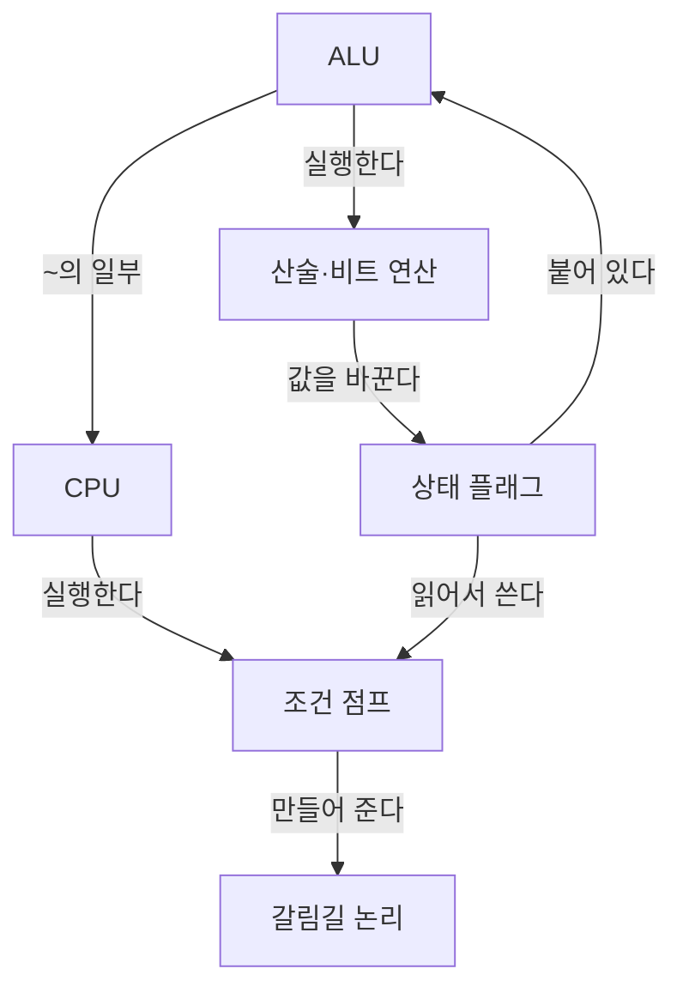


<div class="callout callout-summary" markdown="1">
<div class="callout-title callout-title--default" markdown="span">요약</div>

계산기는 답만 보여 주지만 CPU는 계산할 때마다 답에 대한 쪽지 몇 장을 함께 남긴다. 답이 0인가, 맨 윗자리 비트가 1인가, 칸이 모자라 넘쳤는가. 넘쳤는지는 같은 비트를 음수가 없는 수로 볼 때와 음수가 있는 수로 볼 때 답이 달라서 쪽지가 두 장이다. CPU는 프로그래머가 어느 쪽으로 쓰는지 모르므로 늘 두 장을 다 쓰고, 어느 쪽지를 읽을지는 프로그래머가 고른다. 쪽지는 다음 계산이 덮어쓰므로 필요한 것은 바로 읽어야 한다.

</div>


## 예시로 보기

AL에 FFh를 넣고 1을 더하면 AL은 00h가 된다. 이 계산은 맞았을까?

- FFh를 255로 쓰고 있었다면 255 + 1 = 256인데 0이 나왔다. 틀렸다.
- FFh를 −1로 쓰고 있었다면 −1 + 1 = 0이다. 맞았다.

CPU는 덧셈 회로 하나로 두 경우를 똑같이 계산한다. 부호 있는 수인지 없는 수인지 구별하지 못한다. 알맞은 종류로 쓰는 것은 온전히 프로그래머의 몫이다[^1]. 그래서 CPU는 답과 함께 1비트짜리 표시 여러 개를 남긴다. 이 표시를 상태 플래그라 부른다. 방금 계산에서는 "부호 없는 수로는 넘쳤다"는 표시가 1이 되고 "부호 있는 수로는 넘쳤다"는 표시는 0이 된다.

<div class="callout callout-check" markdown="1">
<div class="callout-title" markdown="span">검증: 슬라이드의 모든 예와 Your turn, 8비트 ADD·SUB 65,536쌍 전수에서 네 플래그가 정의와 맞는 것, 넘침 플래그의 세 정의가 같은 것, "OF = CF XOR MSB"가 틀리는 개수, INC·DEC·NEG의 플래그, 카드 C2·C5. 파이썬 흉내로 확인 — [19_x86-status-flags_verify.py](/Hongs_Blog/studies/assembly-language/code/19_x86-status-flags_verify/)</div>

</div>


## 정의

CPU에서 계산을 맡은 부분(ALU)에는 산술 연산과 비트 연산의 결과를 알려 주는 상태 플래그가 있다. 플래그의 값은 목적지 피연산자에 들어간 결과로 정해진다[^2]. 플래그가 1이면 켜졌다(set), 0이면 꺼졌다(clear)고 말한다[^3].

| 플래그 | 켜지는 때 | 근거 |
|---|---|---|
| 제로 플래그 ZF | 결과가 0이다 | [^3] |
| 부호 플래그 SF | 결과가 음수다. 결과의 맨 윗자리 비트를 그대로 복사한 값이다 | [^4] |
| 올림 플래그 CF | 부호 없는 수로 볼 때 결과가 칸의 범위를 벗어났다(너무 크거나 0보다 작다) | [^5] |
| 넘침 플래그 OF | 부호 있는 수로 볼 때 결과가 칸의 범위를 벗어났다 | [^6] |

`MOV`는 플래그를 바꾸지 않는다[^2].

기호로 쓰면 다음과 같다. 피연산자의 크기를 $$n$$비트라 하자(8, 16, 32 가운데 하나). 두 피연산자의 비트를 부호 없는 수로 읽은 값을 $$a$$, $$b$$라 하고, 같은 비트를 2의 보수로 읽은 값을 $$\hat a$$, $$\hat b$$(에이 햇, 비 햇)라 한다. 결과 $$r$$은 참값을 $$2^n$$으로 나눈 나머지다[^s1].

$$\text{ADD: } r = (a + b) \bmod 2^n, \qquad \text{SUB: } r = (a - b) \bmod 2^n$$


$$\mathrm{ZF} = [\,r = 0\,], \qquad \mathrm{SF} = r\text{의 } (n-1)\text{번 비트}$$


$$\mathrm{CF} = \begin{cases}[\,a + b \ge 2^n\,] & \text{ADD}\\ [\,a < b\,] & \text{SUB}\end{cases} \qquad \mathrm{OF} = [\,\hat a \pm \hat b \notin [-2^{n-1},\ 2^{n-1} - 1]\,]$$


$$[\,\cdot\,]$$는 안의 조건이 참이면 1, 거짓이면 0이다. $$\pm$$는 `ADD`면 더하기, `SUB`면 빼기다. 8비트라면 CF는 "참값이 0~255 밖", OF는 "참값이 −128~127 밖"이다.

### 회로가 정하는 법

덧셈 회로는 부호를 모르므로 올림만 보고 두 플래그를 정한다[^7][^8].

- **`ADD`.** CF는 맨 윗자리 비트 밖으로 나간 올림이다. OF는 "맨 윗자리 비트로 들어온 올림"과 "맨 윗자리 비트에서 나간 올림"이 서로 다를 때 1이다. 8비트라면 6번 비트에서 올라온 올림과 7번 비트에서 나간 올림의 XOR이다.
- **`SUB`.** 빼는 수의 2의 보수를 더한다. CF는 나간 올림을 뒤집은 값이다. OF는 덧셈과 같은 방법으로 정한다.

```
FFh + 01h                          7Fh + 01h
  올림   1 1 1 1 1 1 1 1             올림   0 1 1 1 1 1 1 1
           1 1 1 1 1 1 1 1                    0 1 1 1 1 1 1 1
         + 0 0 0 0 0 0 0 1                  + 0 0 0 0 0 0 0 1
         ─────────────────                  ─────────────────
           0 0 0 0 0 0 0 0                    1 0 0 0 0 0 0 0
들어온 올림 1, 나간 올림 1           들어온 올림 1, 나간 올림 0
CF = 1, OF = 1 XOR 1 = 0            CF = 0, OF = 1 XOR 0 = 1
```

"올림" 줄의 맨 왼쪽 수가 맨 윗자리 밖으로 나간 올림이고, 그 오른쪽 수가 맨 윗자리로 들어온 올림이다[^s1].

<div class="callout callout-warning" markdown="1">
<div class="callout-title" markdown="span">원본 오류 의심</div>

원문: 5주차 슬라이드(05.wk05-chapt_04-3-2.pdf, p.2) "OF = CF XOR MSB" (`ADD`와 `SUB` 모두). / 문제점: MSB를 결과의 맨 윗자리 비트로 읽으면 FFh + 01h에서 CF = 1, 결과 00h의 맨 윗자리 비트 0이라 OF = 1이 나온다. 실제로는 −1 + 1 = 0이라 넘치지 않았고 OF = 0이다. / 수정안: "OF = (맨 윗자리 비트로 들어온 올림) XOR (맨 윗자리 비트에서 나간 올림)". 7주차 슬라이드(07.wk07-chapt_06-3-2.pdf, p.4)의 "bit 7 carry is XORed with bit 6 Carry"가 이 규칙이다. / 근거: 8비트 `ADD` 65,536쌍을 전수 검사했다. MSB를 결과, 목적지, 원본의 맨 윗자리 비트 어느 것으로 읽어도 32,768쌍(절반)에서 틀린다. `SUB`도 같다. 수정안은 `ADD`와 `SUB` 모두 65,536쌍 전부에서 "부호 있는 참값이 −128~127 밖"과 일치한다(19_x86-status-flags_verify.py).

</div>


<div class="callout callout-warning" markdown="1">
<div class="callout-title" markdown="span">원본 오류 의심</div>

원문: 같은 자료 p.5 Example 2에서 주석 "; OF = 1, AL = 80h"가 `mov al,7Fh` 줄에 붙어 있다. / 문제점: `MOV`는 플래그를 바꾸지 않고, 그 줄 뒤의 AL은 7Fh다. / 수정안: 주석은 다음 줄 `add al,1`의 것이다(Example 1과 같은 자리). / 근거: 파이썬 흉내에서 `mov al,7Fh` 뒤 AL = 7Fh, `add al,1` 뒤 AL = 80h, OF = 1.

</div>


`SUB`의 "빼는 수의 2의 보수를 더한다"는 비트를 뒤집은 수와 1을 한꺼번에 더한다는 뜻이다. 빼는 수에 먼저 `NEG`를 해서 얻은 수를 더한다고 글자 그대로 읽으면, 빼는 수가 0일 때 나가는 올림이 없어 CF = 1이 나온다. 실제로는 $$a - 0$$에서 빌려 올 일이 없으니 CF = 0이다[^s2].

### 넘침 플래그의 세 가지 정의

`ADD`에서 다음 셋은 같은 말이다[^s1].

1. 부호 있는 수로 본 참값 $$\hat a + \hat b$$가 범위 밖이다. (위의 정의)
2. 두 피연산자의 부호가 같은데 결과의 부호가 다르다. 양수 둘을 더했는데 음수가 나왔거나, 음수 둘을 더했는데 양수가 나왔다. (슬라이드의 어림 규칙[^9])
3. 맨 윗자리 비트로 들어온 올림과 나간 올림이 다르다. (회로의 규칙[^8])

## 증명

맨 윗자리 한 칸의 덧셈만 보고, 두 피연산자의 부호 비트가 (0, 0), (1, 1), 서로 다름인 세 경우로 나눈다(경우 나누기).

<details class="callout callout-proof" markdown="1">
<summary class="callout-title" markdown="span">증명 펼치기</summary>

맨 윗자리의 두 비트를 $$a_s$$, $$b_s$$, 아래에서 들어온 올림을 $$c_{in}$$, 밖으로 나간 올림을 $$c_{out}$$, 결과의 맨 윗자리 비트를 $$r_s$$라 한다.
1. **한 칸의 덧셈.** $$r_s$$는 $$a_s + b_s + c_{in}$$의 아랫자리이고, $$c_{out}$$은 셋 가운데 둘 이상이 1일 때 1이다. — 한 자리 2진 덧셈
2. **둘 다 0 이상($$a_s = b_s = 0$$).** 1이 될 수 있는 것이 $$c_{in}$$ 하나뿐이라 $$c_{out} = 0$$이고 $$r_s = c_{in}$$이다. 올림이 나가지 않았으니 $$r = a + b = \hat a + \hat b$$다. 이 값이 범위를 넘는 것은 $$2^{n-1}$$ 이상일 때, 곧 $$r_s = 1$$일 때다. 그래서 (넘침) ⟺ ($$r_s = 1$$: 양수 둘의 합이 음수로 보임) ⟺ ($$c_{in} = 1$$) ⟺ ($$c_{in} \ne c_{out}$$). — 1단계, 2의 보수의 범위
3. **둘 다 음수($$a_s = b_s = 1$$).** 1이 이미 둘이라 $$c_{out} = 1$$이고 $$r_s = c_{in}$$이다. $$\hat a = a - 2^n$$, $$\hat b = b - 2^n$$이고 올림이 나갔으니 $$r = a + b - 2^n$$이다. 그래서 $$\hat a + \hat b = r - 2^n$$이다. 이 값이 $$-2^{n-1}$$ 이상인 것은 $$r \ge 2^{n-1}$$, 곧 $$r_s = 1$$일 때다. 그래서 (넘침) ⟺ ($$r_s = 0$$: 음수 둘의 합이 양수로 보임) ⟺ ($$c_{in} = 0$$) ⟺ ($$c_{in} \ne c_{out}$$). — 1단계, 2의 보수로 읽는 법
4. **부호가 다르다.** 음수 쪽을 $$\hat a$$, 0 이상인 쪽을 $$\hat b$$라 하면 $$\hat a \le \hat a + \hat b \le \hat b$$다. 두 끝이 범위 안이므로 합도 범위 안이다. 넘치지 않는다. 한편 맨 윗자리에 1이 하나뿐이라 $$c_{out} = c_{in}$$이다. 정의 1, 2, 3이 모두 "아니다"로 일치한다. — 부등식, 1단계
5. 세 경우 모두에서 세 정의가 같은 답을 낸다. ∎

`SUB`는 $$a + (b\text{의 비트를 뒤집은 수}) + 1$$이라는 덧셈이므로 같은 논증이 통한다. 전수 검사로도 확인했다.

</details>


### 스스로 설명해 보기

<details class="callout callout-question" markdown="1">
<summary class="callout-title" markdown="span">1. 2단계에서 $$c_{out} = 0$$이라고 한 근거</summary>

1단계에서 $$c_{out}$$은 $$a_s$$, $$b_s$$, $$c_{in}$$ 가운데 둘 이상이 1일 때만 1이다. $$a_s = b_s = 0$$이면 1이 많아야 하나라 $$c_{out} = 0$$이다.

</details>


<details class="callout callout-question" markdown="1">
<summary class="callout-title" markdown="span">2. 3단계에서 $$\hat a + \hat b = r - 2^n$$이 나오는 과정</summary>

맨 윗자리 비트가 1인 $$n$$비트 값은 2의 보수로 읽으면 부호 없는 값에서 $$2^n$$을 뺀 것이다. 그래서 $$\hat a + \hat b = a + b - 2^{n+1}$$이다. 올림이 나갔으므로 $$a + b = r + 2^n$$이고, 넣으면 $$r - 2^n$$이다.

</details>


<details class="callout callout-question" markdown="1">
<summary class="callout-title" markdown="span">3. 4단계에서 합이 두 수 사이에 있다고 한 근거</summary>

$$\hat a < 0 \le \hat b$$다. $$\hat a$$에 0 이상인 수를 더하면 $$\hat a$$보다 작아지지 않고, $$\hat b$$에 음수를 더하면 $$\hat b$$보다 커지지 않는다.

</details>


<details class="callout callout-question" markdown="1">
<summary class="callout-title" markdown="span">이 증명의 핵심 아이디어는?</summary>

넘쳤는지는 맨 윗자리 한 칸에서 일어난 일만 보면 안다. 아래 비트들이 한 일은 "들어온 올림" 하나에 다 담겨 있다. 부호 비트의 조합이 셋뿐이라 경우를 다 따질 수 있다.

</details>


<details class="callout callout-question" markdown="1">
<summary class="callout-title" markdown="span">이 방법을 쓸 수 있는 다른 상황은?</summary>

뺄셈(비트를 뒤집어 더하는 덧셈으로 본다)과 16비트, 32비트 계산. 맨 윗자리가 15번, 31번으로 바뀔 뿐 논증은 같다.

</details>


## 예제

**제로 플래그와 부호 플래그.**[^3][^4]

```asm
mov cx,1
sub cx,1         ; CX = 0, ZF = 1
mov ax,0FFFFh
inc ax           ; AX = 0, ZF = 1
inc ax           ; AX = 1, ZF = 0

mov al,0
sub al,1         ; AL = 11111111b, SF = 1
add al,2         ; AL = 00000001b, SF = 0
```

**올림 플래그.** 너무 커도, 0 아래로 내려가도 켜진다[^5].

```asm
mov al,0FFh
add al,1         ; CF = 1, AL = 00
mov al,0
sub al,1         ; CF = 1, AL = FF
```

**넘침 플래그.**[^6][^9]

```asm
mov al,+127
add al,1         ; OF = 1, AL = 80h (127 + 1이 −128로 보인다)

mov al,80h
add al,92h       ; OF = 1  (음수 둘을 더했는데 12h, 양수가 나왔다)
mov al,-2
add al,+127      ; OF = 0  (부호가 다르면 넘치지 않는다)
```

**추적 표.** 슬라이드의 문제에 OF 칸을 더했다[^10][^s3].

| 명령 | 결과 | SF | ZF | CF | OF |
|---|---|---|---|---|---|
| `mov ax,00FFh` | AX = 00FFh | — | — | — | — |
| `add ax,1` | AX = 0100h | 0 | 0 | 0 | 0 |
| `sub ax,1` | AX = 00FFh | 0 | 0 | 0 | 0 |
| `add al,1` | AL = 00h | 0 | 1 | 1 | 0 |
| `mov bh,6Ch` | BH = 6Ch | 그대로 | 그대로 | 그대로 | 그대로 |
| `add bh,95h` | BH = 01h | 0 | 0 | 1 | 0 |
| `mov al,2` | AL = 02h | 그대로 | 그대로 | 그대로 | 그대로 |
| `sub al,3` | AL = FFh | 1 | 0 | 1 | 0 |

`add ax,1`과 `add al,1`은 같은 FFh에 1을 더하지만 칸의 크기가 달라 CF가 다르다. 16비트 칸에서는 0100h가 들어가고, 8비트 칸에서는 넘친다.

**넘침 플래그가 켜지는 예와 꺼지는 예**(8비트)[^s3].

| 계산 | 부호 있는 수로 읽으면 | OF |
|---|---|---|
| 7Fh + 01h = 80h | 127 + 1 = 128 → 범위 밖 | 1 |
| 80h + 80h = 00h | −128 + (−128) = −256 → 범위 밖 | 1 |
| 80h − 01h = 7Fh | −128 − 1 = −129 → 범위 밖 | 1 |
| FFh + 01h = 00h | −1 + 1 = 0 | 0 |
| 02h − 03h = FFh | 2 − 3 = −1 | 0 |

**INC, DEC, NEG.** `INC`와 `DEC`는 ZF, SF, OF를 `ADD 1`, `SUB 1`처럼 바꾸지만 CF는 건드리지 않는다. `NEG`는 값이 0이 아니면 CF를 켜고, 값이 범위에서 가장 작은 음수(8비트에서 −128)일 때 OF를 켠다[^s4].

## 설계 이유

플래그가 "넘쳤다" 하나가 아니라 CF와 OF 둘인 것은 CPU가 수의 종류를 모르기 때문이다. 같은 덧셈 회로의 답 FFh + 01h = 00h가 한쪽 해석에서는 틀리고 다른 쪽에서는 맞다. 종류마다 덧셈 명령을 따로 두는 대신 명령은 하나만 두고, 두 해석 각각에 대한 표시를 다 남긴다. 프로그래머는 자기가 쓰는 해석에 맞는 플래그만 본다.

플래그는 그 자체로 쓰기보다 다음 명령의 갈림길이 된다. 슬라이드의 개념 지도는 이 관계를 그린다[^11].



## 활용

- 플래그를 읽어 갈라지는 명령: [조건 점프](/Hongs_Blog/studies/assembly-language/conditional-jumps/). 값은 바꾸지 않고 플래그만 얻는 명령: [TEST와 CMP](/Hongs_Blog/studies/assembly-language/test-cmp/).
- 7주차의 복습 슬라이드는 플래그를 여섯 개로 정리한다. 위의 넷에 더해 패리티 플래그(결과의 아랫바이트에 1이 짝수 개면 켜진다)와 보조 올림 플래그(3번 비트에서 4번 비트로 올림이 생기면 켜진다)가 있다[^8].
- 결과 값을 구할 때는 16진수로 계산하는 편이 쉽다. 7Fh + 1 = 80h처럼 바로 나온다[^6].
- 흔한 실수: 부호 있는 계산의 넘침을 CF로 확인한다. 어느 플래그를 볼지는 [올림 플래그와 넘침 플래그 비교](/Hongs_Blog/studies/assembly-language/carry-vs-overflow-flag/)에 있다.
- 흔한 실수: 계산과 플래그 확인 사이에 다른 산술 명령을 끼워 넣어 플래그를 덮어쓴다. `MOV`는 끼워도 된다.
- 연습: [플래그 추적 예제 사다리](/Hongs_Blog/studies/assembly-language/flag-tracing-ladder/)

## 연결

- 선수: [덧셈·뺄셈 명령](/Hongs_Blog/studies/assembly-language/add-sub-instructions/), [정수의 2진 표현과 2의 보수](/Hongs_Blog/studies/data-and-information/twos-complement/)
- 플래그가 모여 있는 레지스터: [x86 레지스터](/Hongs_Blog/studies/assembly-language/x86-registers/)
- 한 자리 덧셈의 올림과 XOR: [불 대수와 논리 회로](/Hongs_Blog/studies/discrete-math/boolean-algebra/)
- 자바는 정수가 넘쳐도 아무 표시를 주지 않는다. CPU가 남긴 이 플래그를 언어가 프로그램에 보여 주지 않는 것이다: [연산자와 오버플로](/Hongs_Blog/studies/java/java-operators/)

## 자주 하는 오해

<div class="callout callout-misconception" markdown="1">
<div class="callout-title" markdown="span">"올림 플래그가 켜졌으니 계산 결과가 틀렸다"</div>

틀렸다. 올림 플래그는 "부호 없는 수로 읽으면 범위를 벗어났다"만 말한다. 그럴듯해 보이는 까닭은 손으로 덧셈할 때 맨 앞에서 올림이 나오면 자리가 모자란 것이기 때문이다. 하지만 FFh + 01h를 −1 + 1로 쓰고 있었다면 답 00h는 정확하고, 그때도 CF는 1이다. 부호 있는 계산이 틀렸는지는 OF가 말해 주고, 이 예에서 OF는 0이다. 반대로 7Fh + 01h = 80h는 CF가 0인데도 127 + 1이 −128이 되어 부호 있는 계산으로는 틀렸다. 확인하는 법: 두 피연산자를 자기가 쓰는 해석(부호 있음, 없음)의 10진수로 바꿔 참값을 구하고, 그 해석의 범위 안인지 본다.

</div>


## 확인 문제

<details class="callout callout-question" markdown="1">
<summary class="callout-title" markdown="span">**C1** 제로, 부호, 올림, 넘침 플래그가 각각 언제 켜지는지 쓰라. 넷 가운데 "부호 없는 수"와 "부호 있는 수"라는 말이 꼭 들어가야 하는 둘은 무엇인가?</summary>

**답:** ZF: 결과가 0. SF: 결과의 맨 윗자리 비트가 1(음수). CF: 부호 없는 수로 볼 때 결과가 범위 밖. OF: 부호 있는 수로 볼 때 결과가 범위 밖. 해석을 밝혀야 하는 둘은 CF와 OF다.<br>
**이유:** "넘쳤다"는 말은 어느 범위를 기준으로 하느냐에 따라 달라진다. 8비트에서 CF의 범위는 0~255, OF의 범위는 −128~127이다.

</details>


<details class="callout callout-question" markdown="1">
<summary class="callout-title" markdown="span">**C2** 다음을 차례로 실행한다. 표시한 줄마다 AL과 ZF, SF, CF, OF를 쓰라. `mov al,0F0h` / `add al,20h` (가) / `sub al,11h` (나) / `add al,1` (다) / `mov al,90h` (라) / `sub al,20h` (마)</summary>

**답:** (가) AL = 10h, ZF 0, SF 0, CF 1, OF 0. (나) AL = FFh, ZF 0, SF 1, CF 1, OF 0. (다) AL = 00h, ZF 1, SF 0, CF 1, OF 0. (라) AL = 90h, 플래그는 (다) 그대로(ZF 1, SF 0, CF 1, OF 0). (마) AL = 70h, ZF 0, SF 0, CF 0, OF 1.<br>
**이유:** (가) F0h + 20h = 110h. 부호 없이 240 + 32 = 272로 범위 밖, 부호 있게 −16 + 32 = 16으로 범위 안. (나) 10h − 11h는 16 − 17이라 빌림이 생긴다. (다) FFh + 1 = 100h. (라) `MOV`는 플래그를 바꾸지 않는다. 여기서 ZF를 0으로 답하기 쉽다. (마) 90h − 20h = 70h. 부호 없이 144 − 32 = 112로 범위 안, 부호 있게 −112 − 32 = −144로 범위 밖.

</details>


<details class="callout callout-question" markdown="1">
<summary class="callout-title" markdown="span">**C3** CPU가 덧셈 한 번마다 CF와 OF를 둘 다 계산해 두는 이유를 쓰라.</summary>

**답:** CPU는 피연산자가 부호 있는 수인지 없는 수인지 구별하지 못한다. 같은 비트 계산이 한 해석에서는 넘치고 다른 해석에서는 안 넘칠 수 있으므로 두 해석의 판정을 모두 남기고, 프로그래머가 자기 해석에 맞는 쪽을 읽게 한다.

</details>


<details class="callout callout-question" markdown="1">
<summary class="callout-title" markdown="span">**C4** "부호가 다른 두 수를 더하면 넘침 플래그는 절대 켜지지 않는다"의 근거를 대라.</summary>

**답:** 음수 $$\hat a$$와 0 이상인 $$\hat b$$를 더한 값은 $$\hat a$$ 이상 $$\hat b$$ 이하다. 두 수가 범위 안이므로 그 사이에 있는 합도 범위 안이다.<br>
**이유:** 넘침은 참값이 범위 밖으로 나가는 것인데, 반대 방향의 두 수는 서로를 범위 안쪽으로 끌어당긴다. 회로로 보면 맨 윗자리에 1이 하나뿐이라 들어온 올림과 나간 올림이 같아진다.

</details>


<details class="callout callout-question" markdown="1">
<summary class="callout-title" markdown="span">**C5** "넘침 플래그 = 올림 플래그 XOR 결과의 맨 윗자리 비트"가 틀렸음을 보이는 8비트 덧셈을 하나 들고, 맞는 규칙을 쓰라.</summary>

**답:** FFh + 01h. CF = 1, 결과 00h의 맨 윗자리 비트 0이라 규칙은 OF = 1을 내지만, −1 + 1 = 0이라 실제 OF는 0이다. 맞는 규칙은 "맨 윗자리 비트로 들어온 올림 XOR 맨 윗자리 비트에서 나간 올림"이다.<br>
**이유:** 이 덧셈에서는 들어온 올림도 1, 나간 올림도 1이라 XOR이 0이다. 틀린 규칙은 65,536쌍 가운데 절반에서 어긋난다.

</details>


[^1]: 어셈블리어 5회 강의 자료 「wk05-chapt_04-3-2」, p.1 (Signed and Unsigned Integers: A Hardware Viewpoint)
[^2]: 어셈블리어 5회 강의 자료 「wk05-chapt_04-3-1」, p.11 (Flags Affected by Arithmetic: ALU, 네 플래그, MOV는 플래그를 바꾸지 않는다)
[^3]: 같은 자료, p.13 (Zero Flag, "A flag is set when it equals 1 / clear when it equals 0")
[^4]: 같은 자료, p.14 (Sign Flag: 목적지의 맨 윗자리 비트의 복사)
[^5]: 어셈블리어 5회 강의 자료 「wk05-chapt_04-3-2」, p.3 (Carry Flag)
[^6]: 같은 자료, p.5 (Overflow Flag: Example 1, 2, 16진수로 계산하면 쉽다)
[^7]: 같은 자료, p.2 (Overflow and Carry Flags: A Hardware Viewpoint. CF = carry out of the MSB, SUB는 CF = INVERT)
[^8]: 어셈블리어 7회 강의 자료 「wk07-chapt_06-3-2」, p.4 (Status Flags - Review: 여섯 플래그, "bit 7 carry is XORed with bit 6 Carry")
[^9]: 어셈블리어 5회 강의 자료 「wk05-chapt_04-3-2」, p.6 (A Rule of Thumb: 80h + 92h는 OF = 1, −2 + 127은 OF = 0)
[^10]: 같은 자료, p.4 (Your turn: 결과와 SF, ZF, CF)
[^11]: 어셈블리어 5회 강의 자료 「wk05-chapt_04-3-1」, p.12 (Concept Map)
[^s1]: <span class="fn-tag" title="수업 자료에 없고 따로 보탠 내용">보충</span> 기호로 쓴 정의, 올림을 적은 세로셈 그림, 넘침 플래그의 세 정의가 같다는 정리와 증명, 스스로 설명해 보기는 원본에 없다. 슬라이드의 말로 된 정의(5주차 p.5~6, 7주차 p.4)를 식으로 옮겼다. 증명은 단계별로 점검했고, 8비트 `ADD`·`SUB` 65,536쌍 전수와 16비트 표본에서 세 정의가 일치하는 것을 파이썬 흉내로 확인했다. 실제 CPU나 어셈블러로 돌린 결과가 아니다.
[^s2]: <span class="fn-tag" title="수업 자료에 없고 따로 보탠 내용">보충</span> 슬라이드 p.2의 "negate the source and add it to the destination"을 글자 그대로 따르면 빼는 수가 0인 256쌍에서 CF가 반대로 나온다. 비트를 뒤집은 수와 1을 함께 더하는 것으로 계산하면 65,536쌍 전부에서 맞는다(검증 코드).
[^s3]: <span class="fn-tag" title="수업 자료에 없고 따로 보탠 내용">보충</span> 추적 표의 OF 칸과 `mov` 줄, 넘침 플래그가 켜지는 예와 꺼지는 예 표, 설계 이유, 오해 항목, 카드 C1~C5는 원본에 없다. 값은 파이썬 흉내로 확인했다.
[^s4]: <span class="fn-tag" title="수업 자료에 없고 따로 보탠 내용">보충</span> `INC`·`DEC`가 CF를 바꾸지 않는다는 것과 `NEG`의 CF·OF는 슬라이드에 없다. Intel 64 and IA-32 Architectures Software Developer's Manual, Volume 2의 INC, DEC, NEG 항목에 있다. 흉내기는 이 규칙대로 만들었고, `INC`·`DEC`의 나머지 플래그가 `ADD 1`·`SUB 1`과 같은지를 8비트 전수로 확인했다.

