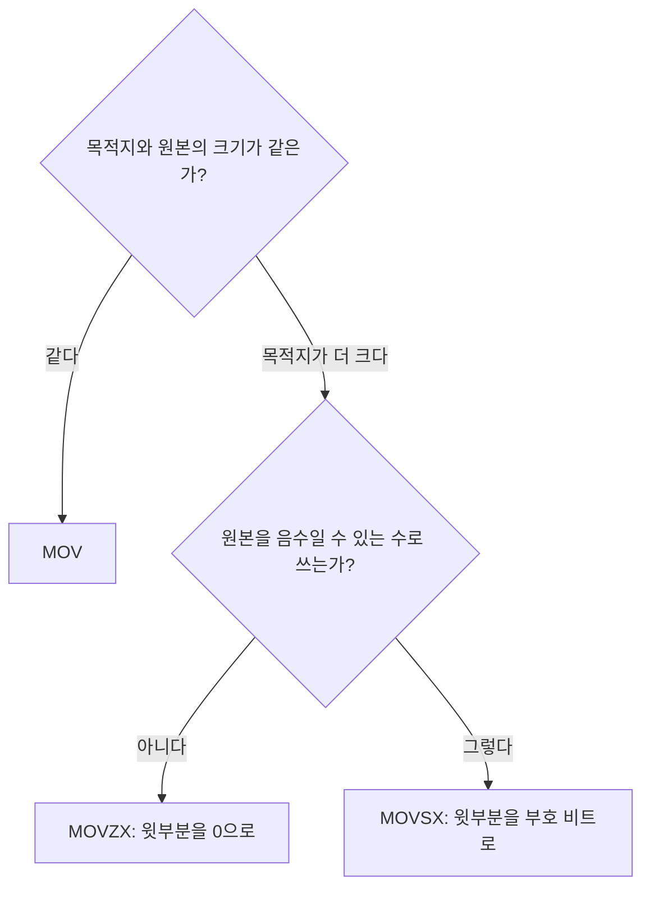


<div class="callout callout-summary" markdown="1">
<div class="callout-title callout-title--default" markdown="span">요약</div>

작은 칸의 값을 큰 칸으로 옮기면 큰 칸의 윗부분이 남는다. 그 빈자리를 무엇으로 채우느냐가 문제다. 음수가 없는 수라면 0으로 채우면 값이 그대로다. 음수일 수도 있는 수라면 맨 윗자리 비트를 복사해 채워야 값이 그대로다. 같은 비트라도 어느 쪽으로 채우느냐에 따라 전혀 다른 수가 되므로, 원래 값이 어떤 종류의 수였는지를 프로그래머가 알고 골라야 한다.

</div>


## 예시로 보기

BL에 든 8비트 값을 AX(16비트)로 옮기고 싶다. `mov ax,bl`은 크기가 달라 오류다. 그러면 AX의 윗바이트는 어떻게 될까? 그대로 두면 예전에 쓰던 값이 남아 엉뚱한 수가 된다. 채울 값을 정해야 한다.

BL = `10001111`(8Fh)로 두 가지를 해 본다.

```
                         원본 BL        10001111

제로 확장  movzx ax,bl    00000000  10001111     AX = 008Fh
부호 확장  movsx ax,bl    11111111  10001111     AX = FF8Fh
                         └ 채운 곳 ┘ └ 복사한 곳 ┘
```

8Fh를 부호 없는 수로 읽으면 143, 부호 있는 수로 읽으면 −113이다. 008Fh는 143이고, FF8Fh는 16비트 부호 있는 수로 −113이다. 제로 확장은 143을, 부호 확장은 −113을 지켰다[^s1].

<div class="callout callout-check" markdown="1">
<div class="callout-title" markdown="span">검증: 예시의 008Fh와 FF8Fh, 8비트 값 256개 모두에서 MOVZX는 부호 없는 값을 지키고 MOVSX는 부호 있는 값을 지키는 것(16비트·32비트로), 16비트 표본, 카드 C1·C3. 파이썬 흉내로 확인 — [17_zero-sign-extension_verify.py](/Hongs_Blog/studies/assembly-language/code/17_zero-sign-extension_verify/)</div>

</div>


## 정의

**제로 확장.** 작은 값을 큰 목적지에 복사할 때 `MOVZX`는 목적지의 윗부분을 0으로 채운다.

**부호 확장.** `MOVSX`는 목적지의 윗부분을 원본의 부호 비트(맨 윗자리 비트)를 복사해 채운다.

두 명령 모두 목적지는 레지스터여야 한다.

기호로 쓰면, 원본이 $$m$$비트 값 $$x$$이고 목적지가 $$n$$비트($$n > m$$)일 때 다음과 같다. $$s$$는 $$x$$의 맨 윗자리 비트(0 또는 1)다[^s1].

$$\text{MOVZX: } x \;\longmapsto\; x, \qquad \text{MOVSX: } x \;\longmapsto\; x + s \cdot (2^n - 2^m)$$


$$2^n - 2^m$$은 $$m$$번 비트부터 $$n - 1$$번 비트까지를 모두 1로 채운 수다. 8비트를 16비트로 넓히면 $$2^{16} - 2^8$$ = FF00h다. 8Fh는 $$s = 1$$이라 8Fh + FF00h = FF8Fh가 된다.

### 적용 조건과 고르는 법

- 크기가 다른 두 곳 사이에서 값을 옮길 때 쓴다. 크기가 같으면 `MOV`다.
- 원본을 음수가 없는 수(개수, 크기, 글자 코드)로 쓰고 있으면 `MOVZX`.
- 원본을 음수일 수 있는 수(차이, 온도, 좌표 변화량)로 쓰고 있으면 `MOVSX`.



## 예제

**부호 비트를 복사하면 왜 값이 그대로인가.**

<details class="callout callout-note" markdown="1">
<summary class="callout-title" markdown="span">유도 과정</summary>

8비트 2의 보수에서 맨 윗자리(7번 비트)의 자릿값은 $$-2^7$$이다. 나머지 비트의 자릿값은 양수다.<br>
16비트로 넓힌 뒤에는 맨 윗자리가 15번 비트가 되어 자릿값이 $$-2^{15}$$이고, 7번부터 14번 비트는 자릿값이 양수 $$2^7, \dots, 2^{14}$$이다.<br>
부호 비트가 1이면 7번부터 15번까지 모두 1이 된다. 그 합은

$$-2^{15} + (2^{14} + 2^{13} + \cdots + 2^{7}) = -2^{15} + (2^{15} - 2^{7}) = -2^{7}$$

이다. 원래 7번 비트 혼자 내던 값 $$-2^7$$과 같다. 아래 0~6번 비트는 그대로이므로 전체 값도 그대로다.<br>
부호 비트가 0이면 채운 비트가 모두 0이라 더해지는 것이 없다. ∎

</details>


**잘못 고르면.** 나이 200을 `BYTE`에 넣어 두었다(C8h). `movsx eax,bl`로 넓히면 EAX는 FFFFFFC8h, 곧 −56이 된다. 반대로 기온 −5(FBh)를 `movzx eax,bl`로 넓히면 251이 된다[^s1].

## 활용

- `MOVZX`가 없으면 두 줄이 든다. 큰 레지스터를 먼저 0으로 만들고 아랫부분만 채운다: `mov eax,0` 다음에 `mov al,bl`[^s1].
- 부호 비트가 0인 값(0~127)은 어느 쪽으로 넓혀도 결과가 같다. 차이는 부호 비트가 1일 때만 난다.
- 자바가 `byte`를 `int`로 넓힐 때 하는 일이 부호 확장이다: [타입 변환](/Hongs_Blog/studies/java/java-type-conversion/)[^s1].
- 오른쪽으로 밀 때 빈 윗자리를 0으로 채우느냐 부호 비트로 채우느냐도 같은 갈림이다: [논리 시프트와 산술 시프트 비교](/Hongs_Blog/studies/assembly-language/logical-vs-arithmetic-shift/).

## 연결

- 선수: [데이터 전송 명령](/Hongs_Blog/studies/assembly-language/data-transfer-instructions/)(크기가 다르면 `MOV`가 안 된다), [정수의 2진 표현과 2의 보수](/Hongs_Blog/studies/data-and-information/twos-complement/)(맨 윗자리의 자릿값이 음수다)
- AL, AX, EAX가 한 레지스터의 일부라는 것: [x86 레지스터](/Hongs_Blog/studies/assembly-language/x86-registers/)

## 확인 문제

<details class="callout callout-question" markdown="1">
<summary class="callout-title" markdown="span">**C1** BL이 7Fh일 때와 F0h일 때, `movzx ax,bl`과 `movsx ax,bl` 뒤의 AX를 각각 쓰라.</summary>

**답:** 7Fh: 둘 다 007Fh. F0h: `movzx`는 00F0h, `movsx`는 FFF0h.<br>
**이유:** 7Fh는 맨 윗자리 비트가 0이라 둘 다 0으로 채운다. F0h는 맨 윗자리 비트가 1이라 `movsx`가 윗바이트를 모두 1로 채운다.

</details>


<details class="callout callout-question" markdown="1">
<summary class="callout-title" markdown="span">**C2** 8비트 음수를 16비트로 부호 확장하면 7번부터 15번 비트가 모두 1이 된다. 이 아홉 비트의 값을 더하면 원래 7번 비트의 값 $$-2^7$$과 같다는 것을 식으로 보여라.</summary>

**답:** $$-2^{15} + (2^{14} + \cdots + 2^{7}) = -2^{15} + (2^{15} - 2^{7}) = -2^{7}$$.<br>
**이유:** 16비트에서 15번 비트만 자릿값이 음수이고 나머지는 양수다. $$2^7$$부터 $$2^{14}$$까지의 합은 $$2^{15} - 2^7$$이라, 새 부호 비트의 $$-2^{15}$$과 더하면 $$-2^7$$만 남는다.

</details>


<details class="callout callout-question" markdown="1">
<summary class="callout-title" markdown="span">**C3** (a) 나이 200이 든 `BYTE` 변수를 EAX로 넓힌다. (b) 기온 −5가 든 `SBYTE` 변수를 EAX로 넓힌다. 각각 어느 명령을 쓰는가? 반대로 쓰면 EAX는 얼마가 되는가?</summary>

**답:** (a) `MOVZX`. `MOVSX`를 쓰면 −56. (b) `MOVSX`. `MOVZX`를 쓰면 251.<br>
**이유:** 200은 C8h로 맨 윗자리 비트가 1이다. 부호 확장하면 이 비트를 음수 표시로 읽어 $$200 - 256 = -56$$이 된다. −5는 FBh이고, 0으로 채우면 부호 없는 수 251로 읽힌다.

</details>


[^s1]: 8비트 값 256개 모두에서 파이썬 흉내로 확인했다. 실제 어셈블러로 돌린 결과가 아니다.

