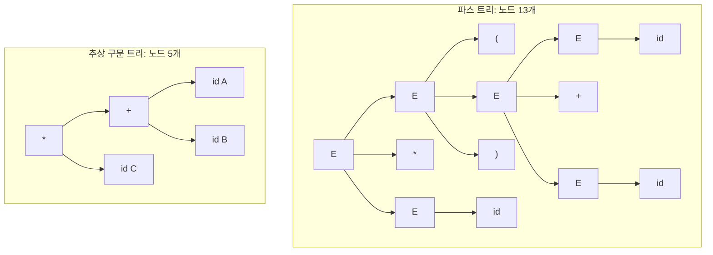


<div class="callout callout-summary" markdown="1">
<div class="callout-title callout-title--default" markdown="span">요약</div>

문법대로 그린 나무에서 뒤 단계에 쓸모없는 가지를 쳐 내고 뼈대만 남긴 나무다. 괄호처럼 묶음을 알려 주려고 있던 기호는 나무 모양에 이미 드러나 있으니 지우고, 거쳐 가기만 하는 마디도 지운다. 남는 것은 "무슨 연산을 무엇과 무엇에 하는가"뿐이다. 훨씬 작고 다루기 쉬워서 컴파일러의 뒤 단계는 모두 이 나무를 받아 일한다. 무엇을 남길지는 문법의 규칙마다 사람이 정해 준다.

</div>


## 예시로 보기

[파스 트리](/Hongs_Blog/studies/compilers/derivation-parse-tree/)는 유도 과정을 빠짐없이 담는다. 그런데 뒤 단계(타입 검사, 코드 만들기)가 알고 싶은 것은 "무엇과 무엇을 더하고, 그 결과에 무엇을 곱하는가"다. 유도를 몇 걸음에 했는지, 괄호가 어디 있었는지는 필요 없다.

입력 $$(A + B) * C$$는 어휘 분석을 거쳐 $$(id + id) * id$$가 된다. 문법 $$E \to E + E \mid E * E \mid (E) \mid id$$로 그린 파스 트리가 왼쪽이고, 줄인 나무가 오른쪽이다[^1].



오른쪽 나무에는 괄호가 없다. 그래도 $$+$$가 $$*$$의 자식이라는 모양만으로 덧셈을 먼저 한다는 것을 안다. 슬라이드는 파스 트리가 유도 순서와 겹친 구조를 다 담지만 정보가 너무 많다고 하고, 줄인 나무는 겹친 구조(핵심 문법 정보)만 담아 더 작고 쓰기 쉽다고 적는다[^2].

<div class="callout callout-check" markdown="1">
<div class="callout-title" markdown="span">검증: $$(id + id) * id$$의 파스 트리가 노드 13개, 줄인 나무가 5개인 것, 세 가지 노드를 지우는 방법과 의미 동작으로 만드는 방법이 같은 나무를 내는 것, while 문 예의 나무 — [16_abstract-syntax-tree_impl.py](/Hongs_Blog/studies/compilers/code/16_abstract-syntax-tree_impl/)</div>

</div>


## 무엇을 지우는가

추상 구문 트리(AST)는 파스 트리와 닮았지만 파싱에만 쓰이는 세부를 뺀 나무다. 지울 수 있는 노드는 세 가지다[^3].

| 단계 | 지우는 것 | 까닭 | 위 예에서 |
|---|---|---|---|
| 1 | 자식이 딱 하나인 노드 | 관심 있는 것은 그 자식이지 거쳐 가는 부모가 아니다 | $$E$$ 아래 $$id$$ 하나만 달린 세 곳을 $$id$$로 바꾼다 |
| 2 | 문법 세부를 적는 기호(괄호, 쉼표) | 묶음은 나무 모양이 이미 말해 준다 | `(`와 `)`를 지운다. 자식이 하나가 된 $$E$$도 다시 지운다 |
| 3 | 연산자와 그 인자들을 자식으로 둔 비단말 기호 | 연산자를 부모 자리에 올리면 비단말 기호는 필요 없다 | $$E$$ 아래 $$id + id$$를 "$$+$$ 아래 $$id$$, $$id$$"로 바꾼다 |

**표현 불변식.** 다 줄인 식의 AST에서는 잎이 모두 피연산자($$id$$와 그 이름)이고, 잎이 아닌 노드가 모두 연산자다. 비단말 기호와 괄호는 하나도 남지 않는다[^s1].

<div class="callout callout-warning" markdown="1">
<div class="callout-title" markdown="span">원본 오류 의심</div>

원문: p.54 "AST for $$(id * id) + id$$ describes …" / 문제점: 같은 쪽 그림은 뿌리가 $$*$$이고 그 왼쪽 자식이 $$+$$인 나무다. 이것은 $$(id + id) * id$$의 AST다. $$(id * id) + id$$라면 뿌리가 $$+$$여야 한다. / 수정안: 제목의 식을 $$(id + id) * id$$로 읽는다. / 근거: 앞 쪽(p.49~53)이 줄곧 $$(id + id) * id$$를 줄여 온 결과가 이 그림이다. 검증 코드에서 두 식의 AST를 만들어 뿌리가 각각 $$*$$와 $$+$$로 다름을 확인했다.

</div>


## 만드는 법: 의미 동작

파스 트리를 다 그린 뒤에 깎는 것이 아니다. 문법의 생성 규칙마다 "이 규칙을 쓸 때 할 일"을 붙여 두고, 파싱하면서 바로 AST를 짓는다. 규칙에 붙인 이 동작을 의미 동작(semantic action)이라 한다. 의미 동작은 AST를 지을 때뿐 아니라 타입 검사, 코드 만들기에도 쓴다[^4].

| 생성 규칙 | 의미 동작 |
|---|---|
| $$E \to E_1 + E_2$$ | $$E.node = new\ Node('+',\ E_1.node,\ E_2.node)$$ |
| $$E \to E_1 * E_2$$ | $$E.node = new\ Node('*',\ E_1.node,\ E_2.node)$$ |
| $$E \to (E_1)$$ | $$E.node = E_1.node$$ |
| $$E \to id$$ | $$E.node = new\ Leaf(id,\ id.value)$$ |

$$E.node$$는 "이 $$E$$가 가리키는 AST 노드"다. 아래 첨자 1, 2는 같은 $$E$$가 규칙에 여러 번 나와서 구별하려고 붙인 번호다. $$Node$$는 연산자와 자식들을 받아 안쪽 노드를 만들고, $$Leaf$$는 토큰 종류와 그 값(변수 이름)을 받아 잎을 만든다.

세 가지 지우기가 이 표에 그대로 들어 있다. 셋째 줄은 괄호 규칙에서 새 노드를 만들지 않고 안쪽 것을 그대로 넘긴다(2단계). 첫째·둘째 줄은 $$E$$ 대신 연산자를 노드로 만든다(3단계). 넷째 줄은 $$E$$를 거치지 않고 바로 잎을 만든다(1단계)[^s1].

$$(id + id) * id$$의 좌측 유도를 따라가면 나무가 위에서부터 자란다[^5].

| 유도 걸음 | 쓴 규칙 | AST에 생기는 것 |
|---|---|---|
| $$E \Rightarrow_{lm} E * E$$ | $$E \to E_1 * E_2$$ | 뿌리 $$*$$. 두 자식 자리는 아직 비어 있다 |
| $$\Rightarrow_{lm} (E) * E$$ | $$E \to (E_1)$$ | 아무것도 생기지 않는다. 왼쪽 자식 자리를 안쪽 $$E$$가 그대로 물려받는다 |
| $$\Rightarrow_{lm} (E + E) * E$$ | $$E \to E_1 + E_2$$ | 뿌리의 왼쪽 자식으로 $$+$$ |
| $$\Rightarrow_{lm}^* (id + id) * id$$ | $$E \to id$$ 세 번 | 잎 $$id\ A$$, $$id\ B$$, $$id\ C$$ |

## 예제

**while 문의 AST.** 문법은 $$S \to while(C)\{B\}$$, $$\ C \to id\ comp\ id$$, $$\ B \to type\ id; \mid id();$$이다[^6].

| 생성 규칙 | 의미 동작 |
|---|---|
| $$S \to while(C)\{B\}$$ | $$S.node = new\ Node('while',\ C.node,\ B.node)$$ |
| $$C \to id_1\ comp\ id_2$$ | $$C.node = new\ Node('cond',\ new\ Node('comp',\ comp.value,\ new\ Leaf(id_1, id_1.value),\ new\ Leaf(id_2, id_2.value)))$$ |
| $$B \to type\ id;$$ | $$B.node = new\ Node('block',\ new\ Node('declaration',\ new\ Leaf(type, type.value),\ new\ Leaf(id, id.value)))$$ |
| $$B \to id();$$ | $$B.node = new\ Node('block',\ new\ Node('call',\ new\ Leaf(id, id.value)))$$ |

`while (leftVar < rightVar) { int a; }`의 AST를 짓는다.

1. *어휘 분석:* $$while(id\ comp\ id)\{type\ id;\}$$
2. *유도:* $$S \Rightarrow_{lm} while(C)\{B\} \Rightarrow_{lm} while(id\ comp\ id)\{B\} \Rightarrow_{lm} while(id\ comp\ id)\{type\ id;\}$$
3. *규칙마다 의미 동작:* 첫 걸음에서 뿌리 `while`, 둘째 걸음에서 조건 가지, 셋째 걸음에서 몸통 가지가 생긴다[^s2].

```
while
├── cond
│   └── comp  <
│       ├── id  leftVar
│       └── id  rightVar
└── block
    └── declaration
        ├── type  int
        └── id  a
```

괄호 `( )`, 중괄호 `{ }`, 쌍반점 `;`은 나무에 없다. 이 예에서는 `cond`, `block`처럼 문법에 없던 이름표를 사람이 붙였다. AST에 무엇을 남기고 어떤 이름을 붙일지는 의미 동작을 쓰는 사람이 정한다.

## 활용

- **구문 분석기의 출력.** 구문 분석기는 토큰열이 문법에 맞으면 파스 트리를 거쳐 AST를 내놓는다. 이 AST가 [의미 분석](/Hongs_Blog/studies/compilers/semantic-analysis/)과 중간 코드 생성의 입력이다[^7].
- **중간 코드로.** 11회 강의는 AST의 정의와 의미 동작을 다시 짚은 뒤, AST를 돌며 [3주소 코드](/Hongs_Blog/studies/compilers/three-address-code/)를 만든다[^8]. 자식을 먼저 처리하고 부모를 나중에 처리하는 순서(후위 순회)가 곧 계산 순서다. $$(A + B) * C$$의 AST를 그렇게 읽으면 $$A,\ B,\ +,\ C,\ *$$다([AST에서 3주소 코드 만들기](/Hongs_Blog/studies/compilers/ast-to-tac/))[^s3].
- **문법이 달라도 AST는 같다.** 모호함을 없앤 문법 $$E \to T + E \mid T$$, $$T \to F * T \mid F$$, $$F \to (E) \mid id$$로 같은 입력의 파스 트리를 그리면 노드가 18개로 늘지만, 줄인 AST는 똑같이 5개짜리다. 문법을 파서에 맞게 고쳐 쓰느라 생긴 $$T$$, $$F$$, $$E'$$ 같은 마디가 AST에서는 사라진다[^s3].
- **흔한 실수.** 괄호를 지웠으니 우선순위 정보도 사라졌다고 생각한다. 우선순위는 나무의 깊이로 남아 있다. 아래쪽 노드가 먼저 계산된다.

## 연결

- 선수: [유도와 파스 트리](/Hongs_Blog/studies/compilers/derivation-parse-tree/)
- 나무 모양이 뜻을 정하므로 문법이 모호하면 AST도 둘이 된다: [모호한 문법](/Hongs_Blog/studies/compilers/ambiguous-grammar/)
- 나무를 도는 순서: [트리 순회와 이진 탐색 트리](/Hongs_Blog/studies/algorithms/tree-traversal-bst/)
- AST를 받아 하는 일: [타입 검사 절차](/Hongs_Blog/studies/compilers/type-checking-procedure/), [AST에서 3주소 코드 만들기](/Hongs_Blog/studies/compilers/ast-to-tac/)

## 확인 문제

<details class="callout callout-question" markdown="1">
<summary class="callout-title" markdown="span">**C1** 파스 트리에서 지워 AST를 만드는 세 가지 노드를 쓰라.</summary>

**답:** ① 자식이 딱 하나인 노드 ② 괄호·쉼표처럼 문법 세부를 적는 기호 ③ 연산자와 그 인자들을 자식으로 둔 비단말 기호(연산자를 부모 자리로 올린다).<br>
**이유:** 셋 다 묶이는 구조를 알려 주는 데 필요 없는 것이다. 흔한 오답은 ②에서 연산자 $$+$$, $$*$$까지 지우는 것이다. 연산자는 남아서 안쪽 노드가 된다.

</details>


<details class="callout callout-question" markdown="1">
<summary class="callout-title" markdown="span">**C2** 문법 $$E \to T + E \mid T$$, $$T \to F * T \mid F$$, $$F \to (E) \mid id$$로 $$id * id + id$$(이름은 차례로 A, B, C)를 파싱했다. AST를 그려라.</summary>

**답:** 뿌리가 $$+$$다. 왼쪽 자식은 $$*$$이고 그 자식이 $$id\ A$$, $$id\ B$$다. 오른쪽 자식은 $$id\ C$$다.<br>
**이유:** 이 문법은 곱셈을 먼저 묶으므로 $$*$$가 $$+$$보다 아래에 온다. $$T$$, $$F$$는 자식이 하나이거나 연산자를 올리고 나면 사라진다[^s3].

</details>


<details class="callout callout-question" markdown="1">
<summary class="callout-title" markdown="span">**C3** AST에는 괄호가 없는데 $$(A + B) * C$$와 $$A + B * C$$를 어떻게 구별하는가?</summary>

**답:** 나무 모양이 다르다. 앞의 것은 뿌리가 $$*$$이고 $$+$$가 그 자식이다. 뒤의 것은 뿌리가 $$+$$이고 $$*$$가 그 자식이다. 아래쪽 노드를 먼저 계산하므로 괄호가 하던 일을 깊이가 대신한다.

</details>


<details class="callout callout-question" markdown="1">
<summary class="callout-title" markdown="span">**C4** 의미 동작 표에서 $$E \to (E_1)$$의 동작이 $$E.node = E_1.node$$인 것은 세 가지 지우기 가운데 어느 것을 옮긴 것인가?</summary>

**답:** 둘째(문법 세부를 적는 기호 지우기)다. 괄호 규칙에서 새 노드를 만들지 않고 안쪽 식의 노드를 그대로 넘기므로 괄호가 나무에 남지 않는다.

</details>


[^1]: 컴파일러 4회 강의 자료 「Lecture04 Syntax analysis part 1」, p.49~53 (입력 $$(A + B) * C$$, 파스 트리에서 AST까지)
[^2]: 같은 자료, p.50, p.54 (정보가 너무 많다, 더 작고 쓰기 쉽다)
[^3]: 같은 자료, p.51~53, p.61 (지울 수 있는 세 가지 노드)
[^4]: 같은 자료, p.55, p.61 (의미 동작의 정의와 표)
[^5]: 같은 자료, p.56~59 (유도 걸음마다 자라는 AST)
[^6]: 같은 자료, p.60 (while 문의 문법과 의미 동작)
[^7]: 같은 자료, p.62 (토큰열 → 파스 트리 → AST)
[^8]: 컴파일러 11회 강의 자료 「Lecture11 Intermediate code generation」, p.7~9 (AST 다시 보기, $$id * id$$의 예)
[^s1]: <span class="fn-tag" title="수업 자료에 없고 따로 보탠 내용">보충</span> 표현 불변식과, 의미 동작 표의 각 줄이 세 가지 지우기의 어느 것인지 짝지은 설명은 원본에 없다. 구현 코드에서 "세 단계로 깎은 나무 = 의미 동작으로 지은 나무"를 확인했다.
[^s2]: <span class="fn-tag" title="수업 자료에 없고 따로 보탠 내용">보충</span> 슬라이드 p.60은 문법, 의미 동작, 유도까지만 적고 완성된 나무는 그리지 않았다. 의미 동작을 그대로 따라가 그렸고 구현 코드로 확인했다.
[^s3]: <span class="fn-tag" title="수업 자료에 없고 따로 보탠 내용">보충</span> 후위 순회로 읽은 순서, 모호함을 없앤 문법의 파스 트리 노드 수(18), 카드 C2는 원본에 없다. 구현 코드로 확인했다.

