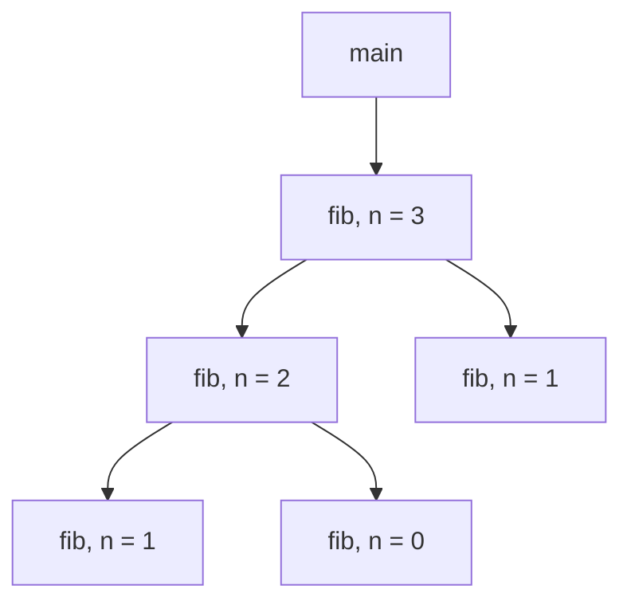


<div class="callout callout-summary" markdown="1">
<div class="callout-title callout-title--default" markdown="span">요약</div>

전화를 받다가 다른 전화가 오면 먼저 통화를 잠깐 세워 두고, 나중 전화가 끝나야 먼저 통화로 돌아간다. 함수도 그렇다. 부른 함수는 불린 함수가 끝날 때까지 멈춰 서 있고, 늦게 시작한 쪽이 먼저 끝난다. 누가 누구를 불렀는지를 그리면 나무 모양이 되고, 지금 멈춰 서 있는 함수들만 따로 적으면 접시 더미처럼 위에서만 넣고 빼는 목록이 된다. 그래서 함수 호출은 접시 더미 하나로 관리할 수 있다. 다만 이것은 불린 함수가 끝난 뒤에 부른 함수가 이어서 도는, 보통의 호출에서만 맞는 이야기다.

</div>


## 예시로 보기

함수를 기계어로 옮기려면 두 가지를 정해야 한다. 함수끼리 부르는 관계를 어떻게 나타낼 것인가, 그리고 함수 하나를 돌리는 데 필요한 정보(인자, 반환값, 돌아갈 자리)를 어디에 둘 것인가[^1]. 여기서는 첫째 물음을 본다.

같은 함수라도 부를 때마다 사정이 다르다. `fib(3)`과 `fib(1)`은 같은 코드지만 `n`이 다르고 돌아갈 자리도 다르다. 그래서 "함수"가 아니라 "함수를 한 번 부른 것"을 낱개로 센다. 이것을 그 함수의 활성(activation)이라 부른다[^2].

```c
int fib(int n) {
    if (n <= 1) return n;
    return fib(n - 1) + fib(n - 2);
}
int main() {
    fib(3);
}
```

`main`이 `fib(3)`을 부르면 활성이 여섯 개 생긴다. 누가 누구를 불렀는지 선으로 이으면 나무가 된다. 이것이 활성 트리(activation tree)다[^3].



`fib, n = 1`이 두 번 나온다. 같은 인자로 불렸어도 서로 다른 활성이다. 왼쪽 것은 `fib(2)`가 불렀고 오른쪽 것은 `fib(3)`이 불렀다.

실행을 따라가며 "지금 도는 함수"와 "멈춰서 기다리는 함수"를 적는다. 오른쪽 끝이 지금 도는 함수다[^4].

| 일어난 일 | 스택 (왼쪽이 바닥) | 기다리는 함수 |
|---|---|---|
| `main` 시작 | main | 없음 |
| `main`이 `fib(3)`을 부름 | main, fib(3) | main |
| `fib(3)`이 `fib(2)`를 부름 | main, fib(3), fib(2) | fib(3), main |
| `fib(2)`가 `fib(1)`을 부름 | main, fib(3), fib(2), fib(1) | fib(2), fib(3), main |
| `fib(1)`이 끝남 | main, fib(3), fib(2) | fib(3), main |
| `fib(2)`가 `fib(0)`을 부름 | main, fib(3), fib(2), fib(0) | fib(2), fib(3), main |
| `fib(0)`, `fib(2)`가 끝남 | main, fib(3) | main |
| `fib(3)`이 `fib(1)`을 부름 | main, fib(3), fib(1) | fib(3), main |
| 모두 끝남 | (빔) | 없음 |

부를 때는 오른쪽 끝에 붙이고, 끝날 때는 오른쪽 끝에서 뗀다. 가운데에서 빠지는 일은 한 번도 없다. 이렇게 한쪽 끝에서만 넣고 빼는 목록이 [스택](/Hongs_Blog/studies/algorithms/stack/)이다. 어느 순간이든 스택에 든 것은 활성 트리의 뿌리(`main`)에서 지금 도는 활성까지 내려오는 길이다[^s1].

<div class="callout callout-check" markdown="1">
<div class="callout-title" markdown="span">검증: 위 트리의 간선 다섯과 표의 스택 모습(슬라이드 p.14~22), 활성의 수명이 겹쳐 엇갈리지 않음, 스택이 늘 뿌리에서 지금 활성까지의 길임($$n = 0 \sim 8$$), `fib(n)`의 활성 수와 가장 높은 스택, 카드 C1 — [48_activation-tree_verify.py](/Hongs_Blog/studies/compilers/code/48_activation-tree_verify/)</div>

</div>


## 활성과 수명

함수 $$F$$를 한 번 부른 것을 $$F$$의 활성이라 부른다[^2].

- $$F$$의 활성의 수명은 $$F$$의 문장이 모두 실행될 때까지다.
- $$F$$가 다른 함수 $$Q$$를 부르면, $$F$$의 수명은 $$Q$$의 문장이 모두 실행되는 시간을 품는다.
- 활성끼리 부른 관계를 그리면 나무가 된다. 부른 쪽이 부모, 불린 쪽이 자식이다.

**수명은 가지런히 겹친다.** 두 활성의 수명은 아예 겹치지 않거나, 한쪽이 다른 쪽 안에 완전히 들어간다. "A가 먼저 시작했고, B가 나중에 시작했는데, A가 먼저 끝난다"처럼 엇갈리는 일은 없다. 슬라이드는 이것을 활성이 제대로 포개진다(properly nested)고 적고, 그래서 스택으로 관리할 수 있다고 한다[^3].

<details class="callout callout-note" markdown="1">
<summary class="callout-title" markdown="span">가지런히 겹치면 스택으로 충분한 까닭</summary>

가장 늦게 시작한 활성을 $$B$$라 하자. $$B$$보다 먼저 시작해 아직 안 끝난 활성 $$A$$가 있다면, $$A$$와 $$B$$의 수명은 지금 겹쳐 있다. 엇갈릴 수 없으므로 $$B$$가 $$A$$ 안에 완전히 들어가 있고, $$B$$가 $$A$$보다 먼저 끝난다. 곧 안 끝난 활성 가운데 다음에 끝나는 것은 늘 가장 늦게 시작한 것이다. "가장 늦게 넣은 것을 가장 먼저 뺀다"는 스택의 규칙 그대로다[^s1].

</details>


## 지켜 주는 것과 지켜 주지 않는 것

**지켜 주는 것.** 불린 함수가 끝나야 부른 함수가 이어서 도는 호출에서는, 지금 살아 있는 활성 전부를 스택 하나에 담을 수 있다. 재귀도 마찬가지다. 같은 함수가 자기를 불러도 활성은 따로 세므로 규칙이 그대로 통한다.

**지켜 주지 않는 것.**

- 활성 트리 전체가 메모리에 있는 것은 아니다. 메모리에 있는 것은 뿌리에서 지금 활성까지의 길 하나뿐이다. `fib(3)`은 활성이 여섯이지만 스택은 가장 높을 때 네 겹이다.
- 스택이 얼마나 높아질지는 프로그램을 돌려 봐야 안다. `fib(n)`은 $$n$$이 클수록 깊어진다. 끝없이 자기를 부르면 스택이 바닥난다([재귀와 백트래킹](/Hongs_Blog/studies/algorithms/recursion-backtracking/))[^s2].
- 스택에 무엇을 적어 두는지는 아직 정하지 않았다. 활성 하나마다 적어 둘 내용이 [활성 레코드](/Hongs_Blog/studies/compilers/activation-record/)다.

## 연결

- 선수: [데이터 정렬과 패딩](/Hongs_Blog/studies/compilers/data-alignment/)(런타임 환경의 첫 물음), [3주소 코드](/Hongs_Blog/studies/compilers/three-address-code/)(`param`, `call`, `return`)
- 스택 한 칸에 담는 것: [활성 레코드](/Hongs_Blog/studies/compilers/activation-record/). 스택이 메모리의 어디에 있는가: [실행 시 메모리 배치](/Hongs_Blog/studies/compilers/runtime-memory-layout/)
- 자료구조로서의 스택, 재귀 호출이 스택에 쌓이는 모습: [스택](/Hongs_Blog/studies/algorithms/stack/), [재귀와 백트래킹](/Hongs_Blog/studies/algorithms/recursion-backtracking/)
- 기계가 실제로 부르고 돌아오는 명령: [프로시저와 CALL·RET](/Hongs_Blog/studies/assembly-language/call-ret/)

## 확인 문제

<details class="callout callout-question" markdown="1">
<summary class="callout-title" markdown="span">**C1** 같은 코드에서 `main`이 `fib(4)`를 부른다. `fib`의 활성은 모두 몇 개인가? 스택이 가장 높을 때 몇 겹이고, 그때 스택에는 무엇이 들어 있는가?</summary>

**답:** `fib` 활성 9개(n = 4, 3, 2, 1, 0, 1, 2, 1, 0 순으로 시작한다). 가장 높을 때 5겹이고, 두 번 있다: main, fib(4), fib(3), fib(2), fib(1)일 때와 main, fib(4), fib(3), fib(2), fib(0)일 때.<br>
**이유:** `fib(n)`의 활성 수는 `fib(n-1)`과 `fib(n-2)`의 활성 수에 자기 하나를 더한 것이다. 1, 1, 3, 5, 9로 자란다. 스택 높이는 활성 수가 아니라 트리에서 가장 깊은 길의 길이다. 흔한 오답은 활성 수 9(또는 main까지 10)를 스택 높이로 답하는 것이다.

</details>


<details class="callout callout-question" markdown="1">
<summary class="callout-title" markdown="span">**C2** 함수 호출을 스택 하나로 관리할 수 있는 까닭을 활성의 수명으로 설명하라.</summary>

**답:** 두 활성의 수명은 겹치지 않거나 한쪽이 다른 쪽에 완전히 들어간다. 그래서 안 끝난 활성 가운데 가장 늦게 시작한 것이 늘 가장 먼저 끝난다. 늦게 넣은 것을 먼저 빼는 스택과 순서가 같다.

</details>


<details class="callout callout-question" markdown="1">
<summary class="callout-title" markdown="span">**C3** 스택이 바닥부터 main, f, g, f라고 한다. 활성 트리에서 이 순간까지 확실히 있는 부분을 그리고, 지금 도는 활성과 기다리는 활성을 말하라.</summary>

**답:** main → f → g → f로 내려가는 길 하나가 확실히 있다. 지금 도는 것은 맨 아래의 f(둘째 활성)이고, 기다리는 것은 g, f(첫째 활성), main이다. 이미 끝나서 스택에서 빠진 활성은 스택만 봐서는 알 수 없다.<br>
**이유:** 스택은 트리의 뿌리에서 지금 활성까지의 길이다. f가 두 번 나오는 것은 f가 g를 거쳐 다시 불렸다는 뜻이고, 두 f는 서로 다른 활성이다.

</details>


[^1]: 컴파일러 14회 강의 자료 「Lecture14 Code generation part 1」, p.11 (함수 표현의 두 가지 물음), p.23 (첫째 물음의 답: 스택)
[^2]: 같은 자료, p.12 (활성의 뜻, 수명, 활성 트리)
[^3]: 같은 자료, p.13 (fib(3)의 활성 트리, "활성은 제대로 포개진다, 스택으로 관리할 수 있다")
[^4]: 같은 자료, p.14~22 (호출과 반환마다의 스택 그림, 지금 도는 함수와 기다리는 함수)
[^s1]: <span class="fn-tag" title="수업 자료에 없고 따로 보탠 내용">보충</span> 실행 순서를 한 표로 모은 것, "스택은 뿌리에서 지금 활성까지의 길"이라는 설명, 접어 둔 논증, 카드 C1~C3은 원본에 없다. 슬라이드는 그림 아홉 장으로 보이고 까닭은 적지 않는다. 검증 코드로 $$n = 0 \sim 8$$에서 확인했다.
[^s2]: <span class="fn-tag" title="수업 자료에 없고 따로 보탠 내용">보충</span> 스택이 바닥나는 이야기는 원본에 없다. 다이어그램 1개는 슬라이드 p.13의 그림을 옮긴 것이다.

