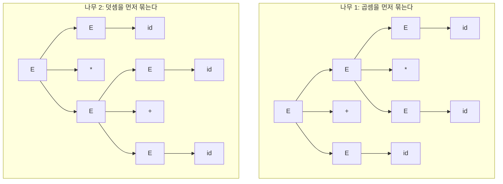
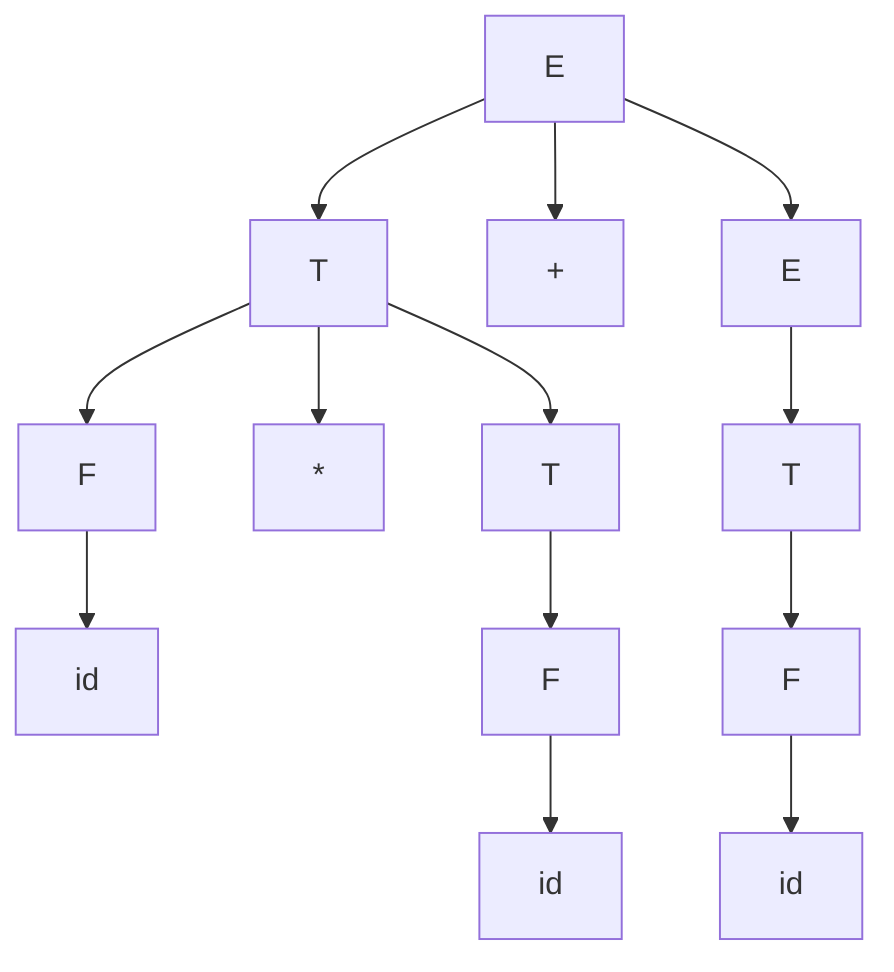



요약

문장 하나를 두 가지 나무로 그릴 수 있는 문법이다. "2 곱하기 3 더하기 4"를 곱셈부터 묶으면 10이고 덧셈부터 묶으면 14인데, 문법이 둘 다 허락하면 컴파일러는 어느 쪽으로 계산할지 정할 수 없다. 받아들이는 문장의 범위는 그대로 둔 채, "곱셈을 먼저 묶는다" 같은 약속을 규칙에 새겨 넣어 나무가 하나만 나오도록 문법을 다시 쓴다. 다시 쓰는 정해진 공식은 없어서 경우마다 손으로 고쳐야 한다.

## 예시로 보기

문법이 토큰열을 받아들이기만 하면 끝이 아니다. 구문 분석기는 토큰들이 어떻게 묶이는지를 나무로 내놓아야 하고, 뒤 단계는 그 나무대로 계산 순서를 정한다.

문법 $$E \to E + E \mid E * E \mid (E) \mid id$$로 $$id * id + id$$의 [파스 트리](/Hongs_Blog/studies/compilers/derivation-parse-tree/)를 그리면 두 개가 나온다.

나무 1은 처음에 $$E \to E + E$$를 썼고 나무 2는 $$E \to E * E$$를 썼다. 두 나무 모두 잎을 왼쪽부터 읽으면 $$id * id + id$$다. 세 $$id$$가 2, 3, 4라면 나무 1은 $$(2 \times 3) + 4 = 10$$, 나무 2는 $$2 \times (3 + 4) = 14$$로 계산한다[^s1]. 입력 하나에 어느 나무를 고를지 하나로 정할 수 없는 문법을 모호하다고 한다.

검증: 위 문법에서 $$id * id + id$$의 파스 트리가 정확히 둘인 것, 고친 문법이 길이 9 이하에서 같은 문자열을 만들고 모든 문자열의 나무가 하나인 것, 매달린 else 문자열의 나무가 둘에서 하나로 주는 것, 조건 자리까지 $$MATCHED$$로 묶은 if 문법이 문자열 하나를 놓치는 것, 조건 자리를 $$E$$로 둔 if 문법이 길이 13 이하에서 원래 문법과 같은 문자열을 만들고 모든 문자열의 나무가 하나인 것 — [13_ambiguous-grammar_verify.py](/Hongs_Blog/studies/compilers/code/13_ambiguous-grammar_verify/)

## 정의

정의

문법 $$G$$가 만드는 문자열 가운데 파스 트리가 둘 이상인 것이 하나라도 있으면 $$G$$는 **모호하다**(ambiguous).

기호로 쓰면, $$G$$가 모호하다는 것은 $$\vert T_G(w)\vert  \ge 2$$인 $$w \in L(G)$$가 있다는 것이다. $$L(G)$$는 $$G$$가 만드는 문자열 전부이고, $$T_G(w)$$는 문자열 $$w$$의 파스 트리를 모두 모은 집합, $$\vert \cdot\vert $$는 원소의 개수다[^s2].

**같은 뜻의 다른 정의.** 파스 트리 하나에는 좌측 유도가 정확히 하나 짝지어진다. 그래서 "좌측 유도가 둘 이상인 문자열이 있다"고 해도 같은 정의다. 우측 유도로 바꿔 말해도 같다[^s2].

**모호한 문법과 아닌 문법**[^s3].

| 문법 | 모호한가 | 근거 |
|---|---|---|
| $$E \to E + E \mid E * E \mid (E) \mid id$$ | 모호하다 | $$id * id + id$$의 나무가 둘 |
| $$E \to if\ E\ then\ E \mid if\ E\ then\ E\ else\ E \mid other$$ | 모호하다 | 아래 매달린 else |
| $$S \to S\,S \mid a$$ | 모호하다 | $$aaa$$를 $$(aa)a$$와 $$a(aa)$$로 묶을 수 있다 |
| $$E \to T + E \mid T$$, $$\ T \to F * T \mid F$$, $$\ F \to (E) \mid id$$ | 아니다 | 길이 9 이하 모든 문자열의 나무가 하나 |
| $$BALANCED \to (BALANCED) \mid \epsilon$$ | 아니다 | 괄호 한 겹마다 쓸 규칙이 하나로 정해진다 |

모호한 것은 문법이지 언어가 아니다. 첫째 줄과 넷째 줄의 문법은 똑같은 문자열들을 만든다.

## 모호함 없애기

방법은 하나다. 어느 쪽 나무를 고를지 약속(disambiguating rule)을 정하고, 그 약속대로만 유도되게 문법을 다시 쓴다.

### 산술식: 곱셈을 먼저 묶는다

약속은 "$$*$$가 $$+$$보다 우선순위가 높다"이다. 다시 쓴 문법은 비단말 기호를 세 층으로 나눈다.

$$E \to T + E \mid T \qquad T \to F * T \mid F \qquad F \to (E) \mid id$$

$$E$$는 덧셈으로 이어진 것, $$T$$는 곱셈으로 이어진 것, $$F$$는 더 쪼갤 수 없는 한 덩어리($$id$$나 괄호 친 식)다. $$+$$는 $$E$$의 규칙에만, $$*$$는 $$T$$의 규칙에만 있다. $$T$$에서 출발하면 괄호를 거치지 않고는 $$+$$를 만들 수 없다. 그래서 $$*$$의 양옆에는 괄호 없는 덧셈이 올 수 없고, 곱셈이 늘 덧셈보다 아래쪽(먼저 묶이는 쪽)에 놓인다.

$$id * id + id$$의 나무는 이제 하나다.

**같은 연산자가 이어질 때.** $$E \to T + E$$는 오른쪽에서 자기 자신을 부른다. 그래서 $$id + id + id$$는 $$id + (id + id)$$로 오른쪽부터 묶인다. 덧셈은 어느 쪽부터 묶어도 값이 같지만, 뺄셈을 같은 꼴로 쓰면 $$8 - 3 - 2$$가 $$8 - (3 - 2) = 7$$이 되어 틀린다. 위 문법은 $$+$$와 $$*$$만 다룬다[^s4].

### 매달린 else

가장 흔한 모호함이다. 문법 $$E \to if\ E\ then\ E \mid if\ E\ then\ E\ else\ E \mid other$$에서 아래 문장은 두 가지로 읽힌다.

$$if\ other\ then\ if\ other\ then\ other\ else\ other$$

| 읽는 법 | 묶음 | else가 붙는 곳 |
|---|---|---|
| 나무 1 | $$if\ other\ then\ (\,if\ other\ then\ other\ else\ other\,)$$ | 안쪽(가까운) if |
| 나무 2 | $$if\ other\ then\ (\,if\ other\ then\ other\,)\ else\ other$$ | 바깥쪽(먼) if |

else가 어느 if에 매달릴지 정해지지 않아서 매달린 else(dangling else)라 부른다. 약속은 "else는 아직 짝이 없는 가장 가까운 then과 짝짓는다"이고, 나무 1을 고른다는 뜻이다. 이 약속대로 다시 쓴 문법은 다음과 같다[^s6].

$$\begin{aligned}
E &\to MATCHED \mid UNMATCHED\\
MATCHED &\to if\ E\ then\ MATCHED\ else\ MATCHED \mid other\\
UNMATCHED &\to if\ E\ then\ E \mid if\ E\ then\ MATCHED\ else\ UNMATCHED
\end{aligned}$$

$MATCHED$는 then마다 else가 다 짝지어진 문장이고, $UNMATCHED$는 else 없는 then이 하나라도 남은 문장이다. 핵심은 then과 else 사이에 $MATCHED$만 올 수 있다는 것이다. 나무 2는 then과 else 사이에 else 없는 if($UNMATCHED$)를 넣어야 하므로 이 문법에서는 그릴 수 없다. 위 문장의 나무는 바깥이 $UNMATCHED \to if\ E\ then\ E$, 안쪽이 $MATCHED$인 것 하나만 남는다.

if 바로 뒤의 조건 자리는 $E$로 둔다. 조건 자리까지 $MATCHED$로 묶어도 모호함은 사라지지만, 원래 문법이 만들던 문장 일부를 잃는다. $if\ if\ other\ then\ other\ then\ other\ else\ other$는 조건 자리에 else 없는 if($if\ other\ then\ other$)가 든 문장이다. 원래 문법은 이 문장을 만들지만, 조건 자리를 $MATCHED$로 묶은 문법은 만들지 못한다. 모호함을 없앨 때는 나무의 수만 줄이고 받아들이는 문장의 범위는 그대로 두어야 한다[^s6].

### 문법을 고치지 않는 길

이처럼 문법을 다시 쓰는 일은 쉽지 않다. 다른 길은 모호한 문법을 그대로 두고 파서에게 약속을 따로 알려 주는 것이다. 상향식 파서는 $E \to E + E \mid E * E \mid id$로 $id + id * id$를 읽다가 $E + E$까지 읽고 $*$를 만나면 "지금 묶을까, 더 읽을까"에서 막힌다. 여기에 "$*$가 $+$보다 우선순위가 높다"고 선언해 두면 $*$ 쪽 일을 먼저 하도록 정해진다. 이 충돌은 [[3-2학기/컴파일러/3.개념집/26.SLR 파싱|SLR 파싱]]에서 다룬다.

### 스스로 설명해 보기

1. 세 층 문법에서 $id * id + id$를 "덧셈 먼저"로 묶는 나무는 왜 그릴 수 없는가?

덧셈을 먼저 묶으려면 $*$의 오른쪽 자식이 $id + id$ 전체여야 한다. $*$는 $T \to F * T$에서만 나오고 그 오른쪽은 $T$다. $T$에서는 $F * T$나 $F$만 나오고, $F$에서 $+$를 만들려면 $(E)$를 거쳐야 해서 괄호가 생긴다. 괄호 없는 $id + id$는 $T$에서 나올 수 없다.

2. 고친 if 문법에서 then과 else 사이를 $MATCHED$로 묶으면 왜 else가 가까운 then에 붙는가?

else가 먼 then에 붙으려면 그 then과 else 사이에 "else 없는 if"가 통째로 들어가야 한다. 그것은 $UNMATCHED$인데 그 자리에는 $MATCHED$만 올 수 있다. 그래서 사이에 낀 if는 모두 자기 else를 이미 가진 것뿐이고, else는 짝 없는 가장 가까운 then의 것이 된다.

이 고쳐 쓰기의 핵심 아이디어는?

고르고 싶지 않은 나무가 쓰는 규칙 조합을 문법에서 아예 쓸 수 없게 만든다. 비단말 기호를 뜻에 따라 나누고(덧셈 층·곱셈 층, 짝 맞은 것·안 맞은 것), 각 자리에 올 수 있는 종류를 좁힌다.

이 방법을 쓸 수 있는 다른 상황은?

우선순위가 여러 단계인 연산자(비교 < 덧셈 < 곱셈 < 단항 연산)마다 층을 하나씩 더 둔다. 같은 연산자를 왼쪽부터 묶을지 오른쪽부터 묶을지도 재귀를 왼쪽에 두느냐 오른쪽에 두느냐로 정한다.

## 활용

- **왜 없애야 하나.** 좋은 문법의 첫째 조건이 모호하지 않은 것이다. 위에서 내려가는 파서([[3-2학기/컴파일러/3.개념집/17.재귀 하강 파싱|재귀 하강 파싱]], [[3-2학기/컴파일러/3.개념집/20.LL(1) 파싱 표|LL(1) 파싱 표]])는 모호하지 않은 문법을 조건으로 건다. 모호한 문법으로 LL(1) 표를 만들면 한 칸에 규칙이 둘 들어간다.
- **판정하는 법.** 모호함을 보이려면 나무가 둘인 문자열 하나를 찾으면 된다. 거꾸로 모호하지 않음을 보이려면 모든 문자열을 따져야 한다. 임의의 문법이 모호한지 판정하는 알고리즘은 없다고 알려져 있다. 문법을 다시 쓰기가 쉽지 않은 까닭 가운데 하나다.
- **실제 언어.** C와 Java는 else를 가장 가까운 if에 붙인다. 중괄호를 쳐서 묶음을 드러내면 헷갈릴 일이 없다.
- **흔한 실수.** 고쳐 쓴 문법이 원래 문법과 같은 문자열들을 만드는지 확인하지 않는다. 매달린 else에서 조건 자리까지 $MATCHED$로 묶은 문법이 그 예다. 짧은 문자열을 몇 개 골라 양쪽에서 다 유도되는지 본다.

## 연결

- 선수: [[3-2학기/컴파일러/3.개념집/12.유도와 파스 트리|유도와 파스 트리]]
- 좋은 문법의 나머지 두 조건: [[3-2학기/컴파일러/3.개념집/14.좌재귀 없애기|좌재귀 없애기]], [[3-2학기/컴파일러/3.개념집/15.좌인수분해|좌인수분해]]. 둘은 기계적으로 고칠 수 있지만 모호함은 그렇지 않다.
- 우선순위 선언으로 푸는 길: [[3-2학기/컴파일러/3.개념집/26.SLR 파싱|SLR 파싱]]
- 나무가 달라지면 계산 순서가 달라진다: [[3-2학기/컴파일러/3.개념집/16.추상 구문 트리|추상 구문 트리]]

## 자주 하는 오해

"좌측 유도와 우측 유도가 다르니 이 문법은 모호하다"

틀렸다. 어떤 문법에서든 비단말 기호가 둘 이상 나오면 좌측 유도와 우측 유도는 적는 순서가 다르다. 그럴듯해 보이는 까닭은 둘 다 "한 문자열을 만드는 방법이 둘"처럼 보이기 때문이다. 하지만 그 둘은 같은 나무를 다른 순서로 그린 것이다. 모호함은 나무가 둘일 때, 곧 좌측 유도끼리 견줘 둘 이상일 때다. 확인하는 법: 좌측 유도만 놓고 센다. $E \to T + E \mid T$, $T \to F * T \mid F$, $F \to (E) \mid id$에서 $id * id + id$의 좌측 유도는 하나, 우측 유도도 하나이고 둘이 그리는 나무는 같다.

## 확인 문제

**C1** 문법이 모호하다는 것의 정의를 쓰라. 파스 트리 대신 유도로 말하면 어떻게 되는가?

**답:** 파스 트리가 둘 이상인 문자열이 하나라도 있는 문법이다. 유도로 말하면 좌측 유도(또는 우측 유도)가 둘 이상인 문자열이 있는 문법이다. 
**이유:** 파스 트리 하나에 좌측 유도가 하나씩 짝지어진다. "유도가 둘 이상"이라고만 하면 좌측·우측 유도의 차이까지 세게 되어 틀린다.

**C2** $E \to E + E \mid E * E \mid (E) \mid id$에서 $id + id + id$의 파스 트리를 모두 찾아라.

**답:** 둘이다. $(id + id) + id$로 묶는 나무(뿌리의 왼쪽 자식이 $E + E$)와 $id + (id + id)$로 묶는 나무(뿌리의 오른쪽 자식이 $E + E$). 
**이유:** 연산자가 하나뿐이어도 같은 연산자를 어느 쪽부터 묶을지가 정해지지 않아 모호하다. 우선순위만 정해서는 모호함이 다 없어지지 않는다[^s3].

**C3** $E \to T + E \mid T$, $T \to F * T \mid F$, $F \to (E) \mid id$에서 $*$가 $+$보다 먼저 묶이는 까닭을 규칙의 짜임으로 설명하라.

**답:** $+$는 $E$의 규칙에만, $*$는 $T$의 규칙에만 있다. $E$에서 $T$로는 내려가지만 $T$에서 $E$로 돌아가려면 $F \to (E)$의 괄호를 거쳐야 한다. 그래서 곱셈으로 이어진 덩어리 $T$ 안에는 괄호 없는 덧셈이 들어갈 수 없고, 곱셈이 나무의 더 아래에 놓여 먼저 계산된다.

**C4** 고친 if 문법에서 $if\ other\ then\ if\ other\ then\ other\ else\ other$의 else를 바깥 if에 붙이는 나무가 없다는 것은 어느 규칙의 어느 자리 때문인가?

**답:** else가 있는 두 규칙 $if\ \dots\ then\ MATCHED\ else\ \dots$에서 then과 else 사이가 $MATCHED$로 묶여 있기 때문이다. else를 바깥 if에 붙이려면 그 자리에 $if\ other\ then\ other$가 와야 하는데, 이것은 else 없는 then이 있어 $MATCHED$가 아니다.

**C5** (가) "문자열 $w$의 좌측 유도와 우측 유도가 서로 다르다" (나) "문자열 $w$의 좌측 유도가 두 가지다" 가운데 문법이 모호하다는 근거가 되는 것은?

**답:** (나)만 근거가 된다. (가)는 모호하지 않은 문법에서도 늘 일어난다. 
**이유:** (가)의 두 유도는 같은 나무를 다른 순서로 그린 것일 수 있다. (나)는 나무가 둘이라는 뜻이다.

[^s1]: 두 나무의 뜻이 다르다는 것을 수로 보이려고 넣었다.
[^s2]: 표준 정의다(Aho 외, *Compilers* 2판 4.2.5절). 파스 트리 수와 좌측 유도 수가 같음은 [[3-2학기/컴파일러/3.개념집/12_derivation-parse-tree_verify.py|12_derivation-parse-tree_verify.py]]에서 확인했다.
[^s3]: 나무 수는 검증 코드로 셌다. "아니다"로 적은 두 줄은 정해진 길이 이하의 문자열을 모두 확인한 것이고 증명은 아니다.
[^s4]: $id + id + id$의 나무가 $id + (id + id)$ 하나인 것을 검증 코드로 확인했다.
[^s6]: 조건 자리를 $E$로 둔 문법과 $MATCHED$로 둔 문법을 길이 13 이하의 모든 문자열로 견주어 검증 코드로 확인했다. 표준 교재(Aho·Lam·Sethi·Ullman, *Compilers* 2판, 4.3.2절)는 조건을 문장과 다른 비단말 기호로 써서 이 문제가 생기지 않는다.

