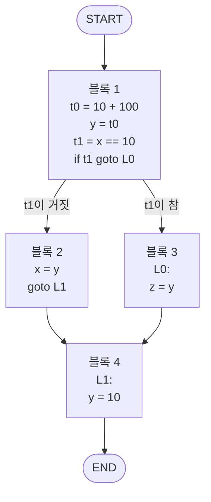


<div class="callout callout-summary" markdown="1">
<div class="callout-title callout-title--default" markdown="span">요약</div>

고속도로에서 나들목과 나들목 사이 구간은 한번 들어서면 끝까지 달릴 수밖에 없다. 컴파일러가 만든 코드에서도 중간에 끼어들거나 빠져나갈 수 없이 처음부터 끝까지 한 줄씩 차례로 실행되는 구간을 한 덩어리로 묶고, 덩어리에서 덩어리로 갈 수 있는 길을 화살표로 이으면 프로그램의 지도가 된다. 덩어리 안에서는 "윗줄이 반드시 먼저 실행됐다"고 믿을 수 있어서 코드를 고치기 쉽다. 덩어리 밖으로 나가면 어느 길로 왔는지 모르기 때문에 훨씬 조심해야 한다.

</div>


## 예시로 보기

코드를 고쳐 더 빠르게 만들려면 "이 줄에 올 때 저 변수 값이 무엇인가"를 알아야 한다. 점프가 섞여 있으면 바로 윗줄이 방금 실행됐는지조차 알 수 없다. 그래서 먼저 코드를 "위에서 아래로만 흐르는 구간"으로 자른다.

```c
int x, y, z;
y = 10 + 100;
if (x == 10) z = y;
else x = y;
y = 10;
```

이 코드의 [3주소 코드](/Hongs_Blog/studies/compilers/three-address-code/) 열 줄은 네 덩어리로 잘린다[^1].

```
┌──────────────────┐
│ t0 = 10 + 100    │
│ y = t0           │  블록 1
│ t1 = x == 10     │
│ if t1 goto L0    │  ← 점프는 블록의 마지막 줄
├──────────────────┤
│ x = y            │  블록 2
│ goto L1          │
├──────────────────┤
│ L0:              │  ← 레이블은 블록의 첫 줄
│ z = y            │  블록 3
├──────────────────┤
│ L1:              │  블록 4
│ y = 10           │
└──────────────────┘
```

덩어리들을 길로 이으면 이렇다[^2].



블록 1에서 길이 둘로 갈린다. 블록 3은 끝에 점프가 없어서 바로 아래의 블록 4로 흘러간다. 블록 2는 `goto L1`로 블록 4에 간다.

<div class="callout callout-check" markdown="1">
<div class="callout-title" markdown="span">검증: 블록의 첫 줄 자리 [1, 5, 7, 9]번째, 블록 크기 4·2·2·2, 간선 여섯 개, 고치기 전과 p.11·p.12의 고친 코드가 x = −3~14와 110에서 같은 (x, y, z)를 냄, 카드 C2의 블록과 간선 — [40_basic-block-cfg_impl.py](/Hongs_Blog/studies/compilers/code/40_basic-block-cfg_impl/)</div>

</div>


## 정의

**기본 블록(basic block).** 연달아 놓인 3주소 명령의 줄 가운데 더 늘릴 수 없이 긴 것으로, 두 조건을 지킨다[^1].

- 프로그램은 블록의 첫 명령으로만 블록에 들어올 수 있다. 중간 줄로 뛰어 들어오는 점프가 없다.
- 프로그램은 블록의 마지막 명령에서만 멈추거나 갈라진다. 중간 줄에서는 멈추지도 다른 곳으로 뛰지도 않는다.

"더 늘릴 수 없이 길다(maximal)"는 위아래로 한 줄을 더 붙이면 두 조건 중 하나가 깨진다는 뜻이다. 블록 1에 `x = y`를 붙이면 `if t1 goto L0`가 중간 줄이 되어 둘째 조건이 깨진다.

<div class="callout callout-warning" markdown="1">
<div class="callout-title" markdown="span">원본 오류 의심</div>

원문: p.9 "The program leaves the block without halting or branching at the last instruction in the block". / 문제점: 글자 그대로 읽으면 "마지막 명령에서 멈추거나 갈라지지 않고 블록을 떠난다"가 된다. 그런데 같은 쪽 그림의 첫 블록은 마지막 줄이 `if t1 goto L0`라서 마지막 명령에서 갈라진다. / 수정안: "마지막 명령 말고는 멈추거나 갈라지지 않는다"로 읽는다. / 근거: 같은 쪽의 블록 나누기 그림. Aho 외, *Compilers* 2판 8.4절의 정의는 "except possibly at the last instruction"이다.

</div>


**블록 자르는 법.** 블록의 첫 줄이 될 자리 세 가지를 찾고, 한 첫 줄부터 다음 첫 줄 바로 앞까지를 한 블록으로 묶는다[^s1].

1. 코드의 맨 첫 명령.
2. 점프가 닿는 곳, 곧 레이블이 붙은 줄.
3. 점프(`goto`, `if … goto`, `ifnot … goto`) 바로 다음 줄.

위 예에서 첫 줄은 `t0 = 10 + 100`(규칙 1), `x = y`(규칙 3), `L0:`(규칙 2), `L1:`(규칙 2, 3)이다.

**제어 흐름 그래프(control flow graph).** 기본 블록을 점으로 하는 그래프다. 화살표는 어느 블록 다음에 어느 블록이 실행될 수 있는지를 나타낸다[^2]. 블록 $$B$$에서 블록 $$C$$로 화살표를 긋는 경우는 둘이다[^s1].

- $$B$$의 마지막 줄이 $$C$$의 레이블로 가는 점프다.
- $$C$$가 코드에서 $$B$$ 바로 다음에 있고, $$B$$의 마지막 줄이 무조건 점프(`goto`)가 아니다.

조건 분기로 끝나는 블록은 화살표가 둘 나간다. 시작과 끝을 나타내는 START와 END를 덧붙인다.

**지역과 전역.** 최적화가 기본 블록 하나 안에서만 일하면 지역(local) 최적화, 제어 흐름 그래프 전체를 보고 일하면 전역(global) 최적화다[^3].

| | 지역 최적화 | 전역 최적화 |
|---|---|---|
| 보는 범위 | 기본 블록 하나 | 그래프 전체 |
| 슬라이드의 예 | 블록 1의 `t0 = 10 + 100`, `y = t0`를 `y = 110`으로 | 블록 3의 `z = y`를 `z = 110`으로, 블록 2의 `x = y`를 `x = 110`으로 |
| 믿을 수 있는 것 | 블록 안 윗줄은 반드시 먼저 실행됐다 | 어느 길로 왔는지 모른다. 들어오는 모든 길을 따져야 한다 |

`z = y`를 `z = 110`으로 바꿔도 되는 까닭은 블록 3에 들어오는 길이 블록 1에서 오는 것 하나뿐이고, 블록 1을 나올 때 y가 110이기 때문이다. 이것은 블록 3만 봐서는 알 수 없다. 블록 4의 `y = 10` 뒤에서는 y가 10이다[^s2].

## 활용

- 블록 안에서 하는 일: [지역 최적화 기법](/Hongs_Blog/studies/compilers/local-optimizations/), [사용 가능한 식 분석](/Hongs_Blog/studies/compilers/available-expressions/), [생존 변수 분석](/Hongs_Blog/studies/compilers/live-variable-analysis/)
- 그래프 전체로 넓히기: [전역 생존 변수 분석](/Hongs_Blog/studies/compilers/global-live-variable-analysis/), [전역 사용 가능한 식 분석](/Hongs_Blog/studies/compilers/global-available-expressions/)
- 구현: [40_basic-block-cfg_impl.py](/Hongs_Blog/studies/compilers/code/40_basic-block-cfg_impl/)
- 반복문은 그래프에서 아래 블록에서 위 블록으로 되돌아가는 화살표로 나타난다. 화살표를 따라가다 같은 블록으로 돌아오는 길(사이클)이 있으면 반복이 있다는 뜻이다[^s2].
- 흔한 실수: 레이블 줄을 앞 블록의 끝에 붙인다. 조건 분기 뒤에 "분기하지 않고 그냥 내려가는" 화살표를 빠뜨린다. `goto`로 끝나는 블록에서 바로 아래 블록으로 화살표를 긋는다.

## 연결

- 선수: [3주소 코드](/Hongs_Blog/studies/compilers/three-address-code/)
- 점과 화살표로 된 방향 그래프다: [그래프의 기초](/Hongs_Blog/studies/discrete-math/graph-basics/), [그래프 표현](/Hongs_Blog/studies/algorithms/graph-representation/)

## 확인 문제

<details class="callout callout-question" markdown="1">
<summary class="callout-title" markdown="span">**C1** 기본 블록의 정의를 두 조건과 함께 쓰고, 제어 흐름 그래프에서 점과 화살표가 각각 무엇인지 쓰라.</summary>

**답:** 기본 블록은 연달아 놓인 3주소 명령의 줄 가운데 더 늘릴 수 없이 긴 것으로, ① 첫 명령으로만 들어올 수 있고 ② 마지막 명령에서만 멈추거나 갈라진다. 제어 흐름 그래프의 점은 기본 블록이고, 화살표는 한 블록 다음에 실행될 수 있는 블록을 가리킨다.

</details>


<details class="callout callout-question" markdown="1">
<summary class="callout-title" markdown="span">**C2** 다음 코드를 기본 블록으로 자르고 화살표를 모두 쓰라. `L0:` / `t0 = y + z` / `t1 = x < t0` / `ifnot t1 goto L1` / `t2 = x + 1` / `x = t2` / `goto L0` / `L1:` / `r = x`</summary>

**답:** 블록 A: `L0:`부터 `ifnot t1 goto L1`까지 네 줄. 블록 B: `t2 = x + 1`, `x = t2`, `goto L0` 세 줄. 블록 C: `L1:`, `r = x` 두 줄. 화살표: START → A, A → B(조건이 참이라 그냥 내려감), A → C(`L1`로 점프), B → A(`goto L0`), C → END.<br>
**이유:** B → A가 되돌아가는 화살표다. B는 `goto`로 끝나므로 B → C 화살표는 없다. 슬라이드 p.7의 while 예에 한 줄을 붙인 코드다[^s3].

</details>


<details class="callout callout-question" markdown="1">
<summary class="callout-title" markdown="span">**C3** 예시 코드에서 (가) `t0 = 10 + 100`, `y = t0`를 `y = 110`으로 바꾸는 것과 (나) `z = y`를 `z = 110`으로 바꾸는 것은 각각 지역 최적화인가 전역 최적화인가? (나)를 블록 4 뒤의 `w = y`에 똑같이 해서 `w = 110`으로 바꾸면 왜 틀리는가?</summary>

**답:** (가)는 지역. 두 줄이 같은 블록 안에 있어 그 블록만 보고 고친다. (나)는 전역. `y`가 110이라는 사실은 블록 1에 있고 `z = y`는 블록 3에 있어, 블록 사이의 길을 봐야 한다. 블록 4에서 `y = 10`으로 다시 넣기 때문에 그 뒤의 y는 10이다. `w = 110`은 틀린다.<br>
**이유:** x = 10으로 실행하면 끝에서 (x, y, z) = (10, 10, 110), x = 3이면 (110, 10, 처음 z 그대로)다. 고친 코드도 같은 값을 낸다.

</details>


[^1]: 컴파일러 12회 강의 자료 「Lecture12 Code optimization part 1」, p.9 (기본 블록의 정의와 예의 네 블록)
[^2]: 같은 자료, p.10 (제어 흐름 그래프의 뜻과 예의 그래프)
[^3]: 같은 자료, p.11~12 (지역 최적화와 전역 최적화의 뜻과 예)
[^s1]: <span class="fn-tag" title="수업 자료에 없고 따로 보탠 내용">보충</span> 블록의 첫 줄을 찾는 세 규칙과 화살표를 긋는 두 경우는 원본에 없다. 슬라이드는 정의와 결과 그림만 준다. Aho 외, *Compilers: Principles, Techniques, and Tools* 2판 8.4.1절(리더 찾기)과 8.4.3절(흐름 그래프)을 따랐고, 이 규칙으로 슬라이드의 네 블록과 간선 여섯 개가 그대로 나오는 것을 구현으로 확인했다. 고속도로 비유도 원본에 없다. 실제 블록은 한 줄짜리일 수도 있다.
[^s2]: <span class="fn-tag" title="수업 자료에 없고 따로 보탠 내용">보충</span> 전역 최적화가 왜 안전한지에 대한 설명, 반복문과 사이클의 관계, 표의 "믿을 수 있는 것" 줄은 원본에 없다. 고치기 전후 코드를 실행해 같은 결과를 확인했다. 다이어그램은 p.10의 그림을 옮긴 것이다.
[^s3]: <span class="fn-tag" title="수업 자료에 없고 따로 보탠 내용">보충</span> 카드 C2·C3은 원본에 없다. C2의 코드는 슬라이드 p.7의 while 예에 `r = x`를 붙인 것이고, 블록과 간선은 구현으로 확인했다.

