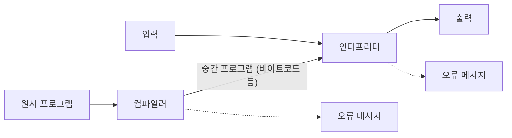


둘 다 사람이 쓴 프로그램을 컴퓨터가 돌릴 수 있게 옮기고, 틀린 곳을 찾아 알려 준다[^1]. 가르는 질문은 "언제, 얼마만큼 옮기는가"다. 책 한 권을 미리 통째로 번역해 두는 것과, 통역사가 옆에서 한 문장씩 옮겨 주는 것의 차이다. 그 답이 실행 속도, 다른 컴퓨터로 옮기기 쉬운 정도, 틀린 곳을 찾는 방식을 함께 정한다.

## 어느 쪽일까

**C1** (a) 같은 계산을 수억 번 되풀이하는 날씨 예측 프로그램을 한 종류의 컴퓨터에서만 돌린다. (b) 웹 페이지에 딸려 온 짧은 프로그램을 방문자의 휴대폰, 노트북 어디서든 바로 돌려야 한다. 어느 쪽인가?

**답:** (a) 컴파일. 한 번 옮겨 두면 되풀이할 때마다 다시 옮기지 않아 빠르다. (b) 인터프리트. 원시 프로그램을 그대로 보내고, 기기마다 있는 인터프리터가 그 자리에서 옮긴다. 
**이유:** (a)를 인터프리트하면 같은 문장을 수억 번 다시 옮긴다. (b)를 컴파일하면 기기 종류마다 따로 옮긴 파일을 준비해야 한다[^s1].

**C2** 프로그램의 넷째 줄에 문법이 틀린 문장이 있다. 앞의 세 줄은 화면에 글자를 찍는다. 컴파일 방식과 인터프리트 방식에서 각각 화면에 무엇이 찍히는가?

**답:** 컴파일 방식은 아무것도 찍지 않는다. 전체를 먼저 옮기다가 넷째 줄에서 오류를 내고, 실행할 프로그램을 만들지 않는다. 인터프리트 방식은 세 줄을 찍은 뒤 넷째 줄에서 멈춘다. 
**이유:** 컴파일은 실행 전에 전체를 한 번 훑고, 인터프리트는 실행할 차례가 된 문장만 옮긴다. 장난감 언어로 확인하면 셋째 줄이 틀린 네 줄짜리 프로그램에서 인터프리트는 두 줄을 찍고 멈추고, 컴파일은 한 줄도 찍지 않는다[^s1].

## 결정적 차이

| | 컴파일 | 인터프리트 |
|---|---|---|
| 무엇을 옮기나 | 원시 프로그램 전체 | 원시 프로그램의 문장 하나 |
| 언제 옮기나 | 프로그램이 돌기 전에 한 번 | 그 문장을 실행할 때마다 |
| 옮긴 결과 | 원시 프로그램과 뜻이 같은 목적 프로그램 | 그 문장과 뜻이 같은 목적 코드 |
| 예 | C, C++ | 자바스크립트 |
| 입력을 받는 쪽 | 만들어진 목적 프로그램 | 인터프리터(원시 프로그램과 입력을 함께 받는다) |

위 다섯 줄은 슬라이드의 표와 그림이다[^2]. 슬라이드는 장단점 표의 세 줄(실행 성능, 옮기기 쉬움, 디버깅)을 빈칸으로 남겼다. 채우면 아래와 같다[^s2].

| | 컴파일 | 인터프리트 |
|---|---|---|
| 실행 성능 | 빠르다. 실행 중에는 옮기는 일이 없다 | 느리다. 실행하면서 옮기고, 되풀이하는 문장은 다시 옮긴다 |
| 옮기기 쉬움·유연함 | 낮다. 목적 프로그램은 한 종류의 기계에서만 돈다 | 높다. 인터프리터만 있으면 같은 원시 프로그램이 돈다 |
| 디버깅·개발 | 고칠 때마다 다시 컴파일해야 한다. 대신 실행 전에 전체를 검사한다 | 고친 뒤 바로 돌려 본다. 오류가 난 문장에서 멈춰 어디가 틀렸는지 짚기 쉽다. 대신 실행해 보지 않은 문장의 오류는 모른다 |

선택을 가르는 줄은 "언제 옮기나"다. 문장 하나를 1,000번 되풀이하는 장난감 프로그램에서 옮긴 횟수를 세면, 인터프리트는 1,002번이고 컴파일은 3번이다.

검증: 장난감 언어에서 같은 프로그램의 출력이 두 방식에서 같은 것, 옮긴 횟수 1,002번과 3번, 틀린 줄이 있을 때 인터프리트는 앞의 두 줄을 찍고 멈추고 컴파일은 아무것도 찍지 않는 것 — [02_compilation-vs-interpretation_verify.py](/Hongs_Blog/studies/compilers/code/02_compilation-vs-interpretation_verify/)

## 둘 다 아닐 때

**C3** Java와 파이썬은 둘을 섞는다. 앞쪽에서 컴파일하고 뒤쪽에서 인터프리트한다. 앞쪽과 뒤쪽은 각각 무엇을 얻으려고 있는가?

**답:** 앞쪽의 컴파일러가 원시 프로그램을 중간 프로그램(바이트코드 등)으로 한 번 옮긴다. 이것은 실행 시간을 줄이려는 것이다. 뒤쪽의 인터프리터가 중간 프로그램과 입력을 받아 실행한다. 이것은 여러 기계에서 그대로 돌게 하려는 것이다[^3]. 
**이유:** 글자를 끊고 문법을 검사하는 무거운 일은 앞에서 한 번만 한다. 기계마다 다른 부분은 뒤의 인터프리터가 떠안는다. 이런 방식을 하이브리드 컴파일러라 부른다. Java에서 이 인터프리터가 [JVM](/Hongs_Blog/studies/java/jvm-bytecode/)이다.

컴파일러와 인터프리터가 한 줄로 이어진다. 오류 메시지는 두 곳에서 모두 나올 수 있다[^3][^s3].

[^1]: 컴파일러 1회 강의 자료 「Lecture01 Compilers overview」, p.4 (언어 처리기의 두 역할: 번역과 오류 찾기)
[^2]: 같은 자료, p.5 (두 방식의 표와 그림)
[^3]: 같은 자료, p.7 (하이브리드 컴파일러: 컴파일 쪽은 "For high efficiency (low execution time)", 인터프리터 쪽은 "For high portability")
[^s1]: 보충 카드 C1·C2의 상황과 장난감 언어 실험은 원본에 없다. 실험은 검증 코드로 돌렸다.
[^s2]: 보충 원본 p.6은 장단점 표의 칸을 비워 두었다. 실행 성능과 옮기기 쉬움은 p.7이 컴파일 쪽에 "high efficiency", 인터프리터 쪽에 "high portability"라고 적은 것을 따랐다. 디버깅 줄은 Aho·Lam·Sethi·Ullman, *Compilers: Principles, Techniques, and Tools* 2판, 1.1절(컴파일한 목적 프로그램이 대개 훨씬 빠르고, 인터프리터는 문장을 하나씩 실행하므로 오류를 더 잘 짚어 준다)을 따랐다. 수업에서 교수가 채운 내용과 다를 수 있다.
[^s3]: 보충 다이어그램은 원본 p.7의 그림을 옮긴 것이다.

