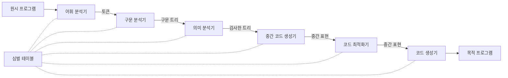



요약

컴파일러는 사람이 쓴 프로그램을 컴퓨터가 돌릴 수 있는 프로그램으로 옮기는 번역기다. 긴 글을 한 사람이 통째로 번역하지 않고 여섯 사람이 차례로 넘겨받듯, 글자를 낱말로 끊고, 문장 구조를 세우고, 뜻이 맞는지 검사하고, 중간 글로 옮기고, 다듬고, 마지막 기계의 말로 쓴다. 단계를 나누면 한 단계씩 따로 만들고 고칠 수 있다. 단, 옮긴 프로그램은 원래 프로그램과 똑같은 일을 해야 한다. 이것만은 빠질 수 없고, 결과물이 빠른지나 번역이 금방 끝나는지는 그다음 문제다.

## 예시로 보기

기계어는 0과 1의 줄이고, 어셈블리어는 `ADD t1, t2`처럼 그 줄에 이름만 붙인 말이다. C, Java, 파이썬 같은 말은 사람이 쓰기 편하지만 컴퓨터는 그대로 돌리지 못한다[^1]. 그래서 번역이 한 번 끼어든다. 번역기 하나가 글자 줄을 곧장 기계어로 바꾸게 짜면 어떨까? 띄어쓰기, 괄호 짝, 타입, 레지스터 고르기를 한꺼번에 따져야 해서 금방 감당이 안 된다. 그래서 일을 여섯으로 나눈다.

`A = B + C` 한 줄이 여섯 단계를 지나는 모습이다[^2].

| 단계 | 받는 것 | 내놓는 것 |
|---|---|---|
| 어휘 분석기 | 글자 줄 `A = B + C` | 토큰 `'A'` `'='` `'B'` `'+'` `'C'` |
| 구문 분석기 | 토큰 다섯 개 | 트리: 맨 위 `=`, 왼쪽 `A`, 오른쪽 `+`. `+` 아래에 `B`와 `C` |
| 의미 분석기 | 그 트리 | `C`를 `inttofloat`로 감싼 트리 |
| 중간 코드 생성기 | 감싼 트리 | `t1 = inttofloat(C)` / `t2 = t1 + B` / `A = t2` |
| 코드 최적화기 | 세 줄 | `t1 = inttofloat(C)` / `A = t1 + B` |
| 코드 생성기 | 두 줄 | `LDF R2, C` / `LDF R1, B` / `ADDF R1, R1, R2` / `STF A, R1` |

의미 분석기가 끼워 넣은 `inttofloat`는 정수를 실수로 바꾸는 표시다. 정수 `C`를 실수 `B`와 더하려면 먼저 같은 종류로 맞춰야 해서다[^s1]. 최적화기는 `t2`에 담았다가 곧바로 `A`로 옮기는 헛걸음을 없앴다. 줄이 셋에서 둘로 줄었지만 `A`에 들어가는 값은 같다.

$$B = 1.5$$, $$C = 2$$를 넣어 보면 트리, 세 줄, 두 줄, 기계 명령 네 줄이 모두 $$A = 3.5$$를 낸다.

검증: 위 여섯 단계의 결과물을 각각 실행해 무작위 값 1,000쌍에서 `A`가 모두 같은 것, $$B = 1.5$$, $$C = 2$$일 때 3.5 — [01_compiler-structure_verify.py](/Hongs_Blog/studies/compilers/code/01_compiler-structure_verify/). 기계 명령 네 줄은 파이썬 흉내로 돌렸다[^s1].

원본 오류 의심

원문: p.16의 기계 코드 `LDF R2, C` / `LDF R1, B` / `ADDF R1, R1, R2` / `STF A, R1` / 문제점: 받은 중간 코드에는 `t1 = inttofloat(C)`가 있는데, 기계 코드에는 정수를 실수로 바꾸는 명령이 없다. `LDF`가 정수 `C`를 읽으면서 실수로 바꿔 준다고 봐야 값이 맞는다. / 수정안: 변환 명령을 한 줄 넣거나, `LDF`가 변환까지 한다고 밝힌다. / 근거: 검증 코드에서 `LDF`가 값을 실수로 바꿔 읽게 했을 때만 앞 단계들과 결과가 같았다. 슬라이드에 `LDF`의 뜻이 적혀 있지 않아 확정할 수 없다 [확인필요].

## 여섯 단계와 두 묶음

상자 여섯 개가 한 줄로 이어지고, 맨 아래 표 하나에 모든 상자가 점선으로 붙어 있다[^3][^s2].

| 단계 | 하는 일 | 이 과목에서 |
|---|---|---|
| 어휘 분석기(스캐너) | 글자 줄을 뜻 있는 덩어리로 끊어 토큰을 낸다 | [토큰과 렉심](/Hongs_Blog/studies/compilers/token-lexeme/) |
| 구문 분석기(파서) | 토큰들이 문법에 맞게 놓였는지 보고, 그 짜임을 나무 모양으로 그린다 | [문맥 자유 문법](/Hongs_Blog/studies/compilers/context-free-grammar/) |
| 의미 분석기 | 프로그램이 언어의 규칙과 뜻으로 맞는지 본다. 타입 검사와 타입 바꾸기가 그 예다 | [의미 분석](/Hongs_Blog/studies/compilers/semantic-analysis/) |
| 중간 코드 생성기 | 만들기 쉽고 기계어로 옮기기도 쉬운 중간 표현을 만든다 | [3주소 코드](/Hongs_Blog/studies/compilers/three-address-code/) |
| 코드 최적화기 | 중간 코드를 고쳐 더 빠르거나 더 짧은 결과가 나오게 한다. 없어도 된다 | [지역 최적화 기법](/Hongs_Blog/studies/compilers/local-optimizations/) |
| 코드 생성기 | 중간 표현을 목표 기계의 말로 옮긴다 | [단순 연산과 분기의 코드 생성](/Hongs_Blog/studies/compilers/codegen-simple-operations/) |

- **분석부(analysis part).** 앞의 세 단계다. 원시 프로그램을 뜯어 읽어 무슨 뜻인지 알아낸다[^3].
- **합성부(synthesis part).** 뒤의 세 단계다. 알아낸 뜻으로 목적 프로그램을 짓는다[^3].
- **심벌 테이블(symbol table).** 변수 이름 같은 것을 적어 두는 표다. 여섯 단계가 모두 쓴다[^3]. 어휘 분석기가 이름을 적어 넣고, 뒤 단계들이 타입이나 저장 위치를 찾아본다: [심벌 테이블과 스코프 검사](/Hongs_Blog/studies/compilers/symbol-table-scope-checking/).

1950년대 말에 나온 첫 컴파일러 FORTRAN I의 큰 틀이 지금 컴파일러에도 그대로 남아 있다[^3].

**좋은 컴파일러의 세 조건.** 첫째만 필수다[^4].

1. 정확성(correctness): 목적 프로그램이 원시 프로그램과 뜻이 같아야 한다. 필수다.
2. 성능 개선: 목적 프로그램이 더 빨리 돌게 한다. 선택이다.
3. 적당한 컴파일 시간: 번역이 너무 오래 걸리지 않는다. 선택이다.

2번과 3번은 서로 당긴다. 최적화를 오래 할수록 결과물은 좋아지지만 번역 시간이 늘어난다[^s1].

**컴파일러 앞뒤의 도구.** 컴파일러 혼자 실행 파일을 만들지는 않는다. GCC에서는 네 도구가 이어서 돈다[^5].

| 도구 | 받는 것 | 내놓는 것 |
|---|---|---|
| 전처리기 | 원시 프로그램 `test.c` | `#include` 등을 풀어 넣은 원시 프로그램 |
| 컴파일러 | 고쳐진 원시 프로그램 | 어셈블리 프로그램 `test.s` |
| 어셈블러 | `test.s` | 옮겨 놓을 수 있는 기계어 `test.o` |
| 링커 | `test.o`와 라이브러리 파일 | 실행 파일 `test.out` |

어셈블러와 링커가 하는 일은 [어셈블·링크·실행 과정](/Hongs_Blog/studies/assembly-language/assemble-link-execute/)에서 다룬다.

## 활용

- 단계마다 받는 것과 내놓는 것이 정해져 있어서, 한 단계만 갈아 끼울 수 있다. 코드 생성기만 바꾸면 같은 언어를 다른 기계용으로 옮긴다[^s1].
- 오류가 어느 단계에서 걸리는지 알면 오류 메시지를 읽기 쉽다. 언어에 없는 글자는 어휘 분석기가, 짝이 안 맞는 괄호는 구문 분석기가, 선언하지 않은 변수나 맞지 않는 타입은 의미 분석기가 잡는다[^s1].
- 흔한 실수: 최적화기를 필수 단계로 적는다. 슬라이드는 제목에 "(optional)"을 붙였다[^2].
- 흔한 실수: 중간 코드 생성기를 분석부에 넣는다. 그림에서 분석부는 의미 분석기까지다[^3].

## 연결

- 선수: [어셈블리어와 기계어](/Hongs_Blog/studies/assembly-language/assembly-language/)
- 번역을 미리 하지 않고 실행하면서 하는 방식: [컴파일과 인터프리트 비교](/Hongs_Blog/studies/compilers/compilation-vs-interpretation/)
- 첫 단계가 내놓는 것: [토큰과 렉심](/Hongs_Blog/studies/compilers/token-lexeme/). 둘째 단계가 그리는 나무: [추상 구문 트리](/Hongs_Blog/studies/compilers/abstract-syntax-tree/)
- 의미 분석기가 `inttofloat`를 넣는 규칙은 이 과목의 타입 규칙에서는 다루지 않는다: [타입과 타입 시스템](/Hongs_Blog/studies/compilers/type-system/)

## 확인 문제

**C1** 컴파일러의 여섯 단계를 순서대로 쓰고, 분석부와 합성부의 경계가 어디인지 밝혀라. 모든 단계가 함께 쓰는 것은 무엇인가?

**답:** 어휘 분석기 → 구문 분석기 → 의미 분석기 → 중간 코드 생성기 → 코드 최적화기 → 코드 생성기. 앞의 셋이 분석부, 뒤의 셋이 합성부다. 심벌 테이블을 모든 단계가 쓴다. 
**이유:** 흔한 오답은 중간 코드 생성기를 분석부에 넣는 것이다. 분석부는 원시 프로그램을 읽어 내는 데까지다.

**C2** `X = Y + Z`에서 `X`와 `Y`는 실수, `Z`는 정수다. 어휘 분석기, 구문 분석기, 의미 분석기, 중간 코드 생성기, 코드 최적화기가 내놓는 것을 차례로 쓰라.

**답:** 토큰 `'X'` `'='` `'Y'` `'+'` `'Z'` → 맨 위가 `=`, 왼쪽 `X`, 오른쪽 `+`(아래에 `Y`, `Z`)인 트리 → `Z`를 `inttofloat`로 감싼 트리 → `t1 = inttofloat(Z)` / `t2 = t1 + Y` / `X = t2` → `t1 = inttofloat(Z)` / `X = t1 + Y`. 
**이유:** 슬라이드의 `A = B + C`와 이름만 다르다. 최적화기는 `t2`를 거치는 한 줄을 없앤다[^s1].

**C3** 좋은 컴파일러의 세 조건 가운데 정확성만 필수인 까닭은 무엇인가? 어떤 "최적화"가 줄 수를 더 줄였는데 결과 값이 달라졌다면 그것을 최적화라고 부를 수 있는가?

**답:** 번역의 목적이 "같은 뜻의 프로그램을 다른 말로 쓰는 것"이기 때문이다. 뜻이 달라지면 빨라도 쓸모가 없다. 값이 달라진 변환은 최적화가 아니라 잘못된 번역이다. 
**이유:** 성능 개선과 컴파일 시간은 "더 좋게"의 문제이고, 정확성은 "맞느냐"의 문제다. 예를 들어 `A = B + C`를 `A = C + C`로 바꾸면 한 줄이지만 $$B = 1.5$$, $$C = 2$$에서 3.5가 아니라 4가 나온다[^s1].

[^1]: 컴파일러 1회 강의 자료 「Lecture01 Compilers overview」, p.2~4 (기계어·어셈블리어·고급 언어, 번역이 필요한 까닭, 언어 처리기의 두 역할)
[^2]: 같은 자료, p.11~16 (단계별 정의와 `A = B + C`의 변화)
[^3]: 같은 자료, p.10, p.17 (여섯 단계, 분석부와 합성부, 심벌 테이블, FORTRAN I)
[^4]: 같은 자료, p.9 (좋은 컴파일러의 세 조건)
[^5]: 같은 자료, p.8 (전처리기·컴파일러·어셈블러·링커, GCC의 test.c → test.s → test.o → test.out)
[^s1]: 보충 `inttofloat`를 넣는 까닭의 설명, $$B = 1.5$$, $$C = 2$$의 수치 예, 두 선택 조건이 서로 당긴다는 말, 단계를 갈아 끼우는 이야기, 어느 오류를 어느 단계가 잡는지, 카드 C2·C3의 예는 원본에 없다. 슬라이드에는 `B`와 `C`의 타입이 적혀 있지 않아 `C`를 정수, `B`를 실수로 두었다. 기계 명령은 실제 기계가 아니라 네 명령만 아는 파이썬 흉내기로 돌렸다. 단계 구분과 오류 분담은 Aho·Lam·Sethi·Ullman, *Compilers: Principles, Techniques, and Tools* 2판, 1.2절을 따랐다.
[^s2]: 보충 다이어그램은 원본 p.10의 그림을 옮긴 것이다. 화살표 위의 "토큰", "구문 트리" 같은 이름은 p.11~16에서 가져왔다.

