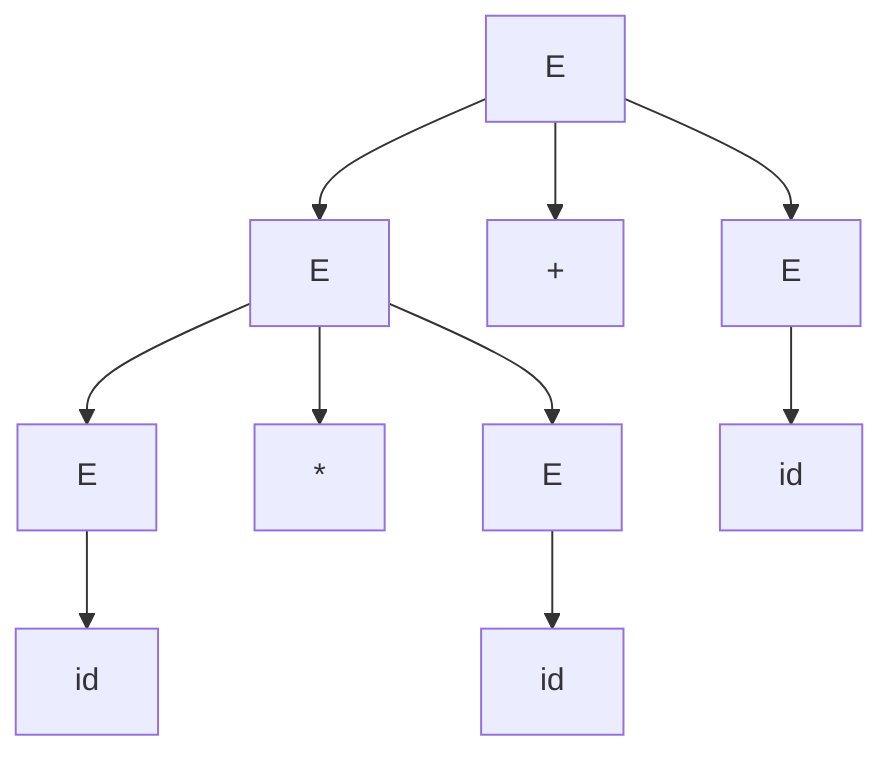



요약

문법의 규칙을 한 번에 하나씩 써서 시작 이름을 조금씩 바꿔 나가는 과정이 유도다. 이렇게 해서 주어진 토큰들을 그대로 만들어 낼 수 있으면 그 토큰들은 문법에 맞다. 어느 이름을 어떤 조각들로 바꿨는지를 위에서 아래로 가지 쳐 그리면 나무가 되고, 이 나무가 토큰들이 어떻게 묶이는지를 보여 준다. 바꿀 이름이 여럿일 때 어느 것부터 바꾸느냐에 따라 적는 순서는 달라지지만, 같은 나무를 그리는 한 결과는 같다.

## 예시로 보기

[문맥 자유 문법](/Hongs_Blog/studies/compilers/context-free-grammar/)은 올바른 문장을 정하는 규칙이다. 규칙이 있어도 "이 토큰열이 규칙에 맞는가"를 보이는 절차가 따로 필요하다. 그 절차가 시작 기호에서 그 토큰열을 실제로 만들어 보이는 것이다.

문법 $$E \to E + E \mid E * E \mid (E) \mid id$$로 $$id * id + id$$를 만든다. 비단말 기호가 여럿 남아 있으면 가장 왼쪽 것부터 바꾼다[^1].

| 걸음 | 지금 모양 | 바꾼 것 |
|---|---|---|
| 0 | $$E$$ | |
| 1 | $$E + E$$ | $$E \to E + E$$ |
| 2 | $$E * E + E$$ | 맨 왼쪽 $$E \to E * E$$ |
| 3 | $$id * E + E$$ | 맨 왼쪽 $$E \to id$$ |
| 4 | $$id * id + E$$ | 맨 왼쪽 $$E \to id$$ |
| 5 | $$id * id + id$$ | 맨 왼쪽 $$E \to id$$ |

다섯 걸음 만에 비단말 기호가 모두 사라지고 원하던 토큰열이 나왔다. 이 과정이 유도이고, 걸음마다 나온 모양(0~5의 줄)을 문장 형식, 단말 기호만 남은 마지막 줄을 문장이라 부른다.

바꿀 때마다 "바뀐 기호 아래에 새 기호들을 자식으로 단다"고 그리면 나무가 자란다. 걸음 1에서 뿌리 $$E$$ 아래에 $$E$$, $$+$$, $$E$$가 달리고, 걸음 2에서 왼쪽 $$E$$ 아래에 $$E$$, $$*$$, $$E$$가 달린다. 다 그리면 아래 나무가 된다[^2].

이 나무가 파스 트리다. 잎(자식이 없는 맨 아래 노드)을 왼쪽부터 읽으면 $$id$$, $$*$$, $$id$$, $$+$$, $$id$$로 원래 토큰열이 나온다. 나무 모양을 보면 $$id * id$$가 먼저 한 덩어리로 묶이고 거기에 $$+ id$$가 붙는다는 것도 보인다.

검증: 위 좌측 유도와 아래 우측 유도가 슬라이드와 같은 것, 두 유도가 같은 나무에서 나오고 걸음 수가 비단말 노드 수(5)와 같은 것, 잎을 왼쪽부터 읽으면 원래 토큰열인 것, 파스 트리 수와 좌측 유도 수가 늘 같은 것 — [12_derivation-parse-tree_verify.py](/Hongs_Blog/studies/compilers/code/12_derivation-parse-tree_verify/)

## 정의

**유도.** 문장 형식 안의 비단말 기호 하나를 그 기호의 생성 규칙 오른쪽으로 바꾸는 일을 한 걸음이라 하고 $$\Rightarrow$$로 쓴다. 0걸음 이상 이어 간 것은 $$\Rightarrow^*$$로 쓴다[^3].

$$E \Rightarrow E + E \Rightarrow E * E + E \quad\text{이므로}\quad E \Rightarrow^* E * E + E$$

$$\to$$는 문법에 적힌 규칙이고, $$\Rightarrow$$는 그 규칙을 실제로 한 번 쓴 것이다. 괄호가 든 예도 같다. $$E \Rightarrow (E) \Rightarrow (E + E) \Rightarrow (id + E) \Rightarrow (id + id)$$이므로 $$E \Rightarrow^* (id + id)$$다[^3].

**어느 것부터 바꾸는가.** 비단말 기호가 둘 이상이면 순서를 정해 둔다[^4].

- 좌측 유도(leftmost, $$\Rightarrow_{lm}$$): 가장 왼쪽 비단말 기호부터 바꾼다.
- 우측 유도(rightmost, $$\Rightarrow_{rm}$$): 가장 오른쪽 비단말 기호부터 바꾼다.

같은 $$id * id + id$$를 두 방법으로 만든 것이다. 굵게 쓴 것이 다음에 바꿀 기호다.

| | 유도 |
|---|---|
| 좌측 | $$\mathbf{E} \Rightarrow_{lm} \mathbf{E} + E \Rightarrow_{lm} \mathbf{E} * E + E \Rightarrow_{lm} id * \mathbf{E} + E \Rightarrow_{lm} id * id + \mathbf{E} \Rightarrow_{lm} id * id + id$$ |
| 우측 | $$\mathbf{E} \Rightarrow_{rm} E + \mathbf{E} \Rightarrow_{rm} \mathbf{E} + id \Rightarrow_{rm} E * \mathbf{E} + id \Rightarrow_{rm} \mathbf{E} * id + id \Rightarrow_{rm} id * id + id$$ |

정의

문법 $$G$$의 시작 기호를 $$A$$라 하자[^5].
- **문장 형식**(sentential form): $$A \Rightarrow^* \alpha$$인 $$\alpha$$. 시작 기호에서 유도해 나올 수 있는 모든 모양이다. 비단말 기호가 남아 있어도 된다. 좌측 유도로만 나온 것은 좌문장 형식, 우측 유도로만 나온 것은 우문장 형식이다.
- **문장**(sentence): 단말 기호만으로 된 문장 형식.
- **문법의 언어** $$L(G)$$: $$G$$의 문장을 모두 모은 집합. $$L(G) = \{\alpha \mid \alpha\text{는 } G\text{의 문장}\}$$.

입력 토큰열이 $$L(G)$$ 안에 있으면 그 입력은 $$G$$에서 올바르다.

위 표에서 $$E * E + E$$는 문장 형식이지만 문장은 아니다. $$id * id + id$$는 문장 형식이면서 문장이다.

원본 오류 의심

원문: p.21이 "A sentinel form of a CFG G"라 쓰고, 문장의 정의에서 "α is a sentence form of G"라 쓴다. / 문제점: sentinel은 '보초'라는 뜻의 다른 낱말이다. 문법 용어는 sentential form(문장 형식)이다. 둘째 줄의 "sentence form"도 정의하려는 것은 sentence(문장)다. / 수정안: sentinel form → sentential form, sentence form → sentence. / 근거: 같은 쪽 제목이 "A sentence of a CFG G"이고, 표준 교재(Aho 외, *Compilers* 2판 4.2.3절)가 sentential form이라 쓴다.

**파스 트리.** 유도를 나무로 그린 것이다[^6].

- 잎 노드는 단말 기호다.
- 잎이 아닌 노드는 비단말 기호다. 그 노드의 자식들은 그 비단말 기호에 쓴 규칙의 오른쪽 기호들이다.
- 잎을 왼쪽부터 차례로 읽으면 원래 문자열이다.

원본 오류 의심

원문: p.30 "An inorder traversal of a parse tree = original strings" / 문제점: 중위 순회는 "왼쪽 자식, 자기 자신, 오른쪽 자식" 순서로 도는 것이라 자식이 둘인 이진 트리에서만 뜻이 정해진다. 파스 트리의 $$E$$ 노드는 자식이 $$E$$, $$+$$, $$E$$ 셋이거나 $$id$$ 하나다. 또 비단말 노드 자신은 읽지 않는다. / 수정안: "잎을 왼쪽부터 차례로 읽으면 원래 문자열이다." / 근거: 위 나무에서 잎만 왼쪽부터 읽으면 $$id * id + id$$다. 검증 코드가 이 문법의 모든 파스 트리에서 확인한다.

**유도 순서와 나무.** 위의 좌측 유도와 우측 유도는 바꾸는 순서만 다르고 같은 나무를 그린다. 슬라이드는 "유도 방법에 상관없이 같은 나무가 만들어진다"고 적는다[^6]. 정확히는 파스 트리 하나에 좌측 유도가 하나, 우측 유도가 하나씩 짝지어진다[^s1]. 한 문자열에 나무가 둘 이상 그려지는 문법도 있는데, 그것은 유도 순서 때문이 아니라 고르는 규칙이 달라서다([모호한 문법](/Hongs_Blog/studies/compilers/ambiguous-grammar/)).

## 활용

- 구문 분석기가 하는 두 일이 여기서 풀린다. 토큰열이 올바른지는 "문법에서 그 토큰열을 유도할 수 있는가"로 판정하고, 나무 모양의 결과물은 그 유도를 파스 트리로 옮겨 얻는다[^7].
- 위에서 내려가는 파서([재귀 하강 파싱](/Hongs_Blog/studies/compilers/recursive-descent-parsing/), [LL(1) 파서의 스택 동작](/Hongs_Blog/studies/compilers/ll1-stack-parser/))는 좌측 유도를 찾는다. 아래에서 올라가는 파서([이동-환원 파싱](/Hongs_Blog/studies/compilers/shift-reduce-parsing/))는 우측 유도를 거꾸로 따라간다.
- 파스 트리에는 괄호나 자식이 하나뿐인 노드처럼 뒤 단계에 필요 없는 것이 많다. 이것을 덜어 낸 것이 [추상 구문 트리](/Hongs_Blog/studies/compilers/abstract-syntax-tree/)다.
- 흔한 실수: 좌측 유도를 하다가 중간에 오른쪽 기호를 먼저 바꾼다. 걸음마다 "지금 가장 왼쪽 비단말 기호가 무엇인가"를 먼저 찾는다.

## 연결

- 선수: [문맥 자유 문법](/Hongs_Blog/studies/compilers/context-free-grammar/)
- 나무 용어(뿌리, 잎, 자식): [트리](/Hongs_Blog/studies/discrete-math/trees/)
- 나무가 둘 이상 나오는 경우: [모호한 문법](/Hongs_Blog/studies/compilers/ambiguous-grammar/)
- 정규 표현식에서 문자열이 언어에 드는지 따지던 것([알파벳·문자열·언어](/Hongs_Blog/studies/compilers/alphabet-string-language/))과 같은 물음을 문법에 대해 묻는다.

## 확인 문제

**C1** 문법 $$E \to E + E \mid E * E \mid (E) \mid id$$에서 $$E + id$$, $$id + id$$, $$id\ +$$ 가운데 문장 형식인 것과 문장인 것을 가르라.

**답:** $$E + id$$는 문장 형식이지만 문장은 아니다($$E \Rightarrow E + E \Rightarrow E + id$$, 비단말 기호 $$E$$가 남아 있다). $$id + id$$는 문장 형식이면서 문장이다. $$id\ +$$는 어느 쪽도 아니다. $$E$$에서 유도할 수 없다. 
**이유:** 문장 형식은 시작 기호에서 유도되기만 하면 되고, 문장은 거기에 더해 단말 기호만으로 되어 있어야 한다. 흔한 오답은 "문장이면 문장 형식이 아니다"라고 보는 것이다. 문장은 문장 형식의 한 가지다.

**C2** 같은 문법에서 $$id + id * id$$를, 처음에 $$E \to E + E$$를 쓰는 우측 유도로 만들어라.

**답:** $$E \Rightarrow_{rm} E + E \Rightarrow_{rm} E + E * E \Rightarrow_{rm} E + E * id \Rightarrow_{rm} E + id * id \Rightarrow_{rm} id + id * id$$. 
**이유:** 걸음마다 가장 오른쪽 비단말 기호를 바꾼다. 둘째 걸음에서 오른쪽 $$E$$를 $$E * E$$로 바꿔야 $$id * id$$가 한 덩어리가 된다. 여기서 왼쪽 $$E$$부터 바꾸면 우측 유도가 아니다[^s2].

**C3** 유도 $$E \Rightarrow (E) \Rightarrow (E + E) \Rightarrow (id + E) \Rightarrow (id + id)$$를 파스 트리로 그려라. 비단말 노드는 몇 개인가?

**답:** 뿌리 $$E$$의 자식이 `(`, $$E$$, `)` 셋이다. 가운데 $$E$$의 자식이 $$E$$, $$+$$, $$E$$이고, 그 두 $$E$$의 자식이 각각 $$id$$다. 비단말 노드는 4개이고 유도의 걸음 수도 4다. 
**이유:** 유도 한 걸음이 비단말 노드 하나에 자식을 다는 일이라서 걸음 수와 비단말 노드 수가 같다.

[^1]: 컴파일러 4회 강의 자료 「Lecture04 Syntax analysis part 1」, p.20, p.24~29 (좌측 유도와 나무가 자라는 과정)
[^2]: 같은 자료, p.29~30 (완성된 파스 트리)
[^3]: 같은 자료, p.19 (유도, $$\Rightarrow^*$$)
[^4]: 같은 자료, p.20, p.31 (좌측 유도와 우측 유도)
[^5]: 같은 자료, p.21 (문장 형식, 문장, 문법의 언어)
[^6]: 같은 자료, p.30 (파스 트리의 성질)
[^7]: 같은 자료, p.22, p.32
[^s1]: 보충 파스 트리와 좌측 유도가 하나씩 짝지어진다는 설명은 원본에 없다. 표준 사실이고(Aho 외, *Compilers* 2판 4.2.4절), 검증 코드에서 다섯 문자열에 대해 파스 트리 수와 좌측 유도 수가 같음을 확인했다.
[^s2]: 보충 카드 C2·C3의 유도는 원본에 없다. C2는 검증 코드로, C3는 슬라이드 p.19의 유도를 나무로 옮겨 확인했다.

