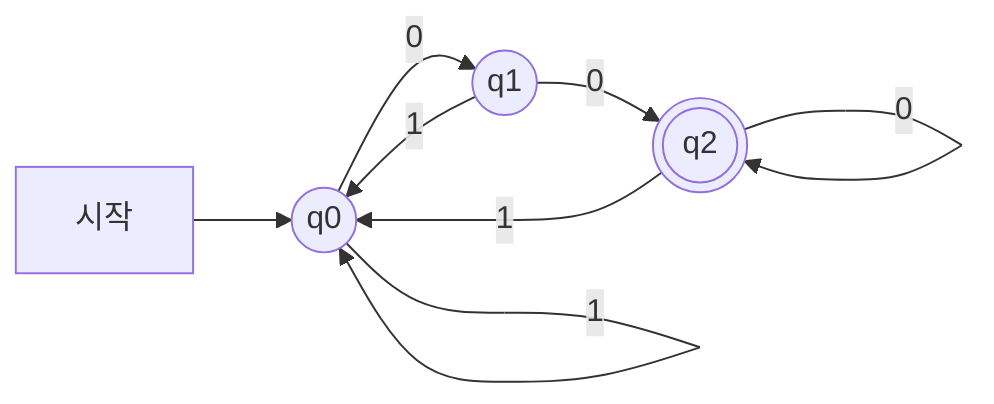
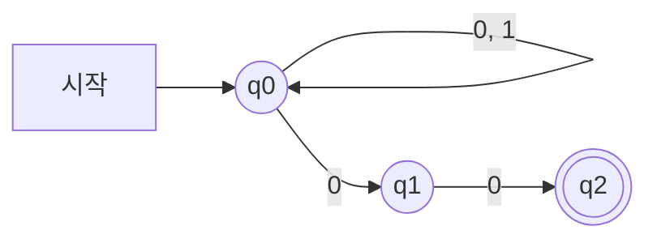


둘 다 [유한 오토마타](/Hongs_Blog/studies/compilers/finite-automata/)이고, 알아볼 수 있는 언어도 똑같이 정규 언어다[^1]. 가르는 질문은 "한 상태에서 글자 하나를 읽었을 때 갈 곳이 하나로 정해지는가"다. 정해지면 DFA(결정적 유한 오토마타), 여러 곳이 될 수 있거나 글자 없이도 옮길 수 있으면 NFA(비결정적 유한 오토마타)다. 갈림길이 없는 외길과, 갈림길마다 분신을 보내 모든 길을 한꺼번에 가 보는 미로의 차이다. 분신 비유는 "한꺼번에"까지만 맞다. 실제 컴퓨터는 분신을 못 만들어서 길을 하나씩 가 보거나 분신들이 있는 칸의 모음을 들고 다닌다.

## 같은 언어, 두 기계

$$\Sigma = \{0, 1\}$$에서 "`00`으로 끝나는 줄", 곧 $$(0 \mid 1)^*00$$을 알아보는 두 기계다[^1].

DFA다. 상태마다 0과 1의 화살표가 하나씩 있다. q0은 "방금 0을 못 봤다", q1은 "끝이 0 하나", q2는 "끝이 00"이다[^s1].

NFA다. q0에서 0을 읽으면 q0에 머물 수도, q1로 갈 수도 있다. 정규 표현식의 모양 그대로다. q0의 고리가 $$(0 \mid 1)^*$$, 뒤의 두 화살표가 $$00$$이다.

`100`을 넣는다.

| 읽은 글자 | DFA의 상태 | NFA에서 말이 있을 수 있는 상태 |
|---|---|---|
| (처음) | q0 | q0 |
| 1 | q0 | q0 |
| 0 | q1 | q0, q1 |
| 0 | q2 | q0, q1, q2 |

DFA는 길이 하나다. q2에서 끝나 받아들인다. NFA는 끝까지 간 길이 셋이다(q0에 계속 머문 길, 마지막에 q1로 간 길, q1을 거쳐 q2로 간 길). 그 가운데 하나가 q2에서 끝나므로 받아들인다[^s1].

## 어느 쪽일까

**C1** (a) 정규 표현식을 보고 손으로 오토마타를 빨리 그려야 한다. (b) 수십만 줄짜리 원시 프로그램의 글자를 하나씩 읽으며 토큰을 잘라야 한다. 각각 DFA와 NFA 중 어느 쪽이 맞는가?

**답:** (a) NFA. 정규 표현식의 조각을 ε-화살표로 이어 붙이기만 하면 된다. (b) DFA. 글자 하나에 표 한 칸만 읽으면 다음 상태가 정해진다. 
**이유:** NFA는 만들고 읽기 쉽지만 돌릴 때 여러 길을 따져야 해서 느리다. DFA는 돌릴 때 빠르지만 손으로 만들기 어렵고 상태가 많아질 수 있다. 그래서 어휘 분석기는 NFA로 만든 뒤 DFA로 바꿔서 쓴다[^2].

**C2** 위의 두 기계에 `1001`을 넣는다. DFA가 거치는 상태를 차례로 쓰고, NFA에서 끝까지 간 길과 중간에 막힌 길이 각각 몇 개인지 쓰라. 두 기계의 답은 같은가?

**답:** DFA는 q0 → q0 → q1 → q2 → q0. q0에서 끝나 거절한다. NFA에서 끝까지 간 길은 q0에만 머문 하나이고, 중간에 막힌 길이 둘이다(q1에서 1을 만난 길, q2에서 1을 만난 길). 받아들이는 상태에서 끝난 길이 없어 거절한다. 답이 같다. 
**이유:** NFA의 q1과 q2에는 1로 나가는 화살표가 없다. 막힌 길은 버린다. 길이 하나라도 받아들이는 상태에서 끝나야 받아들이는데 그런 길이 없다.

## 결정적 차이

| | DFA | NFA |
|---|---|---|
| 한 상태에서 한 글자로 가는 전이의 수 | 0개 또는 1개 | 0개 이상 |
| ε-전이 | 없다 | 있어도 된다 |
| 입력 하나에 대한 길의 수 | 하나뿐 | 여럿일 수 있다 |
| 받아들이는 조건 | 그 길이 받아들이는 상태에서 끝난다 | 받아들이는 상태에서 끝나는 길이 하나라도 있다 |
| 장점 | 돌릴 때 빠르다(길이 하나) | 적기 쉽다(만들기도 읽기도 쉽다) |
| 단점 | 복잡하다. 자리를 많이 쓴다(NFA보다 지수적으로 커질 수 있다) | 느리다(길이 여럿) |

표는 슬라이드의 표다[^3]. 선택을 가르는 줄은 장점과 단점이다. 돌리는 속도가 중요하면 DFA, 만드는 쉬움이 중요하면 NFA다. 알아볼 수 있는 언어는 같아서 "어느 쪽이 더 많은 것을 알아보는가"는 선택 기준이 아니다. NFA를 같은 언어의 DFA로 바꾸는 방법이 [부분집합 구성법](/Hongs_Blog/studies/compilers/subset-construction/)이고, 그 문서에서 상태 $$n$$개짜리 NFA가 $$2^n$$개짜리 DFA가 되는 예를 본다.

원본 오류 의심

원문: p.15 표의 "# of path for a given input" 줄. DFA "Only one", NFA "One or more" / 문제점: 길이 하나도 없을 수 있다. DFA에서 전이가 빈 칸을 만나면 끝까지 가는 길이 0개다(같은 표의 첫 줄이 전이를 "Zero or one"이라 적었다). NFA도 모든 길이 중간에 막힐 수 있다. / 수정안: DFA "많아야 하나", NFA "0개 이상" / 근거: $$1^*0$$의 DFA에 `01`을 넣으면 둘째 글자에서 갈 곳이 없다. 화살표가 q0 →(a) q1 하나뿐인 NFA에 `b`를 넣으면 길이 없다. 뜻이 달라질 만큼 큰 차이는 아니고, "DFA는 길이 갈라지지 않는다"로 읽으면 된다.

검증: 두 기계가 길이 12 이하의 모든 문자열에서 $$(0 \mid 1)^*00$$과 같은 답을 내는 것, `100`의 추적, 카드 C2의 길 수 — [07_dfa-vs-nfa_verify.py](/Hongs_Blog/studies/compilers/code/07_dfa-vs-nfa_verify/)

## 둘 다 아닐 때

**C3** 여는 괄호와 닫는 괄호의 짝이 맞는지 알아봐야 한다. DFA로 할지 NFA로 할지 고민 중이다. 무엇이 문제이고 무엇을 써야 하는가?

**답:** 둘 다 안 된다. DFA와 NFA가 알아보는 언어는 같고, 괄호 짝은 그 밖에 있다. [문맥 자유 문법](/Hongs_Blog/studies/compilers/context-free-grammar/)과 스택을 쓰는 파서가 필요하다. 
**이유:** NFA의 "여러 길"은 기억을 늘려 주지 않는다. 상태 수가 정해져 있는 것은 같아서 끝없이 세는 일은 못 한다: [유한 오토마타](/Hongs_Blog/studies/compilers/finite-automata/).

[^1]: 컴파일러 3회 강의 자료 「Lecture03 Lexical analysis part 2」, p.12~13 (DFA와 NFA의 정의, 같은 정규 언어를 알아본다, $$(0 \mid 1)^*00$$의 두 그래프)
[^2]: 같은 자료, p.14 (DFA는 "Faster to execute", NFA는 "Simpler to represent"), p.16 (정규 표현식 → NFA → DFA)
[^3]: 같은 자료, p.15 (DFA와 NFA의 비교 표)
[^s1]: 보충 두 다이어그램은 원본 p.13의 그림을 옮긴 것이다. DFA의 세 상태가 무엇을 기억하는지의 풀이, `100`과 `1001`의 추적, 분신 비유는 원본에 없다. 추적은 검증 코드로 확인했다.

