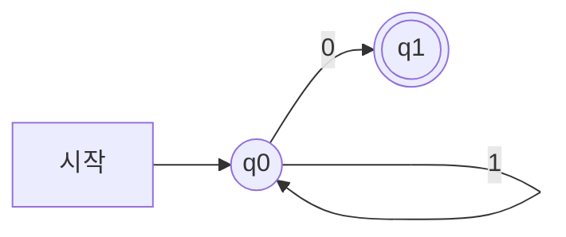
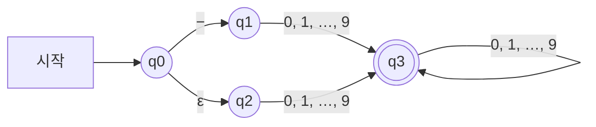



요약

말판 놀이를 떠올리면 된다. 칸 몇 개와 "이 칸에서 이 글자가 나오면 저 칸으로"라는 화살표가 있고, 말 하나를 시작 칸에 놓은 뒤 입력 글자를 한 개씩 읽으며 화살표를 따라 옮긴다. 글자를 다 읽었을 때 말이 표시해 둔 칸에 서 있으면 그 글자 줄을 받아들인다. 글자마다 한 걸음만 가므로 빠르고 만들기 쉽다. 대신 기억하는 것이 "지금 어느 칸인가" 하나뿐이고 칸 수가 정해져 있어서, 끝없이 커질 수 있는 수를 세어야 하는 일은 하지 못한다.

## 예시로 보기

[정규 표현식](/Hongs_Blog/studies/compilers/regular-expression/)은 토큰의 모양을 적어 줄 뿐이다. 글자 줄 하나를 받아 "이 모양이 맞는가"를 답해 주지는 않는다. 그 답을 내는 기계가 필요하다[^1].

알파벳이 $$\{0, 1\}$$인 아래 기계에 `110`을 넣는다[^2].

| 읽은 글자 | 말이 있던 칸 | 옮겨 간 칸 |
|---|---|---|
| 1 | q0 | q0 |
| 1 | q0 | q0 |
| 0 | q0 | q1 |

다 읽었을 때 말이 q1에 있다. q1은 겹동그라미로 표시한 칸이므로 `110`을 받아들인다. `101`을 넣으면 `1`, `0`을 읽고 q1에 갔다가 마지막 `1`에서 나갈 화살표가 없다. 말이 더 못 가므로 받아들이지 않는다.

이 기계가 받아들이는 것은 "1이 몇 개든 이어지다가 0 하나로 끝나는 줄"이다. 정규 표현식으로는 $$1^*0$$이다[^s1]. 칸을 상태, 화살표를 상태 전이, 겹동그라미 칸을 받아들이는 상태라 부른다.

## 정의

유한 오토마타는 토큰을 알아보는 장치다. 정규 표현식으로 적은 모양에 맞으면 입력을 받아들이고, 아니면 거절한다. 문자열 $$s$$가 $$L(token)$$에 들어 있으면 받아들인다[^1].

유한 오토마타는 다섯 가지를 정하면 하나로 정해진다[^1].

기호로 쓰면 $$M = \{Q, \Sigma, \delta, q_0, F\}$$다.

| 기호 | 읽는 법 | 뜻 |
|---|---|---|
| $$Q$$ | 큐 | 상태의 유한한 집합 $$\{q_0, q_1, \dots, q_i\}$$ |
| $$\Sigma$$ | 시그마 | 입력 알파벳. 입력에 나올 수 있는 기호의 유한한 집합 |
| $$\delta$$ | 델타 | 상태 전이 함수. $$\delta(q_0, a) = q_1$$은 "상태 $$q_0$$에서 기호 $$a$$를 읽으면 $$q_1$$로 간다"는 뜻 |
| $$q_0$$ | 큐 영 | 시작 상태. $$Q$$의 원소 하나 |
| $$F$$ | 에프 | 받아들이는 상태의 집합. $$Q$$의 부분집합 |

**받아들인다는 것.** 시작 상태에서 출발해 입력의 기호를 차례로 읽으며 전이를 따라간다. 입력을 끝까지 읽었을 때 $$F$$에 든 상태에 있으면 받아들인다. 중간에 따라갈 전이가 없으면 거절한다[^3]. 오토마타 $$M$$이 받아들이는 문자열을 모두 모은 집합을 $$L(M)$$으로 쓴다[^s1].

**전이 그래프.** 오토마타를 그림으로 그린 것이다[^4].

| 그림 | 뜻 |
|---|---|
| 동그라미 | 상태 |
| "start"라고 적힌 화살표가 들어오는 동그라미 | 시작 상태 |
| 겹동그라미 | 받아들이는 상태 |
| $$q_i$$에서 $$q_j$$로 가는, $$a$$라고 적힌 화살표 | 전이 $$\delta(q_i, a) = q_j$$ |

**전이 표.** 같은 것을 표로 적은 것이다. 줄이 상태, 칸이 기호이고, 칸 안에 다음 상태를 적는다. 갈 곳이 없으면 $$\varnothing$$을 적는다[^5]. 위 예의 표는 이렇다[^s1].

| | 0 | 1 |
|---|---|---|
| q0 | q1 | q0 |
| q1 | $$\varnothing$$ | $$\varnothing$$ |

컴퓨터 안에서는 그림이 아니라 이 표를 배열로 두고 `표[상태][글자]`를 읽는다. 글자 하나에 표 한 칸이다.

**ε-전이(ε-move).** 입력을 읽지 않고 $$q_i$$에서 $$q_j$$로 넘어가는 특별한 전이다. 화살표에 $$\epsilon$$을 적는다[^6]. 말이 글자를 쓰지 않고 공짜로 한 칸 옮기는 셈이다. 표에서는 $$\epsilon$$ 칸을 하나 더 둔다[^5]. ε-전이가 있으면 말이 있을 수 있는 칸이 여럿이 된다: [DFA와 NFA 비교](/Hongs_Blog/studies/compilers/dfa-vs-nfa/).

## 예제

**슬라이드의 간단한 예 둘.** $$\Sigma = \{0\}$$이다[^7].

- 정규 표현식 $$0$$: $$M = \{Q = \{q_0, q_1\},\ \Sigma = \{0\},\ \delta = \{\delta(q_0, 0) = q_1\},\ q_0,\ F = \{q_1\}\}$$. 상태 둘, 화살표 하나다.
- 정규 표현식 $$0^*$$: $$M = \{Q = \{q_0\},\ \Sigma = \{0\},\ \delta = \{\delta(q_0, 0) = q_0\},\ q_0,\ F = \{q_0\}\}$$. 상태 하나가 시작 상태이자 받아들이는 상태이고, 자기 자신으로 돌아오는 화살표가 있다. 아무것도 안 읽어도 받아들이는 상태에 있으므로 빈 문자열도 받아들인다.

**ε-전이가 있는 예.** $$\Sigma = \{0, 1, \dots, 9, -\}$$이다. 슬라이드는 이 그래프가 어떤 정규 표현식인지 묻는다[^8]. 펼치기 전에 답을 써 본다.

답

$$(- \mid \epsilon)\;digit\;digit^*$$. 빼기 기호가 있어도 되고 없어도 되는 정수다.

위쪽 길은 `−`를 읽고 q1로 간다. 아래쪽 길은 아무것도 읽지 않고 q2로 간다. 어느 쪽이든 숫자 하나를 읽어야 q3에 닿고, q3에서는 숫자를 더 읽을 수 있다. `-42`를 넣으면 말이 있을 수 있는 칸이 $$\{q_0, q_2\}$$ → $$\{q_1\}$$ → $$\{q_3\}$$ → $$\{q_3\}$$으로 바뀌어 받아들인다. `-`만 넣으면 q1에서 끝나 거절한다[^s1].

검증: 위 두 그래프가 각각 $$1^*0$$, $$(- \mid \epsilon)\,digit\,digit^*$$와 길이 8~9 이하의 모든 문자열에서 같은 답을 내는 것, 슬라이드의 전이 표 세 개, 추적 값, 카드의 답 — [06_finite-automata_impl.py](/Hongs_Blog/studies/compilers/code/06_finite-automata_impl/)

## 할 수 있는 것과 없는 것

- **할 수 있는 것.** 정규 표현식으로 적을 수 있는 언어는 모두 유한 오토마타로 알아볼 수 있다. 정규 표현식을 오토마타로 바꾸는 방법이 [톰슨 구성법](/Hongs_Blog/studies/compilers/thompson-construction/)이다[^9].
- **멈춘다.** 글자 하나에 한 걸음이고 입력은 유한하므로, 길이 $$n$$인 입력은 $$n$$걸음 뒤에 답이 난다[^s1].
- **할 수 없는 것.** 여는 괄호 $$n$$개 뒤에 닫는 괄호 $$n$$개가 오는 줄만 받아들이는 유한 오토마타는 없다. 상태 수가 정해져 있어서 $$n$$을 끝없이 셀 수 없기 때문이다.

**주장.** 한 상태에서 한 기호로 갈 곳이 많아야 하나이고 ε-전이가 없는 유한 오토마타 가운데, $$\{(^n\,)^n \mid n \ge 0\}$$을 정확히 받아들이는 것은 없다. 증명 기법은 귀류법과 [비둘기집 원리](/Hongs_Blog/studies/discrete-math/pigeonhole/)다[^s2].

증명 펼치기

1. 그런 오토마타 $$M$$이 있고 상태가 $$k$$개라고 하자. — 귀류법의 가정
2. 여는 괄호만으로 된 문자열 $$($$, $$(($$, …, $$(^{k+1}$$을 $$M$$에 넣는다. 어느 것도 중간에 막히지 않는다. $$(^i$$에서 막히면 그 뒤에 무엇을 붙여도 거절하는데, $$(^i\,)^i$$는 받아들여야 하기 때문이다. — $$M$$이 언어를 정확히 받아들인다는 가정
3. 문자열은 $$k + 1$$개인데 상태는 $$k$$개다. 그래서 읽고 난 뒤 같은 상태 $$q$$에 있게 되는 두 문자열 $$(^i$$와 $$(^j$$($$i < j$$)가 있다. — 비둘기집 원리
4. 두 문자열 뒤에 똑같이 $$)^i$$를 붙인다. 둘 다 상태 $$q$$에서 출발해 같은 글자를 읽으므로 같은 상태에서 끝난다. — 다음 상태는 지금 상태와 읽는 글자만으로 정해진다
5. 그 상태가 받아들이는 상태이면 $$(^j\,)^i$$도 받아들인다. 아니면 $$(^i\,)^i$$도 거절한다. 어느 쪽이든 $$M$$이 언어를 정확히 받아들인다는 것과 어긋난다. — $$i \ne j$$
6. 그러므로 그런 $$M$$은 없다. ∎

ε-전이가 있거나 갈 곳이 여럿인 오토마타도 같은 언어를 받아들이는, 갈 곳이 하나뿐인 오토마타로 바꿀 수 있다([부분집합 구성법](/Hongs_Blog/studies/compilers/subset-construction/)). 그래서 어떤 유한 오토마타로도 안 된다. 정규 표현식은 모두 유한 오토마타로 바꿀 수 있으므로, 이 언어를 적는 정규 표현식도 없다.

검증: 상태가 3개 이하인 모든 오토마타(전이를 빠짐없이 채운 5,898개)가 길이 8 이하의 문자열에서 이미 틀린 답을 내는 것, 3단계의 "같은 상태에 닿는 둘"이 늘 있는 것을 전수로 확인했다. 작은 범위의 실험이고, 모든 $$k$$에 대한 근거는 위 증명이다 — [06_finite-automata_impl.py](/Hongs_Blog/studies/compilers/code/06_finite-automata_impl/)

### 스스로 설명해 보기

1. 2단계에서 여는 괄호만 넣은 문자열이 막히지 않는다고 말할 수 있는 까닭

막힌 뒤에는 무엇을 더 읽어도 거절이다. 그런데 $$(^i$$ 뒤에 $$)^i$$를 붙인 문자열은 언어에 들어 있어서 받아들여야 한다. 그래서 $$(^i$$까지는 반드시 갈 곳이 있다.

2. 3단계에서 문자열을 k + 1개 고른 까닭

상태가 $$k$$개이므로 $$k$$개만 넣으면 모두 다른 상태에 갈 수도 있다. 하나 더 많은 $$k + 1$$개를 넣어야 겹치는 것이 반드시 생긴다.

3. 4단계가 기대는 오토마타의 성질

다음 상태가 "지금 상태"와 "읽는 글자"만으로 정해진다는 것이다. 어떤 길로 그 상태에 왔는지는 기억에 없다. 그래서 같은 상태에 있는 두 말은 같은 글자를 읽으면 끝까지 같이 간다.

이 증명의 핵심 아이디어는?

오토마타의 기억은 상태 하나뿐이다. 구별해야 할 것(여는 괄호를 몇 개 읽었나)이 상태 수보다 많으면 서로 다른 둘을 같은 것으로 뭉개게 되고, 뒤에 같은 것을 붙여 그 차이를 드러내면 모순이 난다.

이 방법을 쓸 수 있는 다른 상황은?

$$a^n b^n$$, "앞뒤가 같은 문자열(회문)", "0과 1의 개수가 같은 문자열"처럼 끝없이 많은 경우를 기억해야 하는 언어가 정규 언어가 아님을 보일 때 쓴다. 해시 함수에서 입력이 출력보다 많으면 충돌이 반드시 있다는 논증도 같은 꼴이다.

## 활용

- 어휘 분석기의 속이 유한 오토마타다. 정규 표현식 → NFA → DFA → 전이 표의 순서로 만들고, 표를 따라가며 토큰을 자른다[^9]. 자르는 방법은 [최장 일치와 토큰 인식](/Hongs_Blog/studies/compilers/longest-match-tokenizing/)에 있다.
- 시간: 전이 표가 있으면 글자 하나에 표를 한 번 읽는다. 길이 $$n$$인 입력에 $$n$$번이다. 공간: 상태 수 × 기호 수 크기의 표다[^s1].
- 어셈블리어에서 `CMP`와 조건 점프로 짜는 [유한 상태 기계](/Hongs_Blog/studies/assembly-language/asm-finite-state-machine/)가 같은 기계다. 상태 하나가 레이블 하나이고, 전이가 점프다.
- 흔한 실수: 시작 상태가 받아들이는 상태인 것을 놓쳐 빈 문자열을 빼먹는다.
- 흔한 실수: 전이 표의 $$\varnothing$$ 칸을 "제자리에 머문다"로 읽는다. 갈 곳이 없어 거절한다는 뜻이다.

## 연결

- 선수: [정규 표현식](/Hongs_Blog/studies/compilers/regular-expression/)
- 갈 곳이 하나인 것과 여럿인 것: [DFA와 NFA 비교](/Hongs_Blog/studies/compilers/dfa-vs-nfa/)
- 괄호 짝처럼 셀 것이 있는 모양을 다루는 도구: [문맥 자유 문법](/Hongs_Blog/studies/compilers/context-free-grammar/). 파서는 상태에 더해 스택을 써서 센다.
- 정규 표현식 하나를 상태 그림으로 옮긴 예: [문자열 파싱과 정규 표현식](/Hongs_Blog/studies/algorithms/string-parsing/)

## 자주 하는 오해

"가는 길에 받아들이는 상태를 한 번이라도 지나면 받아들인다"

틀렸다. 받아들이는지는 입력을 **끝까지 읽은 순간**의 상태로만 정한다. 맨 위의 $$1^*0$$ 기계에 `01`을 넣으면 `0`을 읽고 받아들이는 상태 q1에 가지만, 남은 `1`을 읽을 화살표가 없어 거절한다. `01`은 $$1^*0$$의 모양이 아니다. 그럴듯해 보이는 까닭은 겹동그라미를 "도착하면 끝나는 결승점"으로 읽기 때문이다. 겹동그라미는 "여기서 입력이 끝나면 합격"이라는 표시일 뿐이고, 입력이 남아 있으면 계속 가야 한다. 다만 어휘 분석기는 "지나온 받아들이는 상태 가운데 마지막 것"을 따로 적어 두었다가 거기서 토큰을 자른다. 이것은 한 문자열을 받아들이는 일이 아니라 긴 입력의 앞부분을 잘라 내는 다른 일이다: [최장 일치와 토큰 인식](/Hongs_Blog/studies/compilers/longest-match-tokenizing/).

## 확인 문제

**C1** 유한 오토마타를 정하는 다섯 가지를 쓰고, 문자열을 받아들이는 조건을 쓰라.

**답:** 상태의 유한 집합 $$Q$$, 입력 알파벳 $$\Sigma$$, 상태 전이 함수 $$\delta$$, 시작 상태 $$q_0$$, 받아들이는 상태의 집합 $$F \subseteq Q$$. 시작 상태에서 입력을 차례로 읽어 전이를 따라갔을 때, 입력을 다 읽은 순간의 상태가 $$F$$에 들면 받아들인다. 
**이유:** 흔한 오답은 "받아들이는 상태를 지나면"이라고 쓰는 것이다. 끝났을 때의 상태만 본다.

**C2** 맨 위의 기계(q0에서 1을 읽으면 q0, 0을 읽으면 q1, q1이 받아들이는 상태)에 `1101`을 넣는다. 글자를 읽을 때마다 말이 있는 칸을 적고, 받아들이는지 답하라.

**답:** q0 → (1) q0 → (1) q0 → (0) q1 → (1) 갈 곳 없음. 거절한다. 
**이유:** q1에서 나가는 화살표가 없다. 전이 표의 q1 줄이 모두 $$\varnothing$$이다.

**C3** "1이 짝수 개(0개 포함) 들어 있는 0과 1의 줄"을 받아들이는 오토마타를 전이 표로 적으라. 상태는 둘이면 된다.

**답:** 상태를 "짝", "홀"로 둔다. 시작 상태와 받아들이는 상태는 둘 다 "짝"이다.

| | 0 | 1 |
|---|---|---|
| 짝 | 짝 | 홀 |
| 홀 | 홀 | 짝 |

**이유:** 기억할 것은 "지금까지 1이 짝수 개였나 홀수 개였나" 하나다. 0은 그 답을 바꾸지 않고 1은 뒤집는다. 1의 개수 자체는 끝없이 커질 수 있지만, 짝·홀은 두 가지뿐이라 상태 둘로 된다[^s1].

**C4** 괄호 짝 증명에서 "$$(^i$$와 $$(^j$$가 같은 상태에 닿으면 뒤에 $$)^i$$를 붙인 둘도 같은 상태에서 끝난다"는 오토마타의 어떤 성질에서 나오는가? 스택을 하나 더 쓰는 기계에서는 이 단계가 왜 통하지 않는가?

**답:** 다음 상태가 지금 상태와 읽는 글자만으로 정해진다는 성질에서 나온다. 스택이 있으면 같은 상태에 있어도 스택에 쌓인 것(여는 괄호 $$i$$개와 $$j$$개)이 달라서, 같은 글자를 읽고도 다르게 움직인다. 
**이유:** 유한 오토마타의 기억은 상태가 전부다. 스택은 상태 밖의 기억이고 크기에 끝이 없어서 비둘기집 논증이 걸리지 않는다.

**C5** 1의 개수가 짝수인지는 상태 둘로 알아보는데(C3), 여는 괄호와 닫는 괄호의 개수가 같은지는 상태를 아무리 늘려도 못 알아본다. 무엇이 다른가?

**답:** 앞의 것은 기억할 경우가 두 가지(짝, 홀)로 정해져 있다. 뒤의 것은 "여는 괄호를 몇 개 읽었나"를 정확히 기억해야 하고, 그 경우가 0, 1, 2, …로 끝이 없다. 
**이유:** 상태 수는 오토마타를 만들 때 정해지는데 입력의 길이는 정해져 있지 않다. 구별할 경우가 유한하면 상태 하나에 경우 하나를 맡기면 되고, 끝이 없으면 어떤 상태 수로도 모자란다.

[^1]: 컴파일러 3회 강의 자료 「Lecture03 Lexical analysis part 2」, p.4 (Finite automata: 받아들이거나 거절한다, 다섯 가지 구성 요소)
[^2]: 같은 자료, p.8 ($$\Sigma = \{0, 1\}$$인 전이 그래프. 어떤 정규 표현식인지 묻는다)
[^3]: 같은 자료, p.13 (시작 상태에서 받아들이는 상태까지 가는 길이 있을 때만 받아들인다), p.40 (전이 규칙이 없으면 오류)
[^4]: 같은 자료, p.5 (전이 그래프의 그림 기호)
[^5]: 같은 자료, p.11 (전이 표 세 개)
[^6]: 같은 자료, p.9 (ε-move)
[^7]: 같은 자료, p.6~7 (정규 표현식 $$0$$과 $$0^*$$의 오토마타)
[^8]: 같은 자료, p.10 ($$\Sigma = \{0, \dots, 9, -\}$$인 전이 그래프. 어떤 정규 표현식인지 묻는다)
[^9]: 같은 자료, p.16 (어휘 분석기를 만드는 순서: 정규 표현식 → NFA → DFA)
[^s1]: 보충 p.8과 p.10의 물음에 대한 답($$1^*0$$, $$(- \mid \epsilon)\,digit\,digit^*$$), `110`·`101`·`-42`의 추적, p.8 그래프의 전이 표, $$L(M)$$ 표기, 시간과 공간, 카드 C2·C3·C5는 원본에 없다. 답과 추적은 구현 코드로 확인했다.
[^s2]: 보충 원본은 괄호 짝이 정규 표현식이 아니라고만 적었다(Lecture04 p.9). 증명, 스스로 설명해 보기, 카드 C4는 원본에 없다. 비둘기집 원리를 쓰는 표준 논증이다(Sipser, *Introduction to the Theory of Computation* 3판, 1.4절).

