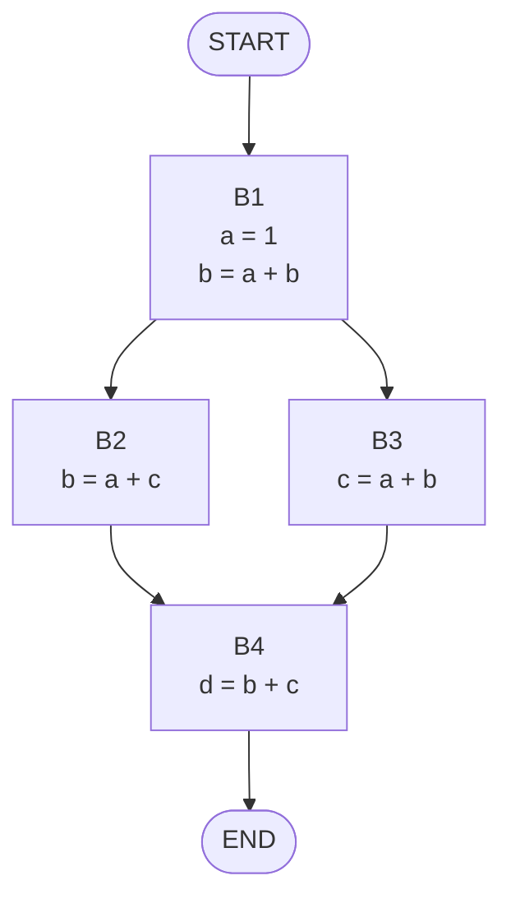
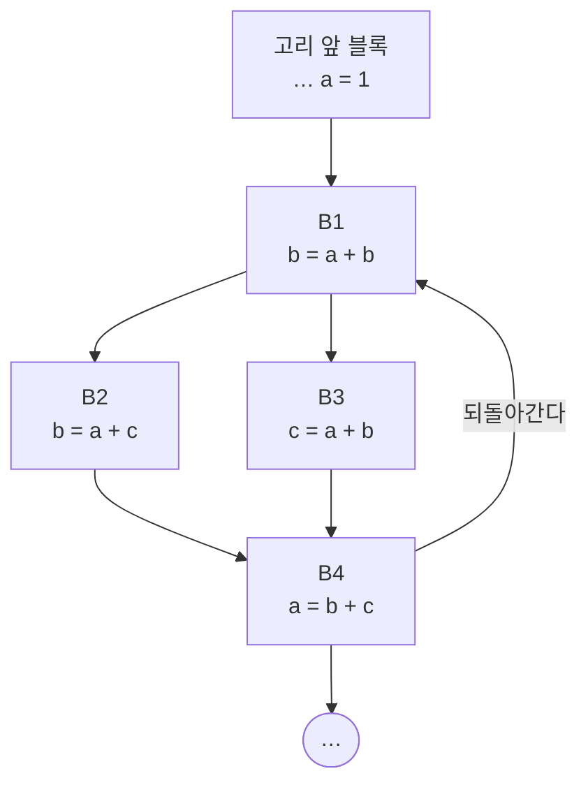


<div class="callout callout-summary" markdown="1">
<div class="callout-title callout-title--default" markdown="span">요약</div>

여러 길로 올 수 있는 교차로에서 "여기 오는 사람은 누구나 우산을 들고 있다"고 말하려면, 어느 길로 왔든 우산을 들고 있어야 한다. 코드에서도 "이 자리에서 a는 1이다" 같은 사실을 프로그램의 처음부터 앞으로 넘겨 가다가, 길이 합쳐지는 곳에서는 모든 길에 공통으로 있는 사실만 남긴다. 남은 사실로 변수를 값으로 바꿔 쓰거나 같은 계산을 한 번만 하게 고친다. 되돌아오는 길(반복문)이 있으면 그 길로 온 사실과도 맞춰 봐야 하므로, 더 바뀌지 않을 때까지 되풀이한 뒤에 고친다.

</div>


## 예시로 보기

[사용 가능한 식 분석](/Hongs_Blog/studies/compilers/available-expressions/)은 블록 하나 안에서 "지금 믿어도 되는 식"의 집합을 위에서 아래로 넘겼다. 블록의 첫 줄에서는 집합이 비어 있다고 쳤다. 그러면 앞 블록에서 `a = 1`을 했어도 다음 블록은 그것을 모른다. 블록 사이로 집합을 넘겨야 `a`를 1로 바꿔 쓸 수 있다[^1].

블록 넷으로 본다. 블록 이름은 설명하려고 붙였다[^2][^s1].



프로그램의 처음에는 믿을 식이 없다. 빈 집합으로 시작해 앞에서부터 내려간다. 블록 안에서는 지역 분석과 똑같이 한다.

| 차례 | 블록 | 시작 집합 | 한 줄씩 | 끝 집합 |
|---|---|---|---|---|
| 1 | B1 | {} | `a = 1` 뒤 {a = 1}. `b = a + b`는 a를 1로 바꿔 `b = 1 + b` | {a = 1} |
| 2 | B2 | {a = 1} (B1의 끝) | `b = a + c` → `b = 1 + c` | {a = 1, b = 1 + c} |
| 3 | B3 | {a = 1} (B1의 끝) | `c = a + b` → `c = 1 + b` | {a = 1, c = 1 + b} |
| 4 | B4 | {a = 1, b = 1 + c} ∩ {a = 1, c = 1 + b} = {a = 1} | `d = b + c`는 고칠 것이 없다 | {a = 1, d = b + c} |

결과는 B1 `a = 1; b = 1 + b`, B2 `b = 1 + c`, B3 `c = 1 + b`, B4 `d = b + c`다[^3].

1번 줄에서 `b = 1 + b`를 지난 뒤 집합에 `b = 1 + b`가 들어가지 않는다. 이 줄을 지나면 b가 새 값이 되는데, 새 b가 "1 + 새 b"와 같을 수는 없다. 자기 자신을 읽어서 자기에게 넣는 줄은 지난 뒤에 믿을 식이 되지 못한다[^s2].

4번 줄이 핵심이다. B4에는 B2에서도 오고 B3에서도 온다. B2에서 왔다면 `b = 1 + c`가 맞지만 B3에서 왔다면 맞지 않는다. 어느 길로 왔는지 모르므로 두 길 모두에서 맞는 `a = 1`만 믿는다[^4].

<div class="callout callout-check" markdown="1">
<div class="callout-title" markdown="span">검증: 위 표의 집합과 결과 코드(슬라이드 p.22~27), 아래 고리 예의 바퀴별 집합(p.30~34), 합집합으로 합치면 거짓인 식이 섞이는 것, 무작위 제어 흐름 그래프 1,500개에서 집합의 식이 실행 중에 실제로 참이고 고친 뒤에도 모든 변수 값이 같음, 카드 C1 — [45_global-available-expressions_impl.py](/Hongs_Blog/studies/compilers/code/45_global-available-expressions_impl/)</div>

</div>


## 정의

**쉬운 말로.** 어떤 지점에서 식 `x = …`가 사용 가능하다는 것은, 프로그램의 처음에서 그 지점까지 오는 모든 길에서 그 식이 지금도 맞다는 뜻이다. 전역 분석은 지역 분석의 규칙에 두 가지를 보탠다[^4].

1. 블록의 끝 집합을 다음 블록들에 넘긴다.
2. 앞 블록이 여럿이면, 블록의 시작 집합은 앞 블록들의 끝 집합에 공통으로 든 식만 모은 것이다.

**기호로 쓰면.** 블록 $$B$$의 시작 집합을 $$\text{IN}[B]$$, 끝 집합을 $$\text{OUT}[B]$$라 쓴다. $$\text{pred}(B)$$는 $$B$$ 바로 앞에 실행될 수 있는 블록들의 집합이다[^s3].

$$\text{IN}[B] = \bigcap_{P \in \text{pred}(B)} \text{OUT}[P], \qquad \text{IN}[\text{첫 블록}] = \emptyset$$


블록 안의 문장 `x = e`를 지날 때는 앞의 집합 $$A_{\text{앞}}$$에서 뒤의 집합 $$A_{\text{뒤}}$$를 이렇게 만든다. $$x$$가 들어 있는 식을 모두 빼고, 새 식 `x = e`를 넣는다. 단, $$e$$가 $$x$$를 읽으면 넣지 않는다.

$$A_{\text{뒤}} = \{\, s \in A_{\text{앞}} : s\text{에 } x\text{가 없다} \,\} \cup \{\, x = e \,\}$$


집합이 있으면 지역 최적화 때의 두 가지 고쳐 쓰기를 그대로 한다. `b = a`나 `b = 상수`가 집합에 있으면 뒤 문장의 b를 그 값으로 바꾼다(복사 전파). 오른쪽이 같은 식이 집합에 있으면 다시 계산하지 않고 그 변수를 가져다 쓴다(공통 부분식 제거)[^1].

### 되돌아오는 길이 있을 때

고리 앞에서 `a = 1`을 하고, 고리 안 B4에서 `a = b + c`를 한 뒤 B1로 되돌아가는 프로그램이다[^5].



B1에는 고리 앞에서도 오고 B4에서도 온다. B1의 시작 집합을 알려면 B4의 끝 집합이 필요한데, 그것은 B1부터 내려가야 나온다. [전역 생존 변수 분석](/Hongs_Blog/studies/compilers/global-live-variable-analysis/)과 방향만 반대인 같은 문제다. 푸는 단계도 방향만 반대다[^6].

```
1단계: 고리 앞 블록들을 먼저 처리한다 (고쳐 쓰기까지 한다)
2단계: 고리의 첫 블록에서 끝 블록까지 사용 가능한 식 분석만 한다 (고쳐 쓰지 않는다)
3단계: 고리 첫 블록의 시작 집합 = 지금 값 ∩ 고리 끝 블록의 끝 집합
4단계: 2~3단계를 집합이 더 바뀌지 않을 때까지 되풀이한다
5단계: 다 구한 집합으로 고리 안 블록을 고쳐 쓴다
```

| 지점 | 첫 바퀴 | 둘째 바퀴 |
|---|---|---|
| B1 시작 | {a = 1} | {a = 1} ∩ {a = b + c} = {} |
| B1 끝 | {a = 1} | {} |
| B2 끝 | {a = 1, b = a + c} | {b = a + c} |
| B3 끝 | {a = 1, c = a + b} | {c = a + b} |
| B4 시작 = B2 끝 ∩ B3 끝 | {a = 1} | {} |
| B4 끝 | {a = b + c} | {a = b + c} |

첫 바퀴의 B4에서 `a = b + c`는 a가 든 식 `a = 1`을 빼고 자기를 넣는다. 그래서 B4의 끝 집합에는 `a = 1`이 없다. 3단계에서 B1의 시작 집합이 빈 집합이 된다. 셋째 바퀴에서는 바뀌는 것이 없어 멈춘다. B1~B3의 시작 집합이 모두 비었으므로 고칠 줄이 하나도 없고, 프로그램은 그대로다[^7].

**2단계에서 고쳐 쓰면 안 되는 까닭.** 첫 바퀴의 집합만 보면 B1에서 `b = a + b`를 `b = 1 + b`로 바꾸게 된다. 처음 들어올 때는 맞지만, 고리를 한 바퀴 돈 뒤에는 a가 `b + c`의 값이라 1이 아니다. a = 1, b = 2, c = 3으로 시작해 B1 → B2 → B4 → B1을 따라가면 둘째로 B1에 왔을 때 a는 7이다[^s2].

## 활용

- 구현: [45_global-available-expressions_impl.py](/Hongs_Blog/studies/compilers/code/45_global-available-expressions_impl/). 연습: [전역 분석 예제 사다리](/Hongs_Blog/studies/compilers/global-dataflow-ladder/)
- 이 분석 하나로 전역 복사 전파, 전역 상수 전파, 전역 공통 부분식 제거를 한다[^8].
- **코드 이동.** 전역으로 봐야만 할 수 있는 최적화도 있다. 코드를 한 블록에서 다른 블록으로 옮겨 쓸데없는 계산을 줄이는 것이 그 예다[^8]. 고리를 돌 때마다 같은 값이 나오는 계산을 고리 앞으로 꺼내면 한 번만 계산한다[^s4].
- 틀려도 되는 쪽: 실제로는 맞는 식을 집합에서 빠뜨리는 것은 괜찮다. 고칠 기회를 놓칠 뿐이다. 맞지 않는 식을 집합에 넣으면 프로그램이 틀린다. 그래서 길이 합쳐질 때 줄이는 쪽(교집합)을 쓴다[^s3].
- 흔한 실수: 고리 첫 블록의 시작 집합을 고리 앞 블록의 끝 집합으로만 정한다. 되돌아오는 길의 집합과도 교집합을 해야 한다.

## 연결

- 선수: [사용 가능한 식 분석](/Hongs_Blog/studies/compilers/available-expressions/)(블록 하나), [기본 블록과 제어 흐름 그래프](/Hongs_Blog/studies/compilers/basic-block-cfg/)
- 방향이 반대인 짝: [전역 생존 변수 분석](/Hongs_Blog/studies/compilers/global-live-variable-analysis/). 둘을 나란히 놓은 표는 [사용 가능한 식과 생존 변수 비교](/Hongs_Blog/studies/compilers/available-vs-live/)에 있다.
- 블록 안에서 하는 고쳐 쓰기: [지역 최적화 기법](/Hongs_Blog/studies/compilers/local-optimizations/)

## 확인 문제

<details class="callout callout-question" markdown="1">
<summary class="callout-title" markdown="span">**C1** B1 `a = 1`, B2 `c = a + b`, B3 `c = a + b`, B4 `d = a + b`이고 B1 → B2, B1 → B3, B2 → B4, B3 → B4다(고리 없음). B4의 시작 집합과, 고쳐 쓴 뒤의 네 블록을 쓰라.</summary>

**답:** B1 끝 {a = 1}. B2: `c = 1 + b`, 끝 {a = 1, c = 1 + b}. B3도 같다. B4 시작 = 두 끝 집합의 교집합 = {a = 1, c = 1 + b}. B4의 `d = a + b`는 a를 1로 바꿔 `d = 1 + b`가 되고, 오른쪽이 같은 식 `c = 1 + b`가 집합에 있으므로 `d = c`로 바뀐다. 결과: B1 `a = 1`, B2 `c = 1 + b`, B3 `c = 1 + b`, B4 `d = c`.<br>
**이유:** 두 길이 같은 식을 만들면 교집합에 남는다. 예시에서는 두 길이 다른 식(`b = 1 + c`, `c = 1 + b`)을 만들어서 빠졌다[^s1].

</details>


<details class="callout callout-question" markdown="1">
<summary class="callout-title" markdown="span">**C2** 3단계 "고리 첫 블록의 시작 집합 = 지금 값 ∩ 고리 끝 블록의 끝 집합"이 하는 일을 한 문장으로 쓰라.</summary>

**답:** 고리에 처음 들어올 때 맞던 식 가운데 고리를 한 바퀴 돌고 온 뒤에도 맞는 식만 남긴다.

</details>


<details class="callout callout-question" markdown="1">
<summary class="callout-title" markdown="span">**C3** 길이 합쳐지는 블록의 시작 집합은 왜 합집합이 아니라 교집합인가?</summary>

**답:** 사용 가능하다는 것은 "어느 길로 왔든 맞다"는 뜻이다. 한쪽 길에서만 맞는 식을 믿고 고쳐 쓰면, 다른 길로 왔을 때 틀린 값을 쓴다.<br>
**이유:** 예시에서 합집합을 쓰면 B4의 시작 집합에 `c = 1 + b`가 들어간다. 그런데 B2로 왔다면 c는 B3의 줄을 거치지 않았다. b = 5, c = 7로 시작하면 B2를 지난 뒤 b = 8, c = 7이라 `c = 1 + b`는 거짓이다. 생존 변수 분석이 합집합을 쓰는 것과 헷갈리기 쉽다. 저쪽은 "한 길에서라도 읽히면 살았다"이고 이쪽은 "모든 길에서 맞아야 믿는다"이다.

</details>


[^1]: 컴파일러 13회 강의 자료 「Lecture13 Code optimization part 2」, p.20 (전역 복사 전파·공통 부분식 제거의 핵심 생각, 지역 분석 복습 표)
[^2]: 같은 자료, p.21~24 (단순한 예의 제어 흐름 그래프와 블록별 집합)
[^3]: 같은 자료, p.26~27 (단순한 예의 마지막 집합과 결과)
[^4]: 같은 자료, p.23 (끝 집합을 다음 블록들에 넘긴다), p.25 (다음 블록의 시작 집합 = 앞 블록들 결과의 교집합)
[^5]: 같은 자료, p.28 (고리가 있는 예)
[^6]: 같은 자료, p.29~33 (다섯 단계)
[^7]: 같은 자료, p.30~35 (바퀴별 집합과 결과). p.32의 B2 시작 집합에 지워진 글자로 "{a = 1b}"가 보이는데 "{a = 1}"의 오타로 읽었다.
[^8]: 같은 자료, p.36 (전역 최적화 요약, 코드 이동)
[^s1]: <span class="fn-tag" title="수업 자료에 없고 따로 보탠 내용">보충</span> 블록 이름, 차례를 적은 표, 다이어그램 2개, 카드 C1의 문제는 원본에 없다. 다이어그램은 슬라이드 p.21과 p.28의 그림을 옮긴 것이고, 표와 카드의 값은 구현 코드로 확인했다.
[^s2]: <span class="fn-tag" title="수업 자료에 없고 따로 보탠 내용">보충</span> `b = 1 + b`가 집합에 들어가지 않는 까닭과, 첫 바퀴에 고쳐 쓰면 틀리는 수치 예(둘째로 B1에 왔을 때 a = 7)는 원본에 없다. 슬라이드 p.22는 까닭을 적지 않고 `b = 1 + b` 뒤의 집합을 {a = 1}로만 보인다. 수치 예는 구현 코드로 확인했다.
[^s3]: <span class="fn-tag" title="수업 자료에 없고 따로 보탠 내용">보충</span> IN, OUT, pred 기호와 두 식, "빠뜨리는 쪽은 괜찮다"는 설명은 원본에 없다. 슬라이드 p.20, p.25의 말로 된 규칙을 기호로 옮겼다(Aho·Lam·Sethi·Ullman, Compilers 2판, 9.2절).
[^s4]: <span class="fn-tag" title="수업 자료에 없고 따로 보탠 내용">보충</span> 고리 밖으로 꺼내는 예는 원본에 없다. 슬라이드 p.36은 "코드를 한 블록에서 다른 블록으로 옮겨 불필요한 계산을 피한다"까지만 적는다.

