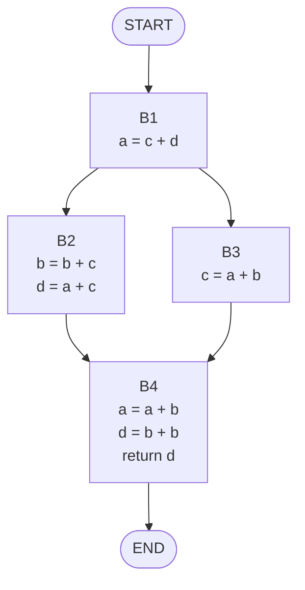
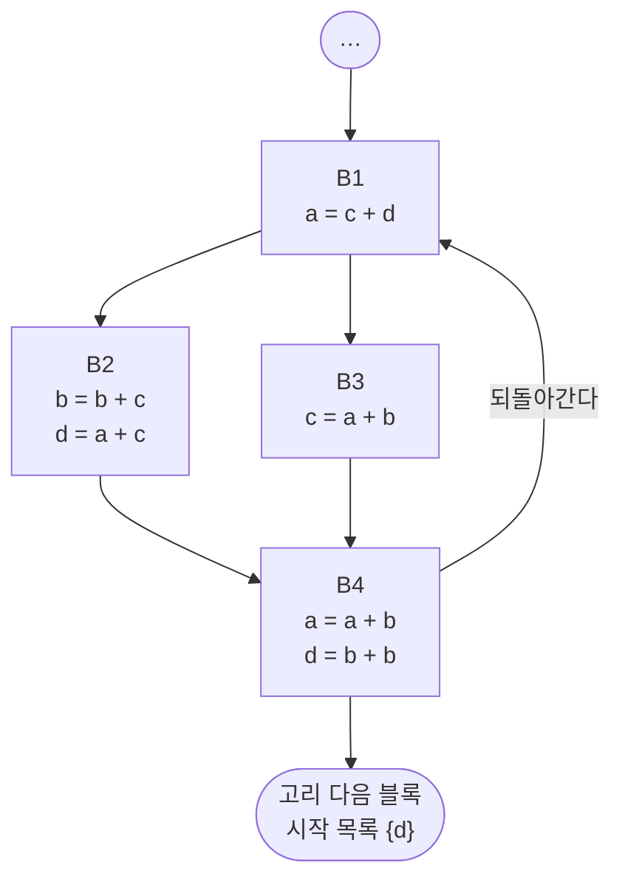


<div class="callout callout-summary" markdown="1">
<div class="callout-title callout-title--default" markdown="span">요약</div>

이사 갈 때 "새집에서 쓸 물건"만 싸려면, 새집에서 무엇을 쓸지 먼저 알아야 한다. 코드 덩어리 하나만 봐서는 그 뒤에 무엇이 쓰일지 모르므로, 프로그램의 끝에서부터 거꾸로 올라오며 "여기서부터 앞으로 쓰일 값"의 목록을 덩어리마다 넘겨준다. 길이 둘로 갈라지는 곳에서는 두 길의 목록을 합친다. 이 목록에 없는 변수에 값을 넣는 줄은 지워도 된다. 되돌아가는 길(반복문)이 있으면 목록이 한 바퀴 돌아 다시 바뀔 수 있어서, 더 바뀌지 않을 때까지 되풀이한 뒤에야 지울 수 있다.

</div>


## 예시로 보기

[생존 변수 분석](/Hongs_Blog/studies/compilers/live-variable-analysis/)은 블록 하나를 뒤에서부터 훑었다. 그때 "블록이 끝난 뒤에도 쓰이는 변수"는 누가 알려 준다고 치고 시작했다. 그 정보는 블록 하나만 봐서는 알 수 없다. 다음 블록들이 무엇을 읽는지 봐야 하기 때문이다[^1].

블록 넷으로 된 프로그램으로 본다. 블록 이름 B1~B4는 설명하려고 붙였다[^2][^s1].



B4 뒤에는 아무것도 없다. 그래서 B4의 끝에서 살아 있는 변수는 없다. 여기서 출발해 거꾸로 올라간다. 블록 안에서는 지역 분석 때와 똑같이 한다. `x = y + z`를 만나면, 그 줄 뒤의 목록에서 `x`를 빼고 `y`, `z`를 넣은 것이 그 줄 앞의 목록이다. `x`가 뒤의 목록에 없으면 그 줄은 지운다.

| 차례 | 블록 | 블록 끝의 목록 | 뒤에서부터 훑기 | 블록 시작의 목록 |
|---|---|---|---|---|
| 1 | B4 | {} | `return d` 앞은 {d}. `d = b + b` 앞은 {b}. `a = a + b`는 a가 {b}에 없어 지운다 | {b} |
| 2 | B2 | {b} (B4의 시작 목록) | `d = a + c`는 d가 {b}에 없어 지운다. `b = b + c` 앞은 {b, c} | {b, c} |
| 3 | B3 | {b} (B4의 시작 목록) | `c = a + b`는 c가 {b}에 없어 지운다 | {b} |
| 4 | B1 | {b, c} ∪ {b} = {b, c} | `a = c + d`는 a가 {b, c}에 없어 지운다 | {b, c} |

눈여겨볼 곳이 둘 있다[^3].

- B4 앞에는 블록이 둘(B2, B3) 있다. B4의 시작 목록 {b}를 두 블록의 끝 목록으로 똑같이 넘겨준다.
- B1 뒤에는 블록이 둘 있다. B1이 끝난 뒤 어느 길로 갈지 모르므로, 두 길의 시작 목록을 합친 것이 B1의 끝 목록이다. 한쪽 길에서라도 쓰이면 살아 있는 것이다.

대입문 여섯 줄 가운데 넷이 지워지고 `b = b + c`(B2)와 `d = b + b`(B4)만 남는다. `return d`의 값은 두 길 모두에서 지우기 전과 같다.

<div class="callout callout-check" markdown="1">
<div class="callout-title" markdown="span">검증: 위 표의 목록과 남는 코드, 지우기 전후의 `return` 값이 두 길에서 같음(무작위 초깃값 500개), 아래 고리 예의 바퀴별 목록(슬라이드 p.14, p.16, p.18)과 결과 코드(p.19), 무작위 제어 흐름 그래프 1,500개에서 지운 뒤에도 살아 있는 변수의 값이 같음, 카드 C2 — [44_global-live-variable-analysis_impl.py](/Hongs_Blog/studies/compilers/code/44_global-live-variable-analysis_impl/)</div>

</div>


<div class="callout callout-warning" markdown="1">
<div class="callout-title" markdown="span">원본 오류 의심</div>

원문: 13회 슬라이드 p.5~8은 B4의 둘째 줄을 `d = b + b`로 적었는데, p.9~11은 같은 자리를 `d = b + c`로 적었다. p.11은 결과를 `b = b + c` → `d = b + c; return d`의 한 줄기로 그렸다.<br>
문제점: ① 같은 예제 안에서 문장이 바뀌었다. p.6이 구한 목록 {b}는 `d = b + b`일 때의 값이다(`d = b + c`면 {b, c}다). ② 지운 뒤에도 B1에서 갈라지는 두 길은 남는다. 오른쪽 길(B3)은 비었을 뿐이고, 그 길로 가면 `b = b + c`를 하지 않는다. 한 줄기로 합치면 늘 `b = b + c`를 한다.<br>
수정안: 결과는 B2에 `b = b + c`, B4에 `d = b + b; return d`가 남고, B1과 B3은 빈 블록으로 남는 것이다. 이 문서는 `d = b + b`를 따랐다.<br>
근거: a = 0, b = 1, c = 2, d = 0에서 원래 프로그램은 왼쪽 길로 6, 오른쪽 길로 2를 돌려준다. p.11의 한 줄기 코드는 5를 돌려준다. `d = b + b`로 고쳐도 한 줄기면 늘 6이라 오른쪽 길의 2와 다르다(검증 코드).

</div>


## 정의

제어 흐름 그래프 전체를 보고 하는 최적화를 전역 최적화(global optimization)라 부른다. 지역 최적화 기법 가운데 여럿을 그대로 전역으로 넓힐 수 있고, 죽은 코드 제거가 그 하나다[^4].

**쉬운 말로.** 어떤 지점에서 변수가 살아 있다는 것은, 그 지점에서 출발하는 길 가운데 그 변수의 지금 값을 읽는 길이 하나라도 있다는 뜻이다. 전역 분석은 지역 분석의 규칙에 두 가지를 보탠다[^3].

1. 블록의 끝 목록은 바로 다음에 올 수 있는 블록들의 시작 목록을 모두 합친 것이다.
2. 블록의 시작 목록은 그 블록 앞에 올 수 있는 모든 블록에 똑같이 넘겨진다.

**기호로 쓰면.** 블록 $$B$$의 시작 목록을 $$\text{IN}[B]$$, 끝 목록을 $$\text{OUT}[B]$$라 쓴다. $$\text{succ}(B)$$는 $$B$$ 바로 다음에 실행될 수 있는 블록들의 집합이다[^s2].

$$\text{OUT}[B] = \bigcup_{S \in \text{succ}(B)} \text{IN}[S]$$


블록 안의 문장 `x = y op z` 하나를 거꾸로 지날 때는 뒤의 목록 $$L_{\text{뒤}}$$에서 앞의 목록 $$L_{\text{앞}}$$을 이렇게 만든다. 쓰는 변수 $$x$$를 빼고 읽는 변수 $$y, z$$를 넣는다.

$$L_{\text{앞}} = (L_{\text{뒤}} \setminus \{x\}) \cup \{y, z\}$$


`b = b + c`처럼 같은 변수를 읽고 쓰면 먼저 빼고 나중에 넣으므로 b는 앞의 목록에 남는다.

### 되돌아가는 길이 있을 때

반복문이 있으면 블록 끝에서 앞쪽 블록으로 되돌아가는 간선이 생긴다. 위 예의 B4에서 B1로 가는 간선을 더하고, 반복이 끝난 뒤의 블록은 d만 읽는다고 하자[^5].



B4의 끝 목록을 알려면 B1의 시작 목록이 필요하다. 그런데 B1의 시작 목록은 B2, B3, B4를 거쳐야 나온다. 서로 물려 있어서 한 번에 못 구한다. 슬라이드는 다섯 단계로 푼다[^6].

```
1단계: 고리 다음 블록들을 먼저 처리한다 (죽은 코드까지 지운다)
2단계: 고리의 끝 블록에서 첫 블록까지 생존 변수 분석만 한다 (지우지 않는다)
3단계: 고리 끝 블록의 끝 목록 = 지금 값 ∪ 고리 첫 블록의 시작 목록
4단계: 2~3단계를 목록이 더 바뀌지 않을 때까지 되풀이한다
5단계: 다 구한 목록으로 고리 안 블록의 죽은 코드를 지운다
```

## 예제

고리 예를 단계대로 따라간다[^6].

*1단계.* 고리 다음 블록의 시작 목록은 {d}다. 이것이 B4의 첫 끝 목록이다.

*2단계(첫 바퀴)와 3~4단계(둘째 바퀴).* 지우지 않고 목록만 구한다.

| 지점 | 첫 바퀴 | 둘째 바퀴 |
|---|---|---|
| B4 끝 | {d} | {d} ∪ {b, c, d} = {b, c, d} |
| B4의 `d = b + b` 앞 | {b} | {b, c} |
| B4 시작 (`a = a + b` 앞) | {a, b} | {a, b, c} |
| B2 끝 | {a, b} | {a, b, c} |
| B2의 `d = a + c` 앞 | {a, b, c} | {a, b, c} |
| B2 시작 | {a, b, c} | {a, b, c} |
| B3 끝 | {a, b} | {a, b, c} |
| B3 시작 | {a, b} | {a, b} |
| B1 끝 = B2 시작 ∪ B3 시작 | {a, b, c} | {a, b, c} |
| B1 시작 | {b, c, d} | {b, c, d} |

첫 바퀴가 끝나면 B1의 시작 목록 {b, c, d}가 나온다. 3단계에서 이것을 B4의 끝 목록에 합쳐 {b, c, d}로 고친다. 둘째 바퀴에서 몇 곳이 커진다. 셋째 바퀴를 돌면 B1의 시작 목록이 여전히 {b, c, d}라 아무것도 바뀌지 않는다. 여기서 멈춘다.

*5단계.* 다 구한 목록으로 지운다.

- B4: 끝 목록 {b, c, d}. `d = b + b`는 d가 살아 있어 남는다. 그 앞은 {b, c}. `a = a + b`는 a가 {b, c}에 없어 지운다.
- B2: 끝 목록은 B4의 새 시작 목록 {b, c}. `d = a + c`는 지운다. `b = b + c`는 남는다.
- B3: 끝 목록 {b, c}. `c = a + b`는 c가 살아 있어 남는다.
- B1: 끝 목록 {b, c} ∪ {a, b} = {a, b, c}. `a = c + d`는 남는다.

결과는 B1 `a = c + d`, B2 `b = b + c`, B3 `c = a + b`, B4 `d = b + b`다[^7].

**2단계에서 지우면 안 되는 까닭.** 첫 바퀴의 목록만 보면 B3의 끝 목록이 {a, b}라서 `c = a + b`가 죽은 코드로 보인다. 하지만 고리를 한 바퀴 돌아 B1로 가면 `a = c + d`가 c를 읽는다. 둘째 바퀴의 목록 {a, b, c}에는 c가 들어 있다. 첫 바퀴에서 지웠다면 틀린 프로그램이 된다. 그래서 슬라이드는 2단계에 "죽은 코드 제거 없이"라고 못 박는다[^6].

### 정확성: 반드시 멈추고, 살아 있는 변수를 빠뜨리지 않는다

**주장.** 빈 목록에서 시작해 위 규칙을 되풀이하면 (가) 유한 번 안에 멈추고, (나) 멈췄을 때의 목록에는 실제로 살아 있는 변수가 모두 들어 있다[^s3].

<details class="callout callout-proof" markdown="1">
<summary class="callout-title" markdown="span">증명 펼치기</summary>

1. **목록은 줄어들지 않는다.** 문장 하나의 규칙 $$L_{\text{앞}} = (L_{\text{뒤}} \setminus \{x\}) \cup \{y, z\}$$에서 $$L_{\text{뒤}}$$가 커지면 $$L_{\text{앞}}$$도 같거나 커진다. 합집합도 재료가 커지면 결과가 같거나 커진다. 첫 바퀴는 고리 쪽에서 오는 몫을 빈 집합으로 두고 시작하므로, 둘째 바퀴의 재료는 첫 바퀴의 재료를 품는다. 바퀴 수에 대한 귀납법으로 모든 지점의 목록이 바퀴마다 같거나 커진다. — 단조성, 수학적 귀납법
2. **끝없이 커질 수는 없다.** 지점 수는 유한하고, 한 지점의 목록은 많아야 프로그램의 변수 전체다. 목록이 하나라도 커지는 바퀴는 많아야 (지점 수 × 변수 수)번이다. 그 뒤에는 바뀌지 않는 바퀴가 나오고 거기서 멈춘다. — 유한 집합
3. **빠뜨리지 않는다.** 지점 $$p$$에서 변수 $$v$$가 실제로 살아 있다고 하자. $$p$$에서 출발해 $$v$$를 다시 쓰기 전에 $$v$$를 읽는 문장에 닿는 길이 있다. 그 길의 문장 수에 대한 귀납법을 쓴다. 문장 수가 1이면 바로 다음 문장이 $$v$$를 읽으므로 규칙이 $$v$$를 넣는다. 문장 수가 $$k + 1$$이면, 첫 문장을 지난 지점에서 $$v$$는 길이 $$k$$인 길로 살아 있으므로 귀납 가정으로 그 지점의 목록에 들어 있다. 첫 문장은 $$v$$를 쓰지 않으므로 규칙이 $$v$$를 빼지 않는다. 블록의 경계를 넘을 때는 합집합이라 $$v$$가 그대로 넘어온다. 멈춘 상태에서는 모든 규칙이 등식으로 맞으므로 $$v$$는 $$p$$의 목록에 있다. — 길 길이에 대한 귀납법
4. 결론: 멈춘 목록에 없는 변수는 어느 길로도 읽히지 않는다. 그 변수에 값을 넣는 줄은 지워도 된다. ∎

</details>


거꾸로 "목록에 있으면 반드시 읽힌다"는 보장은 없다. 그래프에 간선은 있지만 실제로는 절대 가지 않는 길이 있을 수 있다. 그때는 죽은 변수를 살았다고 보고 그 줄을 남긴다. 느려질 뿐 틀리지는 않는다[^s3].

### 스스로 설명해 보기

<details class="callout callout-question" markdown="1">
<summary class="callout-title" markdown="span">1. 1단계에서 "첫 바퀴는 고리 쪽 몫을 빈 집합으로 둔다"가 왜 필요한가?</summary>

귀납법의 출발점이다. 빈 집합은 모든 집합에 들어 있으므로 "둘째 바퀴의 재료 ⊇ 첫 바퀴의 재료"가 처음부터 맞다. 아무 집합에서나 시작하면 목록이 커졌다 줄었다 할 수 있어 2단계의 "많아야 몇 번"이 통하지 않는다.

</details>


<details class="callout callout-question" markdown="1">
<summary class="callout-title" markdown="span">2. 3단계에서 "첫 문장은 $$v$$를 쓰지 않는다"는 어디서 나오는가?</summary>

살아 있다는 뜻에서 나온다. $$v$$를 읽는 문장에 닿기 전에 $$v$$를 다시 쓰는 문장이 없는 길을 골랐다. 길의 첫 문장이 $$v$$를 쓴다면 그 길은 조건에 맞지 않는다. 단, 첫 문장이 $$v$$를 읽으면서 쓰는 경우(`v = v + 1`)는 길이 1인 경우에 들어간다.

</details>


<details class="callout callout-question" markdown="1">
<summary class="callout-title" markdown="span">3. 갈림길에서 교집합을 쓰면 3단계의 어느 곳이 무너지는가?</summary>

"블록의 경계를 넘을 때 $$v$$가 그대로 넘어온다"가 무너진다. $$v$$가 한쪽 길에서만 읽히면 교집합에서 빠진다. 실제로 그 길로 가면 $$v$$가 필요한데 목록에 없어서 $$v$$에 값을 넣는 줄을 지우게 된다.

</details>


<details class="callout callout-question" markdown="1">
<summary class="callout-title" markdown="span">이 증명의 핵심 아이디어는?</summary>

줄어들지 않고(단조) 위가 막힌(유한) 값을 되풀이해 고치면 반드시 멈춘다. 멈춘 곳에서는 모든 규칙이 등식으로 맞는다. 이런 지점을 고정점이라 부른다.

</details>


<details class="callout callout-question" markdown="1">
<summary class="callout-title" markdown="span">이 방법을 쓸 수 있는 다른 상황은?</summary>

[전역 사용 가능한 식 분석](/Hongs_Blog/studies/compilers/global-available-expressions/)(가득 찬 쪽에서 시작해 줄어들기만 한다), [FOLLOW 집합](/Hongs_Blog/studies/compilers/follow-set/)과 [FIRST 집합](/Hongs_Blog/studies/compilers/first-set/) 계산(집합이 더 커지지 않을 때까지 규칙을 되풀이한다).

</details>


## 활용

- 구현: [44_global-live-variable-analysis_impl.py](/Hongs_Blog/studies/compilers/code/44_global-live-variable-analysis_impl/). 연습: [전역 분석 예제 사다리](/Hongs_Blog/studies/compilers/global-dataflow-ladder/)
- 비용: 한 바퀴는 모든 문장을 한 번씩 지난다. 바퀴 수는 많아야 (지점 수 × 변수 수) + 1이지만, 위 예처럼 보통은 두세 바퀴에 멈춘다[^s3].
- 같은 목록을 한 번 더 쓴다. 코드 생성 단계는 이 목록으로 "동시에 살아 있는 변수끼리는 같은 레지스터를 못 쓴다"를 알아낸다([레지스터 간섭 그래프](/Hongs_Blog/studies/compilers/register-interference-graph/)).
- 흔한 실수: 갈림길에서 목록을 합칠 때 교집합을 쓴다. 생존 변수는 합집합이고, 교집합은 사용 가능한 식 쪽이다([사용 가능한 식과 생존 변수 비교](/Hongs_Blog/studies/compilers/available-vs-live/)).
- 흔한 실수: 줄 하나를 지운 뒤 목록을 그대로 둔다. 지운 줄이 읽던 변수는 더는 읽히지 않으므로, 그 변수에 값을 넣던 앞의 줄도 죽은 코드가 될 수 있다. 지운 뒤에는 목록을 다시 구한다.

## 연결

- 선수: [생존 변수 분석](/Hongs_Blog/studies/compilers/live-variable-analysis/)(블록 하나), [기본 블록과 제어 흐름 그래프](/Hongs_Blog/studies/compilers/basic-block-cfg/)
- 방향이 반대인 짝: [전역 사용 가능한 식 분석](/Hongs_Blog/studies/compilers/global-available-expressions/)
- 목록을 다시 쓰는 곳: [레지스터 간섭 그래프](/Hongs_Blog/studies/compilers/register-interference-graph/), [스필링](/Hongs_Blog/studies/compilers/register-spilling/)

## 자주 하는 오해

<div class="callout callout-misconception" markdown="1">
<div class="callout-title" markdown="span">"한 번 훑어서 나온 목록에 없으면 죽은 코드다"</div>

틀렸다. 되돌아가는 길이 없을 때만 맞다. 고리가 있으면 한 번 훑은 목록은 "고리를 다시 돌지 않을 때"의 목록일 뿐이다. 블록을 끝에서부터 한 번 훑으면 모든 블록을 다 본 것 같아서 그럴듯해 보인다. 하지만 고리 끝 블록을 볼 때는 고리 첫 블록의 목록이 아직 없었다. 확인하는 법: 위 예의 첫 바퀴에서 B3의 끝 목록은 {a, b}라 `c = a + b`가 죽어 보이지만, 둘째 바퀴에서는 {a, b, c}다. 목록이 더 바뀌지 않는 바퀴가 나올 때까지는 지우지 않는다.

</div>


## 확인 문제

<details class="callout callout-question" markdown="1">
<summary class="callout-title" markdown="span">**C1** 전역 생존 변수 분석이 지역 분석에 보태는 규칙 두 가지와, 고리가 있을 때의 다섯 단계를 쓰라.</summary>

**답:** ① 블록의 끝 목록은 다음 블록들의 시작 목록의 합집합이다. ② 블록의 시작 목록은 앞 블록 모두에 넘겨진다. 고리: 고리 다음 블록 먼저 처리 → 고리 끝에서 처음까지 분석만(지우지 않음) → 고리 끝 블록의 끝 목록에 고리 첫 블록의 시작 목록을 합침 → 바뀌지 않을 때까지 되풀이 → 그 목록으로 고리 안의 죽은 코드를 지움.<br>
**이유:** 지우는 일을 맨 뒤로 미루는 것이 핵심이다. 덜 구한 목록으로 지우면 살아 있는 줄을 지운다.

</details>


<details class="callout callout-question" markdown="1">
<summary class="callout-title" markdown="span">**C2** 예시의 그래프에서 B4만 `d = b + b; return a`로 바꿨다(B1 `a = c + d`, B2 `b = b + c; d = a + c`, B3 `c = a + b`는 그대로, 고리 없음). 블록마다 시작 목록을 구하고 남는 코드를 쓰라.</summary>

**답:** B4: `return a` 앞 {a}. `d = b + b`는 d가 {a}에 없어 지운다. 시작 {a}. B2: 끝 {a}. `d = a + c`, `b = b + c` 모두 지운다. 시작 {a}. B3: 끝 {a}. `c = a + b`를 지운다. 시작 {a}. B1: 끝 {a} ∪ {a} = {a}. `a = c + d`는 남는다. 시작 {c, d}. 남는 코드는 B1의 `a = c + d`와 B4의 `return a`뿐이다.<br>
**이유:** `return`이 읽는 변수가 d에서 a로 바뀌자 살아남는 줄이 완전히 달라졌다. 죽었는지는 그 줄이 아니라 뒤에 오는 코드가 정한다[^s1].

</details>


<details class="callout callout-question" markdown="1">
<summary class="callout-title" markdown="span">**C3** 3단계 "고리 끝 블록의 끝 목록 = 지금 값 ∪ 고리 첫 블록의 시작 목록"이 하는 일을 한 문장으로 쓰라.</summary>

**답:** 고리를 한 바퀴 더 돌 때 읽히는 변수를, 고리를 나갈 때 읽히는 변수와 합쳐 고리 끝에서 살아 있는 변수로 삼는다.

</details>


<details class="callout callout-question" markdown="1">
<summary class="callout-title" markdown="span">**C4** 갈림길 앞 블록의 끝 목록은 왜 교집합이 아니라 합집합인가?</summary>

**답:** 살아 있다는 것은 "읽는 길이 하나라도 있다"는 뜻이다. 어느 길로 갈지는 실행해 봐야 알므로, 한쪽 길에서라도 읽히는 변수는 남겨 둬야 한다.<br>
**이유:** 교집합을 쓰면 한쪽 길에서만 읽히는 변수가 빠지고, 그 변수에 값을 넣는 줄을 지워 그 길로 갔을 때 틀린 값을 읽는다. 흔한 오답은 "두 길 모두에서 쓰여야 확실히 살아 있다"인데, 여기서 틀리면 안 되는 쪽은 "죽었다"는 판정이다.

</details>


<details class="callout callout-question" markdown="1">
<summary class="callout-title" markdown="span">**C5** "고리가 있어도 한 바퀴 분석한 목록으로 바로 지워도 된다"가 틀림을 예제의 고리 그래프로 보여라.</summary>

**답:** 첫 바퀴에서 B3의 끝 목록은 {a, b}다. c가 없으므로 `c = a + b`를 지우게 된다. 그런데 B3 → B4 → B1로 돌아가면 `a = c + d`가 c를 읽는다. 지우면 그 줄은 B3이 넣었어야 할 값 대신 옛 c를 읽는다.<br>
**이유:** 둘째 바퀴에서 B3의 끝 목록은 {a, b, c}가 되고, 다 구한 목록으로는 `c = a + b`가 남는다(슬라이드 p.19의 결과).

</details>


[^1]: 컴파일러 13회 강의 자료 「Lecture13 Code optimization part 2」, p.4 (지역 분석 복습, "이 정보는 전역으로만 구할 수 있다")
[^2]: 같은 자료, p.5~8 (단순한 예의 제어 흐름 그래프와 블록별 목록)
[^3]: 같은 자료, p.7 (시작 목록을 앞 블록 모두에 넘긴다), p.9 (앞 블록의 끝 목록 = 다음 블록들 시작 목록의 합집합)
[^4]: 같은 자료, p.3 (전역 최적화는 제어 흐름 그래프 전체를 본다)
[^5]: 같은 자료, p.12 (고리가 있는 예)
[^6]: 같은 자료, p.13~18 (다섯 단계와 바퀴별 목록)
[^7]: 같은 자료, p.19 (고리 예의 결과)
[^s1]: <span class="fn-tag" title="수업 자료에 없고 따로 보탠 내용">보충</span> 블록 이름 B1~B4, 차례를 적은 표, 다이어그램 2개, 카드 C2의 변형 문제는 원본에 없다. 다이어그램은 슬라이드 p.5와 p.12의 그림을 옮긴 것이고, 표와 카드의 값은 구현 코드로 확인했다.
[^s2]: <span class="fn-tag" title="수업 자료에 없고 따로 보탠 내용">보충</span> IN, OUT, succ 기호와 두 식은 원본에 없다. 슬라이드 p.7, p.9의 말로 된 규칙과 12회 p.34의 문장 규칙을 기호로 옮겼다. 데이터 흐름 분석의 표준 표기다(Aho·Lam·Sethi·Ullman, Compilers 2판, 9.2절).
[^s3]: <span class="fn-tag" title="수업 자료에 없고 따로 보탠 내용">보충</span> 멈춘다는 것과 빠뜨리지 않는다는 것의 증명, 스스로 설명해 보기, 바퀴 수의 상한, 가지 않는 길 이야기는 원본에 없다. 증명은 위에 적은 단계대로이고, 무작위 그래프 1,500개에서 지운 뒤에도 살아 있는 변수의 값이 같은 것을 구현 코드로 확인했다(실험은 증명이 아니라 확인이다).

