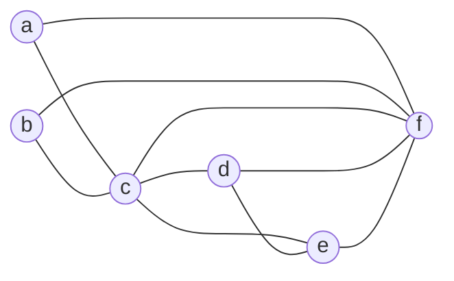
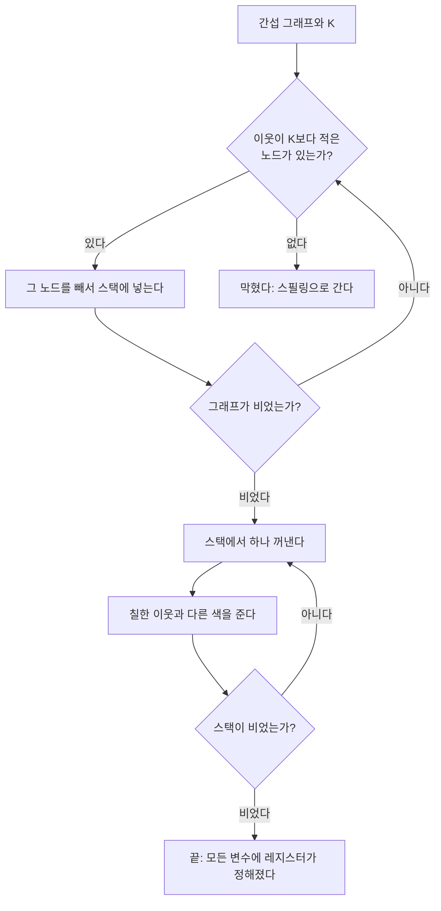


<div class="callout callout-summary" markdown="1">
<div class="callout-title callout-title--default" markdown="span">요약</div>

사이가 나쁜 사람끼리 같은 방에 넣지 않으면서 방 몇 개에 손님을 나누려 한다. 꺼리는 상대가 방 수보다 적은 사람은 걱정할 것이 없다. 남들을 어떻게 넣든 그 사람이 들어갈 방이 하나는 남는다. 그래서 그런 사람부터 차례로 빼놓고 남은 사람들만 생각한 뒤, 빼놓은 순서의 거꾸로 다시 불러 빈 방에 넣는다. 변수를 정해진 수의 빠른 저장 칸에 나눠 넣는 일을 이렇게 한다. 빠르고 간단하지만, 빼놓을 사람이 더 없어 막혔다고 해서 나눌 방법이 정말 없다는 뜻은 아니다. 막히면 변수 하나를 메모리로 내보낸다.

</div>


## 예시로 보기

[레지스터 간섭 그래프](/Hongs_Blog/studies/compilers/register-interference-graph/)까지 만들었다. 남은 물음은 이것이다. 레지스터가 $$K$$개 있을 때, 프로그램의 어느 지점에서든 살아 있는 변수를 모두 레지스터에 담도록 $$K$$개를 나눠 줄 수 있는가[^1].

레지스터를 색이라 부르면 물음이 바뀐다. 색이 $$K$$가지 있을 때, 간선으로 이어진 두 노드가 다른 색이 되게 모든 노드를 칠할 수 있는가. 그렇게 칠할 수 있는 그래프를 $$K$$-색칠 가능($$K$$-colorable)하다고 한다. 간섭 그래프가 $$K$$-색칠 가능하면 레지스터를 $$K$$개 이하로 쓰는 배정이 있다[^2].

앞 문서의 간섭 그래프다. 변수 여섯, 간선 열 개다.



$$K = 4$$면 칠할 수 있다. 예를 들어 a, b, e에 r0, c에 r1, d에 r2, f에 r3을 준다. 간선 열 개를 하나씩 보면 양 끝의 레지스터가 모두 다르다[^3].

문제는 이런 색칠을 찾는 일이 어렵다는 것이다. 그래프 색칠은 NP-난해(NP-hard) 문제로 알려져 있고, 빠른 알고리즘이 알려져 있지 않다[^4]. 그래서 늘 답을 찾지는 못해도 빠르게 도는 어림 방법(휴리스틱)을 쓴다.

<div class="callout callout-check" markdown="1">
<div class="callout-title" markdown="span">검증: 아래 추적의 스택과 빼는 순간의 이웃 수(슬라이드 p.13~18), 슬라이드의 두 색칠(p.9, p.25)이 맞는 색칠임, 레지스터 이름으로 바꾼 코드(p.26)가 두 길 모두에서 원래 코드와 같은 b를 냄, $$K = 3$$에서 a, b 뒤에 막힘(p.28)과 729가지 전수 검사로 실제로도 3색 불가, 사각형 고리 반례, 무작위 그래프 3,000개에서 "다 빼면 색칠이 반드시 맞다"와 "못 칠하는 그래프는 반드시 막힌다", 카드 C2 — [55_graph-coloring-register-allocation_impl.py](/Hongs_Blog/studies/compilers/code/55_graph-coloring-register-allocation_impl/)</div>

</div>


## 알고리즘

**핵심 생각.** 이웃이 $$K$$개보다 적은 노드 $$T$$를 그래프에서 뺀다. 남은 그래프가 $$K$$-색칠 가능하면 $$T$$를 도로 넣은 그래프도 $$K$$-색칠 가능하다. $$T$$의 이웃이 쓴 색은 많아야 $$K - 1$$가지이므로 $$T$$에게 줄 색이 적어도 하나 남는다[^5].

**입력과 출력.** 입력은 간섭 그래프와 쓸 수 있는 레지스터 수 $$K$$다. 출력은 변수마다의 레지스터 번호이거나, "막혔다"는 답과 그때 남은 노드들이다.

```
[빼기]
1단계: 이웃이 K개보다 적은 노드 T를 고른다
2단계: T를 그래프에서 빼고 스택에 넣는다 (T에 붙은 간선도 같이 뺀다)
3단계: 그래프에 노드가 없을 때까지 1~2단계를 되풀이한다
        고를 노드가 없는데 노드가 남아 있으면 막힌 것이다

[칠하기]
4단계: 스택 맨 위의 노드를 꺼낸다
5단계: 이미 칠한 이웃들과 다른 색을 준다
6단계: 그래프가 다 되돌아올 때까지 4~5단계를 되풀이한다
```

여섯 단계는 슬라이드의 것이다[^6]. 이웃 수는 "지금 남은 그래프에서의" 이웃 수다. 노드를 하나 뺄 때마다 그 이웃들의 이웃 수가 하나씩 줄어든다. 그래서 처음에는 못 빼던 노드가 나중에는 빠진다.



### 실행 추적: K = 4

**빼기.** 고를 수 있는 노드가 여럿이면 슬라이드처럼 이름 순으로 고른다[^7].

| 차례 | 빼는 노드 | 그때의 이웃 (남은 그래프에서) | 이웃 수 | 스택 (오른쪽이 맨 위) |
|---|---|---|---|---|
| 1 | a | c, f | 2 | a |
| 2 | b | c, f | 2 | a, b |
| 3 | c | d, e, f | 3 | a, b, c |
| 4 | d | e, f | 2 | a, b, c, d |
| 5 | e | f | 1 | a, b, c, d, e |
| 6 | f | 없음 | 0 | a, b, c, d, e, f |

c는 처음에 이웃이 다섯이라 뺄 수 없었다. a와 b가 빠진 뒤에는 셋으로 줄어 빠진다.

**칠하기.** 맨 위부터 꺼낸다. 색은 슬라이드가 고른 것이다[^8].

| 차례 | 꺼낸 노드 | 이미 칠한 이웃과 그 색 | 주는 색 |
|---|---|---|---|
| 1 | f | 없음 | r3 |
| 2 | e | f(r3) | r0 |
| 3 | d | e(r0), f(r3) | r2 |
| 4 | c | d(r2), e(r0), f(r3) | r1 |
| 5 | b | c(r1), f(r3) | r0 |
| 6 | a | c(r1), f(r3) | r0 |

5단계는 "다른 색"이라고만 하므로 고를 수 있는 색이 여럿일 때가 있다. f에게는 네 색 모두 가능했다. 어느 것을 골라도 맞는 색칠이 나온다. 4번 줄의 c는 이미 칠한 이웃이 셋이라 남은 색이 r1 하나뿐이었다.

**결과.** 변수 이름을 레지스터 이름으로 바꾼다. 변수 여섯을 레지스터 넷으로 돌리고, 메모리를 오가는 명령이 하나도 없다[^9].

```
[원래 코드]                      [레지스터로 바꾼 코드]
B0: b = 3                        B0: r0 = 3
    c = 1                            r1 = 1
    f = 0                            r3 = 0
B1: a = b + c                    B1: r0 = r0 + r1
    d = -a                           r2 = -r0
    e = d + f                        r0 = r2 + r3
B2: f = 2 * e                    B2: r3 = 2 * r0
B3: c = d + e                    B3: r1 = r2 + r0
    e = e - 1                        r0 = r0 - 1
B4: b = f + c                    B4: r0 = r3 + r1
```

`r0 = r0 + r1`(원래 `a = b + c`)에서 b와 a가 같은 r0을 쓴다. b는 이 줄에서 마지막으로 읽히고 a가 태어난다. B2를 지나는 길로 가면 마지막 b는 −7, B3을 지나는 길로 가면 −8이고, 두 코드에서 같다[^s1].

<div class="callout callout-warning" markdown="1">
<div class="callout-title" markdown="span">원본 오류 의심</div>

원문: 16회 슬라이드 p.12, "a has 3 neighbors".<br>
문제점: 같은 슬라이드의 간섭 그래프(p.7)에서 a에 붙은 간선은 a–c, a–f 둘뿐이다.<br>
수정안: "a has 2 neighbors". 결론(a의 이웃은 $$K = 4$$보다 적으므로 a를 빼도 된다)은 그대로다.<br>
근거: p.6의 목록 가운데 a가 든 것은 {a, c, f} 하나뿐이다. 구현 코드로 간섭 그래프를 다시 만들어 a의 이웃이 {c, f}임을 확인했다.

</div>


### 정확성: 다 빼면 반드시 칠해진다

**주장.** 빼기 단계가 모든 노드를 스택에 넣었다면, 칠하기 단계는 색이 모자라는 일 없이 끝나고 결과는 맞는 $$K$$-색칠이다[^s2].

<details class="callout callout-proof" markdown="1">
<summary class="callout-title" markdown="span">증명 펼치기</summary>

스택에서 꺼낸 노드 수에 대한 귀납법으로 "지금까지 칠한 노드들 사이에서는 이웃끼리 색이 다르다"를 보인다.
1. **처음.** 칠한 노드가 없으면 맞다. — 빈 경우
2. **한 걸음.** 노드 $$T$$를 꺼냈다고 하자. $$T$$보다 먼저 꺼낸(이미 칠한) 노드는 $$T$$보다 나중에 뺀 노드들이다. 곧 $$T$$를 빼던 순간 그래프에 남아 있던 노드들이다. — 스택은 넣은 순서의 거꾸로 꺼낸다
3. 그러므로 $$T$$의 이웃 가운데 이미 칠한 것은 $$T$$를 빼던 순간의 이웃들뿐이고, 그 수는 $$K$$보다 적다. — 1단계의 조건
4. 이미 칠한 이웃이 쓴 색은 많아야 $$K - 1$$가지다. $$K$$가지 색 가운데 적어도 하나가 남는다. 그 색을 $$T$$에게 주면 $$T$$와 칠한 이웃의 색이 모두 다르다. — 색의 수 세기
5. $$T$$의 이웃 가운데 아직 안 칠한 것은 나중에 칠할 때 $$T$$의 색을 피한다(그 노드의 차례에 3~4가 똑같이 적용된다). 그래서 귀납 가정이 한 노드 늘어난 상태에서도 맞다. — 귀납 단계
6. 스택이 비면 모든 노드를 칠했고, 모든 간선의 양 끝 색이 다르다. ∎

</details>


거꾸로는 맞지 않는다. 빼기 단계가 막혔다고 해서 그래프가 $$K$$-색칠 불가능한 것은 아니다. 아래 "자주 하는 오해"에 예가 있다. 이 방법은 "된다"는 답은 믿을 수 있고 "막혔다"는 답은 "이 방법으로는 못 찾았다"는 뜻이다[^s2].

### 스스로 설명해 보기

<details class="callout callout-question" markdown="1">
<summary class="callout-title" markdown="span">1. 2단계에서 "먼저 꺼낸 노드는 나중에 뺀 노드"라는 것이 왜 중요한가?</summary>

3단계의 "이미 칠한 이웃은 $$K$$보다 적다"가 여기서 나온다. 스택이 아니라 넣은 순서대로 꺼내면, $$T$$를 칠할 때 $$T$$보다 먼저 뺀 이웃들까지 이미 칠해져 있을 수 있다. 그 이웃들은 $$T$$를 빼던 순간의 이웃 수에 들어 있지 않았으므로 $$K$$개 이상일 수 있다.

</details>


<details class="callout callout-question" markdown="1">
<summary class="callout-title" markdown="span">2. 4단계는 왜 "이웃 수가 $$K$$ 이하"가 아니라 "$$K$$보다 적다"를 요구하는가?</summary>

이웃이 딱 $$K$$개이고 모두 다른 색을 썼다면 남는 색이 없다. $$K - 1$$개 이하여야 최악의 경우에도 하나가 남는다.

</details>


<details class="callout callout-question" markdown="1">
<summary class="callout-title" markdown="span">3. 추적에서 c는 처음에 이웃이 다섯인데 어떻게 뺄 수 있었는가?</summary>

이웃 수는 남은 그래프에서 센다. a와 b가 먼저 빠지면서 c의 이웃이 d, e, f 셋으로 줄었다. a와 b는 c보다 나중에 칠하므로, c를 칠할 때는 아직 색이 없어 c의 선택을 막지 않는다.

</details>


<details class="callout callout-question" markdown="1">
<summary class="callout-title" markdown="span">이 증명의 핵심 아이디어는?</summary>

쉬운 것을 뒤로 미룬다. 이웃이 적은 노드는 남들이 어떻게 칠해지든 자리가 남으므로 맨 나중에 칠해도 된다. 그런 노드를 빼면 문제가 작아지고, 작아진 문제에서 또 쉬운 노드가 생긴다.

</details>


<details class="callout callout-question" markdown="1">
<summary class="callout-title" markdown="span">이 방법을 쓸 수 있는 다른 상황은?</summary>

시험 시간표나 주파수 배정처럼 그래프 색칠로 바뀌는 문제 모두. [이분 그래프와 그래프 색칠](/Hongs_Blog/studies/discrete-math/bipartite-coloring/)의 탐욕 색칠은 정해진 순서로 칠하는데, 이 방법은 그 순서를 "이웃이 적은 것을 맨 뒤로"로 정해 주는 셈이다.

</details>


## K = 3이면

같은 그래프에서 레지스터가 셋이면 막힌다[^10].

| 차례 | 빼는 노드 | 그때의 이웃 수 | 스택 |
|---|---|---|---|
| 1 | a | 2 | a |
| 2 | b | 2 | a, b |
| 3 | 고를 노드가 없다 | c, d, e, f 모두 3 | a, b |

남은 c, d, e, f는 서로 모두 이어져 있어 저마다 이웃이 셋이다. 3보다 적은 노드가 없다. 이 경우에는 실제로도 방법이 없다. 서로 모두 이어진 네 노드는 네 색이 있어야 한다. 이때 쓰는 길이 [스필링](/Hongs_Blog/studies/compilers/register-spilling/)이다.

## 활용

- 구현: [55_graph-coloring-register-allocation_impl.py](/Hongs_Blog/studies/compilers/code/55_graph-coloring-register-allocation_impl/). 연습: [레지스터 할당 예제 사다리](/Hongs_Blog/studies/compilers/register-allocation-ladder/)
- 정확한 색칠의 비용: 슬라이드는 가장 빠른 알고리즘의 계산량을 $$O(2^n n)$$으로 적는다($$n$$은 변수의 수)[^4]. 출처는 적혀 있지 않다[확인필요]. 어느 쪽이든 변수가 하나 늘 때마다 두 배씩 느는 꼴이라 컴파일러가 쓰기에는 너무 느리다.
- 이 방법의 비용: 노드를 하나 뺄 때마다 그 이웃들의 이웃 수를 하나씩 줄이면, 빼기와 칠하기 모두 노드 수와 간선 수에 비례하는 시간에 끝난다[^s2].
- 흔한 실수: 칠하기를 뺀 순서대로(스택의 바닥부터) 한다. 맨 나중에 뺀 것부터 칠해야 한다.
- 흔한 실수: 이웃 수를 처음 그래프에서만 센다. 노드를 뺄 때마다 줄여야 한다.
- 흔한 실수: 색을 고를 때 이웃 전부를 본다고 생각한다. 아직 스택에 있는(안 칠한) 이웃은 보지 않는다.

## 연결

- 선수: [레지스터 간섭 그래프](/Hongs_Blog/studies/compilers/register-interference-graph/)
- 막혔을 때: [스필링](/Hongs_Blog/studies/compilers/register-spilling/)
- 색칠 문제의 뜻, 두 색으로 칠할 수 있는 조건, 세 색 이상이 어려운 까닭: [이분 그래프와 그래프 색칠](/Hongs_Blog/studies/discrete-math/bipartite-coloring/)
- 넣은 순서의 거꾸로 꺼내는 자료구조: [스택](/Hongs_Blog/studies/algorithms/stack/)

## 자주 하는 오해

<div class="callout callout-misconception" markdown="1">
<div class="callout-title" markdown="span">"빼기 단계에서 막히면 그 그래프는 K색으로 칠할 수 없다"</div>

틀렸다. 막혔다는 것은 "이웃이 $$K$$보다 적은 노드가 없다"는 뜻일 뿐이다. 슬라이드의 $$K = 3$$ 예에서는 막힌 그래프가 실제로도 칠할 수 없는 그래프라서 둘이 같은 말처럼 보인다. 하지만 사각형 고리 w–x–y–z–w를 $$K = 2$$로 칠해 보면, 네 노드 모두 이웃이 둘이라 하나도 뺄 수 없어 처음부터 막힌다. 그런데 w와 y에 한 색, x와 z에 다른 색을 주면 두 색으로 칠해진다. 확인하는 법: 무작위 그래프로 돌려 보면 "막혔지만 칠할 수 있는" 경우가 실제로 나온다(검증 코드). 반대 방향은 믿어도 된다. 다 빼는 데 성공하면 색칠은 반드시 맞다.

</div>


## 확인 문제

<details class="callout callout-question" markdown="1">
<summary class="callout-title" markdown="span">**C1** 그래프 색칠로 레지스터를 나눠 주는 어림 방법의 여섯 단계를 쓰고, 핵심 생각을 한 문장으로 쓰라.</summary>

**답:** ① 이웃이 $$K$$보다 적은 노드를 고른다 ② 그래프에서 빼서 스택에 넣는다 ③ 노드가 없을 때까지 되풀이한다 ④ 스택 맨 위를 꺼낸다 ⑤ 이미 칠한 이웃과 다른 색을 준다 ⑥ 그래프가 다 돌아올 때까지 되풀이한다. 핵심: 이웃이 $$K$$보다 적은 노드는 나머지가 어떻게 칠해지든 줄 색이 남으므로, 빼놓고 나머지부터 푼다.<br>
**이유:** "적다"는 $$K - 1$$개 이하라는 뜻이다. $$K$$개면 색이 안 남을 수 있다.

</details>


<details class="callout callout-question" markdown="1">
<summary class="callout-title" markdown="span">**C2** 오각형 고리 a–b–c–d–e–a(간선 다섯)를 $$K = 3$$으로 칠한다. 뺄 노드는 이름 순으로 고르고, 색은 쓸 수 있는 것 가운데 번호가 가장 작은 것(r0, r1, r2 순)을 준다. 스택과 최종 색을 쓰라. $$K = 2$$면 어떻게 되는가?</summary>

**답:** 빼기: 모든 노드의 이웃이 2라서 a, b, c, d, e 순으로 다 빠진다. 스택(바닥부터) a, b, c, d, e. 칠하기: e는 r0. d는 이웃 e(r0)를 피해 r1. c는 이웃 d(r1)를 피해 r0. b는 이웃 c(r0)를 피해 r1. a는 이웃 b(r1)와 e(r0)를 피해 r2. $$K = 2$$면 이웃이 2보다 적은 노드가 없어 처음부터 막힌다.<br>
**이유:** d를 칠할 때 다른 이웃 c는 아직 스택에 있어 보지 않는다. $$K = 2$$에서 막히는 것은 이번에는 옳은 답이다. 홀수 길이 고리는 두 색으로 칠할 수 없다([이분 그래프와 그래프 색칠](/Hongs_Blog/studies/discrete-math/bipartite-coloring/)).

</details>


<details class="callout callout-question" markdown="1">
<summary class="callout-title" markdown="span">**C3** 2단계에서 뺀 노드를 스택에 넣어 두는 일이 칠하기 단계에 해 주는 것을 한 문장으로 쓰라.</summary>

**답:** 맨 나중에 뺀 노드부터 칠하게 해서, 어떤 노드를 칠할 때 이미 칠해진 이웃이 "그 노드를 빼던 순간의 이웃"($$K$$보다 적다)뿐이게 만든다.

</details>


<details class="callout callout-question" markdown="1">
<summary class="callout-title" markdown="span">**C4** 추적의 칠하기 4번 줄에서 c에게 줄 색이 반드시 남아 있다는 것은 증명의 어느 단계에서 나오는가? 그 줄의 수로 설명하라.</summary>

**답:** 3~4단계. c를 빼던 순간 c의 이웃은 d, e, f 셋이었고 $$3 < K = 4$$다. c를 칠할 때 이미 칠한 이웃은 이 셋뿐이라 쓴 색이 많아야 세 가지(r2, r0, r3)이고, 네 색 가운데 하나(r1)가 남는다.<br>
**이유:** c의 다른 이웃 a, b는 c보다 먼저 빠졌으므로 c보다 나중에 칠한다. c를 칠할 때는 아직 색이 없다.

</details>


<details class="callout callout-question" markdown="1">
<summary class="callout-title" markdown="span">**C5** "이 방법이 막히면 $$K$$색으로 칠할 수 없다"의 반례를 들라.</summary>

**답:** 사각형 고리 w–x–y–z–w, $$K = 2$$. 모든 노드의 이웃이 2라서 2보다 적은 노드가 없다. 하나도 못 빼고 막힌다. 그러나 w, y에 r0을, x, z에 r1을 주면 간선 넷의 양 끝이 모두 다르다.<br>
**이유:** 이웃 수 조건은 "남들이 어떻게 칠해져도 자리가 남는다"는 충분조건이다. 이웃이 $$K$$개여도 그 이웃들이 같은 색을 나눠 쓰면 자리가 남는다. 이 방법은 그런 경우를 보지 못한다.

</details>


[^1]: 컴파일러 16회 강의 자료 「Lecture16 Code generation part 3」, p.9 (레지스터 K개로 가능한가라는 물음, K = 4의 예)
[^2]: 같은 자료, p.10 (그래프 색칠 = 레지스터 할당, 색 = 레지스터, K-색칠 가능)
[^3]: 같은 자료, p.25 (색칠 결과: a r0, b r0, c r1, d r2, e r0, f r3). p.9의 예는 d에 r3, f에 r2를 준 다른 색칠이다.
[^4]: 같은 자료, p.11 (그래프 색칠은 NP-난해, 가장 빠른 알고리즘의 계산량, 어림 방법이 필요하다)
[^5]: 같은 자료, p.12 (핵심 생각)
[^6]: 같은 자료, p.13, p.15 (1~3단계), p.19~20 (4~6단계)
[^7]: 같은 자료, p.13~18 (K = 4에서 빼기와 스택)
[^8]: 같은 자료, p.19~24 (꺼내며 칠하기)
[^9]: 같은 자료, p.25~26 (4-색칠 가능, 레지스터로 바꾼 코드)
[^10]: 같은 자료, p.27~28 (K = 3이면 a, b 뒤에 고를 노드가 없다)
[^s1]: <span class="fn-tag" title="수업 자료에 없고 따로 보탠 내용">보충</span> 빼기와 칠하기를 적은 두 표, 입력과 출력, 흐름도, 마지막 b의 값(−7, −8)은 원본에 없다. 슬라이드는 그림으로 한 걸음씩 보인다. 표의 값과 두 코드가 같은 값을 내는 것은 구현 코드로 확인했다. 간섭 그래프 다이어그램은 슬라이드 p.7의 그림을 옮긴 것이다.
[^s2]: <span class="fn-tag" title="수업 자료에 없고 따로 보탠 내용">보충</span> 정확성 증명, "막혀도 칠할 수 있는 그래프가 있다"는 것, 스스로 설명해 보기, 이 방법의 비용, 오해 항목, 카드 C1~C5는 원본에 없다. 증명은 위에 적은 단계대로이고, 무작위 그래프 3,000개에서 두 성질을 구현 코드로 확인했다(실험은 증명이 아니라 확인이다). 이 방법은 Chaitin의 레지스터 할당에서 온 것이다(Aho·Lam·Sethi·Ullman, Compilers 2판, 8.8.4절).

