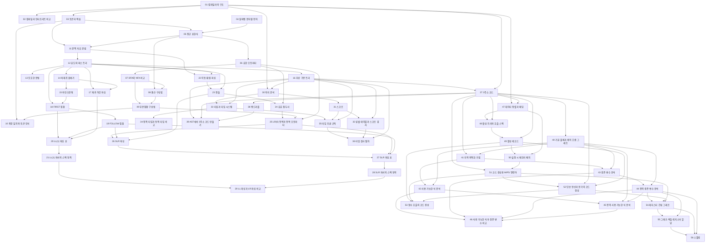


## 먼저 알아야 할 것
- [집합](/Hongs_Blog/studies/discrete-math/sets/) (공학수학 이산수학): 부분집합 구성법에서 상태의 묶음이 곧 부분집합이다
- [재귀적 정의와 구조적 귀납법](/Hongs_Blog/studies/discrete-math/recursive-definitions/) (공학수학 이산수학): 문맥 자유 문법에서 재귀적 정의의 규칙이 곧 생성 규칙이다
- [스택](/Hongs_Blog/studies/algorithms/stack/), [재귀와 백트래킹](/Hongs_Blog/studies/algorithms/recursion-backtracking/), [트리 순회와 이진 탐색 트리](/Hongs_Blog/studies/algorithms/tree-traversal-bst/) (알고리즘): 파서의 스택, 재귀 하강 파싱, AST 순회
- [추론 규칙과 증명 방법](/Hongs_Blog/studies/discrete-math/proof-methods/) (공학수학 이산수학): 타입 추론 규칙
- [이분 그래프와 그래프 색칠](/Hongs_Blog/studies/discrete-math/bipartite-coloring/) (공학수학 이산수학): 그래프 색칠로 하는 레지스터 할당
- [문자열 파싱과 정규 표현식](/Hongs_Blog/studies/algorithms/string-parsing/) (알고리즘): 실전 정규식 기호. 문서의 `과목별 관점`에 기본 다섯 식으로 푸는 표가 있다

## 컴파일러 개요: 번역 방식과 여섯 단계

읽기 전에

1. C로 쓴 프로그램은 윈도우에서 한 번 번역하면 맥에서 못 돌고, 자바스크립트는 어디서든 바로 돈다. 번역하는 때가 어떻게 다르기에 그럴까? → [컴파일과 인터프리트 비교](/Hongs_Blog/studies/compilers/compilation-vs-interpretation/)
2. `A = B + C` 한 줄을 기계어로 바꾸는 일을 여러 단계로 나눈다면 맨 처음에는 무엇을 해야 할까? → [컴파일러의 구조](/Hongs_Blog/studies/compilers/compiler-structure/)
3. 컴파일러가 결과물을 더 빠르게 만들다가 계산 결과가 달라졌다. 이것은 좋은 컴파일러인가? → [컴파일러의 구조](/Hongs_Blog/studies/compilers/compiler-structure/)

| 번호 | 개념 | 한 줄 | 개념 코드 | 연습 |
|---|---|---|---|---|
| 01 | [컴파일러의 구조](/Hongs_Blog/studies/compilers/compiler-structure/) | 글자 끊기부터 기계어 쓰기까지 여섯 단계로 나눠 옮기는 번역기 | [verify](/Hongs_Blog/studies/compilers/code/01_compiler-structure_verify/) | — |
| 02 | [컴파일과 인터프리트 비교](/Hongs_Blog/studies/compilers/compilation-vs-interpretation/) | 미리 통째로 옮기느냐, 실행하면서 한 문장씩 옮기느냐 | [verify](/Hongs_Blog/studies/compilers/code/02_compilation-vs-interpretation_verify/) | — |

떠올려 보기: 노트를 닫고 컴파일러의 여섯 단계와 `A = B + C`가 단계마다 어떻게 바뀌는지 써 본다.

## 어휘 분석 (1): 토큰과 정규 표현식

읽기 전에

1. `total`과 `score`는 글자가 다른데 컴파일러는 문법을 따질 때 둘을 같은 것으로 본다. 무엇이 같을까? → [토큰과 렉심](/Hongs_Blog/studies/compilers/token-lexeme/)
2. "숫자가 하나 이상 이어진 것"을 끝없는 목록 대신 한 줄로 적으려면 어떤 조립법이 필요할까? → [정규 표현식](/Hongs_Blog/studies/compilers/regular-expression/)
3. `a`와 `aa`는 다른 문자열이다. 이어 붙이는 순서를 바꾸면 반드시 다른 문자열이 될까? → [알파벳·문자열·언어](/Hongs_Blog/studies/compilers/alphabet-string-language/)

| 번호 | 개념 | 한 줄 | 개념 코드 | 연습 |
|---|---|---|---|---|
| 03 | [토큰과 렉심](/Hongs_Blog/studies/compilers/token-lexeme/) | 끊어 낸 글자 조각(렉심)과 거기 붙인 종류 꼬리표(토큰) | [verify](/Hongs_Blog/studies/compilers/code/03_token-lexeme_verify/) | — |
| 04 | [알파벳·문자열·언어](/Hongs_Blog/studies/compilers/alphabet-string-language/) | 글자 목록, 글자를 줄 세운 것, 그 줄을 모은 집합 | [verify](/Hongs_Blog/studies/compilers/code/04_alphabet-string-language_verify/) | — |
| 05 | [정규 표현식](/Hongs_Blog/studies/compilers/regular-expression/) | 선택·연결·반복 세 조립법으로 토큰의 모양을 한 줄로 적는 표기 | [verify](/Hongs_Blog/studies/compilers/code/05_regular-expression_verify/) | [정규 표현식 연습](/Hongs_Blog/studies/compilers/regular-expression-practice/) · [문제 코드](/Hongs_Blog/studies/compilers/code/05_regular-expression-practice_p6/) |

떠올려 보기: 노트를 닫고 기본 정규 표현식 다섯 가지와 각각이 가리키는 언어를 써 본다.

## 어휘 분석 (2): 유한 오토마타로 토큰 알아보기

읽기 전에

1. 칸 수가 정해진 말판 놀이 같은 기계로 여는 괄호와 닫는 괄호의 개수가 같은지 알아볼 수 있을까? → [유한 오토마타](/Hongs_Blog/studies/compilers/finite-automata/)
2. 갈림길마다 분신을 보내는 기계를 갈림길 없는 기계로 바꾸려면 새 기계의 칸 하나에 무엇을 적어 둬야 할까? → [부분집합 구성법](/Hongs_Blog/studies/compilers/subset-construction/)
3. `ifx`는 예약어 `if`와 이름 `x`로 끊어야 할까, 이름 하나로 끊어야 할까? 기준은? → [최장 일치와 토큰 인식](/Hongs_Blog/studies/compilers/longest-match-tokenizing/)

| 번호 | 개념 | 한 줄 | 개념 코드 | 연습 |
|---|---|---|---|---|
| 06 | [유한 오토마타](/Hongs_Blog/studies/compilers/finite-automata/) | 글자를 읽으며 상태를 옮겨 다니다 끝난 자리로 받아들일지 정하는 기계 | [impl](/Hongs_Blog/studies/compilers/code/06_finite-automata_impl/) | — |
| 07 | [DFA와 NFA 비교](/Hongs_Blog/studies/compilers/dfa-vs-nfa/) | 갈 곳이 하나로 정해지는 기계와 여러 길을 한꺼번에 가는 기계 | [verify](/Hongs_Blog/studies/compilers/code/07_dfa-vs-nfa_verify/) | — |
| 08 | [톰슨 구성법](/Hongs_Blog/studies/compilers/thompson-construction/) | 정규 표현식을 조각마다 정해진 그림으로 바꿔 ε-화살표로 잇는 방법 | [impl](/Hongs_Blog/studies/compilers/code/08_thompson-construction_impl/) | — |
| 09 | [부분집합 구성법](/Hongs_Blog/studies/compilers/subset-construction/) | NFA 상태의 묶음을 DFA 상태 하나로 삼아 갈림길을 없애는 방법 | [impl](/Hongs_Blog/studies/compilers/code/09_subset-construction_impl/) | [부분집합 구성법 예제 사다리](/Hongs_Blog/studies/compilers/subset-construction-ladder/) · [문제 코드](/Hongs_Blog/studies/compilers/code/09_subset-construction-ladder_p4/) |
| 10 | [최장 일치와 토큰 인식](/Hongs_Blog/studies/compilers/longest-match-tokenizing/) | 토큰이 되는 가장 긴 앞부분을 잘라 내고, 길이가 같으면 우선순위로 정한다 | [impl](/Hongs_Blog/studies/compilers/code/10_longest-match-tokenizing_impl/) | — |

떠올려 보기: 노트를 닫고 정규 표현식에서 전이 표까지 가는 순서(정규 표현식 → NFA → DFA)와 각 걸음에서 쓰는 방법의 이름을 써 본다.

## 구문 분석 (1): 문맥 자유 문법과 AST

읽기 전에

1. 여는 괄호 n개 뒤에 닫는 괄호가 정확히 n개 오는 문자열을 정규 표현식으로 적을 수 있을까? → [문맥 자유 문법](/Hongs_Blog/studies/compilers/context-free-grammar/)
2. `id * id + id`를 나무로 그리는 방법이 두 가지라면 컴파일러에 무슨 문제가 생길까? → [모호한 문법](/Hongs_Blog/studies/compilers/ambiguous-grammar/)
3. `(A + B) * C`를 나무로 그리면 괄호는 나무 어디에 남아야 할까? → [추상 구문 트리](/Hongs_Blog/studies/compilers/abstract-syntax-tree/)

| 번호 | 개념 | 한 줄 | 개념 코드 | 연습 |
|---|---|---|---|---|
| 11 | [문맥 자유 문법](/Hongs_Blog/studies/compilers/context-free-grammar/) | 이름 하나를 더 작은 조각으로 바꿔 쓰는 규칙 묶음. 재귀로 괄호 짝을 적는다 | [verify](/Hongs_Blog/studies/compilers/code/11_context-free-grammar_verify/) | — |
| 12 | [유도와 파스 트리](/Hongs_Blog/studies/compilers/derivation-parse-tree/) | 규칙을 하나씩 써서 토큰열을 만들어 보이는 과정과 그것을 그린 나무 | [verify](/Hongs_Blog/studies/compilers/code/12_derivation-parse-tree_verify/) | — |
| 13 | [모호한 문법](/Hongs_Blog/studies/compilers/ambiguous-grammar/) | 문장 하나에 나무가 둘 나오는 문법. 약속을 규칙에 새겨 다시 쓴다 | [verify](/Hongs_Blog/studies/compilers/code/13_ambiguous-grammar_verify/) | — |
| 14 | [좌재귀 없애기](/Hongs_Blog/studies/compilers/left-recursion-elimination/) | 맨 앞에서 자기를 부르는 규칙 $$A \to A\alpha \mid \beta$$를 $$A \to \beta A'$$, $$A' \to \alpha A' \mid \epsilon$$으로 | [verify](/Hongs_Blog/studies/compilers/code/14_left-recursion-elimination_verify/) | — |
| 15 | [좌인수분해](/Hongs_Blog/studies/compilers/left-factoring/) | 똑같은 앞부분을 묶어 내 고르는 일을 뒤로 미룬다 | [verify](/Hongs_Blog/studies/compilers/code/15_left-factoring_verify/) | [문법 고치기 예제 사다리](/Hongs_Blog/studies/compilers/grammar-rewriting-ladder/) · [문제 코드](/Hongs_Blog/studies/compilers/code/15_grammar-rewriting-ladder_p4/) |
| 16 | [추상 구문 트리](/Hongs_Blog/studies/compilers/abstract-syntax-tree/) | 파스 트리에서 괄호와 거쳐 가는 마디를 쳐 낸 뼈대 나무 | [impl](/Hongs_Blog/studies/compilers/code/16_abstract-syntax-tree_impl/) | — |

떠올려 보기: 노트를 닫고 "좋은 문법의 세 조건"과 각각을 고치는 방법, 그리고 파스 트리에서 AST로 갈 때 지우는 세 가지를 써 본다.

## 구문 분석 (2): 하향식 파싱과 LL(1)

읽기 전에

1. 규칙이 <code>S → cAe &#124; cAd</code>일 때 입력 `cad`를 읽으려면 어느 규칙을 먼저 써야 하는지 어떻게 알까? → [재귀 하강 파싱](/Hongs_Blog/studies/compilers/recursive-descent-parsing/)
2. `E' → ε`처럼 아무것도 내놓지 않는 규칙은 다음 토큰이 무엇일 때 골라야 할까? → [FOLLOW 집합](/Hongs_Blog/studies/compilers/follow-set/)
3. 다음 토큰 하나만 보고 규칙을 정하려면 문법이 어떤 모양이어야 할까? → [LL(1) 파싱 표](/Hongs_Blog/studies/compilers/ll1-parsing-table/)

| 번호 | 개념 | 한 줄 | 개념 코드 | 연습 |
|---|---|---|---|---|
| 17 | [재귀 하강 파싱](/Hongs_Blog/studies/compilers/recursive-descent-parsing/) | 규칙을 순서대로 시험하고 막히면 되돌아가는 가장 단순한 하향식 읽기 | [impl](/Hongs_Blog/studies/compilers/code/17_recursive-descent-parsing_impl/) | — |
| 18 | [FIRST 집합](/Hongs_Blog/studies/compilers/first-set/) | 끝까지 풀었을 때 맨 앞에 올 수 있는 토큰의 모음 | [impl](/Hongs_Blog/studies/compilers/code/18_first-set_impl/) | — |
| 19 | [FOLLOW 집합](/Hongs_Blog/studies/compilers/follow-set/) | 어떤 이름 바로 뒤에 올 수 있는 토큰의 모음. $$\epsilon$$ 규칙의 자리를 정한다 | [impl](/Hongs_Blog/studies/compilers/code/19_follow-set_impl/) | [FIRST·FOLLOW 예제 사다리](/Hongs_Blog/studies/compilers/first-follow-ladder/) · [문제 코드](/Hongs_Blog/studies/compilers/code/19_first-follow-ladder_p4/) |
| 20 | [LL(1) 파싱 표](/Hongs_Blog/studies/compilers/ll1-parsing-table/) | 풀 이름과 다음 토큰 하나로 쓸 규칙을 찾는 표. 한 칸에 둘이면 LL(1)이 아니다 | [impl](/Hongs_Blog/studies/compilers/code/20_ll1-parsing-table_impl/) | [LL(1) 파싱 표 예제 사다리](/Hongs_Blog/studies/compilers/ll1-table-ladder/) · [문제 코드](/Hongs_Blog/studies/compilers/code/20_ll1-table-ladder_p4/) |
| 21 | [LL(1) 파서의 스택 동작](/Hongs_Blog/studies/compilers/ll1-stack-parser/) | 표와 스택으로 되돌아가지 않고 입력을 읽는 기계 | [impl](/Hongs_Blog/studies/compilers/code/21_ll1-stack-parser_impl/) | — |

떠올려 보기: 노트를 닫고 문법 <code>E → TE', E' → +E &#124; ε, T → FT', T' → *T &#124; ε, F → (E) &#124; id</code>의 FIRST, FOLLOW, 파싱 표를 차례로 만들고 `id * id`를 스택으로 읽어 본다.

## 구문 분석 (4): 상향식 파싱과 SLR

읽기 전에

1. 토큰을 먼저 읽어 쌓아 두고 나중에 묶는다면, "지금 묶을까 더 읽을까"는 무엇을 보고 정해야 할까? → [이동-환원 파싱](/Hongs_Blog/studies/compilers/shift-reduce-parsing/)
2. `((((((((`는 문장이 아닌데, 파서가 이것을 읽는 도중에 "틀렸다"고 말해도 될까? → [유효 접두사](/Hongs_Blog/studies/compilers/viable-prefix/)
3. 규칙의 오른쪽을 다 봤는데도 묶으면 안 되는 때가 있다. 다음 토큰 하나를 보면 무엇을 알 수 있을까? → [SLR 파싱](/Hongs_Blog/studies/compilers/slr-parsing/)

| 번호 | 개념 | 한 줄 | 개념 코드 | 연습 |
|---|---|---|---|---|
| 22 | [이동-환원 파싱](/Hongs_Blog/studies/compilers/shift-reduce-parsing/) | 토큰을 읽어 쌓다가 끝자락을 규칙의 왼쪽 기호로 묶어 올라가는 파싱 | [impl](/Hongs_Blog/studies/compilers/code/22_shift-reduce-parsing_impl/) | — |
| 23 | [핸들](/Hongs_Blog/studies/compilers/parse-handle/) | 지금 묶어야 끝까지 갈 수 있는 바로 그 끝자락 | [verify](/Hongs_Blog/studies/compilers/code/23_parse-handle_verify/) | — |
| 24 | [유효 접두사](/Hongs_Blog/studies/compilers/viable-prefix/) | 쌓아 둔 부분이 아직 가망 있는 모양인가 | [verify](/Hongs_Blog/studies/compilers/code/24_viable-prefix_verify/) | — |
| 25 | [LR(0) 항목과 항목 오토마타](/Hongs_Blog/studies/compilers/lr0-item-automaton/) | 점 찍은 규칙을 상태로 삼아 유효 접두사를 알아보는 기계 | [impl](/Hongs_Blog/studies/compilers/code/25_lr0-item-automaton_impl/) | — |
| 26 | [SLR 파싱](/Hongs_Blog/studies/compilers/slr-parsing/) | 다음 토큰이 $$\text{Follow}(X)$$에 있을 때만 $$X$$로 묶는다 | [impl](/Hongs_Blog/studies/compilers/code/26_slr-parsing_impl/) | — |

떠올려 보기: 노트를 닫고 핸들, 유효 접두사, 항목, FOLLOW가 "묶을지 읽을지"를 정하는 데 각각 어떻게 쓰이는지 한 줄로 이어 써 본다.

## 구문 분석 (5): SLR 파싱 표와 스택

읽기 전에

1. DFA 그림의 화살표 가운데 `E`, `T`가 붙은 것과 `id`, `*`가 붙은 것은 표에서 같은 곳에 적힐까? → [SLR 파싱 표](/Hongs_Blog/studies/compilers/slr-parsing-table/)
2. 표의 `S6`과 `R(3)`에서 6과 3은 같은 종류의 번호일까? → [SLR 파싱 표](/Hongs_Blog/studies/compilers/slr-parsing-table/)
3. $$E \to T * E$$로 묶을 때 스택에서 몇 개를 꺼내야 할까, 꺼낸 다음에는 무엇을 넣을까? → [SLR 파서의 스택 동작](/Hongs_Blog/studies/compilers/slr-stack-parser/)

| 번호 | 개념 | 한 줄 | 개념 코드 | 연습 |
|---|---|---|---|---|
| 27 | [SLR 파싱 표](/Hongs_Blog/studies/compilers/slr-parsing-table/) | (상태, 다음 토큰)마다 할 일을 미리 적어 둔 ACTION·GOTO 표 | [impl](/Hongs_Blog/studies/compilers/code/27_slr-parsing-table_impl/) | [SLR 파싱 표 예제 사다리](/Hongs_Blog/studies/compilers/slr-table-ladder/) · [문제 코드](/Hongs_Blog/studies/compilers/code/27_slr-table-ladder_p4/) |
| 28 | [SLR 파서의 스택 동작](/Hongs_Blog/studies/compilers/slr-stack-parser/) | 지나온 상태를 스택에 쌓아 다시 읽지 않고 파싱한다 | [impl](/Hongs_Blog/studies/compilers/code/28_slr-stack-parser_impl/) | [SLR 파서 추적 연습](/Hongs_Blog/studies/compilers/slr-parse-trace-practice/) · [문제 코드](/Hongs_Blog/studies/compilers/code/28_slr-parse-trace-practice_p4/) |
| 29 | [LL 파싱과 LR 파싱 비교](/Hongs_Blog/studies/compilers/ll-vs-lr/) | 규칙을 미리 찍느냐, 다 보고 묶느냐 | [verify](/Hongs_Blog/studies/compilers/code/29_ll-vs-lr_verify/) | — |

떠올려 보기: 노트를 닫고 문법에서 표까지 가는 네 칸(문법 → NFA → DFA → 표)과 스택 파서의 이동·환원 한 걸음씩을 써 본다.

## 의미 분석 (1): 스코프 검사

읽기 전에

1. `int main(void) { return a; }`는 구문 분석을 통과한다. 왜 구문 분석기는 이 잘못을 못 잡을까? → [의미 분석](/Hongs_Blog/studies/compilers/semantic-analysis/)
2. 전역에 `int a = 2;`가 있고 함수 안에서 `a`를 찍은 뒤 `int a = 3;`을 선언하고 다시 찍으면 무엇이 찍힐까? → [스코프](/Hongs_Blog/studies/compilers/identifier-scope/)
3. 선언을 표 하나에 (이름, 타입, 깊이)로만 적으면 어떤 프로그램에서 틀린 답이 나올까? → [심벌 테이블과 스코프 검사](/Hongs_Blog/studies/compilers/symbol-table-scope-checking/)

| 번호 | 개념 | 한 줄 | 개념 코드 | 연습 |
|---|---|---|---|---|
| 30 | [의미 분석](/Hongs_Blog/studies/compilers/semantic-analysis/) | 모양은 맞지만 뜻이 틀린 코드를 걸러 내는 단계 | — | — |
| 31 | [스코프](/Hongs_Blog/studies/compilers/identifier-scope/) | 이름이 통하는 구역, 가장 가까이 감싼 선언이 뽑힌다 | [verify](/Hongs_Blog/studies/compilers/code/31_identifier-scope_verify/) | — |
| 32 | [심벌 테이블과 스코프 검사](/Hongs_Blog/studies/compilers/symbol-table-scope-checking/) | 스코프마다 표를 만들어 부모로 잇고, 안쪽부터 찾는다 | [impl](/Hongs_Blog/studies/compilers/code/32_symbol-table-scope-checking_impl/) | — |

떠올려 보기: 노트를 닫고 의미 규칙 다섯 가지와, 스코프마다 표를 만들어 이름을 찾는 세 걸음을 써 본다.

## 의미 분석 (2): 타입 검사

읽기 전에

1. 정수끼리 더하는 코드와 포인터에 실수를 더하는 코드는 어셈블리로 가면 어떻게 달라 보일까? → [타입과 타입 시스템](/Hongs_Blog/studies/compilers/type-system/)
2. "A가 int이고 B가 int이면 A + B는 int"를 가로선 하나로 적는다면 위와 아래에 무엇을 둘까? `x + 3`의 x는 무엇을 봐야 타입을 알 수 있을까? → [타입 추론 규칙](/Hongs_Blog/studies/compilers/type-inference-rules/)
3. `while (a != b) { a = a + 1; }`에서 가장 먼저 타입이 붙는 곳과 가장 나중에 판정되는 곳은 어디일까? → [타입 검사 절차](/Hongs_Blog/studies/compilers/type-checking-procedure/)

| 번호 | 개념 | 한 줄 | 개념 코드 | 연습 |
|---|---|---|---|---|
| 33 | [타입과 타입 시스템](/Hongs_Blog/studies/compilers/type-system/) | 값에 붙는 꼬리표와 그 규칙 묶음, 기계어에서는 사라져 AST에서 검사한다 | [verify](/Hongs_Blog/studies/compilers/code/33_type-system_verify/) | — |
| 34 | [정적 타입과 동적 타입 비교](/Hongs_Blog/studies/compilers/static-vs-dynamic-typing/) | 타입이 변수에 붙고 실행 전에 검사하느냐, 값에 붙고 실행 중에 검사하느냐 | [verify](/Hongs_Blog/studies/compilers/code/34_static-vs-dynamic-typing_verify/) | — |
| 35 | [타입 추론 규칙](/Hongs_Blog/studies/compilers/type-inference-rules/) | 가로선 위 가정이 참이면 아래 결론이 참, 변수 때문에 $$S \vdash e : T$$로 쓴다 | [verify](/Hongs_Blog/studies/compilers/code/35_type-inference-rules_verify/) | — |
| 36 | [타입 검사 절차](/Hongs_Blog/studies/compilers/type-checking-procedure/) | 스코프 검사 뒤 AST를 잎부터 돌며 식에는 타입, 문장에는 WF를 붙인다 | [impl](/Hongs_Blog/studies/compilers/code/36_type-checking-procedure_impl/) | [타입 검사 연습](/Hongs_Blog/studies/compilers/type-checking-practice/) · [문제 코드](/Hongs_Blog/studies/compilers/code/36_type-checking-practice_p4/) |

떠올려 보기: 노트를 닫고 타입·타입 시스템·타입 검사의 뜻, 덧셈·비교·변수 규칙의 가로선 꼴, 문장을 검사하는 세 단계 순서를 써 본다.

## 중간 코드 생성: 3주소 코드

읽기 전에

1. `A + A * B - 1`을 "한 줄에 계산 하나"로 풀어 쓰면 몇 줄이고 어느 계산이 먼저 나올까? → [3주소 코드](/Hongs_Blog/studies/compilers/three-address-code/)
2. `while (x < y) { x = x + 1; }`를 goto와 레이블만으로 쓰려면 레이블이 몇 개 필요할까? → [3주소 코드](/Hongs_Blog/studies/compilers/three-address-code/)
3. 트리의 뿌리 노드를 맨 먼저 찾아가는데, 왜 뿌리의 계산은 코드에서 맨 마지막 줄이 될까? → [AST에서 3주소 코드 만들기](/Hongs_Blog/studies/compilers/ast-to-tac/)

| 번호 | 개념 | 한 줄 | 개념 코드 | 연습 |
|---|---|---|---|---|
| 37 | [3주소 코드](/Hongs_Blog/studies/compilers/three-address-code/) | 한 줄에 주소가 많아야 셋, 조건문·반복문은 레이블과 goto로 편다 | [verify](/Hongs_Blog/studies/compilers/code/37_three-address-code_verify/) | — |
| 38 | [쿼드러플](/Hongs_Blog/studies/compilers/quadruples/) | 3주소 코드 한 줄을 (op, arg1, arg2, result) 네 칸에 담아 연결 리스트로 잇는다 | [verify](/Hongs_Blog/studies/compilers/code/38_quadruples_verify/) | — |
| 39 | [AST에서 3주소 코드 만들기](/Hongs_Blog/studies/compilers/ast-to-tac/) | 자식 결과를 받아 쿼드러플을 붙이고 임시 변수 이름을 부모에게 돌려준다 | [impl](/Hongs_Blog/studies/compilers/code/39_ast-to-tac_impl/) | [3주소 코드 변환 연습](/Hongs_Blog/studies/compilers/tac-translation-practice/) · [문제 코드](/Hongs_Blog/studies/compilers/code/39_tac-translation-practice_p4/) |

떠올려 보기: 노트를 닫고 3주소 코드의 줄 종류, 쿼드러플의 네 칸, 이항 연산자 노드와 while 노드의 생성 규칙을 써 본다.

## 코드 최적화 (1): 지역 최적화

읽기 전에

1. `t0 = x + x`와 `t2 = x + x`가 한 코드에 있으면 뒤의 것을 늘 `t2 = t0`로 바꿔도 될까? 안 되는 경우는? → [지역 최적화 기법](/Hongs_Blog/studies/compilers/local-optimizations/)
2. 어떤 대입이 쓸모없는지 알려면 코드를 위에서 아래로 봐야 할까, 아래에서 위로 봐야 할까? → [생존 변수 분석](/Hongs_Blog/studies/compilers/live-variable-analysis/)
3. `x = x + 1` 바로 뒤에 "x = x + 1"이라는 등식은 참일까? → [사용 가능한 식 분석](/Hongs_Blog/studies/compilers/available-expressions/)

| 번호 | 개념 | 한 줄 | 개념 코드 | 연습 |
|---|---|---|---|---|
| 40 | [기본 블록과 제어 흐름 그래프](/Hongs_Blog/studies/compilers/basic-block-cfg/) | 첫 줄로만 들어오고 마지막 줄에서만 갈라지는 구간, 그 구간들을 화살표로 이은 그래프 | [impl](/Hongs_Blog/studies/compilers/code/40_basic-block-cfg_impl/) | — |
| 41 | [지역 최적화 기법](/Hongs_Blog/studies/compilers/local-optimizations/) | 공통 부분식 제거·복사 전파·죽은 코드 제거·산술 단순화·상수 접기와 각각의 조건 | [verify](/Hongs_Blog/studies/compilers/code/41_local-optimizations_verify/) | — |
| 42 | [사용 가능한 식 분석](/Hongs_Blog/studies/compilers/available-expressions/) | 위에서 아래로 "지금 참인 등식" 집합을 들고 다니며 공통 부분식 제거와 복사 전파 | [impl](/Hongs_Blog/studies/compilers/code/42_available-expressions_impl/) | — |
| 43 | [생존 변수 분석](/Hongs_Blog/studies/compilers/live-variable-analysis/) | 아래에서 위로 "뒤에서 읽힐 변수" 집합을 들고 다니며 죽은 대입을 지운다 | [impl](/Hongs_Blog/studies/compilers/code/43_live-variable-analysis_impl/) | [지역 최적화 예제 사다리](/Hongs_Blog/studies/compilers/local-optimization-ladder/) · [문제 코드](/Hongs_Blog/studies/compilers/code/43_local-optimization-ladder_p4/) |

떠올려 보기: 노트를 닫고 기본 블록의 두 조건, 지역 최적화 다섯 기법, 두 분석이 집합을 고치는 규칙과 훑는 방향을 써 본다.

## 코드 최적화 (2): 전역 최적화

읽기 전에

1. 블록 하나만 봐서는 "이 변수가 뒤에서 쓰이는지"를 왜 알 수 없을까? → [전역 생존 변수 분석](/Hongs_Blog/studies/compilers/global-live-variable-analysis/)
2. 두 길이 만나는 블록에서, 한쪽 길에서만 맞는 사실(`b = 1 + c`)을 믿어도 될까? → [전역 사용 가능한 식 분석](/Hongs_Blog/studies/compilers/global-available-expressions/)
3. 반복문이 있으면 한 번 훑은 결과로 바로 코드를 지우거나 고쳐도 될까? → [전역 생존 변수 분석](/Hongs_Blog/studies/compilers/global-live-variable-analysis/)

| 번호 | 개념 | 한 줄 | 개념 코드 | 연습 |
|---|---|---|---|---|
| 44 | [전역 생존 변수 분석](/Hongs_Blog/studies/compilers/global-live-variable-analysis/) | 끝에서 거꾸로 "앞으로 쓰일 변수" 목록을 넘기고 갈림길에서 합집합, 고리는 안 바뀔 때까지 되풀이한 뒤 지운다 | [impl](/Hongs_Blog/studies/compilers/code/44_global-live-variable-analysis_impl/) | — |
| 45 | [전역 사용 가능한 식 분석](/Hongs_Blog/studies/compilers/global-available-expressions/) | 처음부터 "지금 믿어도 되는 식"을 넘기고 길이 만나면 교집합, 고리는 안 바뀔 때까지 되풀이한 뒤 고친다 | [impl](/Hongs_Blog/studies/compilers/code/45_global-available-expressions_impl/) | [전역 분석 예제 사다리](/Hongs_Blog/studies/compilers/global-dataflow-ladder/) · [문제 코드](/Hongs_Blog/studies/compilers/code/45_global-dataflow-ladder_p4/) |
| 46 | [사용 가능한 식과 생존 변수 비교](/Hongs_Blog/studies/compilers/available-vs-live/) | 지나온 일을 묻느냐 앞으로 올 일을 묻느냐가 방향과 합치는 법(교집합·합집합)을 정한다 | — | — |

떠올려 보기: 노트를 닫고 두 분석의 방향, 갈림길에서 합치는 법, 고리에서 고치는 곳을 표로 써 본다.

## 코드 생성 (1): 런타임 환경

읽기 전에

1. `char` 하나와 `int` 하나를 연달아 선언하면 메모리를 5바이트만 쓸까? → [데이터 정렬과 패딩](/Hongs_Blog/studies/compilers/data-alignment/)
2. `fib(3)`이 `fib(2)`를 부른 동안 `fib(3)`의 `n`은 어디에 남아 있을까? → [활성 레코드](/Hongs_Blog/studies/compilers/activation-record/)
3. 스택과 힙은 왜 서로 반대 방향으로 자랄까? → [실행 시 메모리 배치](/Hongs_Blog/studies/compilers/runtime-memory-layout/)

| 번호 | 개념 | 한 줄 | 개념 코드 | 연습 |
|---|---|---|---|---|
| 47 | [데이터 정렬과 패딩](/Hongs_Blog/studies/compilers/data-alignment/) | 변수는 타입마다 정해진 $$N$$의 배수 번지에서 시작하고, 맞추느라 빈 바이트(패딩)가 생긴다 | [verify](/Hongs_Blog/studies/compilers/code/47_data-alignment_verify/) | — |
| 48 | [활성 트리와 호출 스택](/Hongs_Blog/studies/compilers/activation-tree/) | 함수를 한 번 부른 것(활성)의 호출 관계는 나무, 지금 살아 있는 활성은 스택 하나 | [verify](/Hongs_Blog/studies/compilers/code/48_activation-tree_verify/) | — |
| 49 | [활성 레코드](/Hongs_Blog/studies/compilers/activation-record/) | 호출 한 번마다 스택에 올리는 다섯 칸: 반환값, 인자, 제어 링크, 돌아갈 주소, 지역·임시 변수 | [verify](/Hongs_Blog/studies/compilers/code/49_activation-record_verify/) | — |
| 50 | [실행 시 메모리 배치](/Hongs_Blog/studies/compilers/runtime-memory-layout/) | 낮은 번지부터 코드, 전역 데이터, 힙(위로), 스택(아래로). 힙과 스택은 마주 보고 자란다 | [verify](/Hongs_Blog/studies/compilers/code/50_runtime-memory-layout_verify/) | — |

떠올려 보기: 노트를 닫고 활성 레코드의 다섯 칸과 메모리의 네 구역을 그림으로 그려 본다.

## 코드 생성 (2): MIPS 어셈블리 만들기

읽기 전에

1. 메모리에 있는 두 변수를 더하는 데 기계 명령이 몇 개 필요할까? → [단순 연산과 분기의 코드 생성](/Hongs_Blog/studies/compilers/codegen-simple-operations/)
2. 스택에 한 칸을 올리는데 왜 `$sp`에서 4를 뺄까? → [함수 호출의 코드 생성](/Hongs_Blog/studies/compilers/codegen-function-call/)
3. 함수가 끝났을 때 쌓은 칸들을 하나씩 지워야 할까? → [함수 호출의 코드 생성](/Hongs_Blog/studies/compilers/codegen-function-call/)

| 번호 | 개념 | 한 줄 | 개념 코드 | 연습 |
|---|---|---|---|---|
| 51 | [코드 생성용 MIPS 명령어](/Hongs_Blog/studies/compilers/mips-instructions/) | 메모리는 `lw`·`sw`로만 닿고 계산은 레지스터끼리만 하는 수업용 명령 표기 | [impl](/Hongs_Blog/studies/compilers/code/51_mips-instructions_impl/) | — |
| 52 | [단순 연산과 분기의 코드 생성](/Hongs_Blog/studies/compilers/codegen-simple-operations/) | 3주소 코드 한 줄 = 꺼내기 → 계산 → 넣기, 조건 분기 = 꺼내기 → 0인지 보고 뛰기 | [impl](/Hongs_Blog/studies/compilers/code/52_codegen-simple-operations_impl/) | — |
| 53 | [함수 호출의 코드 생성](/Hongs_Blog/studies/compilers/codegen-function-call/) | 레코드 다섯 칸을 차례로 쌓고(`sw` + `subi $sp $sp 4`), 끝나면 `$sp`만 제어 링크 아래로 옮긴다 | [impl](/Hongs_Blog/studies/compilers/code/53_codegen-function-call_impl/) | [코드 생성 연습](/Hongs_Blog/studies/compilers/codegen-practice/) · [문제 코드](/Hongs_Blog/studies/compilers/code/53_codegen-practice_p2/) · [문제 코드](/Hongs_Blog/studies/compilers/code/53_codegen-practice_p3/) |

떠올려 보기: 노트를 닫고 `b = call foo, 1`을 부를 때 쌓는 다섯 걸음과 걷는 세 걸음을 명령으로 써 본다.

## 코드 생성 (3): 레지스터 할당

읽기 전에

1. `d = a + b`에서 a와 d는 같은 레지스터를 써도 될까? → [레지스터 간섭 그래프](/Hongs_Blog/studies/compilers/register-interference-graph/)
2. 변수가 여섯인데 레지스터 넷으로 충분한지 어떻게 알아낼까? → [그래프 색칠 레지스터 할당](/Hongs_Blog/studies/compilers/graph-coloring-register-allocation/)
3. 레지스터가 모자라면 변수 하나를 메모리로 보낸다. 어느 변수를 보내도 똑같이 풀릴까? → [스필링](/Hongs_Blog/studies/compilers/register-spilling/)

| 번호 | 개념 | 한 줄 | 개념 코드 | 연습 |
|---|---|---|---|---|
| 54 | [레지스터 간섭 그래프](/Hongs_Blog/studies/compilers/register-interference-graph/) | 변수가 점, 한 지점에서라도 함께 살아 있으면 선. 선이 없으면 같은 레지스터를 써도 된다 | [impl](/Hongs_Blog/studies/compilers/code/54_register-interference-graph_impl/) | — |
| 55 | [그래프 색칠 레지스터 할당](/Hongs_Blog/studies/compilers/graph-coloring-register-allocation/) | 이웃이 $$K$$보다 적은 노드를 빼서 스택에 쌓고, 거꾸로 꺼내며 이웃과 다른 색을 준다 | [impl](/Hongs_Blog/studies/compilers/code/55_graph-coloring-register-allocation_impl/) | — |
| 56 | [스필링](/Hongs_Blog/studies/compilers/register-spilling/) | 막히면 변수 하나를 메모리에 살게 하고 읽기 앞에 `load`, 쓰기 뒤에 `store`, 쓰일 때마다 새 이름 | [impl](/Hongs_Blog/studies/compilers/code/56_register-spilling_impl/) | [레지스터 할당 예제 사다리](/Hongs_Blog/studies/compilers/register-allocation-ladder/) · [문제 코드](/Hongs_Blog/studies/compilers/code/56_register-allocation-ladder_p2/) · [문제 코드](/Hongs_Blog/studies/compilers/code/56_register-allocation-ladder_p4/) |

떠올려 보기: 노트를 닫고 생존 변수 목록 → 간섭 그래프 → 빼서 쌓기 → 칠하기 → 스필링의 순서와 각 걸음이 받는 것·내는 것을 써 본다.

## 다른 과목과의 연결
- [활성 레코드](/Hongs_Blog/studies/compilers/activation-record/), [함수 호출의 코드 생성](/Hongs_Blog/studies/compilers/codegen-function-call/) ↔ [스택 프레임](/Hongs_Blog/studies/assembly-language/stack-frame/), [호출 규약](/Hongs_Blog/studies/assembly-language/calling-convention/) (2-1학기 어셈블리어): 컴파일러가 만드는 호출 코드와 손으로 짜는 호출 코드
- [유한 오토마타](/Hongs_Blog/studies/compilers/finite-automata/) ↔ [유한 상태 기계](/Hongs_Blog/studies/assembly-language/asm-finite-state-machine/) (2-1학기 어셈블리어): 표로 돌리는 기계와 점프로 옮긴 기계
- [컴파일과 인터프리트 비교](/Hongs_Blog/studies/compilers/compilation-vs-interpretation/) ↔ [JVM과 바이트코드](/Hongs_Blog/studies/java/jvm-bytecode/) (2-1학기 소프트웨어 프로젝트): Java는 둘을 섞은 방식이다
- [부분집합 구성법](/Hongs_Blog/studies/compilers/subset-construction/) ↔ [LR(0) 항목과 항목 오토마타](/Hongs_Blog/studies/compilers/lr0-item-automaton/) (같은 과목): 같은 NFA → DFA 구성이 어휘 분석과 구문 분석에 두 번 쓰인다
- [실행 시 메모리 배치](/Hongs_Blog/studies/compilers/runtime-memory-layout/) ↔ [참조 타입과 메모리 영역](/Hongs_Blog/studies/java/java-reference-types/) (2-1학기 소프트웨어 프로젝트): C의 네 구역과 JVM의 세 영역

## 흐름


