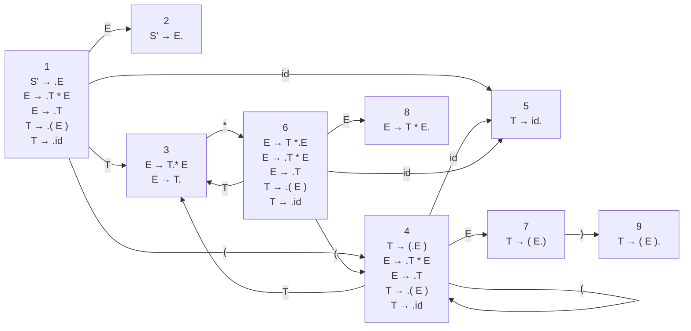


<div class="callout callout-summary" markdown="1">
<div class="callout-title callout-title--default" markdown="span">요약</div>

규칙 하나를 놓고 "여기까지 봤다"는 자리에 점을 찍은 것이 항목이다. 책갈피를 꽂은 규칙이라고 보면 된다. 책갈피 달린 규칙들을 상태로 삼아 기계를 만들면, 그 기계는 지금까지 쌓아 둔 부분이 아직 가망 있는 모양인지 알아본다. 문법만 있으면 정해진 순서대로 누구나 같은 기계를 만든다는 것이 좋은 점이다. 다만 이 기계는 쌓인 부분만 보고 다음 토큰은 보지 않아서, 묶을지 더 읽을지 겹치는 상태가 남을 수 있다.

</div>


## 예시로 보기

[유효 접두사](/Hongs_Blog/studies/compilers/viable-prefix/)는 유한 오토마타로 알아볼 수 있다. 그런데 그 오토마타를 문법마다 머리로 짜내는 것은 힘들고 틀리기 쉽다. 문법에서 기계적으로 만드는 방법이 필요하다.

파서가 `( E`까지 쌓았다고 하자. 규칙 $$T \to (E)$$를 놓고 보면 "여는 괄호와 `E`까지 봤고, 닫는 괄호를 기다리는 중"이다. 이 상황을 규칙에 점을 찍어 적는다.

$$T \to (E\,.\,)$$


점의 왼쪽이 이미 본 것이고 오른쪽이 앞으로 볼 것이다. 말로 하면 "핸들 `(E)` 가운데 `(E`까지 봤고 `)`를 보기를 바란다"이다. 이렇게 점을 찍은 규칙을 항목(item)이라 부른다.

점이 맨 끝에 가면, 곧 $$T \to (E).$$이면 규칙의 오른쪽을 다 본 것이다. 환원할 수 있다는 신호다.

## 정의

**항목.** 규칙의 오른쪽 어딘가에 점 하나를 찍은 것이다.

- 규칙 $$E \to T + E$$의 항목은 넷이다: $$E \to .T + E$$, $$E \to T.+E$$, $$E \to T+.E$$, $$E \to T + E.$$
- 오른쪽이 빈 규칙 $$A \to \epsilon$$의 항목은 $$A \to .$$ 하나다.
- 오른쪽 길이가 $$k$$인 규칙의 항목은 $$k + 1$$개다. 점을 놓을 자리가 기호 사이사이와 양 끝이기 때문이다.

**덧붙인 규칙.** 문법 $$G$$의 시작 기호가 $$S$$일 때, 새 시작 기호 $$S'$$과 규칙 $$S' \to S$$를 덧붙인다. 이 규칙의 항목도 만든다. $$S' \to S.$$에 닿으면 입력 전체를 다 묶었다는 뜻이 된다.

### NFA 만들기

유효 접두사를 알아보는 NFA는 이렇게 만든다.

| 단계 | 할 일 |
|---|---|
| 1 | 규칙마다 항목을 만든다 |
| 2 | 덧붙인 규칙 $$S' \to S$$를 넣고 그 항목도 만든다 |
| 3 | 알파벳 = 문법의 터미널과 논터미널 전부. 상태 = 항목 전부. 시작 상태 = $$S' \to .S$$. 모든 상태가 받아들이는 상태 |
| 4 | 항목 $$E \to \alpha . X\beta$$에서 기호 $$X$$를 읽으면 $$E \to \alpha X . \beta$$로 간다 |
| 5 | 항목 $$E \to \alpha . X\beta$$와 규칙 $$X \to \omega$$마다, 아무것도 읽지 않고 $$X \to .\omega$$로 간다 |

기호로 쓰면 4단계는 $$\delta(E \to \alpha . X\beta,\ X) = E \to \alpha X . \beta$$이고, 5단계는 $$\delta(E \to \alpha . X\beta,\ \epsilon) = X \to .\omega$$다. $$\delta$$(델타)는 "이 상태에서 이 기호를 읽으면 가는 상태"를 주는 전이 함수이고, $$\epsilon$$(엡실론)은 아무것도 읽지 않는다는 표시다. $$\alpha$$, $$\beta$$, $$\omega$$는 기호 0개 이상의 줄이다.

4단계는 점을 한 칸 옮기는 일이다. 5단계의 뜻은 "점 바로 뒤가 논터미널 $$X$$이면, 이제부터 $$X$$가 될 것을 보기 시작한다"이다. 그래서 $$X$$의 규칙을 점이 맨 앞에 있는 채로 연다.

이 알파벳에 논터미널이 들어 있다는 점을 놓치기 쉽다. 이 오토마타가 읽는 것은 입력 토큰열이 아니라 막대 왼쪽에 쌓인 부분이고, 거기에는 환원으로 생긴 논터미널이 섞여 있다.

### DFA로 바꾸기

만든 NFA에 [부분집합 구성법](/Hongs_Blog/studies/compilers/subset-construction/)을 그대로 쓴다. DFA의 상태 하나는 항목 여러 개의 묶음이다.

부분집합 구성법을 항목에 맞춰 풀어 쓰면 두 가지 일이 된다.

```
closure(I):                      # ε으로 닿는 항목을 모두 더한다 (5단계)
    되풀이: I 안에 A → α.Xβ 가 있고 X가 논터미널이면
            X의 규칙마다 X → .ω 를 I에 더한다
    더 늘지 않으면 I를 돌려준다

goto(I, X):                      # 기호 X를 읽는다 (4단계)
    J ← I 안의 A → α.Xβ 꼴 항목마다 점을 옮긴 A → αX.β 를 모은 것
    closure(J)를 돌려준다

상태 1 ← closure({S' → .S})
새 상태 I와 기호 X마다 goto(I, X)가 비지 않으면 상태로 더하고 전이를 적는다
새 상태가 더 안 나올 때까지 되풀이한다
```

### 예: 곱셈과 괄호만 있는 식

문법은 $$S' \to E$$, $$E \to T * E \mid T$$, $$T \to (E) \mid id$$다. 규칙이 다섯 개이고 오른쪽 길이가 1, 3, 1, 3, 1이라 항목은 $$2 + 4 + 2 + 4 + 2 = 14$$개다. NFA의 상태가 14개다.

**상태 1 만들기.** $$S' \to .E$$에서 시작한다. 점 뒤가 `E`이므로 `E`의 규칙을 연다: $$E \to .T * E$$, $$E \to .T$$. 이번에는 점 뒤가 `T`이므로 `T`의 규칙을 연다: $$T \to .(E)$$, $$T \to .id$$. 점 뒤가 터미널뿐이라 더 늘지 않는다. 상태 1은 항목 다섯 개다.

**상태 1에서 `T`를 읽기.** 점 뒤가 `T`인 항목은 $$E \to .T * E$$와 $$E \to .T$$다. 점을 옮기면 $$E \to T.*E$$와 $$E \to T.$$이다. 점 뒤가 `*`이거나 끝이라 더 여는 것이 없다. 이것이 상태 3이다.

이렇게 끝까지 하면 상태가 아홉 개 나온다. 상태에 1부터 9까지 번호를 붙인다.

| 상태 | 항목 | 나가는 전이 |
|---|---|---|
| 1 | $$S' \to .E$$, $$E \to .T * E$$, $$E \to .T$$, $$T \to .(E)$$, $$T \to .id$$ | `E`→2, `T`→3, `(`→4, `id`→5 |
| 2 | $$S' \to E.$$ | |
| 3 | $$E \to T.*E$$, $$E \to T.$$ | `*`→6 |
| 4 | $$T \to (.E)$$, $$E \to .T * E$$, $$E \to .T$$, $$T \to .(E)$$, $$T \to .id$$ | `E`→7, `T`→3, `(`→4, `id`→5 |
| 5 | $$T \to id.$$ | |
| 6 | $$E \to T*.E$$, $$E \to .T * E$$, $$E \to .T$$, $$T \to .(E)$$, $$T \to .id$$ | `E`→8, `T`→3, `(`→4, `id`→5 |
| 7 | $$T \to (E.)$$ | `)`→9 |
| 8 | $$E \to T * E.$$ | |
| 9 | $$T \to (E).$$ | |



### 실행 추적

쌓인 부분 `T * (`가 유효 접두사인지 본다. 상태 1에서 시작해 기호를 하나씩 읽는다.

| 읽은 기호 | 가는 상태 | 그 상태가 말하는 것 |
|---|---|---|
| (시작) | 1 | 아직 아무것도 안 봤다 |
| `T` | 3 | `T`를 봤다. `*`가 더 올 수도, 여기서 `E`로 묶일 수도 있다 |
| `*` | 6 | `T *`까지 봤다. 이제 `E`가 될 것을 기다린다 |
| `(` | 4 | 괄호 안의 `E`를 기다린다 |

끝까지 길이 끊기지 않았으니 유효 접두사다. 모든 상태가 받아들이는 상태라서 "길이 끊기지 않았다"가 곧 "받아들인다"이다. `T * )`였다면 상태 6에서 `)`로 가는 전이가 없어 유효 접두사가 아니다.

`((((((((`는 상태 1에서 `(`로 4에 가고, 4에서 `(`를 읽으면 다시 4다. 여덟 번 읽어도 4에 머문다. 유효 접두사다.

<div class="callout callout-check" markdown="1">
<div class="callout-title" markdown="span">검증: 항목 14개, NFA의 기호 전이 9개와 ε 전이 10개, 부분집합 구성법으로 만든 DFA와 closure/goto로 만든 DFA가 같고 둘 다 위 표(상태 9개, 전이 14개)와 일치, 길이 5 이하 기호열 9,331개에서 NFA와 DFA의 답이 같음, `((((((((`는 4번 상태에 머묾 — [25_lr0-item-automaton_impl.py](/Hongs_Blog/studies/compilers/code/25_lr0-item-automaton_impl/)</div>

</div>


### 정확성: 왜 이 오토마타가 유효 접두사를 알아보는가

**주장.** 항목 오토마타가 기호열 $$\gamma$$를 읽고 항목 $$A \to \alpha.\beta$$가 든 상태에 닿는다는 것은, $$\gamma$$가 유효 접두사이고 그 끝자락이 $$\alpha$$이며 뒤에 $$\beta$$가 올 수 있다는 것과 같다[^s2].

[증명 스케치] 유효 접두사는 규칙 오른쪽의 앞부분을 이어 붙인 것이다([유효 접두사](/Hongs_Blog/studies/compilers/viable-prefix/)). NFA의 4단계는 조각 하나 안에서 한 기호 나아가는 일이고, 5단계는 한 조각을 덜 모은 채 다음 조각을 여는 일이다. 5단계가 여는 규칙은 점 바로 뒤 논터미널의 규칙뿐이라, 열린 조각이 다 모여 묶이면 앞 조각의 다음 기호가 된다. 그래서 NFA가 따라갈 수 있는 기호열은 정확히 "이어 붙인 앞부분들"이다. 완전한 증명은 기호열 길이에 대한 귀납법으로 한다 [증명 생략: Aho 외, *Compilers* 2판, 4.6.5].

실험으로는 [24_viable-prefix_verify.py](/Hongs_Blog/studies/compilers/code/24_viable-prefix_verify/)가 오른쪽 끝 유도에서 정의대로 모은 집합과 이 오토마타가 받아들이는 집합을 견줘 짧은 기호열에서 같음을 확인했다. 이것은 증명이 아니라 실험이다.

### 스스로 설명해 보기

<details class="callout callout-question" markdown="1">
<summary class="callout-title" markdown="span">1. 5단계의 ε 전이가 "점 바로 뒤 논터미널"의 규칙만 여는 이유</summary>

점 뒤가 $$X$$라는 것은 다음에 $$X$$가 와야 한다는 뜻이다. $$X$$는 입력에 바로 나오지 않고 $$X$$의 규칙 오른쪽이 모여 묶인 결과로 생긴다. 그래서 $$X$$의 규칙을 처음부터 보기 시작한다. 다른 논터미널의 규칙은 지금 자리에 올 수 없다.

</details>


<details class="callout callout-question" markdown="1">
<summary class="callout-title" markdown="span">2. 모든 상태가 받아들이는 상태인 이유</summary>

이 오토마타가 답하는 물음은 "유효 접두사인가"이고, 유효 접두사의 앞부분은 다시 유효 접두사다. 길을 따라가다 끊기지만 않으면 어디서 멈춰도 유효 접두사다.

</details>


<details class="callout callout-question" markdown="1">
<summary class="callout-title" markdown="span">3. 상태 4에서 `(`를 읽으면 다시 4가 되는 이유</summary>

상태 4에서 점 뒤가 `(`인 항목은 $$T \to .(E)$$ 하나다. 점을 옮기면 $$T \to (.E)$$이고, 점 뒤 `E`의 규칙과 그 안의 `T`의 규칙을 열면 상태 4의 다섯 항목이 그대로 나온다.

</details>


<details class="callout callout-question" markdown="1">
<summary class="callout-title" markdown="span">이 구성의 핵심 아이디어는?</summary>

파서가 지금 어디쯤 와 있는지를 "점 찍은 규칙"으로 적는다. 한 번에 여러 규칙을 동시에 따라가고 있을 수 있으므로 항목의 묶음을 상태로 삼는다.

</details>


<details class="callout callout-question" markdown="1">
<summary class="callout-title" markdown="span">이 방법을 쓸 수 있는 다른 상황은?</summary>

"가능한 처지를 모두 묶어 한 상태로 본다"는 [부분집합 구성법](/Hongs_Blog/studies/compilers/subset-construction/)과 같은 생각이다. 정규 표현식에서 만든 NFA의 상태 묶음이 DFA의 상태가 되던 것과 같다.

</details>


### 복잡도

항목 수는 규칙마다 (오른쪽 길이 + 1)을 더한 값이다. DFA의 상태는 항목의 묶음이므로 가장 나쁜 경우 항목 수에 대해 지수적으로 많아질 수 있다. 위 예에서는 항목 14개에 상태 9개다.

## 활용

- 구현: [25_lr0-item-automaton_impl.py](/Hongs_Blog/studies/compilers/code/25_lr0-item-automaton_impl/)
- 이 DFA에 "점이 끝에 있는 항목이 있으면 환원, 다음 토큰으로 가는 전이가 있으면 이동"이라는 규칙을 붙이면 LR(0) 파싱이 된다. 상태 3처럼 두 가지가 겹치는 곳을 푸는 것이 [SLR 파싱](/Hongs_Blog/studies/compilers/slr-parsing/)이다.
- DFA의 전이를 표로 옮긴 것이 [SLR 파싱 표](/Hongs_Blog/studies/compilers/slr-parsing-table/)다. 연습: [SLR 파싱 표 예제 사다리](/Hongs_Blog/studies/compilers/slr-table-ladder/)
- 흔한 실수: 상태를 만들 때 점 뒤 논터미널의 규칙을 여는 일을 한 번만 하고 멈추는 것. 새로 연 항목의 점 뒤가 또 논터미널이면 다시 열어야 한다. 상태 1에서 `E`를 열고 나서 `T`까지 열어야 다섯 항목이 된다.

## 연결

- 선수: [유효 접두사](/Hongs_Blog/studies/compilers/viable-prefix/), [부분집합 구성법](/Hongs_Blog/studies/compilers/subset-construction/), [유한 오토마타](/Hongs_Blog/studies/compilers/finite-automata/)
- NFA를 거치는 길과 바로 DFA를 만드는 길: [DFA와 NFA 비교](/Hongs_Blog/studies/compilers/dfa-vs-nfa/)
- 상태와 전이로 동작을 적는 같은 틀: [유한 상태 기계](/Hongs_Blog/studies/assembly-language/asm-finite-state-machine/)

## 자주 하는 오해

<div class="callout callout-misconception" markdown="1">
<div class="callout-title" markdown="span">"항목 오토마타는 입력 토큰열을 읽는다"</div>

틀렸다. 이 오토마타가 읽는 것은 막대 왼쪽에 쌓인 부분이다. 거기에는 `id`, `*` 같은 토큰뿐 아니라 환원으로 생긴 `T`, `E` 같은 논터미널이 섞여 있다. 그래서 알파벳에 논터미널이 들어 있고, 그림에 `E`나 `T`가 붙은 화살표가 있다. 그럴듯해 보이는 이유는 어휘 분석에서 본 오토마타가 늘 입력 글자를 읽었기 때문이다. 확인하는 법: 입력 `id * id`를 그대로 넣으면 상태 1에서 `id`로 5에 간 뒤 `*`로 가는 전이가 없어 끊긴다. 파서는 `id`를 `T`로 환원한 뒤의 `T *`를 읽히고, 이것은 1 → 3 → 6으로 이어진다.

</div>


## 확인 문제

<details class="callout callout-question" markdown="1">
<summary class="callout-title" markdown="span">**C1** 규칙 $$T \to (E)$$의 항목을 모두 쓰고, $$T \to (E.)$$가 무슨 뜻인지 말하라.</summary>

**답:** $$T \to .(E)$$, $$T \to (.E)$$, $$T \to (E.)$$, $$T \to (E).$$ 넷이다. $$T \to (E.)$$는 "`(`와 `E`까지 봤고 `)`를 기다린다"이다.<br>
**이유:** 오른쪽 길이가 3이라 점 놓을 자리가 4곳이다.

</details>


<details class="callout callout-question" markdown="1">
<summary class="callout-title" markdown="span">**C2** 위 예의 DFA(문법 $$S' \to E$$, $$E \to T * E \mid T$$, $$T \to (E) \mid id$$)에서 기호열 `( T * T`를 읽으면 차례로 어느 상태를 지나는가? 마지막 상태에서 점이 끝에 있는 항목은?</summary>

**답:** 1 → 4 → 3 → 6 → 3. 마지막 상태 3에는 $$E \to T.$$이 있다.<br>
**이유:** `(`로 4, `T`로 3, `*`로 6, 다시 `T`로 3이다. 상태 6에서 `T`를 읽으면 $$E \to .T * E$$와 $$E \to .T$$의 점이 옮겨져 상태 3이 된다.

</details>


<details class="callout callout-question" markdown="1">
<summary class="callout-title" markdown="span">**C3** closure가 하는 일을 한 문장으로 쓰라.</summary>

**답:** 점 바로 뒤에 논터미널이 있으면 그 논터미널의 규칙을 점이 맨 앞에 있는 항목으로 더하는 일을, 더 늘지 않을 때까지 되풀이한다.

</details>


<details class="callout callout-question" markdown="1">
<summary class="callout-title" markdown="span">**C4** 덧붙인 규칙 $$S' \to S$$는 왜 넣는가?</summary>

**답:** 시작 상태로 삼을 항목 $$S' \to .S$$와, "입력 전체를 시작 기호로 다 묶었다"를 뜻하는 항목 $$S' \to S.$$을 하나씩 얻으려는 것이다. 원래 시작 기호 $$S$$는 규칙이 여러 개일 수 있고 다른 규칙의 오른쪽에도 나올 수 있어, $$S$$로 환원한 것이 끝인지 중간인지 가릴 수 없다[^s2].

</details>


<details class="callout callout-question" markdown="1">
<summary class="callout-title" markdown="span">**C5** 문법 $$S' \to S$$, $$S \to aS \mid b$$의 상태 1(시작 상태)과, 거기서 `a`를 읽어 가는 상태의 항목을 쓰라.</summary>

**답:** 상태 1: $$S' \to .S$$, $$S \to .aS$$, $$S \to .b$$. `a`를 읽으면 $$S \to a.S$$가 되고, 점 뒤가 `S`이므로 $$S \to .aS$$, $$S \to .b$$를 더한다. 그 상태의 항목은 $$S \to a.S$$, $$S \to .aS$$, $$S \to .b$$ 셋이다.<br>
**이유:** 흔한 오답은 $$S \to a.S$$만 쓰는 것이다. 점 뒤가 논터미널이면 그 규칙을 열어야 한다[^s2].

</details>


[^s2]: C5의 답은 [27_slr-table-ladder_p4.py](/Hongs_Blog/studies/compilers/code/27_slr-table-ladder_p4/)의 문제 2로 확인했다. 근거: 같은 책 4.6.2, 4.6.5.

