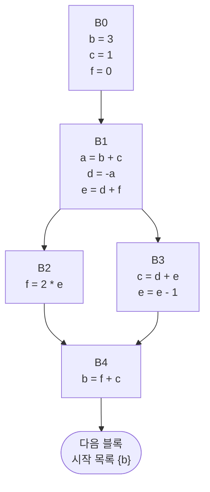
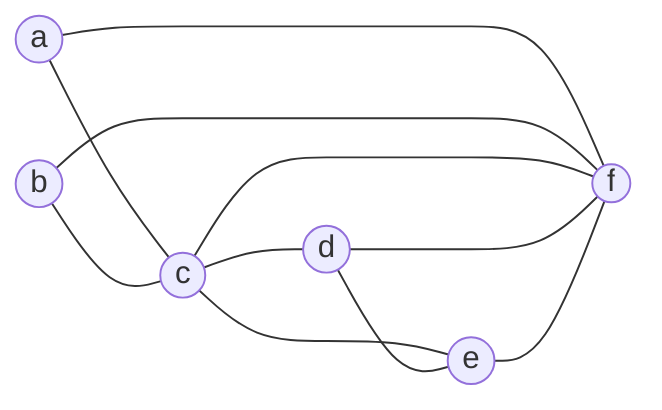


<div class="callout callout-summary" markdown="1">
<div class="callout-title callout-title--default" markdown="span">요약</div>

회의실이 몇 개뿐인 회사에서, 회의 시간이 겹치는 두 팀은 같은 방을 쓸 수 없고 겹치지 않는 두 팀은 같은 방을 번갈아 써도 된다. 변수와 프로세서 안의 빠른 저장 칸 사이도 같다. 값이 앞으로 쓰일 기간이 겹치는 두 변수는 같은 칸에 둘 수 없고, 한 번도 겹치지 않는 두 변수는 한 칸을 번갈아 써도 된다. 변수마다 점을 찍고 "같은 칸을 못 쓰는 사이"를 선으로 이으면, 칸을 나눠 주는 문제가 그림 하나로 정리된다. 다만 이 그림은 "언제 겹치는가"와 "얼마나 자주 쓰이는가"는 담지 않는다.

</div>


## 예시로 보기

[단순 연산과 분기의 코드 생성](/Hongs_Blog/studies/compilers/codegen-simple-operations/)은 변수를 모두 메모리에 두고, 쓸 때마다 꺼내고 넣었다. 메모리를 오가는 일은 느리다. 변수를 아예 레지스터에 살게 하면 꺼내고 넣는 명령이 사라진다. 문제는 레지스터가 몇 개뿐이라는 것이다. 목표는 가진 레지스터만 써서, 되도록 많은 변수를 메모리가 아닌 레지스터에 두는 것이다[^1].

변수가 여섯인데 레지스터가 넷이면 변수마다 하나씩 줄 수 없다. 길은 하나다. 서로 다른 두 변수 a와 b가 한 레지스터를 같이 쓰게 한다. 프로그램의 어느 지점에서도 둘 가운데 많아야 하나만 살아 있다면 그래도 된다[^1].

`d = a + b` 한 줄로 본다. 이 줄 앞에서 살아 있는 변수는 {a, b}, 뒤에서 살아 있는 변수는 {b, d}다[^2].

```
              {a, b}
d = a + b
              {b, d}
```

a는 이 줄에서 마지막으로 읽히고 죽는다. d는 이 줄에서 태어난다. 두 목록 어디에도 a와 d가 함께 든 곳이 없다. 그러니 a가 쓰던 레지스터를 d가 물려받아도 된다. 반대로 a와 b는 앞 목록에 함께 있으므로 서로 다른 레지스터가 필요하다.

"함께 든 적이 있는가"를 모든 변수 쌍에 대해 그림으로 모은 것이 레지스터 간섭 그래프다.

## 만드는 법

두 걸음이다[^3][^4].

**1걸음. 전역 생존 변수 분석을 한다.** [전역 생존 변수 분석](/Hongs_Blog/studies/compilers/global-live-variable-analysis/)으로 문장 앞뒤의 모든 지점에서 살아 있는 변수의 목록을 구한다. 슬라이드의 프로그램과 그 목록이다. 블록 이름은 설명하려고 붙였다[^3][^s1].



| 블록 | 지점마다의 목록 (문장 사이사이) |
|---|---|
| B0 | {} `b = 3` {b} `c = 1` {b, c} `f = 0` {b, c, f} |
| B1 | {b, c, f} `a = b + c` {a, c, f} `d = -a` {c, d, f} `e = d + f` {c, d, e, f} |
| B2 | {c, e} `f = 2 * e` {c, f} |
| B3 | {d, e, f} `c = d + e` {c, e, f} `e = e - 1` {c, f} |
| B4 | {c, f} `b = f + c` {b} |

B1의 끝 목록 {c, d, e, f}는 B2의 시작 목록 {c, e}와 B3의 시작 목록 {d, e, f}를 합친 것이다.

**2걸음. 그래프를 그린다.**

- 노드: 변수 하나마다 하나.
- 간선: 두 변수가 프로그램의 어느 한 지점에서라도 함께 살아 있으면 둘을 잇는다.

목록 하나하나에서 그 안의 변수를 둘씩 짝지으면 된다. {b, c, f}에서는 b–c, b–f, c–f가 나온다. 모든 목록에서 나온 짝을 모으면 간선이 열 개다[^4].



| 변수 | 이웃 | 이웃 수 |
|---|---|---|
| a | c, f | 2 |
| b | c, f | 2 |
| c | a, b, d, e, f | 5 |
| d | c, e, f | 3 |
| e | c, d, f | 3 |
| f | a, b, c, d, e | 5 |

**읽는 법.** b와 d 사이에는 간선이 없다. 둘은 같은 레지스터를 써도 된다. b와 c 사이에는 간선이 있다. 둘은 같은 레지스터를 쓸 수 없다[^5]. 간선으로 이어진 두 변수를 서로 간섭한다(interfere)고 말한다.

c, d, e, f 넷은 서로 모두 이어져 있다. B1의 끝 목록 {c, d, e, f}에서 넷이 한꺼번에 살아 있기 때문이다. 이 넷에는 레지스터가 적어도 넷 필요하다.

<div class="callout callout-check" markdown="1">
<div class="callout-title" markdown="span">검증: 위 표의 목록(슬라이드 p.6)과 간선 열 개(p.7의 그림), 이웃 수, b–d에 간선이 없고 b–c에 있음, c·d·e·f가 서로 모두 이어짐, 죽은 대입이 남아 있을 때의 반례, 카드 C2 — [54_register-interference-graph_impl.py](/Hongs_Blog/studies/compilers/code/54_register-interference-graph_impl/)</div>

</div>


## 약속과 쓰임새

**늘 맞아야 하는 것.** 두 변수 사이에 간선이 있다 ⇔ 생존 변수 분석이 구한 어떤 지점의 목록에 두 변수가 함께 들어 있다[^4].

**기호로 쓰면.** 변수의 집합을 $$V$$, 프로그램의 지점 $$p$$에서 살아 있는 변수의 집합을 $$\text{Live}(p)$$라 하자. 간섭 그래프는 $$G = (V, E)$$이고 간선 집합 $$E$$는 이렇다[^s2].

$$E = \{\, \{u, v\} : u \ne v,\ \exists p,\ u \in \text{Live}(p) \text{ 그리고 } v \in \text{Live}(p) \,\}$$


"$$\exists p$$"는 "그런 지점 $$p$$가 하나라도 있다"로 읽는다.

**이 그래프로 묻는 것.**

| 물음 | 그래프에서 보는 것 | 드는 일 |
|---|---|---|
| 두 변수가 같은 레지스터를 써도 되는가 | 둘 사이에 간선이 없는가 | 간선 하나 찾기 |
| 이 변수와 같이 못 쓰는 변수는 몇인가 | 그 노드의 이웃 수 | 이웃 세기 |
| 레지스터 $$K$$개로 모든 변수를 담을 수 있는가 | 이웃끼리 다른 색이 되게 $$K$$색으로 칠할 수 있는가 | [그래프 색칠 레지스터 할당](/Hongs_Blog/studies/compilers/graph-coloring-register-allocation/) |

만드는 데 드는 일은 목록마다 변수를 둘씩 짝짓는 것이다. 지점이 $$P$$개이고 변수가 $$n$$개면 많아야 $$P \times n(n-1)/2$$쌍을 본다[^s2].

**다른 구조와 견주기.** 변수마다 "살아 있는 구간"을 표로 적어 두는 방법도 있다. 그 표는 언제 겹치는지까지 담지만, 갈림길과 고리가 있으면 구간이 한 줄로 이어지지 않아 적기 어렵다. 그래프는 "겹친 적이 있는가"만 적어서, 프로그램의 모양과 상관없이 같은 꼴이 된다[^s2].

### 스스로 설명해 보기

<details class="callout callout-question" markdown="1">
<summary class="callout-title" markdown="span">1. a와 d가 같은 레지스터를 써도 되는 까닭을 `d = -a` 줄에서 설명하라.</summary>

이 줄 앞의 목록은 {a, c, f}, 뒤의 목록은 {c, d, f}다. a는 이 줄이 읽는 것을 끝으로 다시 읽히지 않고, d는 이 줄에서 처음 값이 들어간다. 기계는 a가 든 레지스터를 읽어 부호를 바꾼 뒤 같은 레지스터에 써도 된다. 읽기가 쓰기보다 먼저 일어나기 때문이다.

</details>


<details class="callout callout-question" markdown="1">
<summary class="callout-title" markdown="span">2. B1의 끝 목록을 구할 때 B2와 B3의 시작 목록을 합치는데, 이것이 간선을 늘리는가?</summary>

늘릴 수 있다. {c, e}와 {d, e, f}를 합친 {c, d, e, f}에는 c–d, c–f처럼 어느 한쪽 목록에도 없던 짝이 생긴다. B1이 끝난 순간에는 어느 길로 갈지 모르므로 양쪽에서 쓰일 변수를 모두 들고 있어야 한다. 그 순간에는 실제로 넷이 다 레지스터에 있어야 한다.

</details>


<details class="callout callout-question" markdown="1">
<summary class="callout-title" markdown="span">3. 간선이 없으면 같은 레지스터를 써도 된다는 말은 어떤 조건에서 맞는가?</summary>

값을 넣는 모든 줄에서, 넣는 변수가 그 줄 뒤에 살아 있을 때다. 뒤에서 안 쓰이는 값을 넣는 줄(죽은 코드)이 남아 있으면, 그 변수는 어느 목록에도 들지 않아 간선이 하나도 없다. 그런데 그 줄은 실행되면서 레지스터를 덮어쓴다. 아래 "가정을 빼면"의 예가 이 경우다.

</details>


<details class="callout callout-question" markdown="1">
<summary class="callout-title" markdown="span">이 구조의 핵심 아이디어는?</summary>

"한정된 자원을 누가 같이 써도 되는가"를 "누구와 누구는 같이 못 쓴다"는 쌍의 모음으로 바꾼다. 쌍의 모음은 그래프다. 그러면 자원 나눠 주기가 그래프 색칠이라는 잘 알려진 문제가 된다.

</details>


<details class="callout callout-question" markdown="1">
<summary class="callout-title" markdown="span">이 방법을 쓸 수 있는 다른 상황은?</summary>

시험 시간표(같은 학생이 듣는 두 과목은 같은 시간에 못 본다), 무선 주파수 배정(가까운 기지국끼리는 같은 주파수를 못 쓴다). 모두 "같이 못 쓰는 사이"를 간선으로 그린다([이분 그래프와 그래프 색칠](/Hongs_Blog/studies/discrete-math/bipartite-coloring/)).

</details>


## 예제

**직선 코드.** `x = 1` / `y = x + 1` / `z = x + y` / `w = z + y`이고 끝난 뒤에는 w만 쓰인다[^s3].

1. *목록 구하기(뒤에서부터):* 끝 {w}. `w = z + y` 앞 {y, z}. `z = x + y` 앞 {x, y}. `y = x + 1` 앞 {x}. `x = 1` 앞 {}.
2. *짝짓기:* {y, z}에서 y–z, {x, y}에서 x–y. 나머지 목록은 원소가 하나 이하라 짝이 없다.
3. *그래프:* 간선은 x–y, y–z 둘. w는 이웃이 없다.

x와 z는 간선이 없다. `z = x + y`에서 x가 죽고 z가 태어난다. w는 누구와도 간선이 없어 아무 레지스터나 써도 된다.

**가정을 빼면: 죽은 코드가 남아 있을 때.** `y = 5` / `x = 1` / `z = y + y`이고 끝난 뒤에는 z만 쓰인다. x는 뒤에서 안 쓰인다. 목록은 {} `y = 5` {y} `x = 1` {y} `z = y + y` {z}다. x는 어느 목록에도 없으므로 x–y 간선이 없다. 그래서 x와 y에 같은 레지스터 r0을 주면 이렇게 된다.

```
r0 = 5        # y
r0 = 1        # x  (y를 덮어쓴다)
r1 = r0 + r0  # z = 2  (10이어야 한다)
```

간섭 그래프를 만들기 전에 [죽은 코드 제거](/Hongs_Blog/studies/compilers/global-live-variable-analysis/)를 먼저 해서 `x = 1`을 지워야 한다. 슬라이드의 프로그램에는 죽은 대입이 없어 이 문제가 드러나지 않는다[^s3].

## 활용

- 구현: [54_register-interference-graph_impl.py](/Hongs_Blog/studies/compilers/code/54_register-interference-graph_impl/). 연습: [레지스터 할당 예제 사다리](/Hongs_Blog/studies/compilers/register-allocation-ladder/)
- 이 그래프를 칠해서 레지스터를 정한다: [그래프 색칠 레지스터 할당](/Hongs_Blog/studies/compilers/graph-coloring-register-allocation/). 칠할 수 없으면 변수를 메모리로 내보내고 그래프를 다시 만든다: [스필링](/Hongs_Blog/studies/compilers/register-spilling/)
- 흔한 실수: 블록의 시작 목록과 끝 목록만 보고 간선을 그린다. 블록 안 문장 사이의 목록도 모두 봐야 한다. 위 프로그램에서 a–c, a–f는 B1 안의 {a, c, f}에서만 나온다.
- 흔한 실수: 한 문장에 같이 나오는 변수끼리 간선을 긋는다. `d = -a`에는 a와 d가 같이 나오지만 둘은 간선이 없다. 간선은 "같은 줄에 나온다"가 아니라 "같은 목록에 든다"로 정한다.

## 연결

- 선수: [전역 생존 변수 분석](/Hongs_Blog/studies/compilers/global-live-variable-analysis/)(목록을 구하는 법), [단순 연산과 분기의 코드 생성](/Hongs_Blog/studies/compilers/codegen-simple-operations/)(풀려는 문제: 헛된 꺼내 오기와 넣어 두기)
- 다음 걸음: [그래프 색칠 레지스터 할당](/Hongs_Blog/studies/compilers/graph-coloring-register-allocation/), [스필링](/Hongs_Blog/studies/compilers/register-spilling/)
- 그래프 색칠 자체: [이분 그래프와 그래프 색칠](/Hongs_Blog/studies/discrete-math/bipartite-coloring/)
- 실제 기계의 레지스터가 몇 개인지: x86의 범용 레지스터는 여덟 개다([x86 레지스터](/Hongs_Blog/studies/assembly-language/x86-registers/))[^s3].

## 자주 하는 오해

<div class="callout callout-misconception" markdown="1">
<div class="callout-title" markdown="span">"같은 문장에 함께 나오는 변수는 서로 간섭한다"</div>

틀렸다. `d = a + b`에서 a와 d는 간섭하지 않는다. 한 줄에 같이 나오니 동시에 필요하다고 생각하기 쉽다. 하지만 기계는 오른쪽을 먼저 읽고 나서 왼쪽에 쓴다. a가 이 줄에서 마지막으로 읽힌다면 읽은 뒤에는 a의 레지스터가 비고, d가 그 자리에 들어가도 된다. 확인하는 법: 이 줄 앞뒤의 목록 {a, b}와 {b, d}에 a와 d가 함께 든 곳이 없다. 반대로 a와 b는 앞 목록에 함께 있어 간섭한다. 슬라이드도 "a와 d는 같은 레지스터를 쓸 수 있다"고 적는다.

</div>


## 확인 문제

<details class="callout callout-question" markdown="1">
<summary class="callout-title" markdown="span">**C1** 레지스터 간섭 그래프의 노드와 간선이 무엇인지 쓰고, 간선이 없는 두 변수와 간선이 있는 두 변수가 각각 무엇을 뜻하는지 쓰라.</summary>

**답:** 노드는 변수 하나하나. 간선은 프로그램의 어느 한 지점에서라도 함께 살아 있는 두 변수 사이에 긋는다. 간선이 없으면 같은 레지스터를 같이 써도 되고, 간선이 있으면 서로 다른 레지스터가 필요하다.<br>
**이유:** 같은 레지스터를 쓰려면 어느 지점에서도 둘 가운데 많아야 하나만 살아 있어야 한다. 단, 죽은 대입이 없는 코드에서 만든 그래프여야 한다.

</details>


<details class="callout callout-question" markdown="1">
<summary class="callout-title" markdown="span">**C2** 한 블록의 목록이 {} `x = 1` {x} `y = x + 1` {x, y} `z = x + y` {y, z} `w = z + y` {w}다. 간섭 그래프의 간선을 모두 쓰고, 레지스터가 몇 개면 되는지 말하라.</summary>

**답:** 간선은 x–y, y–z 둘. 레지스터 둘이면 된다. 예: x와 z에 r0, y에 r1, w는 r0이나 r1 아무거나.<br>
**이유:** 원소가 둘인 목록 {x, y}와 {y, z}에서만 짝이 나온다. 어느 목록도 원소가 둘을 넘지 않는다. x와 z는 함께 든 목록이 없어 r0을 물려 쓴다.

</details>


<details class="callout callout-question" markdown="1">
<summary class="callout-title" markdown="span">**C3** 예시의 프로그램에서 c, d, e, f가 서로 모두 이어지는 까닭은? 이것이 레지스터 수에 대해 알려 주는 것은?</summary>

**답:** B1의 끝(`e = d + f` 바로 뒤)에서 목록이 {c, d, e, f}다. 네 변수가 한 지점에서 한꺼번에 살아 있으므로 여섯 쌍 모두에 간선이 생긴다. 이 넷은 저마다 다른 레지스터가 필요하므로 레지스터가 셋 이하면 모든 변수를 레지스터에 둘 수 없다.<br>
**이유:** 한 지점의 목록 크기는 그 순간 필요한 레지스터 수의 하한이다. 흔한 오답은 "변수가 여섯이니 여섯 개가 필요하다"다. 넷이면 된다(a와 b가 다른 변수와 레지스터를 같이 쓴다).

</details>


<details class="callout callout-question" markdown="1">
<summary class="callout-title" markdown="span">**C4** "간선이 없는 두 변수는 언제나 같은 레지스터를 써도 된다"가 틀리는 예를 만들라.</summary>

**답:** `y = 5` / `x = 1` / `z = y + y`(끝난 뒤 z만 쓰임). x는 죽은 변수라 어느 목록에도 없고 x–y 간선이 없다. 둘에 같은 레지스터를 주면 `x = 1`이 y의 값 5를 덮어써서 z가 10이 아니라 2가 된다.<br>
**이유:** 목록만 보고 만든 그래프는 "값을 넣는 줄 뒤에 그 변수가 살아 있다"를 전제로 한다. 죽은 대입을 먼저 지우면 이 전제가 맞는다.

</details>


[^1]: 컴파일러 16회 강의 자료 「Lecture16 Code generation part 3」, p.3 (더 나은 레지스터 할당의 목표와 핵심 생각)
[^2]: 같은 자료, p.4~5 (생존 변수 분석 복습, "a와 d는 같은 레지스터를 쓸 수 있다"). 표의 왼쪽 설명에는 "the value of a, b, c will be used"라 적혀 있지만 오른쪽 목록은 {a, b}다. 이 문서는 목록을 따랐다.
[^3]: 같은 자료, p.6 (1걸음: 전역 생존 변수 분석, 지점마다의 목록)
[^4]: 같은 자료, p.7 (2걸음: 간섭 그래프의 노드와 간선, 그림)
[^5]: 같은 자료, p.8 (b와 d는 같이 쓸 수 있다, b와 c는 같이 쓸 수 없다)
[^s1]: <span class="fn-tag" title="수업 자료에 없고 따로 보탠 내용">보충</span> 블록 이름 B0~B4, 목록을 한 표로 모은 것, 이웃 수 표, 다이어그램 2개는 원본에 없다. 다이어그램은 슬라이드 p.6과 p.7의 그림을 옮긴 것이고, 목록과 간선은 구현 코드로 다시 구해 그림과 같은 것을 확인했다.
[^s2]: <span class="fn-tag" title="수업 자료에 없고 따로 보탠 내용">보충</span> 기호로 쓴 정의, 쓰임새 표, 만드는 비용, 구간 표와의 비교는 원본에 없다. 슬라이드 p.7의 말로 된 정의를 옮긴 것이다(Aho·Lam·Sethi·Ullman, Compilers 2판, 8.8절).
[^s3]: <span class="fn-tag" title="수업 자료에 없고 따로 보탠 내용">보충</span> 스스로 설명해 보기, 직선 코드 예, 죽은 코드가 남았을 때의 반례, 오해 항목, 카드 C1~C4는 원본에 없다. 반례의 값(z = 2)과 카드의 간선은 구현 코드로 확인했다. x86 범용 레지스터 수는 어셈블리어 과목 문서에 따랐다.

