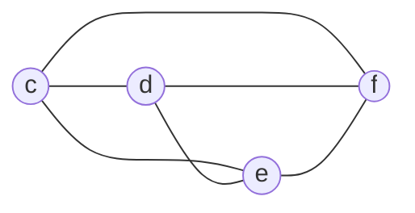
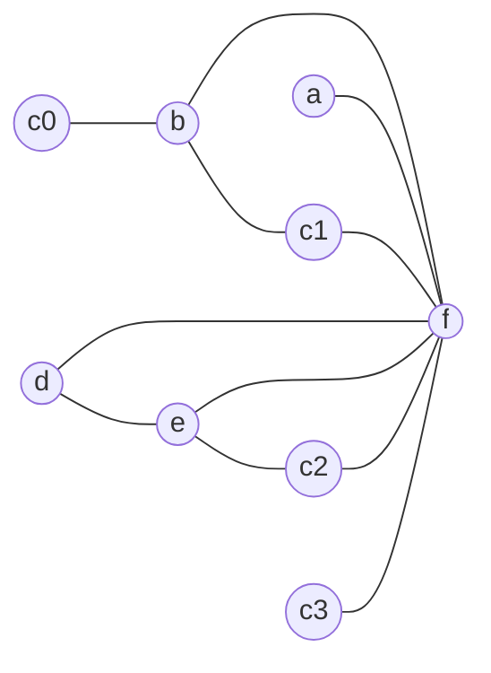


<div class="callout callout-summary" markdown="1">
<div class="callout-title callout-title--default" markdown="span">요약</div>

책상이 좁아 책을 다 펴 놓을 수 없으면, 한 권은 책장에 꽂아 두고 볼 때만 잠깐 꺼냈다가 바로 도로 꽂는다. 빠른 저장 칸이 모자랄 때 컴파일러도 변수 하나를 메모리에 살게 하고, 읽을 때만 잠깐 꺼내고 쓴 직후에 바로 넣는다. 그러면 그 변수가 칸을 차지하는 시간이 아주 짧아져서 다른 변수들과 부딪치는 일이 줄고, 모자라던 칸으로도 나눌 수 있게 된다. 대신 그 변수를 쓸 때마다 메모리를 오가는 명령이 붙는다. 어느 변수를 내보낼지에는 정답이 없고, 한 번으로 안 풀려 더 내보내야 할 때도 있다.

</div>


## 예시로 보기

[그래프 색칠 레지스터 할당](/Hongs_Blog/studies/compilers/graph-coloring-register-allocation/)에서 레지스터가 셋($$K = 3$$)이면 a, b를 뺀 뒤 막혔다. 남은 c, d, e, f가 서로 모두 이어져 있어 이웃이 3보다 적은 노드가 없다[^1].



간선을 줄여야 한다. 간선은 "함께 살아 있는 지점이 있다"에서 나왔다. c가 살아 있는 기간을 짧게 만들면 c에 붙은 간선이 준다. 그래서 c를 레지스터가 아니라 메모리에 살게 한다. 이것이 스필링이다. c의 메모리 자리를 `ca`라 부르자[^2].

원래 코드에서 c는 길게 산다. B0에서 `c = 1`로 태어나 B1의 `a = b + c`까지, B3의 `c = d + e`에서 다시 태어나 B4의 `b = f + c`까지 살아 있다. 그 사이에 d, e, f와 줄곧 겹친다. 코드를 이렇게 고쳐 쓴다[^3].

```
[원래 코드]              [c를 내보낸 코드]
B0: b = 3                B0: b = 3
    c = 1                    c0 = 1
                             store c0 ca
    f = 0                    f = 0
B1: a = b + c            B1: load c1 ca
                             a = b + c1
    d = -a                   d = -a
    e = d + f                e = d + f
B2: f = 2 * e            B2: f = 2 * e
B3: c = d + e            B3: c2 = d + e
                             store c2 ca
    e = e - 1                e = e - 1
B4: b = f + c            B4: load c3 ca
                             b = f + c3
```

c를 읽는 문장 바로 앞에 `load`(메모리에서 꺼내기)를, c에 쓰는 문장 바로 뒤에 `store`(메모리에 넣기)를 넣었다. 그리고 c가 나올 때마다 c0, c1, c2, c3으로 이름을 다르게 붙였다. 이름이 다르면 서로 다른 변수라서, 저마다 `load`와 다음 줄 사이, 또는 앞 줄과 `store` 사이에서만 잠깐 산다.

<div class="callout callout-check" markdown="1">
<div class="callout-title" markdown="span">검증: 고쳐 쓴 코드(슬라이드 p.32), 새 생존 변수 목록(p.33), 새 간섭 그래프의 간선 11개(p.34), 3색으로 칠해짐과 슬라이드의 색(p.35), 원래 코드·고쳐 쓴 코드·레지스터로 바꾼 코드가 두 길 모두에서 같은 b(−7, −8)를 냄, c·d·f는 하나만 내보내도 풀리고 e는 아직 막히며 a·b는 소용없음, 카드 C2 — [56_register-spilling_impl.py](/Hongs_Blog/studies/compilers/code/56_register-spilling_impl/)</div>

</div>


## 절차

**쓸 수 있는 때.** 간섭 그래프를 $$K$$색으로 칠하다가 막혔을 때, 곧 이웃이 $$K$$보다 적은 노드가 없는데 노드가 남아 있을 때다[^1].

**알아보는 신호.** 문제에 "레지스터가 $$K$$개뿐", "$$K$$-색칠 불가", 한 지점의 생존 변수 목록에 변수가 $$K$$개보다 많이 들어 있음, 서로 모두 이어진 노드가 $$K$$개보다 많음.

여섯 걸음이다[^4].

| 걸음 | 하는 일 |
|---|---|
| 1 | 내보낼 후보 노드를 하나 고른다. 내보낸 변수는 레지스터가 아니라 메모리에 산다 |
| 2 | 그 변수의 메모리 자리를 정한다 |
| 3 | 중간 코드를 고쳐 쓴다. ① 그 변수를 읽는 연산마다 바로 앞에 `load` ② 그 변수에 쓰는 연산마다 바로 뒤에 `store` ③ 그 변수가 쓰일 때마다 다른 이름 |
| 4 | 고쳐 쓴 코드로 생존 변수 분석을 다시 한다 |
| 5 | 간섭 그래프를 다시 만들고 다시 칠한다 |
| 6 | 변수를 배정받은 레지스터로 바꾼다 |

**4걸음: 새 목록.** 새 이름 c0~c3은 `load`와 바로 다음 명령 사이, 또는 바로 앞 명령과 `store` 사이에서만 살아 있다[^5].

| 블록 | 지점마다의 목록 |
|---|---|
| B0 | {} `b = 3` {b} `c0 = 1` {b, c0} `store c0 ca` {b} `f = 0` {b, f} |
| B1 | {b, f} `load c1 ca` {b, c1, f} `a = b + c1` {a, f} `d = -a` {d, f} `e = d + f` {d, e, f} |
| B2 | {e} `f = 2 * e` {f} |
| B3 | {d, e, f} `c2 = d + e` {e, f, c2} `store c2 ca` {e, f} `e = e - 1` {f} |
| B4 | {f} `load c3 ca` {f, c3} `b = f + c3` {b} |

가장 큰 목록의 크기가 4({c, d, e, f})에서 3으로 줄었다.

**5걸음: 새 그래프.** 간선이 11개다. c0~c3은 이웃이 한둘뿐이다[^6].



이제 $$K = 3$$으로 칠해진다. 슬라이드의 색은 c0, a, c1, e에 r0, b, d, c2, c3에 r1, f에 r2다[^7].

**6걸음: 레지스터로 바꾼 코드**[^s1].

```
B0: r1 = 3               B1: load r0 ca          B3: r1 = r1 + r0
    r0 = 1                   r0 = r1 + r0            store r1 ca
    store r0 ca              r1 = -r0                r0 = r0 - 1
    r2 = 0                   r0 = r1 + r2        B4: load r1 ca
                         B2: r2 = 2 * r0             r1 = r2 + r1
```

레지스터 셋으로 돈다. 대신 원래 코드에 없던 메모리 읽기 둘(`load`)과 쓰기 둘(`store`)이 생겼다.

## 무엇을 내보낼까

슬라이드는 세 가지를 적는다[^8].

- 내보낸 뒤에도 그래프가 $$K$$-색칠 가능하지 않으면 더 내보내야 할 수 있다.
- 무엇을 내보낼지 정하는 것이 중요한 문제다. 정답은 없다. 어떤 선택을 해도 결국에는 그래프를 $$K$$-색칠 가능하게 만들 수 있다.
- 상황에 따라 다른 기준으로 고른다. 예: 이웃이 가장 많은 변수, 가장 드물게 쓰이는 변수, 고리 밖에 있는 변수.

세 기준의 까닭은 이렇다[^s2]. 이웃이 많은 변수를 내보내면 간선이 한꺼번에 많이 사라진다. 드물게 쓰이는 변수는 붙는 `load`와 `store`가 적다. 고리 안의 변수를 내보내면 고리를 돌 때마다 메모리를 오가므로, 고리 밖의 변수가 싸다.

이 프로그램에서 변수마다 하나씩 내보내 본 결과다[^s2].

| 내보낸 변수 | 다시 칠하면 ($$K = 3$$) | 까닭 |
|---|---|---|
| c | 칠해진다 | 가장 큰 목록이 3으로 준다 |
| d | 칠해진다 | 위와 같다 |
| f | 칠해진다 | 위와 같다 |
| e | 아직 막힌다 | `e0 = d + f` 바로 뒤, `store` 앞에서 c, d, e0, f 넷이 함께 산다 |
| a 또는 b | 아직 막힌다 | c, d, e, f가 그대로 서로 이어져 있다. 처음부터 a, b는 문제가 아니었다 |

e를 내보냈을 때 막히는 것이 "더 내보내야 할 수 있다"의 예다. 새로 태어난 e0은 `store`까지 한 줄 동안은 레지스터에 있어야 하고, 그 한 줄에 c, d, f가 모두 살아 있다.

## 활용

- 구현: [56_register-spilling_impl.py](/Hongs_Blog/studies/compilers/code/56_register-spilling_impl/). 연습: [레지스터 할당 예제 사다리](/Hongs_Blog/studies/compilers/register-allocation-ladder/)
- 내보낸 변수도 레지스터를 아예 안 쓰는 것은 아니다. 읽고 쓰는 그 순간에는 레지스터가 하나 필요하다. 다만 그 시간이 한 줄뿐이다.
- [단순 연산과 분기의 코드 생성](/Hongs_Blog/studies/compilers/codegen-simple-operations/)의 방식은 모든 변수를 내보낸 것과 같다. 변수를 쓸 때마다 꺼내고 넣는다. 스필링은 그 가운데 꼭 필요한 변수만 그렇게 한다[^s2].
- 흔한 실수: `store`를 읽는 문장 뒤에, `load`를 쓰는 문장 앞에 붙인다. 읽기 **앞**에 `load`, 쓰기 **뒤**에 `store`다.
- 흔한 실수: 고쳐 쓴 뒤 옛 간섭 그래프에서 c만 지우고 칠한다. c0~c3이 새 노드로 생기고 다른 변수들의 목록도 달라지므로, 생존 변수 분석부터 다시 한다.
- 흔한 실수: 새 이름을 붙이지 않는다. 이름이 모두 c면 네 조각이 노드 하나로 합쳐져, 네 곳 모두 같은 레지스터를 써야 하고 이웃도 한 노드에 모인다.

## 연결

- 선수: [그래프 색칠 레지스터 할당](/Hongs_Blog/studies/compilers/graph-coloring-register-allocation/)(막히는 곳), [레지스터 간섭 그래프](/Hongs_Blog/studies/compilers/register-interference-graph/), [전역 생존 변수 분석](/Hongs_Blog/studies/compilers/global-live-variable-analysis/)(4걸음에서 다시 쓴다)
- `load`와 `store`가 기계 명령으로는 `lw`와 `sw`다: [수업용 MIPS 명령어](/Hongs_Blog/studies/compilers/mips-instructions/)
- 서로 모두 이어진 노드가 색 수보다 많으면 칠할 수 없다: [이분 그래프와 그래프 색칠](/Hongs_Blog/studies/discrete-math/bipartite-coloring/)

## 확인 문제

<details class="callout callout-question" markdown="1">
<summary class="callout-title" markdown="span">**C1** 스필링의 여섯 걸음을 쓰고, 3걸음에서 코드를 고쳐 쓰는 세 가지 규칙을 쓰라.</summary>

**답:** ① 내보낼 변수 고르기 ② 메모리 자리 정하기 ③ 코드 고쳐 쓰기 ④ 생존 변수 분석 다시 ⑤ 간섭 그래프와 색칠 다시 ⑥ 레지스터로 바꾸기. 고쳐 쓰기: 그 변수를 읽는 연산 바로 앞에 `load`, 쓰는 연산 바로 뒤에 `store`, 쓰일 때마다 다른 이름.<br>
**이유:** 세 규칙이 합쳐져 그 변수가 레지스터에 머무는 시간을 한 줄로 줄인다.

</details>


<details class="callout callout-question" markdown="1">
<summary class="callout-title" markdown="span">**C2** 예시의 원래 코드에서 c 대신 d를 내보낸다(메모리 자리 `da`, 이름은 나오는 순서대로 d0, d1, d2). 바뀌는 블록을 고쳐 쓰라. `load`와 `store`는 몇 개씩 생기는가?</summary>

**답:** B1: `a = b + c` / `d0 = -a` / `store d0 da` / `load d1 da` / `e = d1 + f`. B3: `load d2 da` / `c = d2 + e` / `e = e - 1`. B0, B2, B4는 그대로다. `load` 둘, `store` 하나.<br>
**이유:** d에 쓰는 곳은 `d = -a` 한 곳, 읽는 곳은 `e = d + f`와 `c = d + e` 두 곳이다. 이렇게 고친 코드도 $$K = 3$$으로 칠해진다. `store d0 da` 바로 다음 줄에서 `load d1 da`를 하는 것이 헛일로 보이지만, 규칙을 기계적으로 적용하면 이렇게 나온다.

</details>


<details class="callout callout-question" markdown="1">
<summary class="callout-title" markdown="span">**C3** c가 쓰일 때마다 c0, c1, c2, c3으로 이름을 다르게 붙이는 까닭은? 이름을 모두 c로 두면 새 간섭 그래프에서 c의 이웃은 무엇이 되는가?</summary>

**답:** 이름이 같으면 네 조각이 한 변수, 곧 노드 하나로 분석된다. 그 노드에 네 조각의 이웃이 모두 모여 b, e, f 셋이 되고, 네 곳 모두 같은 레지스터를 써야 한다. 이름을 나누면 노드가 넷으로 갈라져 저마다 이웃이 한둘(c0은 b, c1은 b와 f, c2는 e와 f, c3은 f)이고, 조각마다 다른 레지스터를 받을 수 있다.<br>
**이유:** 색칠에서 막히느냐를 정하는 것은 노드 하나의 이웃 수다. 이웃이 적은 노드 여럿이 이웃이 많은 노드 하나보다 빼기 쉽다. 슬라이드의 색에서도 c0과 c1은 r0, c2와 c3은 r1로 서로 다르다. 이 예에서는 이름을 나누지 않아도 3색으로 칠해지지만, 나누는 쪽이 막힐 일이 더 적다.

</details>


[^1]: 컴파일러 16회 강의 자료 「Lecture16 Code generation part 3」, p.27~28 (K = 3이면 c, d, e, f가 모두 이웃 3개라 막힌다)
[^2]: 같은 자료, p.29 (해결책: 스필링. 1~2걸음, 후보 c와 메모리 자리 ca)
[^3]: 같은 자료, p.30 (읽는 연산 앞에 load), p.31 (쓰는 연산 뒤에 store), p.32 (쓰일 때마다 다른 이름)
[^4]: 같은 자료, p.29~35 (여섯 걸음)
[^5]: 같은 자료, p.33 (고쳐 쓴 코드의 생존 변수 분석)
[^6]: 같은 자료, p.34 (새 간섭 그래프)
[^7]: 같은 자료, p.35 (배정된 레지스터)
[^8]: 같은 자료, p.36 (주의: 더 내보내야 할 수 있다, 무엇을 내보낼지, 세 가지 예)
[^s1]: <span class="fn-tag" title="수업 자료에 없고 따로 보탠 내용">보충</span> 레지스터로 바꾼 코드는 원본에 글로 나오지 않는다. 슬라이드 p.35의 색대로 이름을 바꿔 썼고, 원래 코드와 같은 값을 내는 것을 구현 코드로 확인했다. 다이어그램 2개는 슬라이드 p.29와 p.34의 그림을 옮긴 것이다.
[^s2]: <span class="fn-tag" title="수업 자료에 없고 따로 보탠 내용">보충</span> 알아보는 신호, 세 기준의 까닭, 변수마다 내보내 본 표, "모든 변수를 내보낸 것과 같다"는 설명, 카드 C1~C3은 원본에 없다. 표와 카드 C2는 구현 코드로 확인했다. 카드 C3의 "이름을 모두 c로 둘 때 이웃이 b, e, f 셋이고 그래도 3색으로 칠해진다"도 구현 코드로 확인했다.

