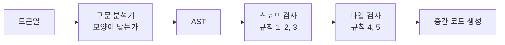


<div class="callout callout-summary" markdown="1">
<div class="callout-title callout-title--default" markdown="span">요약</div>

"내 딸은 소년이다"는 낱말의 차례가 문법에 맞지만 뜻이 맞지 않는다. 프로그램에도 이런 문장이 있다. 모양은 멀쩡한데 선언한 적 없는 이름을 쓰거나, 숫자 자리에 글자를 넣는 코드다. 의미 분석은 구문 분석을 통과한 코드에서 이런 잘못을 찾는다. 모양만 보는 문법 규칙으로는 못 잡는 오류를 실행하기 전에 걸러 주지만, 무엇이 잘못인지는 언어마다 달라서 언어의 규칙을 따로 알아야 한다.

</div>


## 예시로 보기

구문 분석기는 토큰의 차례만 본다. 그래서 이런 코드를 통과시킨다[^1].

```c
int main(void) { return a; }
```

토큰으로 보면 `<type> <id> <lparen> <type> <rparen> <lbrace> <return> <id> <semi> <rbrace>`이고, 함수 정의의 모양에 꼭 맞는다. 그런데 `a`를 선언한 곳이 없다. "이 `a`가 앞에서 선언되었는가"는 토큰의 차례가 아니라 **이름**을 봐야 알 수 있다. `return a;`와 `return b;`는 구문 분석기에게 똑같이 `<return> <id> <semi>`다.

슬라이드의 영어 문장도 같은 꼴이다. "My daughter is a boy"는 `<possessive> <noun> <verb> <article> <noun>`으로 문법에 맞지만 뜻이 틀렸다[^1].

## 다섯 가지 규칙

의미 분석기는 여러 가지 의미 규칙(semantic grammar)을 검사한다. 규칙은 프로그래밍 언어마다 다를 수 있다. 강의가 드는 흔한 규칙은 다섯이다[^2].

| | 규칙 | 맞는 예 | 틀린 예 | 무엇으로 검사하나 |
|---|---|---|---|---|
| 1 | 변수는 쓰기 전에 선언해야 한다(전역이든 지역이든) | `int a; void foo() { a = 3; }` | `void foo() { a = 3; int a; }` | 스코프 검사 |
| 2 | 변수는 한 번만 선언한다(같은 지역 안에서) | `int a; void foo() { int a = 3; }` | `void foo() { int a = 3; int a = 2; }` | 스코프 검사 |
| 3 | 함수는 한 번만 선언한다(전역에서) | `void foo() { … }` | `void foo() { … } void foo() { … }` | 스코프 검사 |
| 4 | 변수는 알맞은 타입의 상수나 변수와 함께 쓴다 | `int a = 3;` | `int a = 3.5;`, `char a = 3.5;`, `a[3.5] = 0;` | 타입 검사 |
| 5 | 함수는 알맞은 개수와 타입의 인자로 부른다 | `void foo(int a) {…}` `foo(3);` | `foo("compiler");`, `foo(1, 2);` | 타입 검사 |

규칙 1의 맞는 예에는 매개변수도 있다. `void foo(int a) { a = 3; }`에서 `a`는 매개변수로 선언된 것이다[^2].

규칙 2에서 "같은 지역 안에서"라는 말이 결론을 바꾼다. 전역에 `int a;`가 있고 함수 안에 `int a = 3;`이 또 있는 것은 괜찮다. 서로 다른 구역이기 때문이다. 같은 구역 안에 둘이면 오류다.

규칙 4의 틀린 예 `int a = 3.5;`는 실제 C 컴파일러에서는 오류가 아니다. C는 3.5를 3으로 바꿔 넣는다. 강의는 이런 자동 변환이 없는 언어를 놓고 규칙을 든다[^s1].

**검사하는 방법은 둘이다.** 규칙 1~3은 "이 이름이 어디서 선언되었고 어디까지 보이는가"를 따지는 스코프 검사로 본다[^3]. 규칙 4~5는 "이 값의 종류가 그 자리에 맞는가"를 따지는 타입 검사로 본다[^4].



의미 분석기는 구문 분석기가 만든 트리를 돌아다니며 검사한다[^5].

<div class="callout callout-check" markdown="1">
<div class="callout-title" markdown="span">검증: 규칙 1~3의 맞는 예와 틀린 예를 스코프 검사기에 넣어 판정이 표와 같음 — [32_symbol-table-scope-checking_impl.py](/Hongs_Blog/studies/compilers/code/32_symbol-table-scope-checking_impl/)</div>

</div>


## 연결

- 선수: [컴파일러의 구조](/Hongs_Blog/studies/compilers/compiler-structure/)(의미 분석은 구문 분석 다음, 중간 코드 생성 앞 단계다), [추상 구문 트리](/Hongs_Blog/studies/compilers/abstract-syntax-tree/)
- 규칙 1~3을 검사하는 법: [스코프](/Hongs_Blog/studies/compilers/identifier-scope/), [심벌 테이블과 스코프 검사](/Hongs_Blog/studies/compilers/symbol-table-scope-checking/)
- 규칙 4~5를 검사하는 법: [타입과 타입 시스템](/Hongs_Blog/studies/compilers/type-system/), [타입 검사 절차](/Hongs_Blog/studies/compilers/type-checking-procedure/)
- [문맥 자유 문법](/Hongs_Blog/studies/compilers/context-free-grammar/)은 규칙을 쓸 때 주변을 보지 않는다. "앞에서 선언한 이름만 쓸 수 있다"는 주변(문맥)에 달린 조건이라 문법에 담지 못하고, 이 단계로 넘긴다[^s1].

## 확인 문제

<details class="callout callout-question" markdown="1">
<summary class="callout-title" markdown="span">**C1** 강의의 흔한 의미 규칙 다섯 가지를 쓰고, 스코프 검사로 보는 것과 타입 검사로 보는 것으로 나누라.</summary>

**답:** ① 변수는 쓰기 전에 선언 ② 변수는 같은 지역 안에서 한 번만 선언 ③ 함수는 전역에서 한 번만 선언 ④ 변수는 알맞은 타입의 상수·변수와 함께 쓴다 ⑤ 함수는 알맞은 개수와 타입의 인자로 부른다. ①~③은 스코프 검사, ④~⑤는 타입 검사다.

</details>


<details class="callout callout-question" markdown="1">
<summary class="callout-title" markdown="span">**C2** 다음 넷은 각각 어느 단계에서 걸리는가? (가) `int a = ;` (나) `void foo() { a = 3; }` (다) `void foo(int a) {…}`를 두고 `foo(1, 2);` (라) `int a; int a;`가 같은 블록에 있다.</summary>

**답:** (가) 구문 분석. `=` 뒤에 식이 없어 모양이 틀렸다. (나) 의미 분석의 스코프 검사, 규칙 1. (다) 의미 분석의 타입 검사, 규칙 5. (라) 의미 분석의 스코프 검사, 규칙 2.<br>
**이유:** (나)~(라)는 토큰의 차례로는 멀쩡하다. 이름이나 개수, 종류를 봐야 알 수 있다.

</details>


<details class="callout callout-question" markdown="1">
<summary class="callout-title" markdown="span">**C3** "선언하지 않은 변수를 썼다"는 오류를 왜 구문 분석기가 못 잡는가?</summary>

**답:** 구문 분석기는 토큰의 종류와 차례만 본다. `return a;`든 `return b;`든 `<return> <id> <semi>`로 같다. 어느 이름이 앞에서 선언되었는지는 이름 자체와 그 이름이 놓인 구역을 기억해야 알 수 있고, 그 기억을 맡는 것이 의미 분석의 심벌 테이블이다.

</details>


[^1]: 컴파일러 9회 강의 자료 「Lecture09 Semantic analysis part 1」, p.3~4 (문법에는 맞지만 뜻이 틀린 영어 문장과 C 코드)
[^2]: 같은 자료, p.5~9 (다섯 가지 흔한 의미 규칙과 맞는 예, 틀린 예. 슬라이드에서 빨간 글씨가 틀린 예다)
[^3]: 같은 자료, p.10~11. 컴파일러 10회 강의 자료 「Lecture10 Semantic analysis part 2」, p.3~4 (규칙 1~3은 스코프 검사로)
[^4]: 컴파일러 9회 강의 자료 「Lecture09 Semantic analysis part 1」, p.12. 컴파일러 10회 강의 자료 「Lecture10 Semantic analysis part 2」, p.5 (규칙 4~5는 타입 검사로)
[^5]: 컴파일러 9회 강의 자료 「Lecture09 Semantic analysis part 1」, p.19 (AST를 돌아다니며 심벌 테이블을 채운다)
[^s1]: <span class="fn-tag" title="수업 자료에 없고 따로 보탠 내용">보충</span> `return a;`와 `return b;`가 구문 분석기에게 같다는 설명, 실제 C에서 `int a = 3.5;`가 자동 변환으로 통과한다는 말, 흐름 다이어그램, 문맥 자유 문법이 선언 여부를 담지 못한다는 말, 카드 C2·C3은 원본에 없다. 근거: Aho·Lam·Sethi·Ullman, *Compilers* 2판, 1.2.3 "Semantic Analysis", 4.3.5 "Non-Context-Free Language Constructs". C의 자동 변환은 ISO C 표준의 대입 변환 규칙이다.

