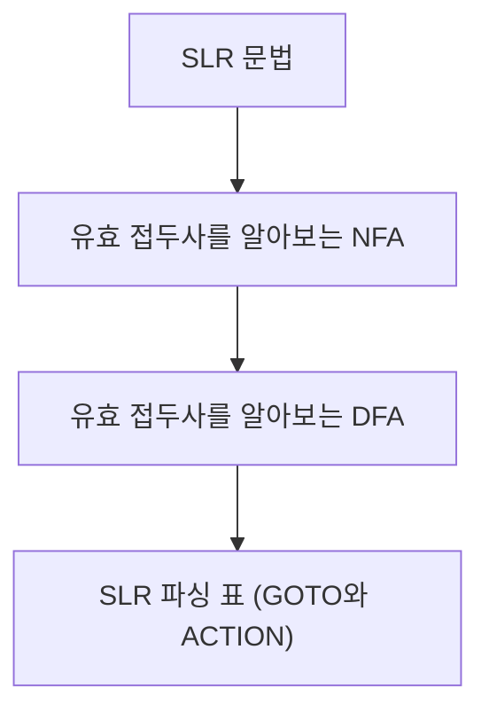


<div class="callout callout-summary" markdown="1">
<div class="callout-title callout-title--default" markdown="span">요약</div>

파서가 걸음마다 할 고민을 미리 다 풀어서 표 한 장에 적어 둔 것이다. 줄은 "지금 처지", 칸은 "다음에 보이는 것"이고, 칸 안에는 읽고 넘어가라, 어느 규칙으로 묶어라, 받아들여라 가운데 하나가 적혀 있다. 파싱할 때는 생각 없이 표만 찾으면 되니 빠르고, 사람이 아니라 프로그램이 문법에서 표를 만들어 낼 수 있다. 한 칸에 할 일이 둘 적히면 그 문법은 이 표로 파싱하지 못한다.

</div>


## 예시로 보기

[SLR 파싱](/Hongs_Blog/studies/compilers/slr-parsing/)은 걸음마다 DFA 그림에서 상태를 찾고, 그 상태의 항목을 훑고, FOLLOW 집합을 뒤진다. 사람이 손으로 하기에도 번거롭고 프로그램으로 옮기기에도 느리다. 그런데 "상태와 다음 토큰이 정해지면 할 일도 정해진다". 그러면 모든 (상태, 토큰) 짝의 답을 한 번만 계산해 표에 적어 두면 된다.

문법에 규칙 번호를 붙인다.

$$(1)\ S' \to E \qquad (2)\ E \to T * E \qquad (3)\ E \to T \qquad (4)\ T \to (E) \qquad (5)\ T \to id$$


[항목 DFA](/Hongs_Blog/studies/compilers/lr0-item-automaton/)의 상태 3은 $$E \to T.*E$$와 $$E \to T.$$이다. 이 상태의 줄을 채워 본다.

- `*` 칸: $$E \to T.*E$$에서 점 뒤가 `*`이고 `*`를 읽으면 상태 6으로 간다. "이동하고 6으로"를 `S6`이라 적는다.
- `)` 칸과 `$` 칸: $$E \to T.$$은 점이 끝이다. Follow(E) = {`)`, `$`}이므로 이 두 칸에 "규칙 (3)으로 환원"을 `R(3)`이라 적는다.
- 나머지 칸 `(`, `id`: 빈칸이다. 빈칸은 오류다.

`S6`의 6은 상태 번호이고 `R(3)`의 3은 규칙 번호다. 둘을 섞으면 표를 못 읽는다.

## 정의

SLR 파싱 표는 두 부분으로 되어 있다.

| 부분 | 줄 | 칸 | 칸에 적는 것 |
|---|---|---|---|
| ACTION | 상태 | 터미널과 `$` | 이동(`S`+갈 상태), 환원(`R`+규칙 번호), 빈칸(오류) |
| GOTO | 상태 | 논터미널 | 갈 상태 |

SLR 문법에서 표까지 가는 길은 네 칸이다.



### 만드는 순서

DFA의 전이 함수를 $$\delta$$(델타)라 하자. $$\delta(q_i, X) = q_j$$는 "상태 $$q_i$$에서 기호 $$X$$를 읽으면 $$q_j$$로 간다"이다.

**1단계. GOTO 표.** 상태 $$q_i$$와 논터미널 $$A$$마다, $$q_i$$에서 $$A$$로 $$q_j$$에 가는 전이가 있으면 그 칸에 $$q_j$$를 적는다.

$$GOTO(q_i, A) = q_j \quad \text{(} \delta(q_i, A) = q_j \text{일 때)}$$


**2단계. ACTION 표.** 상태 $$q_i$$와 터미널 $$a$$마다

1. $$q_i$$에 점 바로 뒤가 $$a$$인 항목 $$X \to \alpha . a\beta$$가 있고 $$\delta(q_i, a) = q_j$$이면, $$ACTION(q_i, a)$$ = "이동하고 $$q_j$$로".
2. $$q_i$$에 점이 끝인 항목 $$X \to \alpha.$$이 있고 $$a \in \text{Follow}(X)$$이면, $$ACTION(q_i, a)$$ = "$$X \to \alpha$$로 환원".
3. 그 밖의 칸은 오류다.

덧붙인 규칙 $$S' \to S$$의 환원은 Follow(S') = {`$`}라서 `$` 칸에만 들어간다. 이 칸이 "받아들임"이다.

정리하면 DFA의 화살표가 그대로 표로 옮겨진다. 논터미널이 붙은 화살표는 GOTO로, 터미널이 붙은 화살표는 ACTION의 이동으로 간다. DFA에 없던 정보는 환원 칸뿐이고, 그것을 FOLLOW가 정한다.

### 의사코드

```
상태 q마다:
    q에서 나가는 전이 (X, q')마다:
        X가 논터미널이면  GOTO[q, X] ← q'
        X가 터미널이면    ACTION[q, X]에 "S q'"를 더한다
    q 안의 점이 끝인 항목 X → α. 마다:
        Follow(X)의 터미널 a마다  ACTION[q, a]에 "R (X → α의 번호)"를 더한다
한 칸에 둘 이상 들어가면 → 충돌 (SLR 문법이 아니다)
```

### 완성된 표

DFA의 전이와 Follow(S') = {`$`}, Follow(E) = {`)`, `$`}, Follow(T) = {`*`, `)`, `$`}로 표를 채우면 이렇다.

| 상태 | `*` | `(` | `)` | `id` | `$` | E | T |
|---|---|---|---|---|---|---|---|
| 1 | | S4 | | S5 | | 2 | 3 |
| 2 | | | | | R(1) | | |
| 3 | S6 | | R(3) | | R(3) | | |
| 4 | | S4 | | S5 | | 7 | 3 |
| 5 | R(5) | | R(5) | | R(5) | | |
| 6 | | S4 | | S5 | | 8 | 3 |
| 7 | | | S9 | | | | |
| 8 | | | R(2) | | R(2) | | |
| 9 | R(4) | | R(4) | | R(4) | | |

앞 다섯 칸이 ACTION이고 뒤 두 칸(E, T)이 GOTO다. ACTION 45칸 가운데 이동이 8칸, 환원이 11칸이고 26칸이 빈칸이다. GOTO는 6칸이 차 있다.

채워지는 순서를 줄 하나로 따라가 본다. 상태 5는 $$T \to id.$$ 하나다.

| 하위 목표 | 한 일 |
|---|---|
| 전이 옮기기 | 상태 5에서 나가는 전이가 없다. 이동도 GOTO도 없다 |
| 점이 끝인 항목 찾기 | $$T \to id.$$, 규칙 (5) |
| FOLLOW 찾기 | Follow(T) = {`*`, `)`, `$`} |
| 환원 적기 | `*`, `)`, `$` 칸에 R(5) |
| 충돌 확인 | 칸마다 하나뿐이다 |

<div class="callout callout-check" markdown="1">
<div class="callout-title" markdown="span">검증: 위 표의 63칸 전부, 1단계만 한 GOTO 6칸, 이동 8칸, FOLLOW 세 개, FOLLOW를 안 쓰면 상태 3의 `*` 칸에 S6과 R(3)이 겹침 — [27_slr-parsing-table_impl.py](/Hongs_Blog/studies/compilers/code/27_slr-parsing-table_impl/)</div>

</div>


### 정확성

**주장.** 표의 $$ACTION(q_i, a)$$ 칸에 적힌 것은, [SLR 파싱](/Hongs_Blog/studies/compilers/slr-parsing/)의 규칙이 "DFA가 상태 $$q_i$$에 닿았고 다음 토큰이 $$a$$일 때" 내리는 결정과 같다[^s1].

<details class="callout callout-proof" markdown="1">
<summary class="callout-title" markdown="span">증명 펼치기</summary>

1. SLR의 이동 조건은 "$$q_i$$에서 $$a$$로 가는 전이가 있다"이다. 2단계의 1번은 바로 그 전이가 있을 때 이동을 적는다. 점 뒤가 $$a$$인 항목이 있다는 것과 $$a$$ 전이가 있다는 것은 같은 말이다. 전이는 점 뒤 기호를 읽어 점을 옮기는 것이기 때문이다. — 항목 DFA의 구성
2. SLR의 환원 조건은 "$$q_i$$에 $$X \to \beta.$$이 있고 $$a \in \text{Follow}(X)$$"이다. 2단계의 2번이 글자 그대로 같다. — SLR 파싱의 정의
3. 둘 다 아닌 칸은 SLR 규칙에서 오류이고 표에서는 빈칸이다.
4. 그러므로 칸마다 표와 규칙의 답이 같다. 한 칸에 둘이 들어가는 것은 규칙의 두 조건이 함께 맞는 것, 곧 충돌과 같다. ∎

</details>


이 증명은 "표가 SLR 규칙을 그대로 옮겼다"를 보인 것이다. SLR 규칙 자체가 옳은 이유는 [SLR 파싱](/Hongs_Blog/studies/compilers/slr-parsing/)의 정확성에 있다.

### 스스로 설명해 보기

<details class="callout callout-question" markdown="1">
<summary class="callout-title" markdown="span">1. 증명 1에서 "점 뒤가 $$a$$인 항목이 있다"와 "$$a$$ 전이가 있다"가 같은 말인 이유</summary>

항목 DFA에서 상태 $$q$$의 $$a$$ 전이는 "$$q$$ 안에서 점 뒤가 $$a$$인 항목들의 점을 한 칸 옮긴 것"으로 만든다. 그런 항목이 하나도 없으면 전이도 없다.

</details>


<details class="callout callout-question" markdown="1">
<summary class="callout-title" markdown="span">2. 상태 2의 `$` 칸이 R(1)이고 다른 칸은 빈칸인 이유</summary>

상태 2의 항목은 $$S' \to E.$$ 하나이고 Follow(S') = {`$`}다. $$S'$$은 어떤 규칙의 오른쪽에도 안 나오므로 뒤에 올 수 있는 것은 입력 끝뿐이다.

</details>


<details class="callout callout-question" markdown="1">
<summary class="callout-title" markdown="span">3. GOTO 표에 터미널 칸이 없는 이유</summary>

터미널로 가는 전이는 ACTION의 이동(`S`+상태)에 이미 적혀 있다. GOTO는 환원으로 논터미널이 생긴 뒤 어느 상태로 갈지를 따로 적는 곳이다.

</details>


<details class="callout callout-question" markdown="1">
<summary class="callout-title" markdown="span">이 구성의 핵심 아이디어는?</summary>

파싱 중에 되풀이할 판단을 파싱 전에 한 번만 해 두고 찾아 쓰기만 한다. 판단에 필요한 것이 (상태, 다음 토큰) 둘뿐이라 표로 다 적을 수 있다.

</details>


<details class="callout callout-question" markdown="1">
<summary class="callout-title" markdown="span">이 방법을 쓸 수 있는 다른 상황은?</summary>

[LL(1) 파싱 표](/Hongs_Blog/studies/compilers/ll1-parsing-table/)도 (논터미널, 다음 토큰)마다 쓸 규칙을 미리 적어 둔다. 어휘 분석의 DFA 전이표도 (상태, 글자)마다 다음 상태를 미리 적어 둔 것이다.

</details>


### 복잡도

표의 크기는 (상태 수) × (터미널 수 + 1 + 논터미널 수)다. 위 예는 $$9 \times 7 = 63$$칸이다. 표를 채우는 일은 전이마다 한 번, 점이 끝인 항목마다 FOLLOW 크기만큼이다[^s1].

## 활용

- 구현: [27_slr-parsing-table_impl.py](/Hongs_Blog/studies/compilers/code/27_slr-parsing-table_impl/). 연습: [SLR 파싱 표 예제 사다리](/Hongs_Blog/studies/compilers/slr-table-ladder/)
- 표를 써서 파싱하는 법: [SLR 파서의 스택 동작](/Hongs_Blog/studies/compilers/slr-stack-parser/)
- 표를 채우는 문제를 알아보는 신호: "다음 문법의 SLR 파싱 표를 만들라". 하위 목표는 늘 같다. 규칙에 번호 붙이기 → 항목 DFA → GOTO → 이동 → FOLLOW와 환원 → 충돌 확인.
- 흔한 실수 둘. 환원을 그 상태의 모든 터미널 칸에 적는다(그것은 LR(0)이고 충돌이 는다). FOLLOW를 구할 때 `$`를 빼먹어 `$` 칸의 환원이 사라진다.

## 연결

- 선수: [SLR 파싱](/Hongs_Blog/studies/compilers/slr-parsing/), [LR(0) 항목과 항목 오토마타](/Hongs_Blog/studies/compilers/lr0-item-automaton/), [FOLLOW 집합](/Hongs_Blog/studies/compilers/follow-set/)
- 같은 "미리 계산한 표"이지만 줄과 칸의 뜻이 다른 표: [LL(1) 파싱 표](/Hongs_Blog/studies/compilers/ll1-parsing-table/). LL(1) 표의 줄은 논터미널이고 칸에는 규칙이 들어간다. SLR 표의 줄은 상태이고 칸에는 동작이 들어간다.

## 자주 하는 오해

<div class="callout callout-misconception" markdown="1">
<div class="callout-title" markdown="span">"점이 끝인 항목이 있으면 그 상태 줄의 모든 칸에 환원을 적는다"</div>

틀렸다. 환원은 그 규칙 왼쪽 기호의 FOLLOW에 든 터미널 칸에만 적는다. 상태 3에서 $$E \to T.$$의 환원 R(3)은 `)`와 `$` 칸에만 들어간다. 모든 칸에 적으면 `*` 칸에서 이동 S6과 겹쳐 충돌이 난다. 그럴듯해 보이는 이유는 "오른쪽을 다 봤으니 무조건 묶으면 된다"고 생각하기 쉽고, 상태 5나 9처럼 항목이 하나뿐인 줄에서는 어디에 적어도 겹치지 않아 틀린 줄 모르기 때문이다. 확인하는 법: FOLLOW를 쓰지 않고 표를 만들어 충돌 칸을 센다. 이 문법에서는 상태 3의 `*` 칸 하나에 S6과 R(3)이 겹친다.

</div>


## 확인 문제

<details class="callout callout-question" markdown="1">
<summary class="callout-title" markdown="span">**C1** SLR 파싱 표의 ACTION 칸을 채우는 규칙 셋을 쓰라.</summary>

**답:** ① $$q_i$$에 $$X \to \alpha . a\beta$$가 있고 $$\delta(q_i, a) = q_j$$이면 "이동하고 $$q_j$$로". ② $$q_i$$에 $$X \to \alpha.$$이 있고 $$a \in \text{Follow}(X)$$이면 "$$X \to \alpha$$로 환원". ③ 그 밖은 오류.

</details>


<details class="callout callout-question" markdown="1">
<summary class="callout-title" markdown="span">**C2** 본문의 DFA에서 상태 9($$T \to (E).$$)와 상태 8($$E \to T * E.$$)의 줄을 채우라.</summary>

**답:** 상태 9: `*`, `)`, `$` 칸에 R(4). 상태 8: `)`, `$` 칸에 R(2). 두 줄 모두 나가는 전이가 없어 이동과 GOTO는 없다.<br>
**이유:** Follow(T) = {`*`, `)`, `$`}, Follow(E) = {`)`, `$`}다. 상태 8의 `*` 칸을 채우면 틀린다. `E` 뒤에는 `*`가 오지 않는다.

</details>


<details class="callout callout-question" markdown="1">
<summary class="callout-title" markdown="span">**C3** 표의 `S6`과 `R(3)`이 각각 무엇을 하라는 말인지 한 문장씩 쓰라.</summary>

**답:** `S6`은 다음 토큰을 읽어 넘기고 상태 6으로 가라는 말이다. `R(3)`은 3번 규칙 $$E \to T$$로 환원하라는 말이다.<br>
**이유:** S 뒤의 수는 상태 번호, R 뒤의 수는 규칙 번호다. 둘을 같은 종류로 읽는 것이 가장 흔한 실수다.

</details>


<details class="callout callout-question" markdown="1">
<summary class="callout-title" markdown="span">**C4** 상태 3 줄에서 환원 R(3)을 `*` 칸에 적지 않는 이유와, 적으면 생기는 일을 말하라.</summary>

**답:** R(3)은 $$E \to T$$이고 `*`는 Follow(E)에 없다. `E` 뒤에 `*`가 올 수 없으니 그 환원은 반드시 막힌다. 적으면 `*` 칸에 S6과 R(3)이 함께 들어가 이동-환원 충돌이 된다.

</details>


<details class="callout callout-question" markdown="1">
<summary class="callout-title" markdown="span">**C5** DFA에서 상태 4에 `E`로 7에 가는 화살표와 `(`로 4에 가는 화살표가 있다. 각각 표의 어느 부분에 어떻게 적히는가?</summary>

**답:** `E` 화살표는 GOTO 표의 (4, E) 칸에 7로 적힌다. `(` 화살표는 ACTION 표의 (4, `(`) 칸에 S4로 적힌다.<br>
**이유:** 논터미널 화살표는 환원 뒤에 쓰이므로 GOTO에, 터미널 화살표는 토큰을 읽을 때 쓰이므로 ACTION의 이동에 적는다.

</details>


[^s1]: 근거: Aho·Lam·Sethi·Ullman, *Compilers* 2판, 4.6.4 "Constructing SLR-Parsing Tables".

