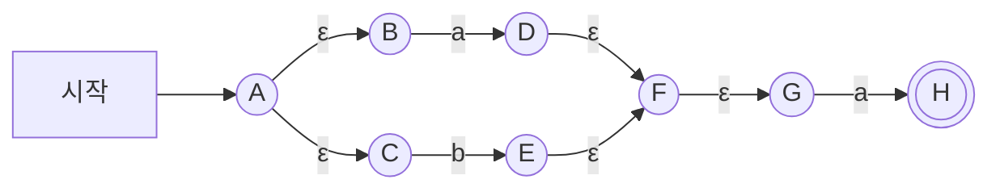
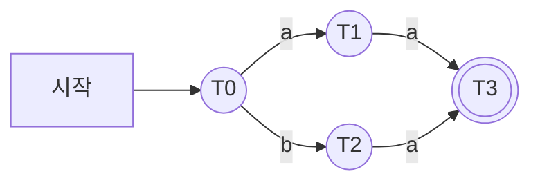
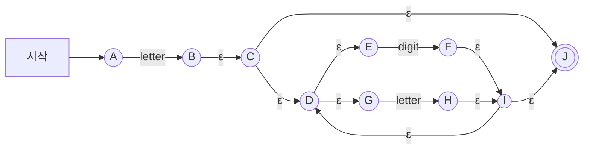


<div class="callout callout-summary" markdown="1">
<div class="callout-title callout-title--default" markdown="span">요약</div>

갈림길이 많은 미로에서 분신 여럿을 따로따로 쫓는 대신, "지금 분신들이 서 있는 칸의 모음"을 쪽지 한 장에 적어 들고 다닌다고 하자. 글자를 하나 읽을 때마다 쪽지를 새 모음으로 고쳐 쓰면, 쪽지는 늘 한 장이다. 나올 수 있는 쪽지를 미리 다 찾아 쪽지마다 칸 하나로 삼으면 갈림길 없는 새 기계가 된다. 이 기계는 원래 기계와 똑같은 글자 줄을 받아들이면서 글자 하나에 한 걸음만 간다. 대신 나올 수 있는 쪽지의 가짓수가 원래 칸 수에 대해 지수적으로 불어날 수 있다.

</div>


## 예시로 보기

[톰슨 구성법](/Hongs_Blog/studies/compilers/thompson-construction/)이 만든 NFA는 ε-화살표와 갈림길이 많다. 글자를 읽을 때마다 "말이 있을 수 있는 칸"을 다시 구해야 해서 느리다. 그 계산을 미리 다 해 두면 실행할 때는 표만 읽으면 된다.

$$(a \mid b)a$$의 NFA다[^1].



아무것도 읽기 전에 말이 있을 수 있는 칸은 A와, A에서 ε-화살표로 닿는 B, C다. 이 모음 $$\{A, B, C\}$$가 첫 쪽지 $$T_0$$이다. 여기서 $$a$$를 읽으면 B에 있던 분신만 D로 가고, D에서 ε-화살표로 F, G까지 닿는다. 쪽지는 $$\{D, F, G\}$$가 된다. 같은 식으로 끝까지 가면 쪽지는 네 장뿐이다[^2].

| 쪽지 | NFA 상태의 모음 | $$a$$를 읽으면 | $$b$$를 읽으면 |
|---|---|---|---|
| $$T_0$$ | $$\{A, B, C\}$$ | $$T_1$$ | $$T_2$$ |
| $$T_1$$ | $$\{D, F, G\}$$ | $$T_3$$ | $$\varnothing$$ |
| $$T_2$$ | $$\{E, F, G\}$$ | $$T_3$$ | $$\varnothing$$ |
| $$T_3$$ | $$\{H\}$$ | $$\varnothing$$ | $$\varnothing$$ |

쪽지 한 장을 상태 하나로 그리면 DFA다. H가 든 $$T_3$$이 받아들이는 상태다[^3].



`ba`를 넣으면 $$T_0 \to T_2 \to T_3$$으로 가서 받아들인다. `ab`를 넣으면 $$T_0 \to T_1$$ 다음에 $$b$$로 갈 곳이 없어 거절한다. NFA 상태 8개가 DFA 상태 4개가 되었고, ε-화살표와 갈림길이 사라졌다.

## 정의

부분집합 구성법은 어떤 문자열들을 읽은 뒤 닿을 수 있는 NFA 상태들을 한 묶음으로 삼는다. 그 묶음 하나가 DFA의 상태 하나다[^4]. 멱집합 구성법이라고도 부른다.

- **입력:** NFA. 상태 집합 $$Q$$, 알파벳 $$\Sigma$$, 전이 $$\delta$$, 시작 상태 $$q_0^N$$, 받아들이는 상태의 집합 $$F$$.
- **출력:** 같은 언어를 받아들이는 DFA. 상태는 $$Q$$의 부분집합 $$T_0, T_1, \dots$$이다.

**ε-closure.** 두 가지 꼴이 있다[^4].

- $$\epsilon\text{-}closure(q)$$: NFA 상태 $$q$$에서 ε-전이만으로 닿을 수 있는 상태를 모두 모은 집합이다. $$q$$ 자신도 들어간다.
- $$\epsilon\text{-}closure(T)$$: 상태의 집합 $$T$$에 든 어느 상태에서든 ε-전이만으로 닿을 수 있는 상태를 모두 모은 집합이다.

기호로 쓰면 $$\epsilon\text{-}closure(T) = \bigcup_{q \in T} \epsilon\text{-}closure(q)$$다. $$T$$의 상태마다 구한 것을 합친다는 뜻이다. $$\delta(T, s)$$는 $$T$$의 어느 상태에서든 기호 $$s$$의 화살표 하나로 갈 수 있는 상태를 모은 집합이다[^s1].

$$(a \mid b)$$의 NFA(위 그림에서 A~F만 떼어 낸 것)에서 $$\epsilon\text{-}closure(A) = \{A, B, C\}$$이고 $$\epsilon\text{-}closure(\{A, B, C, D\}) = \{A, B, C, D, F\}$$다[^4]. ε-화살표를 한 번만 따라가고 멈추지 않는다. 닿은 곳에서 또 ε-화살표가 있으면 계속 따라간다.

**네 단계.**[^5]

1. $$T_0 = \epsilon\text{-}closure(q_0^N)$$을 구한다. NFA의 시작 상태에서 공짜로 닿는 곳 전부다.
2. $$\Sigma$$의 기호 $$s$$마다 $$\epsilon\text{-}closure(\delta(T_0, s))$$를 구한다. 앞에서 나온 어느 $$T_j$$와도 다르면 새 이름 $$T_i$$를 붙인다.
3. 새로 나온 $$T_i$$마다 2를 되풀이한다. 새 결과가 더 안 나오면 멈춘다.
4. DFA를 만든다. $$T_i$$ 하나하나가 DFA의 상태다. $$T_0$$이 시작 상태다. NFA의 받아들이는 상태가 하나라도 든 $$T_i$$는 모두 DFA의 받아들이는 상태다.

결과가 빈 집합이면 표에 $$\varnothing$$을 적고 상태로 만들지 않는다[^2].

### 의사코드

```
입력: NFA (Q, Σ, δ, q0, F)
T[0] = ε-closure({q0})
할 일 = [0]
할 일이 남아 있는 동안:
    i = 할 일에서 하나 꺼낸다
    Σ의 기호 s마다:
        U = ε-closure(δ(T[i], s))
        U가 빈 집합이면:        표[i][s] = ∅
        U가 T[j]와 같으면:      표[i][s] = j
        처음 보는 집합이면:      T의 끝에 U를 붙이고(번호 k), 표[i][s] = k, 할 일에 k를 넣는다
받아들이는 상태 = F의 상태가 하나라도 든 T[i] 전부
```

할 일을 넣은 순서대로 꺼내면 [너비 우선 탐색](/Hongs_Blog/studies/algorithms/bfs/)과 같은 꼴이다. 슬라이드의 $$T_0, T_1, T_2, T_3$$도 이 순서로 번호가 붙는다[^s1].

### 실행 추적

$$(a \mid b)a$$의 NFA, $$\Sigma = \{a, b\}$$[^2].

| 꺼낸 것 | 기호 | $$\delta(T_i, s)$$ | $$\epsilon\text{-}closure$$ | 판정 |
|---|---|---|---|---|
| (처음) | | | $$\epsilon\text{-}closure(A) = \{A, B, C\}$$ | $$T_0$$ |
| $$T_0$$ | $$a$$ | $$\{D\}$$ | $$\{D, F, G\}$$ | 새것, $$T_1$$ |
| $$T_0$$ | $$b$$ | $$\{E\}$$ | $$\{E, F, G\}$$ | 새것, $$T_2$$ |
| $$T_1$$ | $$a$$ | $$\{H\}$$ | $$\{H\}$$ | 새것, $$T_3$$ |
| $$T_1$$ | $$b$$ | $$\varnothing$$ | $$\varnothing$$ | 갈 곳 없음 |
| $$T_2$$ | $$a$$ | $$\{H\}$$ | $$\{H\}$$ | 이미 있다, $$T_3$$ |
| $$T_2$$ | $$b$$ | $$\varnothing$$ | $$\varnothing$$ | 갈 곳 없음 |
| $$T_3$$ | $$a$$, $$b$$ | $$\varnothing$$ | $$\varnothing$$ | 갈 곳 없음 |

<div class="callout callout-check" markdown="1">
<div class="callout-title" markdown="span">검증: 슬라이드의 ε-closure 예 둘, $$(a \mid b)a$$의 $$T_0 \sim T_3$$과 전이 표, 아래 식별자 예의 $$T_0 \sim T_3$$과 전이 표, 무작위 NFA 300개에서 만든 DFA가 길이 7 이하의 모든 문자열에서 NFA와 같은 답을 내는 것, "뒤에서 $$n$$번째 글자가 a"($$n = 1, \dots, 10$$)에서 DFA 상태가 정확히 $$2^n$$개인 것 — [09_subset-construction_impl.py](/Hongs_Blog/studies/compilers/code/09_subset-construction_impl/)</div>

</div>


### 정확성

**불변식.** 문자열 $$w$$를 읽은 뒤 DFA가 있는 상태 $$T$$는, NFA가 $$w$$를 읽은 뒤 있을 수 있는 상태 전체와 같다. DFA가 갈 곳이 없어 멈췄다면 NFA에도 $$w$$를 끝까지 읽는 길이 없다. 증명 기법은 $$w$$의 길이에 대한 [수학적 귀납법](/Hongs_Blog/studies/discrete-math/induction/)이다[^s2].

<details class="callout callout-proof" markdown="1">
<summary class="callout-title" markdown="span">증명 펼치기</summary>

$$R(w)$$를 "NFA가 시작 상태에서 $$w$$를 읽고 있을 수 있는 상태의 집합"이라 하자. 글자 사이사이와 앞뒤에 ε-전이를 몇 번이든 끼워도 된다.
1. **처음.** $$w = \epsilon$$이면 NFA는 ε-전이만 쓸 수 있다. 그래서 $$R(\epsilon) = \epsilon\text{-}closure(q_0^N) = T_0$$이고, DFA의 시작 상태가 $$T_0$$이다. — ε-closure의 정의, 1단계
2. **한 글자 더.** $$w = xa$$이고 DFA가 $$x$$를 읽은 뒤 $$T = R(x)$$에 있다고 하자. — 귀납 가정
3. NFA가 $$xa$$를 읽고 닿는 상태는, $$x$$를 읽고 닿은 어떤 상태($$R(x)$$의 원소)에서 $$a$$ 화살표 하나를 타고, 이어서 ε-화살표를 몇 번 탄 곳이다. 이것을 모두 모으면 $$\epsilon\text{-}closure(\delta(R(x), a))$$다. — NFA가 글자를 읽는 방식, $$\delta(T, a)$$와 ε-closure의 정의
4. 2단계와 3단계가 표에 적은 값이 바로 $$\epsilon\text{-}closure(\delta(T, a))$$다. 그래서 DFA의 다음 상태는 $$R(xa)$$다. 이 집합이 비었으면 DFA는 갈 곳이 없고 NFA에도 길이 없다. — 구성법의 2단계
5. **받아들이기.** NFA가 $$w$$를 받아들인다는 것은 $$R(w)$$에 받아들이는 상태가 하나라도 있다는 것이다. DFA는 그런 $$T$$를 받아들이는 상태로 삼았다. 그래서 두 기계의 답이 같다. — NFA의 받아들이는 조건, 구성법의 4단계 ∎

</details>


**멈춘다.** $$T_i$$는 모두 $$Q$$의 부분집합이고 서로 다르다. $$Q$$의 상태가 $$n$$개면 비지 않은 부분집합은 $$2^n - 1$$개뿐이다. 그래서 새 $$T_i$$는 많아야 $$2^n - 1$$번 나오고, 3단계는 반드시 끝난다[^s2].

### 스스로 설명해 보기

<details class="callout callout-question" markdown="1">
<summary class="callout-title" markdown="span">1. 증명 1단계에서 T0에 시작 상태만 넣지 않고 ε-closure를 쓰는 까닭</summary>

NFA는 글자를 읽기 전에도 ε-전이로 옮겨 갈 수 있다. 아무것도 안 읽은 때 있을 수 있는 곳은 시작 상태 하나가 아니라 거기서 공짜로 닿는 곳 전부다.

</details>


<details class="callout callout-question" markdown="1">
<summary class="callout-title" markdown="span">2. 3단계에서 "a 화살표를 탄 다음에" ε-closure를 하는 까닭. a를 타기 전의 ε-화살표는 어디서 처리되는가</summary>

$$a$$를 읽은 뒤에도 공짜로 더 갈 수 있으므로 그곳까지 넣어야 "있을 수 있는 곳 전부"가 된다. $$a$$를 타기 전의 ε-화살표는 이미 $$R(x)$$를 만들 때 처리되었다. $$R(x)$$가 ε-closure를 마친 집합이기 때문이다.

</details>


<details class="callout callout-question" markdown="1">
<summary class="callout-title" markdown="span">3. 5단계에서 "하나라도"인 까닭. "모두"로 바꾸면 무엇이 틀리는가</summary>

NFA는 받아들이는 상태에서 끝나는 길이 하나만 있어도 받아들인다. "모두"로 바꾸면 $$(0 \mid 1)^*00$$의 NFA에서 `100`을 읽은 뒤의 $$\{q_0, q_1, q_2\}$$가 받아들이는 상태가 아니게 되어 `100`을 거절한다.

</details>


<details class="callout callout-question" markdown="1">
<summary class="callout-title" markdown="span">이 증명의 핵심 아이디어는?</summary>

여러 길을 따로 쫓지 않고 "지금 있을 수 있는 곳의 집합" 하나만 쫓는다. 그 집합은 지금 집합과 읽는 글자만으로 정해지므로, 집합을 상태로 삼으면 갈 곳이 하나로 정해진 기계가 된다.

</details>


<details class="callout callout-question" markdown="1">
<summary class="callout-title" markdown="span">이 방법을 쓸 수 있는 다른 상황은?</summary>

상향식 파서의 [LR(0) 항목 오토마타](/Hongs_Blog/studies/compilers/lr0-item-automaton/)에서 항목의 집합을 상태로 삼는 것이 같은 생각이다. 미로에서 "지금 있을 수 있는 칸 전부"를 한 덩어리로 들고 한 걸음씩 넓혀 가는 [너비 우선 탐색](/Hongs_Blog/studies/algorithms/bfs/)도 닮았다.

</details>


### 복잡도

- **가장 좋을 때.** NFA에 갈림길과 ε-전이가 없으면 $$T_i$$가 모두 상태 하나짜리 집합이라 DFA 상태 수가 NFA와 같다[^s3].
- **가장 나쁠 때.** DFA 상태가 $$2^n$$에 가깝게 불어난다. "뒤에서 $$n$$번째 글자가 a인 줄"을 받아들이는 NFA는 상태가 $$n + 1$$개인데, 만들어지는 DFA는 정확히 $$2^n$$개다. $$n = 10$$이면 11개가 1,024개가 된다. DFA는 마지막 $$n$$글자가 각각 a였는지를 다 기억해야 하기 때문이다[^s3]. 슬라이드가 DFA의 단점으로 "NFA보다 지수적으로 커진다"고 적은 것이 이 경우다[^6].
- **토큰에서는.** 아래 식별자 예처럼 상태가 오히려 줄어드는 일이 흔하다.

## 예제

$$sIdentifier = letter(digit \mid letter)^*$$의 NFA다. 상태 A~J, 받아들이는 상태 J[^7].



1. *시작 묶음:* A에서 나가는 ε-화살표가 없다. $$T_0 = \{A\}$$.
2. *$$T_0$$에서:* $$letter$$로 B에 가고, B에서 ε으로 C, D, J, E, G까지 닿는다. $$T_1 = \{B, C, D, E, G, J\}$$. $$digit$$로는 갈 곳이 없다.
3. *$$T_1$$에서:* $$letter$$는 G에서 H로. H에서 ε으로 I, J, D, E, G. $$T_2 = \{D, E, G, H, I, J\}$$. $$digit$$는 E에서 F로. F에서 ε으로 I, J, D, E, G. $$T_3 = \{D, E, F, G, I, J\}$$.
4. *$$T_2$$와 $$T_3$$에서:* 둘 다 G와 E가 들어 있으므로 $$letter$$는 다시 $$T_2$$, $$digit$$는 다시 $$T_3$$이다. 새 묶음이 없어 멈춘다.
5. *받아들이는 상태:* J가 든 $$T_1$$, $$T_2$$, $$T_3$$.

| | $$letter$$ | $$digit$$ |
|---|---|---|
| $$T_0$$ | $$T_1$$ | $$\varnothing$$ |
| $$T_1$$ | $$T_2$$ | $$T_3$$ |
| $$T_2$$ | $$T_2$$ | $$T_3$$ |
| $$T_3$$ | $$T_2$$ | $$T_3$$ |

<div class="callout callout-warning" markdown="1">
<div class="callout-title" markdown="span">원본 오류 의심</div>

원문: p.36 계산의 마지막 줄 "$$\epsilon\text{-}closure(\delta(T_3, digit)) = \{D, E, G, H, I, J\} = T_3$$" / 문제점: 적힌 집합은 $$T_2$$다. 같은 쪽 위에서 $$T_3 = \{D, E, G, F, I, J\}$$라고 했으므로 "$$= T_3$$"과 맞지 않는다. / 수정안: $$\{D, E, G, F, I, J\} = T_3$$ (H를 F로) / 근거: $$T_3$$에서 $$digit$$ 화살표가 있는 상태는 E뿐이고 E는 F로 간다. $$\epsilon\text{-}closure(F) = \{D, E, F, G, I, J\}$$다. 구현 코드의 결과도 같다. 옆의 전이 표($$T_3$$의 $$digit$$ 칸이 $$T_3$$)는 맞게 적혀 있다.

</div>


NFA 상태 10개가 DFA 상태 4개가 되었다. 이 표에 `(` 칸을 더한 것으로 토큰을 자르는 과정은 [최장 일치와 토큰 인식](/Hongs_Blog/studies/compilers/longest-match-tokenizing/)에 있다.

## 활용

- 어휘 분석기를 만드는 셋째 걸음이다. 정규 표현식 → NFA → **DFA** → 전이 표[^8]. `lex`, `flex` 같은 어휘 분석기 생성 도구가 이 일을 대신 해 준다[^s3].
- 구현: [09_subset-construction_impl.py](/Hongs_Blog/studies/compilers/code/09_subset-construction_impl/). 연습: [부분집합 구성법 예제 사다리](/Hongs_Blog/studies/compilers/subset-construction-ladder/)
- 흔한 실수: ε-closure에서 ε-화살표를 한 번만 따라간다. 닿은 곳에서 또 따라간다.
- 흔한 실수: $$\delta(T, s)$$만 구하고 ε-closure를 빼먹는다. 식별자 예에서 $$\delta(T_1, letter) = \{H\}$$에서 멈추면 I, J, D, E, G가 빠진다.
- 흔한 실수: 원소가 같은데 순서만 다르게 적은 집합에 새 이름을 붙인다. $$\{D, E, G, F, I, J\}$$와 $$\{D, E, F, G, I, J\}$$는 같은 집합이다.

## 연결

- 선수: [DFA와 NFA 비교](/Hongs_Blog/studies/compilers/dfa-vs-nfa/), [톰슨 구성법](/Hongs_Blog/studies/compilers/thompson-construction/)
- DFA의 상태가 NFA 상태의 부분집합이라서 가짓수의 위쪽 끝이 $$2^n$$이다: [집합](/Hongs_Blog/studies/discrete-math/sets/)의 멱집합
- 만든 DFA를 쓰는 곳: [최장 일치와 토큰 인식](/Hongs_Blog/studies/compilers/longest-match-tokenizing/)

## 자주 하는 오해

<div class="callout callout-misconception" markdown="1">
<div class="callout-title" markdown="span">"NFA 상태가 n개면 DFA 상태는 2ⁿ개가 된다"</div>

틀렸다. $$2^n$$은 넘을 수 없는 위쪽 끝이지 실제 개수가 아니다. 구성법은 $$T_0$$에서 출발해 실제로 닿는 묶음에만 이름을 붙인다. 식별자의 NFA는 상태가 10개라 부분집합이 $$2^{10} = 1024$$개지만, 만들어진 DFA는 4개다. 그럴듯해 보이는 까닭은 "멱집합 구성법"이라는 이름과 "지수적으로 커진다"는 단점만 기억하기 때문이다. 정말로 $$2^n$$개가 되는 NFA도 있다("뒤에서 $$n$$번째 글자가 a"). 그래서 "커질 수 있다"가 맞는 말이다. 확인하는 법: 네 단계를 직접 돌려 나온 $$T_i$$의 수를 센다.

</div>


## 확인 문제

<details class="callout callout-question" markdown="1">
<summary class="callout-title" markdown="span">**C1** $$\epsilon\text{-}closure(T)$$의 뜻을 쓰고, 부분집합 구성법의 네 단계를 쓰라. DFA의 받아들이는 상태는 어떻게 정하는가?</summary>

**답:** $$T$$의 어느 상태에서든 ε-전이만으로 닿는 NFA 상태 전부다($$T$$의 상태 자신도 포함). ① $$T_0 = \epsilon\text{-}closure(\text{NFA의 시작 상태})$$ ② 기호 $$s$$마다 $$\epsilon\text{-}closure(\delta(T_0, s))$$를 구해 처음 보는 집합이면 새 $$T_i$$로 삼는다 ③ 새 $$T_i$$마다 되풀이하고 새것이 안 나오면 멈춘다 ④ $$T_i$$가 DFA의 상태, $$T_0$$이 시작 상태. NFA의 받아들이는 상태가 하나라도 든 $$T_i$$가 받아들이는 상태다.

</details>


<details class="callout callout-question" markdown="1">
<summary class="callout-title" markdown="span">**C2** NFA: $$q_0$$에서 0과 1로 $$q_0$$, $$q_0$$에서 0으로 $$q_1$$, $$q_1$$에서 0으로 $$q_2$$. 시작 $$q_0$$, 받아들이는 상태 $$q_2$$. 부분집합 구성법으로 $$T_i$$와 전이 표를 구하라.</summary>

**답:** $$T_0 = \{q_0\}$$, $$T_1 = \{q_0, q_1\}$$, $$T_2 = \{q_0, q_1, q_2\}$$. $$T_0$$: 0이면 $$T_1$$, 1이면 $$T_0$$. $$T_1$$: 0이면 $$T_2$$, 1이면 $$T_0$$. $$T_2$$: 0이면 $$T_2$$, 1이면 $$T_0$$. 받아들이는 상태는 $$T_2$$.<br>
**이유:** ε-전이가 없어서 ε-closure는 집합을 바꾸지 않는다. $$q_0$$이 0과 1에서 늘 자기 자신으로도 가므로 모든 묶음에 $$q_0$$이 들어 있다. 결과는 [DFA와 NFA 비교](/Hongs_Blog/studies/compilers/dfa-vs-nfa/)의 DFA와 같다.

</details>


<details class="callout callout-question" markdown="1">
<summary class="callout-title" markdown="span">**C3** 의사코드의 `U = ε-closure(δ(T[i], s))` 한 줄이 하는 일을 쉬운 말로 한 문장으로 쓰라.</summary>

**답:** 지금 분신들이 서 있는 칸들에서 글자 $$s$$를 읽고 갈 수 있는 칸을 모으고, 거기서 공짜 화살표로 더 닿는 칸까지 모두 더해 "글자 $$s$$를 읽은 뒤 분신들이 있을 수 있는 칸 전부"를 구한다.

</details>


<details class="callout callout-question" markdown="1">
<summary class="callout-title" markdown="span">**C4** 정확성 증명에서 "DFA의 다음 상태가 $$R(xa)$$다"는 무엇과 무엇에서 나오는가?</summary>

**답:** 귀납 가정(DFA가 $$x$$를 읽은 뒤 $$R(x)$$에 있다)과, NFA가 $$xa$$를 읽고 닿는 곳이 $$\epsilon\text{-}closure(\delta(R(x), a))$$라는 사실에서 나온다. 구성법이 표에 적는 값이 바로 그 식이다.<br>
**이유:** 귀납 가정이 "지금 집합이 맞다"를, ε-closure와 $$\delta$$의 정의가 "맞는 집합에서 한 글자 가면 다시 맞는 집합이다"를 준다.

</details>


<details class="callout callout-question" markdown="1">
<summary class="callout-title" markdown="span">**C5** 식별자의 NFA(A~J)에서 $$\epsilon\text{-}closure(B)$$, $$\epsilon\text{-}closure(F)$$, $$\epsilon\text{-}closure(H)$$를 구하라.</summary>

**답:** $$\{B, C, D, E, G, J\}$$, $$\{D, E, F, G, I, J\}$$, $$\{D, E, G, H, I, J\}$$.<br>
**이유:** F와 H는 둘 다 I로 가고, I에서 J와 D로, D에서 E와 G로 간다. 흔한 오답은 I에서 D로 되돌아가는 화살표를 놓쳐 $$\{F, I, J\}$$만 쓰는 것이다.

</details>


<details class="callout callout-question" markdown="1">
<summary class="callout-title" markdown="span">**C6** "NFA 상태가 $$n$$개면 DFA 상태는 반드시 $$2^n$$개다"가 틀렸음을 보이는 예와, DFA가 정말 지수적으로 커지는 예를 하나씩 들라.</summary>

**답:** 틀린 예: 식별자의 NFA는 상태 10개인데 DFA는 4개다. 커지는 예: "뒤에서 $$n$$번째 글자가 a"의 NFA는 상태 $$n + 1$$개, DFA는 $$2^n$$개다.<br>
**이유:** 구성법은 실제로 닿는 묶음만 상태로 만든다. $$2^n$$은 위쪽 끝이다.

</details>


[^1]: 컴파일러 3회 강의 자료 「Lecture03 Lexical analysis part 2」, p.30 ($$(a \mid b)a$$의 NFA)
[^2]: 같은 자료, p.30~33 ($$T_0 \sim T_3$$의 계산과 전이 표)
[^3]: 같은 자료, p.34 (4단계와 $$(a \mid b)a$$의 DFA)
[^4]: 같은 자료, p.29 (Subset (powerset) construction algorithm의 기본 생각, ε-closure의 두 정의와 예)
[^5]: 같은 자료, p.30~34 (Step 1~4)
[^6]: 같은 자료, p.15 (DFA의 단점: "exponentially larger than NFA")
[^7]: 같은 자료, p.35~36 ($$sIdentifier$$의 NFA, $$T_0 \sim T_3$$, 전이 표)
[^8]: 같은 자료, p.16 (어휘 분석기를 만드는 순서)
[^s1]: <span class="fn-tag" title="수업 자료에 없고 따로 보탠 내용">보충</span> $$\epsilon\text{-}closure(T)$$를 합집합으로 쓴 식, $$\delta(T, s)$$의 풀이, 의사코드와 너비 우선 탐색과의 비교는 원본에 없다. 슬라이드는 $$\delta(T_0, s)$$를 설명 없이 쓴다. 다이어그램 세 개는 원본 p.30, p.34, p.35의 그림을 옮긴 것이다.
[^s2]: <span class="fn-tag" title="수업 자료에 없고 따로 보탠 내용">보충</span> 불변식, 정확성 증명, 멈춘다는 논증, 스스로 설명해 보기, 카드 C4는 원본에 없다. 표준 증명이다(Sipser, *Introduction to the Theory of Computation* 3판, 정리 1.39). 무작위 NFA 300개로도 확인했다.
[^s3]: <span class="fn-tag" title="수업 자료에 없고 따로 보탠 내용">보충</span> 복잡도의 세 경우, "뒤에서 $$n$$번째 글자가 a"의 예, 오해 항목, 카드 C6, `lex`·`flex` 언급은 원본에 없다. 상태 수는 구현 코드로 $$n = 1, \dots, 10$$에서 확인했다. 이 언어를 $$2^n$$개보다 적은 상태의 DFA로는 받아들일 수 없다는 것은 이 문서에서 증명하지 않았다.

