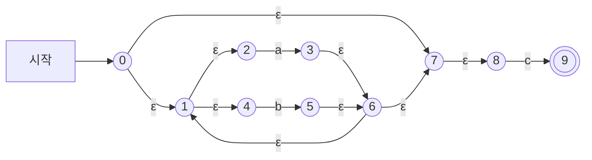
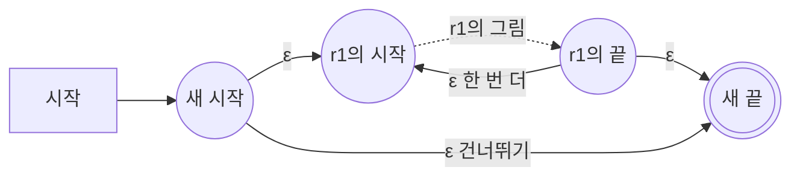


<div class="callout callout-summary" markdown="1">
<div class="callout-title callout-title--default" markdown="span">요약</div>

조립 설명서대로 부품을 끼워 맞추듯, 글자 줄의 모양을 적은 식을 그 모양을 알아보는 기계로 바꾸는 방법이다. 식을 가장 작은 조각까지 쪼개 조각마다 정해진 작은 그림을 그리고, 식이 조립된 순서대로 그림을 공짜 화살표로 이어 붙인다. 생각할 것 없이 규칙만 따르면 되고 어떤 식이든 된다. 대신 만들어진 기계에는 공짜 화살표와 갈림길이 많아서 그대로 돌리면 느리다. 그래서 한 번 더 손봐서 쓴다.

</div>


## 예시로 보기

$$(a \mid b)^* c$$를 알아보는 [유한 오토마타](/Hongs_Blog/studies/compilers/finite-automata/)를 그리려 한다. 식을 통째로 보고 그림을 떠올리기는 어렵다. 식이 길어지면 더 그렇다. 그런데 이 식은 $$a$$, $$b$$, $$c$$ 세 글자에 선택, 반복, 연결을 차례로 쓴 것이다. 조각의 그림을 먼저 그리고 조립 순서대로 이으면 된다.

| 순서 | 부분식 | 하는 일 | 새 상태 | 지금까지 상태 수 |
|---|---|---|---|---|
| 1 | $$a$$ | 상태 2에서 3으로 $$a$$ 화살표 | 2, 3 | 2 |
| 2 | $$b$$ | 상태 4에서 5로 $$b$$ 화살표 | 4, 5 | 4 |
| 3 | $$a \mid b$$ | 새 시작 1에서 2와 4로, 3과 5에서 새 끝 6으로 ε-화살표 | 1, 6 | 6 |
| 4 | $$(a \mid b)^*$$ | 새 시작 0에서 1로, 0에서 새 끝 7로, 6에서 1로, 6에서 7로 ε-화살표 | 0, 7 | 8 |
| 5 | $$c$$ | 상태 8에서 9로 $$c$$ 화살표 | 8, 9 | 10 |
| 6 | $$(a \mid b)^* c$$ | 앞 조각의 끝 7에서 뒤 조각의 시작 8로 ε-화살표 | 없음 | 10 |



상태 10개, ε-화살표 9개, 글자 화살표 3개다. 상태 번호 0~9는 만든 순서대로 붙였다[^s1].

`bc`를 넣어 본다. ε-화살표는 공짜라서, 말이 있을 수 있는 칸에는 ε-화살표로 닿는 칸이 모두 들어간다.

| 읽은 글자 | 말이 있을 수 있는 상태 |
|---|---|
| (처음) | 0, 1, 2, 4, 7, 8 |
| b | 1, 2, 4, 5, 6, 7, 8 |
| c | 9 |

9가 받아들이는 상태이므로 `bc`를 받아들인다.

## 정의

톰슨 구성법(맥노튼-야마다-톰슨 알고리즘)은 정규 표현식을 부분식으로 쪼개 가며 재귀적으로 NFA를 만든다.

- **입력:** 알파벳 $$\Sigma$$ 위의 [정규 표현식](/Hongs_Blog/studies/compilers/regular-expression/) $$r$$.
- **출력:** $$L(r)$$을 받아들이는 NFA. 시작 상태 하나, 받아들이는 상태 하나를 가진다.

기본 정규 표현식이 다섯 가지라서 규칙도 다섯 가지다. 아래 표에서 "시작"과 "끝"은 그 조각 그림의 시작 상태와 받아들이는 상태다.

| 식 | 새로 만드는 상태 | 긋는 화살표 | 결과의 시작과 끝 |
|---|---|---|---|
| $$\epsilon$$ | 둘 | 시작 →(ε) 끝 | 새 두 상태 |
| $$a$$ | 둘 | 시작 →($$a$$) 끝 | 새 두 상태 |
| $$r_1 r_2$$ | 없음 | $$r_1$$의 끝 →(ε) $$r_2$$의 시작 | $$r_1$$의 시작, $$r_2$$의 끝 |
| $$r_1 \mid r_2$$ | 둘 | 새 시작 →(ε) $$r_1$$의 시작, 새 시작 →(ε) $$r_2$$의 시작, $$r_1$$의 끝 →(ε) 새 끝, $$r_2$$의 끝 →(ε) 새 끝 | 새 두 상태 |
| $$r_1^*$$ | 둘 | 새 시작 →(ε) $$r_1$$의 시작, 새 시작 →(ε) 새 끝, $$r_1$$의 끝 →(ε) $$r_1$$의 시작, $$r_1$$의 끝 →(ε) 새 끝 | 새 두 상태 |

조각을 이어 붙이면 안쪽 조각의 끝 상태는 더는 받아들이는 상태가 아니다. 받아들이는 상태는 맨 바깥 그림의 끝 하나뿐이다.

반복 규칙의 네 화살표는 각각 맡은 일이 있다.



"건너뛰기"는 $$r_1$$을 0번 도는 길이고, "한 번 더"는 다시 도는 길이다[^s1].

### 의사코드

```
만들기(r):                       # (시작 상태, 끝 상태)를 돌려준다
    r이 ε 또는 글자 a이면:
        상태 s, f를 새로 만든다.  s --(ε 또는 a)--> f
        (s, f)를 돌려준다
    r이 r1 r2 이면:
        (s1, f1) = 만들기(r1),  (s2, f2) = 만들기(r2)
        f1 --ε--> s2
        (s1, f2)를 돌려준다
    r이 r1 | r2 이면:
        (s1, f1) = 만들기(r1),  (s2, f2) = 만들기(r2)
        상태 s, f를 새로 만든다
        s --ε--> s1,  s --ε--> s2,  f1 --ε--> f,  f2 --ε--> f
        (s, f)를 돌려준다
    r이 r1* 이면:
        (s1, f1) = 만들기(r1)
        상태 s, f를 새로 만든다
        s --ε--> s1,  s --ε--> f,  f1 --ε--> s1,  f1 --ε--> f
        (s, f)를 돌려준다
```

### 정확성

**주장.** 어떤 정규 표현식 $$r$$에 대해서도 `만들기(r)`이 만든 NFA는 정확히 $$L(r)$$을 받아들인다. [증명 스케치] 정규 표현식이 만들어진 순서를 따라가는 [구조적 귀납법](/Hongs_Blog/studies/discrete-math/recursive-definitions/)으로 보인다[^s2].

<details class="callout callout-proof" markdown="1">
<summary class="callout-title" markdown="span">증명 스케치 펼치기</summary>

1. **기본.** $$\epsilon$$의 그림은 아무것도 읽지 않고 끝에 닿는 길 하나뿐이다. $$a$$의 그림은 $$a$$ 하나를 읽고 끝에 닿는 길 하나뿐이다. 각각 $$\{\epsilon\}$$, $$\{a\}$$를 받아들인다. — 그림에서 길을 직접 센다
2. **연결.** $$r_1 r_2$$의 그림에서 시작부터 끝까지 가는 길은 $$r_1$$의 그림을 지나 ε-화살표 하나를 건너 $$r_2$$의 그림을 지난다. 읽은 글자는 $$L(r_1)$$의 문자열 뒤에 $$L(r_2)$$의 문자열을 이은 것이다. — 귀납 가정을 두 조각에 쓴다
3. **선택.** 새 시작에서 두 갈래 중 하나로 들어가 그 조각만 지나 새 끝에 닿는다. 읽은 글자는 $$L(r_1)$$이나 $$L(r_2)$$의 문자열이다. — 귀납 가정
4. **반복.** 건너뛰는 길은 $$\epsilon$$을 읽는다. 그 밖의 길은 $$r_1$$의 그림을 한 번 이상 돈다. $$i$$번 돌면 $$L(r_1)$$의 문자열을 $$i$$개 이은 것을 읽는다. — 귀납 가정을 도는 횟수만큼 쓴다
5. 2~4에서 조각의 그림 안으로 엉뚱하게 들어가거나 나오는 길이 없어야 한다. 조각의 시작으로 들어오는 화살표와 끝에서 나가는 화살표가 조립 전에는 없기 때문에 그렇다. — 만든 그림의 모양 ∎

</details>


### 복잡도

새 상태는 글자·$$\epsilon$$마다 둘, 선택마다 둘, 반복마다 둘이고 연결에서는 생기지 않는다. 식에 글자와 $$\epsilon$$이 $$x$$개, <code>&#124;</code>가 $$y$$개, `*`가 $$z$$개 있으면 상태 수는 $$2(x + y + z)$$다. 예시는 $$x = 3$$, $$y = 1$$, $$z = 1$$이라 10개다. 그래서 상태 수는 많아야 식 길이의 두 배이고, 한 상태에서 나가는 화살표는 많아야 둘이다[^s2].

<div class="callout callout-check" markdown="1">
<div class="callout-title" markdown="span">검증: $$(a \mid b)^* c$$의 상태 10개와 화살표 12개와 `bc`의 추적, $$(a \mid b)a$$의 상태 8개, $$letter(digit \mid letter)^*$$의 상태 10개, 무작위 정규 표현식 400개에서 만든 NFA가 길이 5 이하의 모든 문자열에서 파이썬 `re`와 같은 답을 내는 것과 상태 수 $$2(x + y + z)$$ — [08_thompson-construction_impl.py](/Hongs_Blog/studies/compilers/code/08_thompson-construction_impl/)</div>

</div>


## 예제

**$$r_1^+$$는 어떻게 그리나.** $$r_1^+$$(한 번 이상 반복)에는 따로 그림이 없다. $$r_1^+ = r_1 r_1^*$$로 보고 반복의 그림을 쓰면 될까? 펼치기 전에 답을 써 본다.

<details class="callout callout-note" markdown="1">
<summary class="callout-title" markdown="span">답</summary>

맞다. $$r_1^+ = r_1 r_1^*$$이므로 $$r_1$$의 그림 뒤에 $$r_1^*$$의 그림을 이으면 된다. 이러면 $$r_1$$의 그림을 두 번 그린다. 더 작게 그리려면 반복의 그림에서 "건너뛰기" 화살표 하나만 뺀다. 건너뛰는 길이 없으면 $$r_1$$을 적어도 한 번은 지나야 끝에 닿는다. 두 그림이 같은 문자열을 받아들이는 것을 다섯 가지 식에서 확인했다[^s3].

</details>


**식별자.** $$sIdentifier = letter(digit \mid letter)^*$$의 NFA는 상태가 10개다. $$letter$$ 둘, $$digit$$ 둘, 선택 둘, 반복 둘이고 $$x = 3$$, $$y = 1$$, $$z = 1$$로 위 예시와 같다. 이 그림의 상태 열 개에 A~J라는 이름을 붙여, 이 NFA를 DFA로 바꾸는 과정을 [부분집합 구성법](/Hongs_Blog/studies/compilers/subset-construction/)에서 따라간다.

## 활용

- 어휘 분석기를 만드는 둘째 걸음이다. 토큰의 정규 표현식 → **NFA** → DFA → 전이 표.
- 만든 NFA는 그대로 돌리지 않는다. 글자 하나마다 ε-화살표를 따라 상태 집합을 다시 구해야 해서 느리다. [부분집합 구성법](/Hongs_Blog/studies/compilers/subset-construction/)으로 DFA로 바꾼다.
- 구현: [08_thompson-construction_impl.py](/Hongs_Blog/studies/compilers/code/08_thompson-construction_impl/)
- 흔한 실수: 연결에서 새 상태를 만든다. 연결은 ε-화살표 하나만 긋는다.
- 흔한 실수: 반복에서 "한 번 더" 화살표를 새 끝에서 새 시작으로 긋는다. $$r_1$$의 끝에서 $$r_1$$의 시작으로 긋는다.
- 흔한 실수: 조립한 뒤에도 안쪽 조각의 끝을 겹동그라미로 남긴다.

## 연결

- 선수: [정규 표현식](/Hongs_Blog/studies/compilers/regular-expression/), [DFA와 NFA 비교](/Hongs_Blog/studies/compilers/dfa-vs-nfa/)
- 다음 걸음: [부분집합 구성법](/Hongs_Blog/studies/compilers/subset-construction/)
- 식의 조립 순서대로 답을 조립하는 방식: [재귀적 정의와 구조적 귀납법](/Hongs_Blog/studies/discrete-math/recursive-definitions/)

## 확인 문제

<details class="callout callout-question" markdown="1">
<summary class="callout-title" markdown="span">**C1** $$a^* \mid b$$를 톰슨 구성법으로 바꾼다. 부분식을 만드는 순서대로 새 상태 수를 적고, 완성된 NFA의 상태 수를 구하라.</summary>

**답:** $$a$$ 2개 → $$a^*$$ 2개 더(4) → $$b$$ 2개 더(6) → $$a^* \mid b$$ 2개 더(8). 모두 8개다.<br>
**이유:** 글자 둘, 반복 하나, 선택 하나라서 $$2(2 + 1 + 1) = 8$$이다. 우선순위 때문에 `*`가 `a`에만 걸린다. $$(a \mid b)^*$$로 읽어도 8개지만 그림이 다르다.

</details>


<details class="callout callout-question" markdown="1">
<summary class="callout-title" markdown="span">**C2** 의사코드에서 `r1*`를 다루는 부분이 하는 일을 한 문장으로 쓰라.</summary>

**답:** $$r_1$$의 그림 앞뒤에 새 시작과 새 끝을 두고, 그림을 건너뛰는 길과 그림의 끝에서 처음으로 되돌아가는 길을 ε-화살표로 내어 $$r_1$$을 0번 이상 지나게 한다.

</details>


<details class="callout callout-question" markdown="1">
<summary class="callout-title" markdown="span">**C3** 조각을 이을 때 글자 화살표가 아니라 ε-화살표를 쓰는 까닭은 무엇인가? 이 때문에 만들어진 기계가 DFA가 아닌 까닭도 쓰라.</summary>

**답:** 잇는 화살표가 글자를 읽으면 받아들이는 문자열에 그 글자가 끼어든다. 조각을 잇는 일은 문자열에 아무것도 더하지 않아야 하므로 글자를 읽지 않는 ε-화살표를 쓴다. DFA는 ε-전이가 없어야 하고 한 상태에서 한 글자로 갈 곳이 하나여야 하는데, 이 기계에는 ε-화살표가 있고 선택과 반복에서 길이 갈린다.

</details>


<details class="callout callout-question" markdown="1">
<summary class="callout-title" markdown="span">**C4** $$ab^*$$의 NFA는 상태가 몇 개이고 화살표가 몇 개인가? ε-화살표로만 닿는 상태를 모두 넣으면, 처음에 말이 있을 수 있는 상태는 몇 개인가?</summary>

**답:** 상태 6개, 화살표 7개다. 처음에 말이 있을 수 있는 상태는 시작 상태 하나뿐이다.<br>
**이유:** $$a$$ 2개, $$b$$ 2개, 반복 2개다. 화살표는 글자 2개, 반복의 ε 4개, 연결의 ε 1개다. 시작 상태에서 나가는 화살표는 $$a$$ 하나뿐이라 ε으로 갈 곳이 없다.

</details>


[^s1]: 번호는 구현 코드가 상태를 만든 순서다.
[^s2]: 완전한 증명은 Aho·Lam·Sethi·Ullman, *Compilers* 2판, 3.7.4절에 있다.
[^s3]: $$r_1 r_1^*$$로 만든 NFA와 건너뛰기 화살표를 뺀 NFA가 길이 6 이하의 모든 문자열에서 같은 답을 내는 것을 구현 코드로 확인했다.

