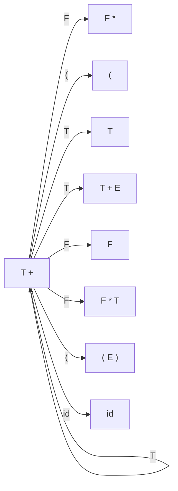



요약

지금까지 읽어 쌓아 둔 부분이 "아직 가망이 있는 모양"이면 유효 접두사라 부른다. 뒤에 알맞은 토큰이 이어지면 문장 전체로 묶일 수 있다는 뜻이다. 쌓인 부분이 이 모양을 벗어나면 뒤에 무엇이 오든 틀린 입력이라 바로 오류를 낼 수 있다. 이런 모양들은 상태 수가 정해진 작은 기계 하나로 알아볼 수 있어서, 묶을 자리를 찾는 일이 기계 한 번 돌리기로 바뀐다. 다만 가망이 있다는 것일 뿐, 남은 입력이 실제로 맞는지는 끝까지 읽어야 안다.

## 예시로 보기

[핸들](/Hongs_Blog/studies/compilers/parse-handle/)이 있으면 환원하고 없으면 이동하면 된다. 그런데 지금 끝자락이 핸들인지 알아낼 방법이 없었다. 방향을 바꿔 "쌓인 부분 전체가 말이 되는 모양인가"를 묻는다.

문법 $$E \to T + E \mid T$$, $$T \to F * T \mid F$$, $$F \to (E) \mid id$$로 `id * id`를 파싱하는 동안, 막대 왼쪽에는 이런 것들이 쌓인다[^1].

| 상태 | 왼쪽 부분 | 핸들 | 한 일 |
|---|---|---|---|
| `\|id * id` | (빈 문자열) | | 이동 |
| `id\|* id` | `id` | `id` | $$F \to id$$로 환원 |
| `F\|* id` | `F` | | 이동 |
| `F *\|id` | `F *` | | 이동 |
| `F * id\|` | `F * id` | `id` | $$F \to id$$로 환원 |
| `F * F\|` | `F * F` | `F` | $$T \to F$$로 환원 |
| `F * T\|` | `F * T` | `F * T` | $$T \to F * T$$로 환원 |
| `T\|` | `T` | `T` | $$E \to T$$로 환원 |
| `E\|` | `E` | | 받아들임 |

왼쪽 부분 칸의 아홉 개가 모두 유효 접두사다. 반대로 `T *`는 아니다. <code>F&#124;* id</code>에서 `F`를 `T`로 잘못 묶고 `*`를 읽으면 `T *`가 쌓이는데, 이 문법에서 `T *`로 시작해 문장까지 가는 길은 없다. 쌓인 부분이 유효 접두사인지만 볼 수 있어도 잘못된 환원을 걸러 낸다.

## 정의

유효 접두사는 문법에 맞는 입력을 이동-환원 파싱하는 동안 막대 왼쪽에 나타날 수 있는 문자열이다. 왼쪽 부분이 유효 접두사이면 그 입력은 아직 받아들여질 가능성이 있다[^1].

기호로 쓰면 이렇다[^s1]. 시작 기호 $$S$$에서 오른쪽 끝 유도로

$$S \Rightarrow_{rm}^{*} \alpha X\omega \Rightarrow_{rm} \alpha\beta\omega$$

가 될 때, $$\alpha\beta$$의 앞부분은 모두 유효 접두사다. $$\alpha\beta$$는 "핸들 $$\beta$$의 오른쪽 끝까지"다. 핸들을 지나쳐 더 오른쪽까지 간 문자열은 유효 접두사가 아니다. 파서는 핸들이 보이면 바로 환원하므로 막대가 핸들을 넘어가는 일이 없기 때문이다.

### 규칙 오른쪽의 앞부분을 이어 붙인 모양

유효 접두사는 규칙 오른쪽의 앞부분 여러 개를 이어 붙인 것이다[^2]. $$\alpha \mid \beta$$에서

$$\alpha = prefix_1\, prefix_2 \cdots prefix_n$$

으로 쪼갤 수 있고, 조각 $$prefix_i$$는 저마다 어떤 규칙 오른쪽의 앞부분이다.

- 마지막을 뺀 조각 $$prefix_k$$ ($$1 \le k < n$$)는 핸들이 아니다. 규칙의 오른쪽이 아직 덜 모인 것이다.
- 마지막 조각 $$prefix_n$$이 핸들이면 환원한다.
- 핸들이 아니면 뒤에 올 것들이 묶인 결과가 붙어 언젠가 핸들이 된다.

`F * id`를 쪼개면 `F *`와 `id`다. `F *`는 $$T \to F * T$$의 앞부분이고 아직 `T`가 안 왔다. `id`는 $$F \to id$$의 전체라서 핸들이다[^2].

### 핸들이 있는지 알아내는 법

$$\alpha\beta \mid b\omega$$에서 왼쪽 부분 $$\alpha\beta$$가 유효 접두사라고 하자. $$b$$는 다음 토큰이다[^3].

| 조건 | 할 일 |
|---|---|
| 규칙 $$X \to \beta$$가 있고 $$\alpha X$$도 유효 접두사다 | $$\beta$$가 핸들이다. 환원한다 |
| 끝자락 가운데 핸들이 없고 $$\alpha\beta b$$가 유효 접두사다 | 이동한다 |
| 둘 다 아니다 | 오류 |

원본 오류 의심

원문: "If there is a production $$X \to \beta$$ and $$\alpha X$$ is a viable prefix, then $$\beta$$ is a handle of $$\alpha\beta b\omega$$ and do reduction" (7회 슬라이드 p.14) / 문제점: 예시의 <code>F&#124;* id</code>에서 $$T \to F$$가 있고 `T`도 유효 접두사라 조건이 맞지만, `F`는 핸들이 아니다. 환원하면 `T *`가 되어 막힌다 / 수정안: 첫 줄의 조건이 맞으면 $$\beta$$는 핸들 "후보"다. 다음 토큰 $$b$$까지 봐야 정해진다 / 근거: `T`는 유효 접두사이고 `T *`는 아니다([24_viable-prefix_verify.py](/Hongs_Blog/studies/compilers/code/24_viable-prefix_verify/)). 같은 슬라이드 p.36이 이 규칙대로 하다 충돌이 나는 것을 보이고, p.37이 다음 토큰을 보는 조건을 더한다.

다음 토큰까지 보아 이 틈을 메우는 방법이 [SLR 파싱](/Hongs_Blog/studies/compilers/slr-parsing/)이다.

### 유효 접두사는 유한 오토마타로 알아본다

유효 접두사를 모두 모은 집합은 정규 언어다. 그래서 [유한 오토마타](/Hongs_Blog/studies/compilers/finite-automata/)로 알아볼 수 있다[^4].

슬라이드의 설명은 이렇다. 조각 하나가 `T +`였다면, 그 뒤에 올 수 있는 조각은 몇 가지로 정해져 있다[^4].

| 뒤에 오는 조각 | 종류 |
|---|---|
| `T +`, `F *`, `(` | 덜 모인 앞부분(핸들 아님). 뒤에 조각이 더 온다 |
| `T`, `F`, `( E )`, `id`, `T + E`, `F * T` | 규칙의 오른쪽 전체(핸들이 될 수 있다) |

`T +` 뒤에는 `E`가 와야 하고, `E`는 `T`나 `(`나 `id`로 시작하는 것들로 만들어지기 때문이다. 조각의 종류는 규칙 오른쪽의 앞부분들이라 유한하고, 어느 조각 뒤에 어느 조각이 오는지도 유한하다. 상태 수와 전이 수가 유한하니 유한 오토마타 하나로 그릴 수 있다[^5].

슬라이드 그림을 옮긴 것이다. 화살표의 글자는 다음 조각이 시작하는 기호다. 같은 기호 `T`로 가는 길이 여럿인 것은 이 그림이 아직 비결정적이기 때문이다[^4].

이 오토마타를 문법에서 기계적으로 만드는 방법이 [LR(0) 항목과 항목 오토마타](/Hongs_Blog/studies/compilers/lr0-item-automaton/)다. 그 오토마타에서 보면 `(` 여덟 개 `((((((((`도 유효 접두사다. 닫는 괄호 여덟 개가 알맞게 따라오면 문장이 되기 때문이다[^6].

검증: 위 표의 왼쪽 부분 아홉 개가 모두 유효 접두사, 정의대로 모은 집합과 오토마타가 받아들이는 집합이 길이 3 이하 기호열 585개에서 일치(유효 접두사 30개), `T +` 뒤에 붙는 아홉 조각이 모두 유효하고 `T *`, `T + )`, `E +`는 아님, `((((((((`는 유효 — [24_viable-prefix_verify.py](/Hongs_Blog/studies/compilers/code/24_viable-prefix_verify/)

## 연결

- 선수: [핸들](/Hongs_Blog/studies/compilers/parse-handle/), [유한 오토마타](/Hongs_Blog/studies/compilers/finite-automata/)
- 오토마타 만들기: [LR(0) 항목과 항목 오토마타](/Hongs_Blog/studies/compilers/lr0-item-automaton/)
- 문장 전체의 집합은 정규 언어가 아닌데(괄호 짝을 세야 한다), 그 문장을 파싱하다 쌓이는 왼쪽 부분의 집합은 정규 언어다. 토큰을 알아보던 도구([정규 표현식](/Hongs_Blog/studies/compilers/regular-expression/), 유한 오토마타)가 구문 분석에서 다시 쓰인다[^s1].

## 확인 문제

**C1** 유효 접두사의 뜻과, 왼쪽 부분이 유효 접두사가 아닐 때 파서가 할 일을 말하라.

**답:** 문법에 맞는 입력을 이동-환원 파싱하는 동안 막대 왼쪽에 나타날 수 있는 문자열이다. 오른쪽 끝 유도로 나온 문자열에서 핸들의 오른쪽 끝을 넘지 않는 앞부분이다. 왼쪽 부분이 유효 접두사가 아니면 뒤에 무엇이 오든 받아들일 수 없으므로 오류를 낸다.

**C2** 강의의 문법에서 (가) `F *`, (나) `T *`, (다) `T + (`, (라) `T + E +`. 유효 접두사를 고르고 아닌 것은 이유를 대라.

**답:** (가)와 (다)가 유효 접두사다. (나) `T *`는 아니다. `*`의 왼쪽에는 `F`만 온다($$T \to F * T$$). (라) `T + E +`도 아니다. `T + E`는 $$E \to T + E$$의 오른쪽 전체라 핸들이고, 파서는 `+`를 읽기 전에 환원한다. 막대가 핸들을 넘어갈 수 없다. 
**이유:** (라)를 "`E + ` 꼴이 없어서"라고 답하면 반만 맞다. 핵심은 유효 접두사가 핸들의 오른쪽 끝을 넘지 않는다는 것이다.

**C3** `((((((((`는 문장이 아닌데 왜 유효 접두사인가?

**답:** 유효 접두사는 "문장"이 아니라 "아직 가망이 있는 왼쪽 부분"이다. 뒤에 `id ))))))))`가 오면 문장이 되고, 그 입력을 파싱하는 동안 막대 왼쪽에 `(` 여덟 개가 쌓이는 순간이 있다.

[^1]: 컴파일러 7회 강의 자료 「Lecture07 Syntax analysis part 4」, p.12 (유효 접두사의 정의, `id * id`의 표)
[^2]: 같은 자료, p.13 (규칙 오른쪽의 앞부분을 이어 붙인 것이라는 설명과 표)
[^3]: 같은 자료, p.14 (핸들이 있는지 알아내는 법)
[^4]: 같은 자료, p.15~17 (정규 언어라는 말, `T +` 뒤에 올 수 있는 조각과 그림)
[^5]: 같은 자료, p.18 (상태 수와 전이 수가 유한하다)
[^6]: 같은 자료, p.31 (`((((((((`가 유효 접두사인가)
[^s1]: 보충 오른쪽 끝 유도로 쓴 기호 정의, `T *`가 유효 접두사가 아닌 이유, 핸들 판정 표만으로는 <code>F&#124;* id</code>를 거르지 못한다는 설명, 문장의 집합과 유효 접두사의 집합을 견준 말, 카드 C2·C3은 원본에 없다. 슬라이드의 정의는 말로만 되어 있다. 정의대로 모은 집합과 오토마타를 코드로 견줘 확인했다. 근거: Aho·Lam·Sethi·Ullman, *Compilers* 2판, 4.6.5 "Viable Prefixes".

