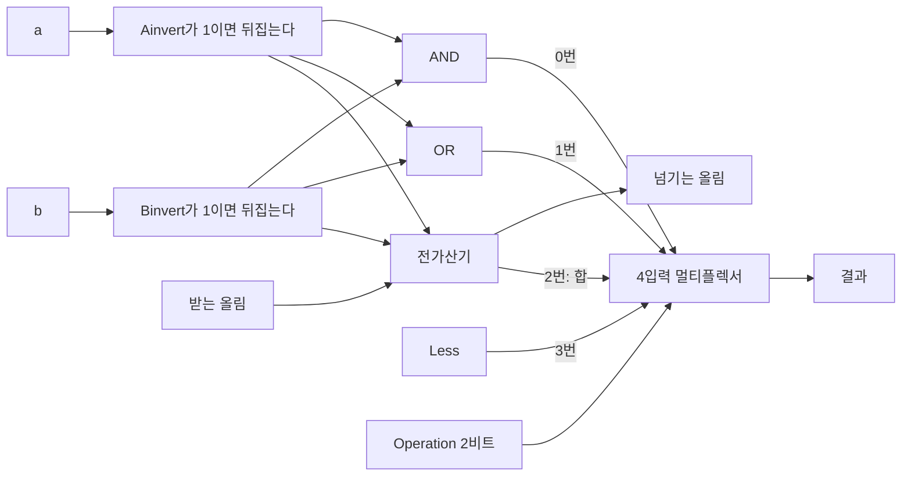



요약

프로세서 안에서 계산을 맡는 회로다. 덧셈, 뺄셈, 비트끼리의 논리 연산을 한 덩어리에 넣어 두고, 바깥에서 주는 신호 몇 가닥으로 그 가운데 하나를 고른다. 버튼으로 기능을 고르는 계산기와 같다. 속은 한 자리짜리 회로를 자리 수만큼 줄지어 세운 것이다. 연산마다 회로를 따로 두지 않아도 되지만, 어떤 연산을 고르든 모든 연산을 다 계산해 놓고 하나만 내보내며, 가장 느린 덧셈이 끝나야 답이 나온다.

## 예시로 보기

덧셈 명령에는 가산기가, AND 명령에는 AND 게이트가, 크기 비교에는 뺄셈이 필요하다. 명령마다 회로를 따로 두고 따로 선을 이으면 프로세서가 복잡해진다. 그래서 두 수가 들어가고 결과 하나가 나오는 상자 하나에 다 넣는다.

8비트로 줄인 ALU에 $$a = 0011\,0110$$(54), $$b = 0010\,1001$$(41)을 넣고 제어선만 바꿔 본다.

| 제어선 | 하는 일 | 결과 | Zero |
|---|---|---|---|
| 0000 | AND | $$0010\,0000$$ | 0 |
| 0001 | OR | $$0011\,1111$$ | 0 |
| 0010 | 덧셈 | $$0101\,1111$$ (95) | 0 |
| 0110 | 뺄셈 | $$0000\,1101$$ (13) | 0 |
| 0111 | 작으면 1 | $$0000\,0000$$ (54 < 41이 아니다) | 1 |
| 1100 | NOR | $$1100\,0000$$ | 0 |

두 입력은 그대로인데 제어선 네 가닥이 결과를 바꾼다. Zero는 결과가 모두 0일 때만 1이 되는 출력이다.

검증: 1비트 ALU 8개를 이은 회로로 여섯 연산을 8비트 전수 검사(65,536쌍 × 6), Zero와 넘침 출력, 부호 비트만 보는 비교가 16,384쌍에서 틀리고 고친 회로는 모두 맞는 것, 위 표, 카드 C2·C3 — [08_alu_verify.py](/Hongs_Blog/studies/computer-architecture/code/08_alu_verify/) (실제 하드웨어가 아니라 파이썬으로 게이트를 흉내 낸 것. MIPS의 ALU는 32비트이고 여기서는 8비트로 줄였다)

## 구조

**한 자리짜리 ALU.** 그 자리의 두 비트로 AND, OR, 합을 모두 구해 놓고 [멀티플렉서](/Hongs_Blog/studies/computer-architecture/mux-decoder/)로 하나를 고른다. 책의 설계는 여기에 선 몇 가닥을 더한다[^1].

멀티플렉서의 선택 신호가 Operation이다. 네 값이 늘 다 계산되어 있고 그 가운데 하나만 결과로 나간다[^s1].

| 선 | 하는 일 |
|---|---|
| Operation (2비트) | 멀티플렉서의 선택 신호. 00은 AND, 01은 OR, 10은 가산기의 합, 11은 Less 입력 |
| Binvert | 1이면 $$b$$를 뒤집어 넣는다. 뺄셈에 쓴다 |
| Ainvert | 1이면 $$a$$를 뒤집어 넣는다. NOR에 쓴다 |
| 받는 올림, 넘기는 올림 | 이웃 자리와 잇는 [가산기](/Hongs_Blog/studies/computer-architecture/adder-circuit/)의 올림 |
| Less | "작으면 1" 연산에서 이 자리에 내보낼 값 |

**줄지어 세우기.** 한 자리짜리 ALU 32개를 놓고 올림을 아래에서 위로 잇는다. 제어선은 모든 자리가 함께 쓴다[^1].

**뺄셈.** $$a - b = a + \bar b + 1$$이므로 Binvert를 1로 하고 맨 아랫자리의 받는 올림에 1을 넣는다. 두 선은 늘 같은 값이라 하나로 묶어 Bnegate라 부른다[^1].

**NOR.** $$\overline{a + b} = \bar a \cdot \bar b$$다(드모르간). 그래서 Ainvert와 Binvert를 둘 다 1로 하고 AND를 고르면 NOR가 나온다[^1].

**작으면 1 (set on less than, slt).** $$a < b$$이면 결과가 1, 아니면 0이다. $$a - b$$가 음수이면 $$a < b$$이고, 음수인지는 뺄셈 결과의 맨 윗자리(부호 비트)에 나온다. 그래서 다음과 같이 잇는다[^1].

- 뺄셈을 시킨다(Bnegate = 1).
- 맨 윗자리 가산기의 출력을 따로 뽑아 Set이라 부르고, 맨 아랫자리의 Less 입력에 잇는다.
- 나머지 자리의 Less에는 0을 잇는다.
- Operation을 11로 해서 모든 자리가 Less를 내보내게 한다.

**Zero.** 결과의 모든 비트를 OR로 모은 뒤 뒤집는다. 하나라도 1이면 0, 모두 0이면 1이다[^1].

$$\text{Zero} = \overline{\text{Result}_{31} + \text{Result}_{30} + \cdots + \text{Result}_0}$$

**제어선 표.** Ainvert, Bnegate, Operation 2비트를 이 순서로 이어 4비트로 적는다[^1].

| 제어선 | Ainvert | Bnegate | Operation | 하는 일 |
|---|---|---|---|---|
| 0000 | 0 | 0 | 00 | AND |
| 0001 | 0 | 0 | 01 | OR |
| 0010 | 0 | 0 | 10 | 덧셈 |
| 0110 | 0 | 1 | 10 | 뺄셈 |
| 0111 | 0 | 1 | 11 | 작으면 1 |
| 1100 | 1 | 1 | 00 | NOR |

## 보장하는 것과 보장하지 않는 것

**보장하는 것.** 제어선이 위 표의 여섯 값 가운데 하나이면, 전파 지연이 지난 뒤 결과는 그 연산의 값이다. 뺄셈을 시켰을 때 Zero가 1인 것과 $$a = b$$인 것은 같은 말이다. 넘침 출력은 부호 있는 수의 덧셈·뺄셈이 범위를 벗어났을 때만 1이다.

**보장하지 않는 것.**

- **값을 기억하지 않는다.** ALU는 조합 회로다. 입력이 바뀌면 결과도 바뀐다. 결과를 남기려면 레지스터에 적어야 한다.
- **뺄셈이 넘치면 부호 비트만 본 비교가 틀린다.** 책도 넘침 때문에 비교가 위 설명보다 조금 복잡하다고 적고, 자세한 것은 연습 문제로 넘긴다[^1]. 8비트에서 $$a = 100$$, $$b = -100$$이면 $$a - b = 200$$이 범위(−128~127)를 넘는다. 결과 $$1100\,1000$$의 맨 윗자리가 1이라 Set이 1이 되고, ALU는 $$100 < -100$$이라고 답한다. 8비트의 모든 쌍 65,536개 가운데 정확히 4분의 1인 16,384쌍에서 틀린다. Set과 넘침 출력을 XOR한 값을 Less에 이으면 모든 쌍에서 맞다[^s2].
- **부호 없는 수의 크기 비교는 이 연결로 하지 못한다.** 부호 비트를 보는 방법은 두 수를 2의 보수로 읽을 때의 것이다.

## 활용

- R형 명령 `add`, `sub`, `and`, `or`, `slt`는 ALU의 연산을 하나씩 고른다: [MIPS 산술·논리 명령](/Hongs_Blog/studies/computer-architecture/mips-arithmetic-logic/).
- `lw`와 `sw`는 ALU의 덧셈으로 메모리 주소를 구하고, `beq`는 ALU에 뺄셈을 시킨 뒤 Zero를 본다: [MIPS 분기와 점프](/Hongs_Blog/studies/computer-architecture/mips-branch-jump/), [데이터패스의 구성 요소](/Hongs_Blog/studies/computer-architecture/datapath-elements/).
- 명령을 보고 제어선 4비트를 정하는 회로: [제어 장치와 제어 신호](/Hongs_Blog/studies/computer-architecture/control-unit/).
- x86은 ALU가 낸 Zero, 부호, 올림, 넘침을 플래그 레지스터에 적어 두고 다음 명령이 읽는다. MIPS에는 그런 레지스터가 없어서 비교 결과를 `slt`로 일반 레지스터에 적거나 `beq`가 그 자리에서 쓴다: [산술 연산과 상태 플래그](/Hongs_Blog/studies/assembly-language/x86-status-flags/).
- **흔한 실수.** 제어선 0110과 0111을 헷갈리는 것. 둘 다 뺄셈을 하지만, 0110은 차를 내보내고 0111은 차의 부호 비트 하나만 맨 아랫자리로 내보낸다.

## 연결

- 선수: [멀티플렉서와 디코더](/Hongs_Blog/studies/computer-architecture/mux-decoder/), [가산기](/Hongs_Blog/studies/computer-architecture/adder-circuit/)
- 곱셈과 나눗셈은 이 ALU를 여러 사이클 되풀이해 쓴다: [곱셈 회로](/Hongs_Blog/studies/computer-architecture/multiplier-circuit/)

## 확인 문제

**C1** ALU 제어선 4비트가 0000, 0001, 0010, 0110, 0111, 1100일 때 하는 일을 쓰고, 4비트가 어떤 선들을 이어 붙인 것인지 말하라.

**답:** AND, OR, 덧셈, 뺄셈, 작으면 1, NOR. 앞에서부터 Ainvert 1비트, Bnegate 1비트, Operation 2비트다. 
**이유:** 0110은 "b를 뒤집고 1을 넣은 뒤 가산기를 고른다"로 읽으면 뺄셈이고, 1100은 "둘 다 뒤집고 AND를 고른다"로 읽으면 NOR다.

**C2** 8비트 ALU에 $$a = 0001\,0100$$, $$b = 0001\,0100$$, 제어선 0110을 넣는다. 결과와 Zero는? 이 Zero를 쓰는 명령은 무엇인가?

**답:** 결과 $$0000\,0000$$, Zero = 1. `beq`가 두 레지스터를 ALU로 빼서 Zero가 1이면 분기한다. 
**이유:** $$a - b = 0$$인 것과 $$a = b$$인 것은 같다. 같은지 보는 데 비교 회로를 따로 두지 않고 뺄셈과 Zero를 쓴다.

**C3** 8비트 ALU에 $$a = 1111\,1011$$(−5), $$b = 0000\,0011$$(3), 제어선 0111을 넣으면 결과가 $$0000\,0001$$이다. 이 결과가 어떤 길로 만들어지는지 한두 문장으로 설명하라.

**답:** ALU가 $$a - b$$를 계산하면 $$1111\,1000$$(−8)이고, 맨 윗자리 가산기의 출력 1이 Set으로 나와 맨 아랫자리의 Less에 들어간다. 모든 자리가 Less를 내보내는데 윗자리의 Less는 0이라 결과는 $$0000\,0001$$이다. 
**흔한 오답:** 결과가 차 $$1111\,1000$$이라고 답하는 것. 차를 내보내는 것은 0110이다.

**C4** 맨 윗자리 가산기 출력(Set)을 그대로 Less에 잇는 ALU가 틀린 답을 내는 8비트 입력을 하나 들고, 왜 틀리는지 말하라.

**답:** $$a = 100$$, $$b = -100$$. $$a - b = 200$$은 8비트 부호 있는 수에 안 들어가 결과가 $$1100\,1000$$이 되고, 맨 윗자리가 1이라 ALU는 $$a < b$$라고 답한다. 실제로는 $$100 > -100$$이다. 
**이유:** "차가 음수이면 작다"는 차가 범위 안에 들어갈 때만 맞다. 뺄셈이 넘치면 부호 비트가 뒤집힌다. 넘침 출력과 XOR하면 바로잡힌다.

[^1]: Patterson & Hennessy, *Computer Organization and Design*, 부록 "The Basics of Logic Design"의 B.5절 "Constructing a Basic Arithmetic Logic Unit" (1비트 ALU와 멀티플렉서, Binvert와 받는 올림으로 하는 뺄셈, 둘을 묶은 Bnegate, Ainvert로 만드는 NOR, slt를 위한 Less 입력과 맨 윗자리의 Set 출력, 넘침 때문에 비교가 더 복잡하다는 말, Zero를 구하는 식, 제어선 표 Figure B.5.13). 절·그림 번호는 공개된 PDF 기준이고 판에 따라 부록 문자가 다를 수 있다. https://www.doc.ic.ac.uk/~wl/teachlocal/arch/HP05/HP_AppB.pdf. 모든 연산을 계산해 놓고 멀티플렉서로 고른다는 설명은 UC Berkeley CS61C 강의 노트 "Arithmetic Logic Unit"에도 있다, https://notes.cs61c.org/content/sds-blocks/alu
[^s1]: 다이어그램 1개와 8비트 예는 직접 만들었다. 선의 이름과 멀티플렉서 입력 순서는 [^1]의 B.5절을 따랐고, 값은 검증 코드로 확인했다.
[^s2]: 8비트 반례, 16,384쌍이라는 수, Set과 넘침을 XOR하는 고침은 책 본문에 없다(책은 연습 문제로 넘긴다). 8비트 전수 검사로 확인했다.

