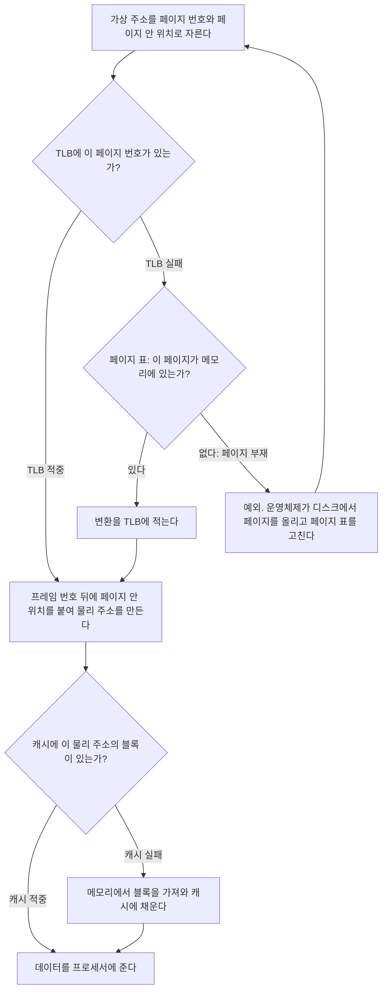


<div class="callout callout-summary" markdown="1">
<div class="callout-title callout-title--default" markdown="span">요약</div>

프로그램이 내는 주소는 진짜 메모리 주소가 아니라서, 메모리를 한 번 쓰려면 먼저 주소를 바꾸고 그다음에 데이터를 찾아야 한다. 주소 바꾸기에도 빠른 수첩이 있고 데이터 찾기에도 빠른 사본 창고가 있어서, 둘 다 맞으면 한두 박자에 끝난다. 하나라도 틀리면 느린 메모리에, 최악에는 디스크에 다녀와야 한다. 두 장치는 서로 다른 것을 기억하므로, 한쪽이 맞았다고 다른 쪽도 맞는 것은 아니다.

</div>


## 예시로 보기

`lw $t0, 0($s1)` 한 줄이 메모리에서 값을 읽는다. [가상 메모리](/Hongs_Blog/studies/operating-systems/virtual-memory/)를 쓰는 컴퓨터에서 `$s1`에 든 주소는 가상 주소다. [캐시](/Hongs_Blog/studies/computer-architecture/direct-mapped-cache/)는 물리 주소로 찾는다고 하자. 그러면 이 한 줄이 세 장치를 차례로 거친다. 어느 장치에서 틀리느냐에 따라 걸리는 시간이 수백 배 달라진다.

작은 컴퓨터를 하나 정한다.

- 가상 주소 16비트, 페이지 256바이트. 위 8비트가 페이지 번호, 아래 8비트가 페이지 안 위치다.
- 물리 주소 12비트. 위 4비트가 프레임 번호다.
- TLB는 2칸이고, 가장 오래 안 쓴 칸을 내보낸다.
- 캐시는 직접 사상 8줄, 블록 16바이트다. 물리 주소 12비트를 태그 5, 인덱스 3, 오프셋 4비트로 자른다.
- 페이지 표: 페이지 0x12 → 프레임 5, 0x2A → 프레임 3, 0x7C → 프레임 9. 페이지 0x44는 디스크에 있다.

가상 주소 여덟 개를 차례로 읽는다.

| 순서 | 가상 주소 | 페이지 | TLB | 페이지 표 | 물리 주소 | 캐시 줄 (태그) | 캐시 |
|---|---|---|---|---|---|---|---|
| 1 | 0x1234 | 0x12 | 실패 | 프레임 5 | 0x534 | 3 (10) | 실패 |
| 2 | 0x1238 | 0x12 | 적중 | 안 본다 | 0x538 | 3 (10) | 적중 |
| 3 | 0x2A10 | 0x2A | 실패 | 프레임 3 | 0x310 | 1 (6) | 실패 |
| 4 | 0x1230 | 0x12 | 적중 | 안 본다 | 0x530 | 3 (10) | 적중 |
| 5 | 0x4400 | 0x44 | 실패 | 부재. 운영체제가 프레임 7에 올린다 | 0x700 | 0 (14) | 실패 |
| 6 | 0x7C50 | 0x7C | 실패 | 프레임 9 | 0x950 | 5 (18) | 실패 |
| 7 | 0x1234 | 0x12 | 실패 | 프레임 5 | 0x534 | 3 (10) | 적중 |
| 8 | 0x4404 | 0x44 | 실패 | 프레임 7 | 0x704 | 0 (14) | 적중 |

7번을 보자. TLB는 2칸뿐이라 5, 6번을 거치며 페이지 0x12의 변환을 잊었다. 그래서 TLB는 실패한다. 하지만 캐시의 3번 줄에는 1번에서 가져온 블록이 그대로 있다. 페이지 표에서 변환을 다시 찾기만 하면 데이터는 캐시에서 바로 나온다. TLB는 "어디에 있는지"를, 캐시는 "거기 무엇이 있는지"를 따로 기억한다.

<div class="callout callout-check" markdown="1">
<div class="callout-title" markdown="span">검증: 위 추적 표, 무작위 접근 2만 번(가끔 페이지를 디스크로 내보냄)에서 여덟 조합 중 다섯만 나오는 것, 동시에 찾기 조건, 카드 C3 — [43_cache-tlb-interaction_verify.py](/Hongs_Blog/studies/computer-architecture/code/43_cache-tlb-interaction_verify/) (실제 하드웨어가 아니라 파이썬 흉내)</div>

</div>


## 한 번의 접근이 거치는 길



- 페이지 안 위치(아래 8비트)는 변환을 거쳐도 그대로다. 바뀌는 것은 페이지 번호가 프레임 번호로 바뀌는 것뿐이다. 1번 접근에서 0x12**34**가 0x5**34**가 된다.
- 페이지 표도 메모리에 있다. 그래서 TLB가 실패하면 페이지 표의 항목을 읽으려고 메모리 접근이 한 번 더 생긴다. 그 접근이 캐시에서 또 실패할 수도 있다. 데이터 한 워드를 읽으려고 느린 메모리에 두 번 다녀오는 셈이다[^1].
- 페이지 부재는 하드웨어가 처리하지 못한다. 예외를 일으켜 운영체제에 넘긴다. 운영체제가 페이지를 올린 뒤 같은 명령어를 처음부터 다시 실행한다([예외 처리](/Hongs_Blog/studies/computer-architecture/processor-exceptions/)).

## 일어날 수 있는 조합과 없는 조합

세 가지(TLB 적중·실패, 페이지가 메모리에 있음·부재, 캐시 적중·실패)를 짝지으면 여덟 가지다. 그중 다섯 가지만 일어난다[^2].

| TLB | 페이지 표 | 캐시 | 일어나는가 | 까닭 |
|---|---|---|---|---|
| 적중 | 있다 | 적중 | 일어난다 | 가장 빠른 경우. 페이지 표는 보지도 않는다 |
| 적중 | 있다 | 실패 | 일어난다 | 변환은 알지만 데이터가 캐시에 없다 |
| 실패 | 있다 | 적중 | 일어난다 | TLB가 잊었을 뿐이다. 예시의 7번 |
| 실패 | 있다 | 실패 | 일어난다 | 변환도 데이터도 메모리에서 가져온다 |
| 실패 | 부재 | 실패 | 일어난다 | 페이지가 디스크에 있다. 가장 느린 경우 |
| 적중 | 부재 | 적중 | 일어나지 않는다 | 메모리에 없는 페이지의 변환은 TLB에 있을 수 없다 |
| 적중 | 부재 | 실패 | 일어나지 않는다 | 같은 까닭 |
| 실패 | 부재 | 적중 | 일어나지 않는다 | 메모리에 없는 페이지의 데이터는 캐시에 있을 수 없다 |

**이 모델이 지켜 주는 것.**

- TLB에 든 변환은 늘 페이지 표와 같다. TLB는 페이지 표의 사본이기 때문이다.
- 캐시에 든 블록은 늘 메모리에 있는 프레임의 사본이다.

이 두 가지가 지켜지려면 운영체제가 할 일이 있다. 페이지를 디스크로 내보낼 때 그 페이지의 TLB 항목을 지우고, 그 프레임의 캐시 블록도 못 쓰게 해야 한다. 이것을 빠뜨리면 위 표의 "일어나지 않는다" 세 줄이 실제로 일어나서, 프로그램이 다른 페이지의 데이터를 읽는다.

**지켜 주지 않는 것.**

- TLB 적중이 캐시 적중을 뜻하지 않는다. 그 반대도 아니다.
- 접근 시간이 일정하다는 보장이 없다. 같은 `lw`가 어떤 때는 2사이클, 어떤 때는 디스크를 기다리는 긴 시간이 걸린다.

**느린 경우의 시간.** TLB 1사이클, 캐시 1사이클, 메모리 100사이클이라 하자. 페이지 표 항목과 데이터가 각각 메모리 접근 한 번이면

| 경우 | 시간 |
|---|---|
| TLB 적중, 캐시 적중 | $$1 + 1 = 2$$ |
| TLB 실패(페이지 표를 메모리에서 읽음), 캐시 적중 | $$1 + 100 + 1 = 102$$ |
| TLB 실패, 캐시 실패 | $$1 + 100 + 1 + 100 = 202$$ |
| 페이지 부재 | 디스크에 다녀오는 시간. 위 값들보다 몇 자릿수 크다 |

## 변환과 캐시 찾기를 동시에 하기

물리 주소로 캐시를 찾으려면 TLB를 먼저 거쳐야 한다. 그러면 모든 접근의 적중 시간에 TLB 시간이 더해진다[^3].

여기서 쓸 수 있는 사실이 하나 있다. 페이지 안 위치 비트는 변환해도 안 바뀐다. 캐시의 줄(집합)을 고르는 데 쓰는 비트, 곧 인덱스와 오프셋이 모두 이 안 바뀌는 비트 안에 들어가면, 변환이 끝나기를 기다리지 않고 줄부터 읽기 시작할 수 있다. TLB가 프레임 번호를 내놓으면 그것을 줄에서 읽은 태그와 비교한다. 줄은 가상 주소로 고르고 태그는 물리 주소로 비교하는 방식이다[^3].

```
 가상 주소:  |   페이지 번호          |   페이지 안 위치 (변환해도 그대로)   |
                    |                 |   인덱스      |   오프셋            |
                    v                        |
                  TLB                        v
                    |                   캐시 줄을 읽는다
                    v                        |
               프레임 번호  ----(비교)----  줄의 태그
```

조건을 식으로 쓰면

$$\log_2(\text{집합 수}) + \log_2(\text{블록 바이트 수}) \le \log_2(\text{페이지 바이트 수}) \quad\Longleftrightarrow\quad \frac{\text{캐시 바이트 수}}{\text{way 수}} \le \text{페이지 바이트 수}$$


페이지가 4 KiB(12비트)일 때 블록 64바이트 캐시로 대입해 본다.

| 캐시 | 집합 수 | 인덱스 + 오프셋 | 동시에 찾을 수 있나 |
|---|---|---|---|
| 32 KiB, 8-way | 64 | 6 + 6 = 12 | 된다 |
| 32 KiB, 4-way | 128 | 7 + 6 = 13 | 안 된다 |
| 16 KiB, 4-way | 64 | 6 + 6 = 12 | 된다 |

이 조건 때문에, 프로세서 바로 옆 캐시를 키우려면 way 수를 함께 늘려야 한다.

조건을 어기고 가상 주소의 윗부분까지 인덱스로 쓰면 문제가 생긴다. 서로 다른 가상 주소 둘이 같은 물리 주소를 가리킬 때, 두 주소가 캐시의 다른 줄로 가서 같은 메모리 워드의 사본이 둘 생긴다. 한쪽을 고쳐도 다른 쪽은 낡은 값으로 남는다[^3].

## 활용

- 캐시의 평균 접근 시간과 같은 꼴로 TLB의 값도 잰다: [캐시 성능과 평균 접근 시간](/Hongs_Blog/studies/computer-architecture/cache-performance-amat/), [TLB](/Hongs_Blog/studies/operating-systems/tlb/).
- 페이지를 크게 잡으면 TLB 한 칸이 덮는 메모리가 넓어져 TLB 실패가 준다. 대신 페이지 끝의 빈 자리 낭비가 는다[^1].
- 흔한 실수.
    - "TLB 적중이면 메모리에 안 간다"고 생각한다. TLB 적중은 주소 변환이 빨리 끝났다는 뜻일 뿐이고, 데이터는 캐시가 실패하면 메모리에서 가져온다.
    - TLB 실패와 페이지 부재를 같은 것으로 본다. TLB 실패는 페이지 표를 한 번 읽으면 끝난다. 페이지 부재는 디스크까지 간다.

## 연결

- 선수: [TLB](/Hongs_Blog/studies/operating-systems/tlb/), [페이징](/Hongs_Blog/studies/operating-systems/paging/), [가상 메모리](/Hongs_Blog/studies/operating-systems/virtual-memory/), [직접 사상 캐시](/Hongs_Blog/studies/computer-architecture/direct-mapped-cache/)
- 페이지 표가 여러 단계일 때 TLB 실패의 값이 더 커진다: [페이지 표 구조](/Hongs_Blog/studies/operating-systems/page-table-structure/)
- 페이지 부재를 운영체제에 넘기는 길: [예외 처리](/Hongs_Blog/studies/computer-architecture/processor-exceptions/)
- 조건식에서 way 수가 하는 일: [집합 연관 캐시](/Hongs_Blog/studies/computer-architecture/set-associative-cache/)

## 확인 문제

<details class="callout callout-question" markdown="1">
<summary class="callout-title" markdown="span">**C1** 다음 중 일어날 수 없는 것을 고르고 까닭을 쓰라. (가) TLB 실패, 페이지는 메모리에 있음, 캐시 적중. (나) TLB 적중, 페이지 부재. (다) TLB 적중, 캐시 실패. (라) TLB 실패, 페이지 부재, 캐시 적중.</summary>

**답:** (나)와 (라).<br>
**이유:** (나) TLB는 메모리에 있는 페이지의 변환만 담는다. 페이지를 내보낼 때 TLB 항목도 지우기 때문이다. (라) 캐시는 메모리의 사본이다. 페이지가 메모리에 없으면 그 데이터가 캐시에 있을 수 없다. (가)는 TLB가 칸이 모자라 변환을 잊었을 뿐이고, (다)는 변환과 데이터를 따로 기억하니 흔히 일어난다.

</details>


<details class="callout callout-question" markdown="1">
<summary class="callout-title" markdown="span">**C2** 캐시 32 KiB, 4-way, 블록 64바이트, 페이지 4 KiB인 컴퓨터에서는 주소 변환과 캐시 줄 읽기를 동시에 시작할 수 없다. 왜인가? 캐시 크기를 그대로 두고 되게 하려면 무엇을 바꾸는가?</summary>

**답:** 집합이 $$32{,}768 \div 4 \div 64 = 128$$개라 인덱스가 7비트, 오프셋이 6비트로 합이 13비트다. 페이지 안 위치는 12비트뿐이라 인덱스의 맨 윗비트가 페이지 번호 쪽에 걸친다. 그 비트는 변환이 끝나야 알 수 있다. 8-way로 바꾸면 집합이 64개, 인덱스 6비트가 되어 12비트 안에 들어간다.

</details>


<details class="callout callout-question" markdown="1">
<summary class="callout-title" markdown="span">**C3** 예시의 컴퓨터(처음 상태)에서 가상 주소 0x2A1C를 읽는다. 페이지 번호, 물리 주소, 캐시의 태그와 줄 번호와 오프셋을 구하라.</summary>

**답:** 페이지 번호 0x2A, 페이지 안 위치 0x1C. 페이지 표에서 프레임 3이므로 물리 주소 0x31C. 2진수로 0011 0001 1100을 태그 5, 인덱스 3, 오프셋 4비트로 자르면 00110 · 001 · 1100이다. 태그 6, 줄 1, 오프셋 12.<br>
**흔한 오답:** 가상 주소 0x2A1C를 그대로 캐시 주소로 잘라 쓰는 것. 이 캐시는 물리 주소로 찾는다.

</details>


[^1]: University of Utah CS 3810, Lecture 20 "Cache Hierarchies, Virtual Memory", 슬라이드 12~13, 16 (페이지 표도 메모리에 있다, TLB 실패는 메모리 접근 두 번이 될 수 있다, 페이지를 키우면 TLB가 덮는 범위가 넓어지지만 낭비가 는다, 가장 느린 경우의 순서), https://users.cs.utah.edu/~rajeev/cs3810/slides/3810-20.pdf
[^2]: Patterson & Hennessy, *Computer Organization and Design* (MIPS Edition), 5장 "Large and Fast: Exploiting Memory Hierarchy" (TLB·페이지 표·캐시의 적중과 실패 조합). 다섯 조합만 나오는 것은 흉내기로 확인했다.
[^3]: University of Utah CS 3810, Lecture 20, 슬라이드 14~15 (TLB and Cache: 물리 주소로 줄을 고르면 TLB를 먼저 거쳐 접근이 길어진다, 가상 주소 여럿이 같은 물리 주소를 가리킬 때의 문제, Virtually Indexed; Physically Tagged Cache 그림)

