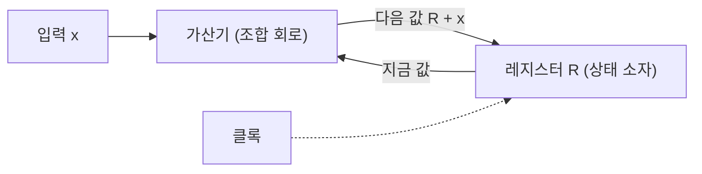


<div class="callout callout-summary" markdown="1">
<div class="callout-title callout-title--default" markdown="span">요약</div>

값을 기억하는 부품과 계산하는 회로를 번갈아 잇고, 모든 기억 부품이 같은 박자에 맞춰 한꺼번에 값을 바꾸게 한 회로다. 박자와 박자 사이에는 계산 회로만 움직이고, 박자가 오는 순간 그 결과가 다음 칸에 찍힌다. 이어달리기에서 정해진 신호에만 바통을 넘기는 것과 같다. 덕분에 자기가 낸 값을 자기가 다시 받아 고쳐 쓰는 회로도 뒤엉키지 않는다. 단, 박자 한 번이 가장 느린 계산이 끝날 만큼은 길어야 한다. 박자를 그보다 빠르게 하면 덜 끝난 값이 찍힌다.

</div>


## 예시로 보기

들어오는 수를 계속 더해 가는 회로를 만들려면, 지금까지의 합을 기억했다가 새 수와 더해 다시 기억해야 한다. 기억 부품의 출력이 가산기를 거쳐 자기 입력으로 돌아온다. 값이 바뀌는 때를 정해 두지 않으면 더한 값이 돌아와 또 더해지고 또 더해진다.

8비트 레지스터 $$R$$과 가산기를 이렇게 잇는다. 가산기는 $$R$$과 입력 $$x$$를 더하고, 그 결과가 $$R$$의 입력으로 들어간다. $$R$$은 클록이 오르는 순간(상승 에지)에만 값을 받는다.



레지스터가 가산기의 입력이면서 출력이 가는 곳이다[^s1].

| 사이클 | $$x$$ | 사이클 동안의 $$R$$ | 가산기 출력 | 에지 뒤의 $$R$$ |
|---|---|---|---|---|
| 1 | 5 | 0 | 5 | 5 |
| 2 | 3 | 5 | 8 | 8 |
| 3 | 0 | 8 | 8 | 8 |
| 4 | 250 | 8 | 2 | 2 |
| 5 | 4 | 2 | 6 | 6 |

사이클마다 딱 한 번 더한다. 사이클 동안 $$R$$은 가만히 있고, 가산기 출력만 바뀌어 다음 값을 준비한다. 에지가 오면 그 값이 $$R$$에 들어간다. 사이클 4에서는 $$8 + 250 = 258$$이 8비트에 안 들어가 아래 8비트인 2만 남는다.

<div class="callout callout-check" markdown="1">
<div class="callout-title" markdown="span">검증: 위 표, 플립플롭 대신 래치를 쓰면 한 사이클에 세 번 더해지는 것, 클록 주기 500·520피코초와 유지 시간 판정, 카드 C2~C4 — [11_clocked-sequential-logic_verify.py](/Hongs_Blog/studies/computer-architecture/code/11_clocked-sequential-logic_verify/) (실제 하드웨어가 아니라 파이썬 흉내)</div>

</div>


## 구조

**클록.** 정해진 길이로 높아졌다 낮아지기를 되풀이하는 신호다. 한 번 되풀이하는 길이가 클록 주기이고, 그 역수가 클록 속도다[^1].

**상태 소자와 순차 회로.** 값을 기억하는 부품(플립플롭, 레지스터, 메모리)을 상태 소자라 부른다. 상태 소자가 들어 있어서 출력이 지금 입력만이 아니라 기억된 값에도 달린 회로가 순차 회로다[^1].

**에지에서만 바꾸기.** 이 과목의 프로세서는 모든 상태 소자가 클록의 에지에서만 값을 바꾼다(에지 트리거 방식)[^1]. 회로는 늘 다음 모양이다.

```
 상태 소자 ──▶ 조합 회로 ──▶ 상태 소자
     ▲                          ▲
     └────────── 클록 ──────────┘
```

한 사이클 동안 일어나는 일은 셋이다[^1][^2].

1. 에지에서 앞쪽 상태 소자가 새 값을 내놓는다.
2. 그 값이 조합 회로를 지나며 계산된다.
3. 다음 에지에서 뒤쪽 상태 소자가 계산 결과를 찍는다.

앞뒤 상태 소자가 같은 것이어도 된다. 위 예의 $$R$$이 그렇다. 에지 한순간에만 값이 바뀌므로, 한 사이클 안에서 읽고 쓰는 것이 뒤엉키지 않는다[^1].

**고리의 규칙.** 회로를 돌아 제자리로 오는 길에는 모두 레지스터가 적어도 하나 있어야 한다. 클록은 다른 게이트를 거치지 않고 레지스터에 바로 잇는다[^2].

**클록 주기.** 에지에서 나온 값이 다음 에지 전에 도착해서 가만히 있어야 한다. 그래서 주기는 다음 세 시간의 합보다 길거나 같아야 한다[^1][^3].

$$T_c \ge t_{\text{clk-q}} + t_{\text{조합}} + t_{\text{준비}}$$


| 기호 | 뜻 |
|---|---|
| $$T_c$$ | 클록 주기 |
| $$t_{\text{clk-q}}$$ | 에지 뒤 플립플롭의 출력에 새 값이 나올 때까지의 시간 (책은 $$t_{\text{prop}}$$로 쓴다) |
| $$t_{\text{조합}}$$ | 두 상태 소자 사이 조합 회로의 지연 가운데 가장 긴 것 ([전파 지연](/Hongs_Blog/studies/computer-architecture/combinational-logic/)) |
| $$t_{\text{준비}}$$ | 에지 전에 입력이 미리 자리 잡아야 하는 [준비 시간](/Hongs_Blog/studies/computer-architecture/latch-flip-flop/) |

회로에 길이 여러 개면 합이 가장 큰 길(임계 경로)이 주기를 정한다[^3]. 가장 빠른 클록 속도는 그 역수다.

$$t_{\text{clk-q}} = 30$$, $$t_{\text{조합}} = 420$$, $$t_{\text{준비}} = 50$$피코초이면 $$T_c \ge 500$$피코초다. 클록 속도는 $$1 \div (500 \times 10^{-12}) = 2 \times 10^9$$, 곧 2 GHz까지다.

**클록 어긋남.** 클록 선의 길이가 달라 두 상태 소자가 에지를 조금 다른 때에 보는 일이다(클록 스큐). 가장 크게 어긋나는 만큼 $$t_{\text{어긋남}}$$을 주기에 더 얹는다[^1].

$$T_c \ge t_{\text{clk-q}} + t_{\text{조합}} + t_{\text{준비}} + t_{\text{어긋남}}$$


위 예에서 20피코초 어긋나면 520피코초, 약 1.92 GHz다.

**유지 시간.** 반대쪽 걱정도 있다. 에지에서 나온 새 값이 너무 빨리 도착하면, 뒤쪽 플립플롭이 옛값을 다 찍기도 전에 입력이 바뀐다. 그래서 가장 빨리 도착하는 시간이 유지 시간보다 길거나 같아야 한다[^2].

$$t_{\text{clk-q, 최소}} + t_{\text{조합, 최소}} \ge t_{\text{유지}}$$


$$t_{\text{조합, 최소}}$$는 가장 짧은 길의 지연이다. $$30 + 40 = 70$$피코초가 유지 시간 25피코초보다 길면 괜찮다. 이 조건에는 주기가 없다. 어기면 클록을 늦춰도 고쳐지지 않고, 짧은 길에 지연을 더 넣어야 한다[^3]. 책은 요즘 회로에서 이 조건이 거의 문제가 되지 않는다고 보고 지켜진다고 가정한다[^1].

## 예제

**플립플롭 대신 래치를 쓰면.** 위 누산기의 $$R$$을 클록이 높은 동안 열려 있는 [래치](/Hongs_Blog/studies/computer-architecture/latch-flip-flop/)로 바꾼다. 클록이 높은 구간이 300피코초, 가산기 지연이 100피코초다.

1. 래치가 열리면 $$R$$이 가산기로 나가고, 100피코초 뒤 $$R + x$$가 돌아온다.
2. 래치가 아직 열려 있어 그 값이 그대로 뚫고 나가 다시 가산기로 간다.
3. 닫힐 때까지 세 바퀴 돈다.

$$x = 5$$를 한 사이클 넣었는데 $$R$$은 15가 된다. 다음 사이클에 $$x = 3$$을 넣으면 24가 된다. 몇 번 더해질지가 가산기가 얼마나 빠른지에 달려 있다. 이렇게 결과가 신호의 빠르기에 달리는 일을 경주(race)라 부른다[^1]. 플립플롭은 입력에서 출력까지 뚫린 길이 없어서 이 일이 생기지 않는다.

**주기를 어기면.** 위 수치에서 주기를 400피코초로 줄인다. 새 값은 에지 뒤 $$30 + 420 = 450$$피코초에 도착하는데, 다음 에지 전에 자리 잡아야 하는 마감은 $$400 - 50 = 350$$피코초다. 가장 긴 길의 값은 덜 끝난 채로 찍힌다. 짧은 길로 온 값은 제때 도착하므로, 틀리는 것은 긴 길을 지나는 계산뿐이다.

## 보장하는 것과 보장하지 않는 것

**보장하는 것.** 두 식을 지키고 고리마다 레지스터가 있으면, 모든 상태 소자의 다음 값은 지금 값과 지금 입력만으로 정해진다. 게이트가 얼마나 빠른지는 결과에 끼어들지 않는다.

**보장하지 않는 것.**

- 클록과 상관없이 바뀌는 바깥 신호(키보드, 다른 클록을 쓰는 장치)는 준비·유지 시간을 지킨다는 보장이 없다. 따로 맞춰 주는 회로를 거쳐야 한다[^1].
- 주기 식은 가장 느린 길 하나에 모든 사이클을 맞춘다. 대부분의 계산이 일찍 끝나도 남은 시간은 그냥 기다린다.

## 활용

- [CPU 시간 식](/Hongs_Blog/studies/computer-architecture/cpu-time-equation/)의 클록 주기가 여기서 정해진다.
- 명령 하나를 한 사이클에 끝내는 프로세서는 가장 느린 명령이 지나는 길이 임계 경로다: [단일 사이클의 클록 주기](/Hongs_Blog/studies/computer-architecture/single-cycle-timing/).
- 긴 조합 회로 가운데에 레지스터를 끼워 넣으면 $$t_{\text{조합}}$$이 줄어 주기가 짧아진다. 이것이 [5단계 파이프라인](/Hongs_Blog/studies/computer-architecture/mips-pipeline/)의 출발점이고, 끼워 넣는 레지스터가 [파이프라인 레지스터](/Hongs_Blog/studies/computer-architecture/pipeline-registers/)다. 레지스터마다 $$t_{\text{clk-q}}$$와 $$t_{\text{준비}}$$가 더 들기 때문에 둘로 나눠도 주기가 절반이 되지는 않는다.
- 상태를 레지스터 하나에 모으고 조합 회로가 "다음 상태"와 "출력"을 계산하게 하면 유한 상태 기계가 된다[^2]. 위 누산기도 상태가 256가지인 유한 상태 기계다.
- **흔한 실수.** 주기를 게이트 지연의 합으로만 구하고 $$t_{\text{clk-q}}$$와 $$t_{\text{준비}}$$를 빼먹는 것.

## 연결

- 선수: [래치와 플립플롭](/Hongs_Blog/studies/computer-architecture/latch-flip-flop/), [논리 게이트와 조합 회로](/Hongs_Blog/studies/computer-architecture/combinational-logic/)
- 운영체제 과목이 "가져오고, 실행하고"로 본 한 바퀴가 이 박자 위에서 돈다: [명령어 사이클](/Hongs_Blog/studies/operating-systems/instruction-cycle/)

## 확인 문제

<details class="callout callout-question" markdown="1">
<summary class="callout-title" markdown="span">**C1** 에지에서만 값을 바꾸는 회로에서 클록 주기가 지켜야 하는 식을 쓰고 세 항이 무엇인지 말하라.</summary>

**답:** $$T_c \ge t_{\text{clk-q}} + t_{\text{조합}} + t_{\text{준비}}$$. 에지 뒤 플립플롭 출력에 값이 나오는 시간, 가장 긴 조합 회로의 지연, 다음 에지 전에 입력이 자리 잡아야 하는 준비 시간이다.<br>
**이유:** 한 에지에서 출발한 값이 다음 에지의 준비 시간 전까지 도착해야 한다.

</details>


<details class="callout callout-question" markdown="1">
<summary class="callout-title" markdown="span">**C2** $$t_{\text{clk-q}}$$ = 40피코초, 가장 긴 조합 회로 지연 = 900피코초, 준비 시간 = 60피코초다. 가장 짧은 클록 주기와 가장 빠른 클록 속도는?</summary>

**답:** $$40 + 900 + 60 = 1000$$피코초, 곧 1나노초. 클록 속도는 1 GHz.<br>
**흔한 오답:** 900피코초만 써서 약 1.11 GHz라고 답하는 것.

</details>


<details class="callout callout-question" markdown="1">
<summary class="callout-title" markdown="span">**C3** C2의 조합 회로 한가운데에 레지스터를 하나 끼워 450피코초짜리 둘로 나눴다. 주기는 얼마가 되는가? 왜 절반인 500피코초가 되지 않는가?</summary>

**답:** $$40 + 450 + 60 = 550$$피코초(약 1.82 GHz). 1000피코초의 절반이 아니라 약 1.82분의 1이다.<br>
**이유:** 줄어드는 것은 조합 회로의 지연뿐이다. 레지스터를 지나는 데 드는 $$t_{\text{clk-q}}$$와 $$t_{\text{준비}}$$ 100피코초는 나눈 조각마다 그대로 든다.

</details>


<details class="callout callout-question" markdown="1">
<summary class="callout-title" markdown="span">**C4** 위 누산기에서 처음 $$R = 250$$이고 세 사이클 동안 $$x = 7$$을 넣는다(8비트). 에지마다 $$R$$은 얼마가 되는가?</summary>

**답:** 1, 8, 15.<br>
**이유:** $$250 + 7 = 257$$은 8비트에 안 들어가 아래 8비트 1만 남는다. 그 뒤로는 사이클마다 한 번씩 7을 더한다.

</details>


[^1]: Patterson & Hennessy, *Computer Organization and Design*, 부록 "The Basics of Logic Design"의 B.7절 "Clocks" (클록 주기, 에지 트리거 방식, 상태 소자 사이에 조합 회로가 낀 그림, 같은 상태 소자를 한 사이클에 읽고 쓸 수 있다는 것), B.11절 "Timing Methodologies" (주기 ≥ $$t_{\text{prop}} + t_{\text{combinational}} + t_{\text{setup}}$$, 경주의 뜻, 유지 시간은 지켜진다고 가정한다는 말, 클록 스큐를 더한 식, 클록과 상관없이 바뀌는 신호와 준안정 상태). 절 번호는 공개된 PDF 기준이고 판에 따라 부록 문자가 다를 수 있다. https://www.doc.ic.ac.uk/~wl/teachlocal/arch/HP05/HP_AppB.pdf
[^2]: MIT 6.004 Computation Structures 강의 노트 "Sequential Logic" (클록 하나로 모든 레지스터를 맞추는 규칙, 고리마다 레지스터가 하나는 있어야 하고 클록은 레지스터에 바로 잇는다는 것, 유지 시간 조건 $$t_{CD,REG} + t_{CD,LOGIC} \ge t_{HOLD}$$, 상태를 레지스터 하나에 모은 유한 상태 기계), https://computationstructures.org/notes/sequential_logic/notes.html
[^3]: UC Berkeley CS61C 강의 노트 "Timing a Synchronous System" (임계 경로 = clk-to-q 지연 + 조합 회로 지연 + 준비 시간, 가장 짧은 주기는 임계 경로의 지연, 유지 시간을 어기면 조합 회로에 지연을 더해 고친다는 것), https://notes.cs61c.org/content/sds-state/timing-synchronous-system
[^s1]: 누산기 예, 다이어그램, 래치로 바꾼 예, 주기를 어긴 예와 모든 수치는 직접 만들었다. 흉내기와 계산으로 확인했다.

