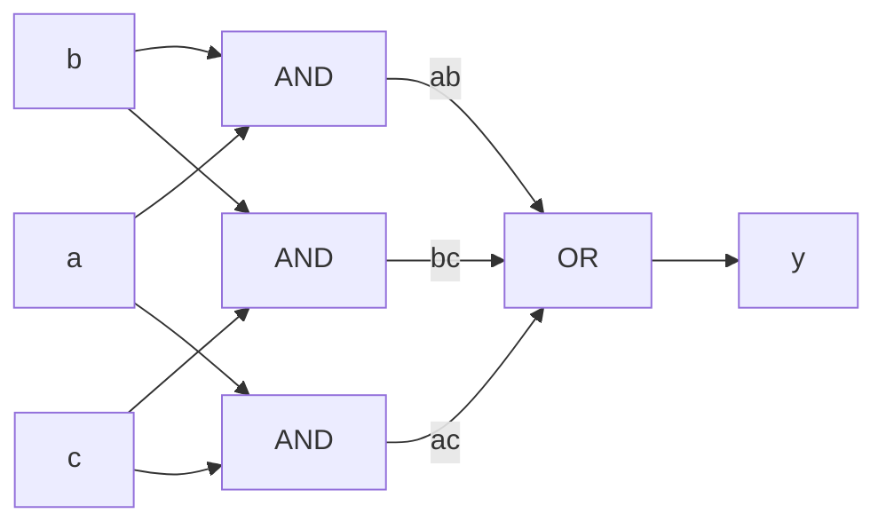



요약

0과 1을 받아 0이나 1을 내놓는 작은 부품 몇 가지를 이으면, 표로 적을 수 있는 계산은 무엇이든 회로로 만들 수 있다. 자판기가 누른 버튼만 보고 음료를 내놓듯, 이런 회로의 출력은 지금 들어온 입력만으로 정해진다. 표에서 회로를 만드는 방법은 기계적이라 쉽지만, 그대로 만들면 부품이 많이 든다. 또 입력이 바뀐 뒤 출력이 따라 바뀌기까지 시간이 걸리고, 그 시간은 가장 여러 부품을 거치는 길이 정한다. 그리고 이런 회로는 아무것도 기억하지 못한다.

## 예시로 보기

프로세서는 덧셈도 비교도 "이 명령이 무엇인지 알아보기"도 모두 회로로 한다. 하고 싶은 계산을 표로 적을 수는 있는데, 그 표를 부품으로 옮기는 방법이 없으면 회로를 만들 수 없다.

세 사람 $$a$$, $$b$$, $$c$$가 찬성(1)이나 반대(0)를 낸다. 둘 이상 찬성이면 통과(1)인 회로를 만든다.

| $$a$$ | $$b$$ | $$c$$ | 통과 $$y$$ |
|---|---|---|---|
| 0 | 0 | 0 | 0 |
| 0 | 0 | 1 | 0 |
| 0 | 1 | 0 | 0 |
| 0 | 1 | 1 | 1 |
| 1 | 0 | 0 | 0 |
| 1 | 0 | 1 | 1 |
| 1 | 1 | 0 | 1 |
| 1 | 1 | 1 | 1 |

출력이 1인 줄은 넷이다. 줄마다 "입력이 딱 이 모양일 때만 1"인 식을 하나씩 만든다. 0인 입력에는 NOT을 붙이고 셋을 AND로 묶으면 된다. 넷째 줄($$a = 0$$, $$b = 1$$, $$c = 1$$)이면 $$\bar a\, b\, c$$다. 그 넷을 OR로 묶는다.

$$y = \bar a\, b\, c + a\, \bar b\, c + a\, b\, \bar c + a\, b\, c$$

이 식을 그대로 회로로 옮기면 NOT 3개, 입력 셋짜리 AND 4개, 입력 넷짜리 OR 1개, 모두 8개가 든다. [불 대수](/Hongs_Blog/studies/discrete-math/boolean-algebra/)의 법칙으로 줄이면 같은 표를 내는 더 작은 식이 나온다.

$$y = a\, b + b\, c + a\, c$$

"둘씩 짝지어 어느 한 짝이라도 둘 다 찬성이면 통과"라는 뜻이다. AND 3개와 OR 1개, 모두 4개면 된다.

입력에서 출력까지 어느 길로 가도 AND 하나와 OR 하나를 거친다. 되돌아가는 선은 없다[^s1].

검증: 게이트 여섯 가지의 진리표, 다수결 표와 두 식이 8줄 모두 같음, 입력 3개인 불 함수 256개를 모두 같은 방법으로 만들 수 있음, 지연 100·80피코초, 카드 C1·C3 — [05_combinational-logic_verify.py](/Hongs_Blog/studies/computer-architecture/code/05_combinational-logic_verify/) (실제 하드웨어가 아니라 파이썬으로 게이트를 흉내 낸 것)

## 정의

**논리 게이트.** 불 연산 하나를 하는 부품이다. 선에 걸린 전압이 높으면 1, 낮으면 0으로 읽는다[^1].

| 게이트 | 식 | 출력이 1인 때 |
|---|---|---|
| NOT (인버터) | $$\bar a$$ | 입력이 0 |
| AND | $$a \cdot b$$ | 둘 다 1 |
| OR | $$a + b$$ | 하나라도 1 |
| NAND | $$\overline{a \cdot b}$$ | 둘 다 1인 경우만 빼고 |
| NOR | $$\overline{a + b}$$ | 둘 다 0 |
| XOR | $$a \oplus b$$ | 둘이 다를 때 |

**조합 회로.** 출력이 지금의 입력만으로 정해지는 회로다(조합 회로). 기억이 없어서 같은 입력을 넣으면 늘 같은 출력이 나온다[^1]. 만드는 규칙은 하나다. 게이트의 출력이 돌고 돌아 자기 입력으로 되돌아오는 길(고리)이 없어야 한다. 조합 회로인 부품들을 고리 없이 이으면 전체도 조합 회로다[^2].

**표에서 회로로.** 진리표가 있으면 다음 순서로 회로가 나온다[^1][^2].

1. 출력이 1인 줄마다 AND 항을 하나 만든다. 그 줄에서 0인 입력에는 NOT을 붙인다.
2. 그 항들을 OR 하나로 묶는다.

이렇게 얻은 "AND 항들의 OR" 꼴을 곱의 합(sum of products)이라 부른다. AND를 곱, OR를 합으로 읽어서 붙은 이름이다. 회로는 NOT 한 줄, AND 한 줄, OR 하나의 세 겹이 된다. 이 방법은 어떤 표에나 통하지만 가장 작은 회로를 주지는 않는다.

**지연.** 게이트는 입력이 바뀐 뒤 조금 있다가 출력을 바꾼다. 회로 전체에서는 길마다 거치는 게이트의 지연을 더한다.

- 입력이 바뀐 뒤 출력이 맞는 값으로 자리 잡을 때까지 걸리는 가장 긴 시간(전파 지연). 입력에서 출력까지 가는 길 가운데 지연의 합이 가장 큰 길이 정한다[^2]. 이 길을 임계 경로라 부른다.
- 입력이 바뀐 뒤 출력이 처음 흔들리기 시작할 때까지의 가장 짧은 시간(오염 지연). 지연의 합이 가장 작은 길이 정한다[^2].

기호로 쓰면 전파 지연은 $$t_{PD} = \max_{\text{길}} \sum_{\text{길 위의 게이트}} t_{PD,\text{게이트}}$$, 오염 지연은 $$t_{CD} = \min_{\text{길}} \sum_{\text{길 위의 게이트}} t_{CD,\text{게이트}}$$다. $$\max$$는 "모든 길 가운데 가장 큰 값", $$\min$$은 "가장 작은 값"이다.

NOT이 20피코초, AND와 OR가 40피코초 걸린다고 하자(입력 수가 달라도 같다고 친다). 곱의 합을 그대로 만든 회로에서 가장 긴 길은 NOT → AND → OR로 $$20 + 40 + 40 = 100$$피코초다. 줄인 회로는 AND → OR뿐이라 80피코초다. 식을 줄이면 부품도 줄고 빨라지기도 한다.

## 활용

- 프로세서에서 값을 기억하지 않는 부분은 모두 조합 회로다. 여러 값 가운데 하나를 고르는 [멀티플렉서와 디코더](/Hongs_Blog/studies/computer-architecture/mux-decoder/), 덧셈을 하는 [가산기](/Hongs_Blog/studies/computer-architecture/adder-circuit/), 연산을 골라 하는 [ALU](/Hongs_Blog/studies/computer-architecture/alu/), 명령을 보고 제어 신호를 내는 [제어 장치](/Hongs_Blog/studies/computer-architecture/control-unit/)가 그렇다.
- 가장 긴 길의 지연이 박자 한 번의 길이를 정한다: [클록과 순차 회로](/Hongs_Blog/studies/computer-architecture/clocked-sequential-logic/).
- 위 다수결 회로는 덧셈에서 윗자리로 넘기는 올림을 구하는 회로와 같다. 세 수 $$a$$, $$b$$, 아래에서 온 올림 가운데 둘 이상이 1이면 올림이 생긴다.
- **흔한 실수.** 입력이 바뀌자마자 출력을 읽는 것. 전파 지연이 지나기 전의 출력은 옛값이거나 잠깐 틀린 값일 수 있다.

## 연결

- 선수: [불 대수와 논리 회로](/Hongs_Blog/studies/discrete-math/boolean-algebra/)(세 연산과 법칙, NAND 하나로 모든 회로를 만들 수 있다는 것), [논리적 동치와 정규형](/Hongs_Blog/studies/discrete-math/logical-equivalence/)(곱의 합은 논리식의 DNF와 같은 꼴이다)
- 같은 연산을 32비트에 한꺼번에: [비트 논리 명령](/Hongs_Blog/studies/assembly-language/bitwise-instructions/)
- 기억하는 회로: [래치와 플립플롭](/Hongs_Blog/studies/computer-architecture/latch-flip-flop/). 고리를 일부러 만들면 값을 붙들 수 있다.

## 확인 문제

**C1** 입력 $$a$$, $$b$$, $$c$$ 가운데 1이 홀수 개일 때만 출력이 1인 회로를 곱의 합으로 쓰라. 항은 몇 개인가?

**답:** 출력이 1인 줄은 001, 010, 100, 111의 넷이다. $$y = \bar a\, \bar b\, c + \bar a\, b\, \bar c + a\, \bar b\, \bar c + a\, b\, c$$. 항은 4개다. 
**이유:** 1인 줄마다 항 하나, 그 줄에서 0인 입력에 NOT. 이 함수는 $$a \oplus b \oplus c$$와 같아서 XOR 게이트 둘로도 만든다.

**C2** 조합 회로를 만들 때 "게이트 출력이 자기 입력으로 되돌아오는 길이 없어야 한다"는 규칙이 왜 필요한가?

**답:** 고리가 있으면 출력이 지금 입력만으로 정해지지 않는다. 되돌아온 값, 곧 조금 전의 출력이 다음 출력에 끼어든다. 같은 입력을 넣어도 앞서 무슨 일이 있었는지에 따라 출력이 달라지므로 조합 회로가 아니다. 
**이유:** 이 성질을 거꾸로 쓰면 값을 기억하는 회로가 된다. [래치](/Hongs_Blog/studies/computer-architecture/latch-flip-flop/)가 고리 하나로 만든 기억이다.

**C3** $$y = a\,b + \bar c$$를 AND 1개, NOT 1개, OR 1개로 만들었다. NOT은 20피코초, AND와 OR는 40피코초다. 전파 지연과 오염 지연은?

**답:** 길은 둘이다. $$a$$나 $$b$$에서 AND → OR로 80피코초, $$c$$에서 NOT → OR로 60피코초. 전파 지연은 80피코초, 오염 지연은 60피코초다. 
**흔한 오답:** 게이트 지연을 모두 더해 100피코초라고 하는 것. 한 신호가 지나는 길 위의 게이트만 더한다.

[^1]: Patterson & Hennessy, *Computer Organization and Design*, 부록 "The Basics of Logic Design"의 B.2절 "Gates, Truth Tables, and Logic Equations", B.3절 "Combinational Logic" (높은 전압과 낮은 전압, 조합 회로는 기억이 없다는 것, 진리표, 곱의 합). 절 번호는 공개된 PDF 기준이고 판에 따라 부록 문자가 다를 수 있다. https://www.doc.ic.ac.uk/~wl/teachlocal/arch/HP05/HP_AppB.pdf
[^2]: MIT 6.004 Computation Structures 강의 노트 "Combinational Logic" (고리 없이 이은 조합 소자는 조합 소자라는 것, 진리표에서 곱의 합을 기계적으로 얻는 법과 세 겹 회로, 전파 지연은 가장 긴 길의 합이고 오염 지연은 가장 짧은 길의 합이라는 것), https://computationstructures.org/notes/combinational_logic/notes.html
[^s1]: 보충 다수결 예와 다이어그램 1개, 지연 수치(20·40피코초)는 직접 만들었다. 식과 지연은 검증 코드로 확인했다.

