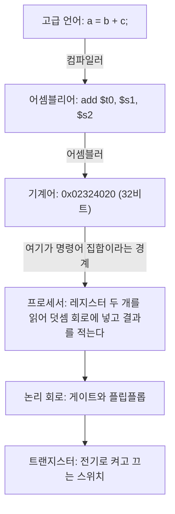



요약

컴퓨터는 여러 층을 쌓아 만든다. 위층은 아래층이 무엇을 해 주는지만 알면 되고, 어떻게 해 주는지는 몰라도 된다. 식당 손님이 주방을 몰라도 메뉴판만 보고 주문하는 것과 같다. 층 가운데 가장 중요한 경계는 프로세서가 알아듣는 명령의 목록이다. 이 목록만 그대로 두면 프로그램을 고치지 않고 프로세서를 새로 만들 수 있고, 프로세서를 몰라도 프로그램을 짤 수 있다. 대신 아래층을 가려 두기 때문에, 프로그램이 왜 느린지는 가려 둔 층을 열어 봐야 보인다.

## 예시로 보기

프로세서 안에는 스위치 수십억 개가 있다. 프로그램을 짤 때마다 어느 스위치를 켤지 정해야 한다면 덧셈 한 번도 짜기 어렵다. 그래서 일을 층으로 나눈다. C로 쓴 한 줄이 아래층으로 내려가면서 모양이 바뀐다.

위 세 칸은 소프트웨어가 하는 일이고 아래 세 칸은 하드웨어가 하는 일이다. 가운데 화살표가 둘이 만나는 자리다[^1][^s1].

어셈블리어 한 줄 `add $t0, $s1, $s2`는 "레지스터 `$s1`과 `$s2`의 값을 더해 `$t0`에 넣어라"다. 어셈블러는 이것을 32비트 수 하나로 바꾼다. 비트를 여섯 칸으로 끊으면 칸마다 뜻이 있다[^2].

| 칸 | 연산 종류 | 첫째 원천 | 둘째 원천 | 목적지 | 시프트 양 | 세부 연산 |
|---|---|---|---|---|---|---|
| 비트 수 | 6 | 5 | 5 | 5 | 5 | 6 |
| 값 | 000000 | 10001 (`$s1` = 17번) | 10010 (`$s2` = 18번) | 01000 (`$t0` = 8번) | 00000 | 100000 (덧셈) |

이어 붙이면 `0000 0010 0011 0010 0100 0000 0010 0000`, 16진수로 `0x02324020`이다. 프로세서가 받는 것은 이 32비트뿐이다. `a`, `b`, `c`라는 이름도 `+` 기호도 남아 있지 않다.

검증: `add $t0, $s1, $s2`의 32비트 값과 여섯 칸, 카드 C3의 `0x01098022` — [01_computer-abstraction-layers_verify.py](/Hongs_Blog/studies/computer-architecture/code/01_computer-abstraction-layers_verify/) (실제 하드웨어가 아니라 파이썬으로 비트를 이어 붙인 확인)

## 층과 경계

**가리고 내놓기.** 아래층의 복잡한 속을 가리고, 위층에는 쓸 수 있는 기능만 간단히 내놓는 일이다(추상화). 위 그림의 화살표 하나하나가 이 일을 한다. 컴파일러를 쓰는 사람은 레지스터 번호를 몰라도 되고, 기계어를 내는 사람은 게이트 배선을 몰라도 된다[^1].

**명령어 집합 구조.** 프로세서가 알아듣는 명령, 레지스터, 메모리를 쓰는 방법을 적어 둔 약속이다(명령어 집합 구조, ISA). 하드웨어와 가장 아래쪽 소프트웨어가 이 약속을 사이에 두고 만난다[^1]. 이 과목은 MIPS라는 32비트 명령어 집합을 쓴다. 자세한 것은 [명령어 집합 구조](/Hongs_Blog/studies/computer-architecture/instruction-set-architecture/)에 있다.

**약속과 만든 방법은 다르다.** 같은 명령어 집합을 서로 다른 회로로 만들 수 있다. 약속을 구조(architecture), 그 약속을 지키는 회로를 구현(implementation)이라 부른다[^1]. `add`를 한 사이클에 끝내는 프로세서와 다섯 단계로 나눠 하는 프로세서는 구현이 다르고 빠르기도 다르지만, 같은 기계어 프로그램을 돌린다. 3단원에서 이 두 구현을 차례로 만든다: [단일 사이클 데이터패스](/Hongs_Blog/studies/computer-architecture/single-cycle-datapath/), [5단계 파이프라인](/Hongs_Blog/studies/computer-architecture/mips-pipeline/).

**컴퓨터의 다섯 부분.** 어떤 컴퓨터든 하드웨어는 다섯 가지 일을 하는 부분으로 나뉜다[^1].

| 부분 | 하는 일 |
|---|---|
| 입력 | 밖에서 자료를 받는다 (키보드, 네트워크) |
| 출력 | 결과를 밖으로 내보낸다 (화면, 디스크) |
| 메모리 | 돌고 있는 프로그램과 그 자료를 담아 둔다 |
| 데이터패스 | 실제 계산을 한다. 레지스터와 덧셈 회로와 그 사이의 길이다 |
| 제어 | 명령을 보고 데이터패스, 메모리, 입출력에 무엇을 할지 시킨다 |

데이터패스와 제어를 합쳐 프로세서라 부른다. 운영체제 과목은 같은 그림을 프로세서, 주기억장치, 입출력 모듈, 시스템 버스로 나눠 본다: [컴퓨터의 기본 구성 요소](/Hongs_Blog/studies/operating-systems/computer-basic-elements/).

## 활용

- **이 과목의 지도.** 1단원은 빠르기를 재는 법과 맨 아래의 논리 회로, 2단원은 가운데 경계인 명령어 집합, 3단원은 그 약속을 지키는 프로세서, 4단원은 메모리를 다룬다.
- **같은 프로그램, 새 프로세서.** 명령어 집합이 같으면 예전에 만든 기계어 프로그램이 새 프로세서에서 그대로 돈다. 반대로 명령어 집합이 다르면(MIPS와 x86) 같은 C 프로그램도 다시 컴파일해야 한다.
- **흔한 실수.** 층을 가렸다고 아래층의 비용이 사라지지는 않는다. C에서 한 줄인 `a[i] = b[i] * c`가 기계어 여러 줄이 되고, 줄마다 걸리는 시간이 다르다. 빠르기를 따지려면 가려 둔 층을 세어야 한다: [CPU 시간 식](/Hongs_Blog/studies/computer-architecture/cpu-time-equation/).
- 어셈블리어 과목은 같은 층 쌓기를 x86에서 다룬다: [가상 기계 계층](/Hongs_Blog/studies/assembly-language/virtual-machine-levels/). 컴파일러 과목의 [코드 생성용 MIPS 명령어](/Hongs_Blog/studies/compilers/mips-instructions/)는 레지스터 이름과 명령을 줄여 쓴 표기라 이 과목의 실제 MIPS 표기와 다르다.

## 연결

- 선수: [진법과 자릿수](/Hongs_Blog/studies/college-math/positional-notation/)(2진수와 16진수 읽기)
- 이어지는 개념: [성능과 실행 시간](/Hongs_Blog/studies/computer-architecture/cpu-performance/), [명령어 집합 구조](/Hongs_Blog/studies/computer-architecture/instruction-set-architecture/), [MIPS 명령어 형식](/Hongs_Blog/studies/computer-architecture/mips-instruction-formats/)(여섯 칸의 규칙)
- 맨 아래층: [논리 게이트와 조합 회로](/Hongs_Blog/studies/computer-architecture/combinational-logic/)

## 확인 문제

**C1** C 한 줄이 프로세서에서 돌기까지 거치는 층을 위에서 아래로 쓰고, 소프트웨어와 하드웨어가 만나는 자리를 짚어라.

**답:** 고급 언어 → (컴파일러) → 어셈블리어 → (어셈블러) → 기계어 → 프로세서(데이터패스와 제어) → 논리 회로 → 트랜지스터. 기계어와 프로세서 사이, 곧 명령어 집합 구조가 만나는 자리다. 
**이유:** 기계어까지는 프로그램이 만들고, 그 기계어를 읽고 해내는 것부터는 회로다.

**C2** 명령어 집합은 그대로 두고 프로세서 회로만 새로 만들었다. 예전 기계어 프로그램은 어떻게 되는가? 빠르기는 어떻게 되는가?

**답:** 고치지 않고 그대로 돈다. 빠르기는 달라질 수 있다. 
**이유:** 프로그램이 기대는 것은 약속(구조)이고, 회로(구현)가 아니다. 약속이 정하는 것은 명령마다 어떤 결과가 나오느냐뿐이고, 몇 사이클이 걸리는지와 한 사이클이 얼마나 긴지는 구현이 정한다. 
**흔한 오답:** "프로세서가 바뀌었으니 다시 컴파일해야 한다." 다시 컴파일해야 하는 것은 명령어 집합이 바뀔 때다.

**C3** `sub $s0, $t0, $t1`을 위 표의 여섯 칸에 채워 32비트 16진수로 쓰라. 뺄셈의 세부 연산 값은 100010이고, `$t0` = 8번, `$t1` = 9번, `$s0` = 16번이다.

**답:** 000000 / 01000 / 01001 / 10000 / 00000 / 100010 → `0x01098022`. 
**이유:** 어셈블리어에서는 목적지(`$s0`)를 맨 앞에 쓰지만, 기계어에서는 두 원천(`$t0`, `$t1`)이 앞 칸이고 목적지가 넷째 칸이다. 
**흔한 오답:** 어셈블리어에 쓴 순서대로 16, 8, 9를 넣는 것.

[^1]: Patterson & Hennessy, *Computer Organization and Design* (MIPS Edition), 1장 "Computer Abstractions and Technology" (프로그램 아래의 층, 고급 언어에서 기계어까지, 하드웨어·소프트웨어 인터페이스, 구조와 구현의 구별, 컴퓨터의 다섯 구성 요소). 책을 직접 열지 못해 장까지만 적는다.
[^2]: 같은 책, 2장 "Instructions: Language of the Computer"와 책에 딸린 MIPS 참조표(Green Sheet). 연산 종류 0, 덧셈의 세부 연산 100000(16진수 20), 뺄셈 100010(16진수 22), 레지스터 번호 `$t0` = 8, `$s0` = 16. 여섯 칸의 규칙은 [MIPS 명령어 형식](/Hongs_Blog/studies/computer-architecture/mips-instruction-formats/)에서 다룬다.
[^s1]: 다이어그램 1개와 `a = b + c` 예는 직접 만들었다. 층의 순서는 [^1]의 장을 따랐고, 32비트 값은 검증 코드로 확인했다.

