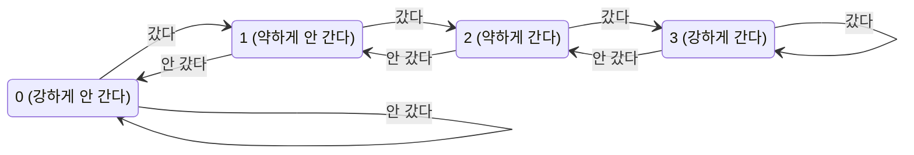


<div class="callout callout-summary" markdown="1">
<div class="callout-title callout-title--default" markdown="span">요약</div>

갈림길에서 어느 쪽으로 갈지 아직 모르는데 차는 계속 들어온다. 멈춰서 기다리면 그때마다 시간을 잃으니, 한쪽으로 일단 보내 놓고 틀렸으면 그 차들을 되돌린다. 프로세서도 분기 명령의 결과가 나오기 전에 다음 명령어를 미리 가져와 흘리고, 잘못 가져왔으면 아무것도 고치기 전에 버린다. 잘 맞히면 분기가 없는 것처럼 빠르지만, 틀릴 때마다 가져온 만큼을 버리므로 얼마나 잘 맞히느냐와 한 번 틀릴 때 몇 개를 버리느냐가 속도를 정한다.

</div>


## 예시로 보기

[파이프라인](/Hongs_Blog/studies/computer-architecture/mips-pipeline/)은 사이클마다 다음 명령어를 가져와야 한다. 그런데 `beq`가 갈지 말지는 두 레지스터를 견줘 봐야 안다. 그 사이에도 IF는 무언가를 가져온다.

`$s3` = `$s4` = 7이라 분기가 가는 경우다.

```asm
        sub $t0, $s1, $s2
        beq $s3, $s4, far
        and $t1, $s1, $s2
        or  $t2, $s1, $s2
        add $t3, $s1, $s2
   far: slt $t4, $s1, $s2
```

**MEM 단계에서 판정하면.** `beq`의 결과가 5번째 사이클에 나온다. 그때까지 뒤따라 들어온 세 명령어는 실행하면 안 되는 것들이다. 셋을 버린다.

| 명령어 | 1 | 2 | 3 | 4 | 5 | 6 | 7 | 8 | 9 | 10 |
|---|---|---|---|---|---|---|---|---|---|---|
| `sub $t0, $s1, $s2` | IF | ID | EX | MEM | WB | | | | | |
| `beq $s3, $s4, far` | | IF | ID | EX | MEM | WB | | | | |
| `and $t1, $s1, $s2` | | | IF | ID | EX | 버림 | | | | |
| `or  $t2, $s1, $s2` | | | | IF | ID | 버림 | | | | |
| `add $t3, $s1, $s2` | | | | | IF | 버림 | | | | |
| `slt $t4, $s1, $s2` | | | | | | IF | ID | EX | MEM | WB |

끝낸 명령어는 셋인데 $$4 + 3 + 3 = 10$$사이클이 들었다.

**ID 단계에서 판정하면.** 비교기와 분기 주소용 가산기를 ID 단계로 옮긴다. 결과가 3번째 사이클에 나오므로 하나만 버린다.

| 명령어 | 1 | 2 | 3 | 4 | 5 | 6 | 7 | 8 |
|---|---|---|---|---|---|---|---|---|
| `sub $t0, $s1, $s2` | IF | ID | EX | MEM | WB | | | |
| `beq $s3, $s4, far` | | IF | ID | EX | MEM | WB | | |
| `and $t1, $s1, $s2` | | | IF | 버림 | | | | |
| `slt $t4, $s1, $s2` | | | | IF | ID | EX | MEM | WB |

$$4 + 3 + 1 = 8$$사이클이다. 분기가 가지 않는 경우(`$s4` = 8)에는 두 설계 모두 아무것도 버리지 않고 여섯 명령어에 10사이클이 든다.

<div class="callout callout-check" markdown="1">
<div class="callout-title" markdown="span">검증: 위 두 표와 사이클 수, 가지 않을 때 버리는 것이 없음, ID에서 판정할 때 기다리는 사이클 수, 반복문의 사이클 수, 두 설계 모두 무작위 프로그램 4,000개에서 단일 사이클 흉내기와 같은 결과 — [27_mips-pipeline_impl.py](/Hongs_Blog/studies/computer-architecture/code/27_mips-pipeline_impl/) (실제 하드웨어가 아니라 파이썬 흉내)</div>

</div>


## 버려도 되는 이유

버린다(flush)는 것은 그 명령어의 제어 신호를 모두 0으로 바꿔 [거품](/Hongs_Blog/studies/computer-architecture/load-use-stall/)으로 만드는 일이다[^1].

**주장.** 분기를 MEM 단계 이전에 판정하면, 잘못 가져온 명령어는 레지스터와 메모리를 하나도 고치지 못한 채 버려진다.

<details class="callout callout-proof" markdown="1">
<summary class="callout-title" markdown="span">이유 펼치기</summary>

1. 명령어가 상태를 고치는 곳은 두 군데뿐이다. MEM 단계의 메모리 쓰기와 WB 단계의 레지스터 쓰기다. — 다섯 단계의 정의
2. `beq`가 MEM 단계에 있을 때, 그 뒤 세 명령어는 EX, ID, IF 단계에 있다. 가장 앞선 것도 아직 EX다. — 한 사이클에 한 단계씩 뒤따른다
3. 그 사이클이 끝날 때 세 명령어의 제어 신호를 0으로 바꾼다. 다음 사이클부터 이들은 MemWrite = 0, RegWrite = 0인 채로 MEM과 WB를 지난다. — 버리기의 정의
4. 그래서 1의 두 군데 어디에서도 쓰지 못한다. ID에서 판정하면 뒤따른 명령어는 IF에 하나뿐이고 같은 논리가 통한다. ∎

</details>


### 스스로 설명해 보기

<details class="callout callout-question" markdown="1">
<summary class="callout-title" markdown="span">1. 2에서 뒤따른 명령어가 세 개인 이유는?</summary>

`beq`는 2번째 사이클에 IF에 들어가 5번째 사이클에 MEM에 있다. 3, 4, 5번째 사이클에 하나씩, 세 명령어가 그 뒤로 들어왔다.

</details>


<details class="callout callout-question" markdown="1">
<summary class="callout-title" markdown="span">2. 판정을 WB 단계까지 미루면 이 논증의 어디가 깨지는가?</summary>

2가 깨진다. `beq`가 WB에 있을 때 바로 뒤 명령어는 MEM에 있고, `sw`였다면 이미 메모리에 쓰는 중이다. 고친 것을 되돌릴 방법이 없다.

</details>


<details class="callout callout-question" markdown="1">
<summary class="callout-title" markdown="span">3. 버려진 명령어도 EX에서 ALU 계산은 했을 수 있다. 그래도 괜찮은 이유는?</summary>

ALU 결과는 파이프라인 레지스터에만 실린다. 파이프라인 레지스터는 프로그램이 보는 상태가 아니다. 프로그램이 보는 것은 레지스터 파일, 메모리, PC뿐이다.

</details>


<details class="callout callout-question" markdown="1">
<summary class="callout-title" markdown="span">이 논증의 핵심 아이디어는?</summary>

"되돌릴 수 없는 일은 뒤 단계에 몰려 있다." 그래서 앞 단계에서는 틀려도 되는 일을 마음껏 미리 해 둘 수 있다.

</details>


<details class="callout callout-question" markdown="1">
<summary class="callout-title" markdown="span">이 방법을 쓸 수 있는 다른 상황은?</summary>

[예외 처리](/Hongs_Blog/studies/computer-architecture/processor-exceptions/)가 같은 회로를 쓴다. 넘침이 난 명령어와 그 뒤 명령어를 버린다. [비순차 실행](/Hongs_Blog/studies/computer-architecture/superscalar-out-of-order/)은 이 생각을 넓혀, 결과를 확정하는 일만 원래 순서대로 한다.

</details>


## 판정을 앞당기는 값

판정을 ID로 당기면 한 번 틀릴 때 버리는 수가 3에서 1로 준다. 공짜는 아니다. 비교할 값이 한 단계 일찍 필요해져서 새 데이터 해저드가 생긴다[^2].

| `beq`가 읽는 레지스터를 고친 명령어 | 기다리는 사이클 |
|---|---|
| 바로 앞의 R형 명령어 | 1 |
| 바로 앞의 `lw` | 2 |
| 두 칸 앞의 `lw` | 1 |
| 두 칸 앞의 R형, 또는 세 칸 이상 앞 | 0 (당겨 쓰거나 레지스터 파일에서 읽는다) |

바로 앞 명령어가 R형이면 그 결과는 `beq`가 ID에 있는 사이클에 아직 ALU에서 계산 중이다. 한 사이클을 기다려야 EX/MEM에서 비교기로 당겨 쓸 수 있다.

`j`는 견줄 것이 없지만, 가져온 것이 `j`라는 사실을 ID에서야 안다. 그래서 늘 하나를 버린다[^s1].

## 예측

분기가 정해질 때까지 무엇을 가져올지 고르는 방법이다. 맞으면 잃는 것이 없고, 틀리면 버린다.

**늘 "안 간다"고 본다.** 위 예시가 이 방식이다. 분기 다음 명령어를 그냥 가져온다. 회로가 가장 간단하다[^3].

**방향을 보고 정한다 (정적 예측).** 프로그램의 모양만 보고 정해 둔다. 뒤로 가는 분기는 "간다", 앞으로 가는 분기는 "안 간다"로 본다. 뒤로 가는 분기는 대개 반복문의 끝이고, 반복문은 여러 번 돌기 때문이다[^4].

**지난 결과를 보고 정한다 (동적 예측).** 분기 명령의 주소로 찾아가는 작은 표를 두고, 그 분기가 지난번에 갔는지를 적어 둔다. 이 표를 분기 예측 버퍼(또는 분기 이력표)라 부른다. 분기를 만나면 표를 보고 그대로 예측하고, 틀리면 가져온 것을 버리고 표를 고친다[^5].

### 1비트 예측기

칸마다 1비트다. "지난번에 갔으면 이번에도 간다, 안 갔으면 안 간다."

반복문 끝의 분기에서 약점이 드러난다. 네 번 도는 안쪽 반복문은 분기가 "간다, 간다, 간다, 안 간다"(TTTN)로 끝난다. 이 반복문에 세 번 들어간다고 하자. 처음 표에는 "안 간다"가 적혀 있다.

| 차례 | 1 | 2 | 3 | 4 | 5 | 6 | 7 | 8 | 9 | 10 | 11 | 12 |
|---|---|---|---|---|---|---|---|---|---|---|---|---|
| 실제 | T | T | T | N | T | T | T | N | T | T | T | N |
| 1비트 예측 | N | T | T | T | N | T | T | T | N | T | T | T |
| 맞았나 | × | ○ | ○ | × | × | ○ | ○ | × | × | ○ | ○ | × |

12번 가운데 6번 맞는다. 반복문을 빠져나올 때 한 번 틀리고(4, 8, 12번째), 그 "안 간다"가 표에 남아 다음에 들어올 때 또 틀린다(5, 9번째). 반복문 하나에 두 번씩 틀린다[^6].

### 2비트 예측기

칸마다 2비트를 두고 0~3을 센다. 가면 1 올리고 안 가면 1 내린다. 0에서는 더 내려가지 않고 3에서는 더 올라가지 않는다. 값이 2 이상이면 "간다", 1 이하면 "안 간다"로 예측한다[^s2].



잇달아 두 번 틀려야 예측이 바뀐다[^7]. 같은 분기에 넣어 본다. 처음 값은 1이다.

| 차례 | 1 | 2 | 3 | 4 | 5 | 6 | 7 | 8 | 9 | 10 | 11 | 12 |
|---|---|---|---|---|---|---|---|---|---|---|---|---|
| 실제 | T | T | T | N | T | T | T | N | T | T | T | N |
| 예측 전의 값 | 1 | 2 | 3 | 3 | 2 | 3 | 3 | 3 | 2 | 3 | 3 | 3 |
| 2비트 예측 | N | T | T | T | T | T | T | T | T | T | T | T |
| 맞았나 | × | ○ | ○ | × | ○ | ○ | ○ | × | ○ | ○ | ○ | × |

12번 가운데 8번 맞는다. 빠져나올 때 한 번 틀려도 값이 3에서 2로 내려갈 뿐 예측은 여전히 "간다"다. 다시 들어올 때는 맞는다.

10번 도는 반복문에 100번 들어가면(분기 1,000번) 차이가 더 뚜렷하다. 1비트는 800번, 2비트는 899번 맞는다. 늘 "간다"고 보면 900번, 늘 "안 간다"고 보면 100번이다.

<div class="callout callout-check" markdown="1">
<div class="callout-title" markdown="span">검증: 위 두 표, 1,000번짜리 수치, 번갈아 가는 분기에서 1비트가 전부 틀림, 아래 CPI 계산 — [31_control-hazard-branch-prediction_verify.py](/Hongs_Blog/studies/computer-architecture/code/31_control-hazard-branch-prediction_verify/) (실제 하드웨어가 아니라 파이썬 흉내)</div>

</div>


**어디로 가는지도 알아야 한다.** "간다"고 맞혀도 갈 주소는 계산해 봐야 나온다. 그래서 분기 명령의 주소와 그 분기가 지난번에 간 주소를 짝지어 적어 두는 표를 하나 더 둔다. 분기 목표 버퍼다. 명령어를 가져오면서 이 표를 함께 찾아, 있으면 곧바로 그 주소에서 다음 명령어를 가져온다[^8].

## 속도에 미치는 영향

분기 때문에 명령어당 사이클 수(CPI)가 얼마나 느는지는 세 수의 곱이다[^s3].

$$\text{CPI} = 1 + (\text{분기 명령의 비율}) \times (\text{예측이 틀리는 비율}) \times (\text{한 번 틀릴 때 버리는 사이클 수})$$


분기가 명령어의 15%이고 위 12번짜리 예처럼 맞힌다고 하자.

| 예측기 | 틀리는 비율 | 1개 버릴 때 (ID 판정) | 3개 버릴 때 (MEM 판정) |
|---|---|---|---|
| 1비트 | 6/12 | 1.075 | 1.225 |
| 2비트 | 4/12 | 1.05 | 1.15 |

단계가 많은 프로세서일수록 버리는 수가 커져서 예측의 정확도가 더 중요해진다. 분기가 20%이고 한 번 틀리면 15사이클을 버리는 프로세서에서, 틀리는 비율이 10%면 CPI는 1.30이고 2%면 1.06이다.

## 활용

- 문제 풀이 순서: ① 분기를 어느 단계에서 판정하는지 본다(버리는 수가 정해진다). ② 분기가 실제로 갔는지 본다. ③ 예측과 다르면 그 수만큼 버린다. ④ 사이클 수 = 4 + 끝낸 명령어 수 + 쉰 사이클 + 버린 명령어 수.
- 실제 MIPS는 분기 바로 다음 명령어를 분기가 가든 말든 늘 실행하기로 정해 두었다(지연 분기). 참조표에서 `jal`이 돌아올 주소로 PC + 4가 아니라 PC + 8을 저장하는 것이 그 때문이다. 이 문서와 흉내기는 지연 분기 없이 "틀리면 버린다"로 설명한다[^9].
- 흔한 실수: 분기가 안 갔는데도 버리는 수를 더하는 것. "안 간다"로 예측했으면 안 갔을 때는 잃는 것이 없다.
- 흔한 실수: 2비트 예측기가 한 번 틀리면 곧바로 예측을 바꾼다고 보는 것. 값이 0이나 3에 있었다면 두 번 잇달아 틀려야 바뀐다.
- 연습: [파이프라인 해저드 예제 사다리](/Hongs_Blog/studies/computer-architecture/pipeline-hazard-ladder/)

## 연결

- 선수: [5단계 파이프라인](/Hongs_Blog/studies/computer-architecture/mips-pipeline/), [적재-사용 해저드와 스톨](/Hongs_Blog/studies/computer-architecture/load-use-stall/), [MIPS 분기와 점프](/Hongs_Blog/studies/computer-architecture/mips-branch-jump/)
- CPI가 실행 시간에 들어가는 자리: [CPU 시간 식](/Hongs_Blog/studies/computer-architecture/cpu-time-equation/)
- 2비트 예측기는 상태가 넷인 순차 회로다: [래치와 플립플롭](/Hongs_Blog/studies/computer-architecture/latch-flip-flop/)
- 같은 "버리기"를 쓰는 곳: [예외 처리](/Hongs_Blog/studies/computer-architecture/processor-exceptions/)

## 자주 하는 오해

<div class="callout callout-misconception" markdown="1">
<div class="callout-title" markdown="span">"분기 예측이 틀리면 프로그램이 틀린 결과를 낸다"</div>

틀렸다. 예측이 틀려도 결과는 늘 같다. 느려질 뿐이다. "예측"이라는 말이 "틀릴 수도 있는 답"처럼 들리고, 실제로 틀린 길의 명령어가 파이프라인 안에서 계산까지 하니 그럴듯해 보인다. 하지만 잘못 가져온 명령어는 레지스터나 메모리를 고치는 단계에 닿기 전에 버려진다. 프로세서가 예측하는 것은 "결과"가 아니라 "다음에 무엇을 미리 가져올까"다. 확인하는 법: 흉내기에서 같은 프로그램을 판정 단계만 바꿔(ID, MEM) 돌리면 버리는 수와 사이클 수는 달라져도 레지스터와 메모리는 단일 사이클 흉내기와 늘 같다.

</div>


## 확인 문제

<details class="callout callout-question" markdown="1">
<summary class="callout-title" markdown="span">**C1** 분기를 MEM 단계에서 판정할 때와 ID 단계에서 판정할 때, 분기가 가면 각각 몇 개의 명령어를 버리는가? ID로 당기려면 어떤 부품을 옮겨야 하고, 무슨 대가를 치르는가?</summary>

**답:** MEM 판정은 3개, ID 판정은 1개. 두 레지스터를 견주는 비교기와 분기 주소를 구하는 가산기를 ID로 옮긴다. 대가는 비교할 값이 한 단계 일찍 필요해지는 것이다. 바로 앞이 R형이면 1사이클, 바로 앞이 `lw`면 2사이클을 기다린다.

</details>


<details class="callout callout-question" markdown="1">
<summary class="callout-title" markdown="span">**C2** 한 분기의 실제 결과가 T T N T T N T T N이다. 처음 표에 "안 간다"(2비트는 값 1)가 적혀 있을 때, 1비트 예측기와 2비트 예측기는 각각 몇 번 맞히는가?</summary>

**답:** 1비트 3번, 2비트 5번.<br>
**이유:** 1비트의 예측은 N T T N T T N T T이고 2, 5, 8번째만 맞는다. 2비트의 값은 1, 2, 3, 2, 3, 3, 2, 3, 3으로 움직여 예측이 N T T T T T T T T이고, 1번째와 N이 나오는 3, 6, 9번째에서 틀린다.

</details>


<details class="callout callout-question" markdown="1">
<summary class="callout-title" markdown="span">**C3** 분기 예측 버퍼와 분기 목표 버퍼가 각각 답하는 질문을 한 문장씩으로 쓰라.</summary>

**답:** 분기 예측 버퍼는 "이 분기가 이번에 갈까?"에 답한다. 분기 목표 버퍼는 "간다면 어느 주소로 갈까?"에 답한다.

</details>


<details class="callout callout-question" markdown="1">
<summary class="callout-title" markdown="span">**C4** 반복문 끝의 분기에서 2비트 예측기가 1비트 예측기보다 잘 맞히는 이유는?</summary>

**답:** 반복문 끝의 분기는 여러 번 가다가 마지막에 딱 한 번 안 간다. 1비트는 그 한 번에 예측을 "안 간다"로 뒤집어서, 다음에 반복문에 다시 들어올 때 또 틀린다. 2비트는 값이 3에서 2로 내려갈 뿐 예측은 "간다"로 남아, 빠져나올 때 한 번만 틀린다.

</details>


<details class="callout callout-question" markdown="1">
<summary class="callout-title" markdown="span">**C5** 명령어의 20%가 분기이고, 예측이 틀리면 3사이클을 버린다. 예측이 틀리는 비율이 25%일 때와 5%일 때의 CPI를 구하라. 다른 손실은 없다고 본다.</summary>

**답:** 1.15와 1.03.<br>
**이유:** $$1 + 0.20 \times 0.25 \times 3 = 1.15$$, $$1 + 0.20 \times 0.05 \times 3 = 1.03$$.

</details>


<details class="callout callout-question" markdown="1">
<summary class="callout-title" markdown="span">**C6** "2비트 예측기는 어떤 분기에서도 1비트 예측기 이상으로 맞힌다"는 틀렸다. 2비트가 더 못 맞히는 분기 결과를 하나 들라. 두 예측기 모두 "안 간다"(2비트는 값 1)에서 시작한다.</summary>

**답:** T T N N T T N N. 1비트는 N T T N N T T N으로 예측해 4번 맞히고, 2비트는 값이 1, 2, 3, 2, 1, 2, 3, 2로 움직여 N T T T N T T T로 예측해 2번 맞힌다.<br>
**이유:** 2비트는 방향이 바뀐 것을 한 박자 늦게 따라간다. 방향이 두 번씩 묶여 바뀌면 그 늦음이 손해가 된다.

</details>


[^1]: 교재 출판사 강의 슬라이드 "Chapter 4 — The Processor" (Cooper Union 게시본), 슬라이드 52 (§4.8 Control Hazards, Branch Hazards: 판정이 MEM에서 나면 뒤의 명령어들을 버린다, 제어 값을 0으로), https://ee.cooper.edu/~curro/comparch/pipeline/chapter4_pipelining_END_FA11.pdf. Patterson & Hennessy, *Computer Organization and Design* (MIPS Edition), 4장 "The Processor"
[^2]: 같은 슬라이드, 53, 56~58 (Reducing Branch Delay: 판정 하드웨어를 ID로, Data Hazards for Branches: 기다리는 사이클 1과 2)
[^3]: 같은 슬라이드, 14~15 (Branch Prediction, MIPS with Predict Not Taken)
[^4]: 같은 슬라이드, 16 (More-Realistic Branch Prediction: 정적 예측과 동적 예측)
[^5]: 같은 슬라이드, 59 (Dynamic Branch Prediction: 분기 예측 버퍼, 분기 주소로 찾는다, 틀리면 버리고 예측을 뒤집는다)
[^6]: 같은 슬라이드, 60 (1-Bit Predictor: Shortcoming, 안쪽 반복문의 분기를 두 번 틀린다)
[^7]: 같은 슬라이드, 61 (2-Bit Predictor: 잇달아 두 번 틀려야 예측을 바꾼다)
[^8]: 같은 슬라이드, 62 (Calculating the Branch Target: 분기 목표 버퍼)
[^9]: MIPS Reference Data (교재의 참조표, Univ. of Patras 게시본), jal의 R[31] = PC + 8, https://eclass.upatras.gr/modules/document/file.php/EE805/MIPS_Instruction_Set/MIPSReferenceData.pdf. 지연 분기라는 약속 자체는 연 자료에서 글로 확인하지 못했다[확인필요].
[^s1]: <span class="fn-tag" title="수업 자료에 없고 따로 보탠 내용">보충</span> `j`가 늘 하나를 버린다는 것은 연 자료에 없다. `j`를 ID에서 알아보는 흉내기로 확인했다.
[^s2]: <span class="fn-tag" title="수업 자료에 없고 따로 보탠 내용">보충</span> 0~3을 오르내리는 계수기는 2비트 예측기를 만드는 가장 흔한 방법이다. 연 슬라이드에는 "잇달아 두 번 틀려야 바꾼다"는 문장과 그림만 있어, 교재 그림의 화살표가 이 계수기와 완전히 같은지는 확인하지 못했다[확인필요]. 문서의 표와 수치는 모두 이 계수기를 기준으로 계산했다. 상태 그림도 이 계수기를 그린 것이다.
[^s3]: <span class="fn-tag" title="수업 자료에 없고 따로 보탠 내용">보충</span> CPI 식과 표의 비율(15%, 20%, 15사이클 등)은 이 문서에서 직접 정한 값이다. 식은 "틀린 분기마다 버리는 사이클만큼 더 든다"를 평균으로 쓴 것이다.

