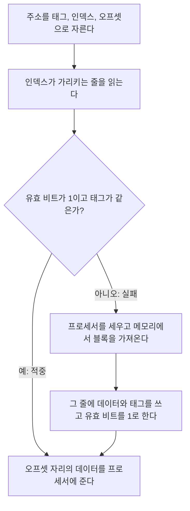


<div class="callout callout-summary" markdown="1">
<div class="callout-title callout-title--default" markdown="span">요약</div>

메모리의 덩어리마다 캐시 안에서 들어갈 자리를 딱 한 곳으로 정해 두는 방식이다. 사물함이 8칸뿐인 학교에서 학번 끝자리로 칸을 정해 주는 것과 같다. 어느 칸을 볼지 주소만 보면 바로 알아서 찾기가 빠르고 회로가 단순하다. 대신 같은 칸을 써야 하는 두 덩어리를 번갈아 쓰면, 다른 칸이 텅 비어 있어도 서로를 계속 쫓아낸다.

</div>


## 예시로 보기

캐시는 메모리보다 훨씬 작다. 프로세서가 "20번지를 달라"고 하면 캐시는 두 가지를 알아내야 한다. 20번지가 캐시 어디에 있을 수 있는가. 거기 지금 들어 있는 것이 정말 20번지의 것인가. 캐시 전체를 뒤지면 느려서 캐시를 둔 보람이 없다.

직접 사상은 첫 물음을 주소의 비트로 바로 답한다. 주소가 8비트이고, 캐시는 8줄이고, 한 줄에 4바이트(워드 1개)가 들어간다고 하자. 주소를 세 토막으로 자른다.

```
 8비트 주소 84 = 0 1 0 | 1 0 1 | 0 0
                 -----   -----   ---
                 태그     줄 번호  줄 안의 위치
                 3비트    3비트    2비트
                  = 2      = 5      = 0
```

- 아래 2비트: 한 줄에 4바이트가 있으니, 그중 몇 번째 바이트인지 가리킨다.
- 가운데 3비트: 8줄 중 몇 번 줄인지 가리킨다. 84번지는 5번 줄에만 들어갈 수 있다.
- 위 3비트: 5번 줄을 쓰는 주소는 여럿이다(20, 52, 84, …). 그중 누구인지 가리는 꼬리표다.

대학 수업에서는 이 세 토막을 위에서부터 태그, 인덱스, 오프셋이라 부른다.

빈 캐시에 주소 20, 22, 24, 84, 21, 48, 50, 84, 26, 20을 차례로 읽는다.

| 순서 | 주소 | 2진수 (태그 · 줄 · 위치) | 태그 | 줄 | 결과 | 그 줄에 일어난 일 |
|---|---|---|---|---|---|---|
| 1 | 20 | 000 · 101 · 00 | 0 | 5 | 실패 | 비어 있었다. 블록을 가져온다 |
| 2 | 22 | 000 · 101 · 10 | 0 | 5 | 적중 | 같은 블록의 다른 바이트다 |
| 3 | 24 | 000 · 110 · 00 | 0 | 6 | 실패 | 비어 있었다 |
| 4 | 84 | 010 · 101 · 00 | 2 | 5 | 실패 | 태그 0을 쫓아내고 태그 2를 넣는다 |
| 5 | 21 | 000 · 101 · 01 | 0 | 5 | 실패 | 태그 2를 쫓아내고 태그 0을 넣는다 |
| 6 | 48 | 001 · 100 · 00 | 1 | 4 | 실패 | 비어 있었다 |
| 7 | 50 | 001 · 100 · 10 | 1 | 4 | 적중 | |
| 8 | 84 | 010 · 101 · 00 | 2 | 5 | 실패 | 태그 0을 쫓아내고 태그 2를 넣는다 |
| 9 | 26 | 000 · 110 · 10 | 0 | 6 | 적중 | 3번에서 가져온 블록이다 |
| 10 | 20 | 000 · 101 · 00 | 0 | 5 | 실패 | 태그 2를 쫓아내고 태그 0을 넣는다 |

적중 3번, 실패 7번이다. 4, 5, 8, 10번을 보면 5번 줄 하나를 두고 20번지 블록과 84번지 블록이 서로를 쫓아낸다. 그동안 0~3번, 7번 줄은 한 번도 쓰이지 않았다. 이것이 직접 사상의 약점이다.

<div class="callout callout-check" markdown="1">
<div class="callout-title" markdown="span">검증: 위 추적 표, 주소 쪼개기 식(블록 크기 5가지 × 줄 수 5가지 × 주소 700여 개를 나눗셈·나머지와 대조), 전체 비트 수, 블록 크기별 실패율, 카드 C2~C4 — [36_direct-mapped-cache_impl.py](/Hongs_Blog/studies/computer-architecture/code/36_direct-mapped-cache_impl/) (실제 하드웨어가 아니라 파이썬 흉내)</div>

</div>


## 정의

**블록과 줄.** 메모리를 같은 크기의 덩어리로 자른 것을 블록이라 부른다. 캐시는 블록 하나가 들어가는 칸을 여러 개 가진다. 이 칸을 줄(라인)이라 부른다. 직접 사상 캐시에서는 블록마다 들어갈 줄이 하나로 정해져 있다[^1].

<div class="callout callout-definition" markdown="1">
<div class="callout-title callout-title--default" markdown="span">정의</div>

블록 번호는 주소를 블록 크기로 나눈 몫이다. 블록이 들어갈 줄은 블록 번호를 줄 수로 나눈 나머지다. 그 줄의 유효 비트가 1이고 줄에 적힌 태그가 주소의 태그와 같으면 적중이고, 아니면 실패다.

</div>


**기호로 쓰면.** 주소가 $$m$$비트, 블록이 $$2^b$$바이트, 줄이 $$2^k$$개다($$b$$는 오프셋 비트 수, $$k$$는 인덱스 비트 수). 주소 $$A$$에 대해

$$\text{오프셋} = A \bmod 2^b, \qquad \text{블록 번호} = \left\lfloor \frac{A}{2^b} \right\rfloor, \qquad \text{인덱스} = \text{블록 번호} \bmod 2^k, \qquad \text{태그} = \left\lfloor \frac{\text{블록 번호}}{2^k} \right\rfloor$$


$$\lfloor x \rfloor$$는 $$x$$의 소수점 아래를 버린 값, $$\bmod$$는 나눈 나머지다. 블록 크기와 줄 수가 2의 거듭제곱이라 실제로는 나눗셈을 하지 않는다. 주소의 비트를 자르기만 한다.

$$\text{오프셋 비트 수} = b = \log_2(\text{블록 바이트 수}), \qquad \text{인덱스 비트 수} = k = \log_2(\text{줄 수}), \qquad \text{태그 비트 수} = m - k - b$$


예시의 캐시는 블록 4바이트, 8줄, 주소 8비트라 $$b = 2$$, $$k = 3$$, 태그는 $$8 - 3 - 2 = 3$$비트다.

```
 m비트 주소
+----------------------+--------------+------------+
|  태그 (m - k - b)     |  인덱스 (k)   | 오프셋 (b)  |
+----------------------+--------------+------------+
        |                     |              |
        |                     v              v
        |        줄을 고른다          줄 안에서 바이트를 고른다
        v
  그 줄의 태그와 비교한다
```

**줄 하나에 들어 있는 것.**

```
 줄    유효  태그        데이터 (블록 1개)
+----+-----+----------+----------------------+
|  0 |  0  |          |                      |
|  1 |  0  |          |                      |
| .. |     |          |                      |
|  5 |  1  |  000     | 20~23번지의 사본       |
|  6 |  1  |  000     | 24~27번지의 사본       |
|  7 |  0  |          |                      |
+----+-----+----------+----------------------+
```

- **유효 비트**(valid bit): 이 줄에 쓸 만한 내용이 들어 있으면 1이다. 전원을 켠 직후에는 줄에 아무 값이나 들어 있어서 태그가 우연히 같을 수 있다. 그래서 모든 유효 비트를 0으로 두고 시작한다[^1].
- **태그**: 이 줄에 지금 어느 블록이 들어 있는지 적은 것이다.
- **데이터**: 블록의 사본이다.

**읽는 순서.**



실패하면 그 줄에 있던 블록은 묻지 않고 쫓겨난다. 들어갈 줄이 하나뿐이라 누구를 쫓아낼지 고를 일이 없다.

### 연산과 비용

| 연산 | 하는 일 | 비용 |
|---|---|---|
| 찾기 | 줄 하나를 읽고 태그 하나를 비교한다 | 비교 회로 1개. 줄 수와 무관하게 한 걸음 |
| 적중 때 읽기 | 오프셋으로 데이터를 고른다 | 찾기와 동시에 한다 |
| 실패 때 채우기 | 블록을 가져와 줄을 덮어쓴다 | 아래층 메모리에 다녀오는 시간(실패 손실) |

직접 사상은 태그 비교가 끝나기 전에 데이터를 먼저 꺼내 쓸 수 있다. 볼 줄이 하나뿐이기 때문이다. 틀렸으면 나중에 되돌린다[^2].

**늘 지켜야 하는 것(불변식).** 유효 비트가 1인 $$i$$번 줄에 태그 $$t$$가 적혀 있으면, 그 줄의 데이터는 블록 번호 $$t \cdot 2^k + i$$의 사본이다.

### 캐시 전체의 비트 수

캐시가 차지하는 칩 면적은 데이터만이 아니다. 줄마다 유효 비트와 태그가 붙는다.

$$\text{전체 비트 수} = 2^k \times (\underbrace{1}_{\text{유효}} + \underbrace{(m - k - b)}_{\text{태그}} + \underbrace{8 \cdot 2^b}_{\text{데이터}})$$


데이터 64 KiB, 블록 32바이트(워드 8개), 주소 32비트인 캐시로 계산해 본다.

1. *줄 수:* $$64 \times 1024 \div 32 = 2{,}048 = 2^{11}$$줄. 인덱스는 11비트다.
2. *오프셋:* $$\log_2 32 = 5$$비트.
3. *태그:* $$32 - 11 - 5 = 16$$비트.
4. *줄 하나:* $$1 + 16 + 256 = 273$$비트.
5. *전체:* $$2{,}048 \times 273 = 559{,}104$$비트 = 68.25 KiB.

"64 KiB 캐시"가 실제로는 68.25 KiB를 쓴다. 데이터의 약 1.066배다. 캐시 크기를 말할 때는 보통 데이터 크기만 말한다.

### 블록 크기 고르기

블록을 키우면 한 번 실패할 때 이웃 워드가 더 많이 딸려 온다. 차례로 읽는 코드에는 좋다. 하지만 캐시 크기가 그대로면 줄 수가 줄어든다. 줄이 너무 적으면 자주 쓰는 블록들이 줄을 두고 다투고, 블록 하나를 가져오는 시간도 길어진다[^3].

배열 하나를 차례로 읽으면서 멀리 떨어진 변수 4개를 돌아가며 쓰는 접근 4,096번을 만들었다. 데이터 256바이트 캐시에서 블록 크기만 바꾼 결과다.

| 블록(바이트) | 4 | 8 | 16 | 32 | 64 | 128 | 256 |
|---|---|---|---|---|---|---|---|
| 줄 수 | 64 | 32 | 16 | 8 | 4 | 2 | 1 |
| 실패율 | 53.0% | 31.0% | 20.0% | 19.8% | 64.0% | 74.2% | 96.9% |

실패율이 내려가다가 다시 올라간다. 줄이 4개가 되는 순간, 변수 4개와 배열이 줄을 나눠 쓰지 못해 무너진다.

### 스스로 설명해 보기

<details class="callout callout-question" markdown="1">
<summary class="callout-title" markdown="span">1. 블록 번호는 주소에서 아래 $$b$$비트를 떼어 낸 나머지 윗부분이다.</summary>

$$2^b$$로 나눈 몫은 2진수에서 아래 $$b$$자리를 버린 것과 같다. 10진수에서 1,000으로 나눈 몫이 아래 세 자리를 버린 것과 같은 이치다.

</details>


<details class="callout callout-question" markdown="1">
<summary class="callout-title" markdown="span">2. 줄 번호는 블록 번호의 아래 $$k$$비트다.</summary>

$$2^k$$로 나눈 나머지는 2진수의 아래 $$k$$자리다. 그래서 "블록 번호를 줄 수로 나눈 나머지"를 구하는 데 회로가 따로 필요 없다.

</details>


<details class="callout callout-question" markdown="1">
<summary class="callout-title" markdown="span">3. 한 줄에 올 수 있는 블록들은 태그가 서로 다르다. 그래서 줄에 태그만 적어 두면 누가 들었는지 정확히 안다.</summary>

블록 번호 = 태그 × $$2^k$$ + 인덱스다. 같은 줄에 온 두 블록은 인덱스가 같으므로, 태그까지 같다면 블록 번호가 같다. 곧 같은 블록이다. 인덱스는 줄의 위치가 이미 말해 주므로 다시 적지 않아도 된다.

</details>


<details class="callout callout-question" markdown="1">
<summary class="callout-title" markdown="span">이 구조의 핵심 아이디어는?</summary>

찾아볼 곳을 주소의 비트로 정해 버려서, 찾기를 "한 줄 읽고 한 번 비교하기"로 줄인다. 자리를 고를 자유를 버린 값으로 속도를 얻는다.

</details>


<details class="callout callout-question" markdown="1">
<summary class="callout-title" markdown="span">같은 생각을 쓰는 다른 곳은?</summary>

해시 테이블. 열쇠를 칸 수로 나눈 나머지로 칸을 정한다. 다만 해시 테이블은 부딪친 항목을 다른 곳에 보관하고, 직접 사상 캐시는 먼저 있던 것을 버린다. 버려도 되는 까닭은 원본이 아래층 메모리에 있기 때문이다.

</details>


## 활용

- **인덱스로 아래쪽 비트를 쓰는 까닭.** 이웃한 블록들이 서로 다른 줄로 간다. 그래서 차례로 읽는 블록들이 캐시에 함께 머문다. 위쪽 비트를 인덱스로 쓰면 가까운 주소들이 모두 한 줄로 몰려 서로 쫓아낸다[^4].
- **MIPS에서.** `lw $t0, 20($s1)`이 내는 주소는 바이트 주소다. 워드는 4바이트라서 워드 주소의 아래 2비트는 늘 00이다. 블록이 워드 1개면 오프셋 2비트가 바로 이 자리다.
- **흔한 실수.**
    - 오프셋을 빼먹고 주소의 맨 아래 비트부터 인덱스로 자른다. 블록이 1바이트가 아닌 한 틀린다.
    - 블록 크기가 "워드 4개"로 주어졌는데 오프셋을 2비트로 잡는다. 바이트 주소에서는 16바이트이므로 4비트다.
    - 유효 비트와 태그를 빼고 캐시 전체 비트 수를 센다.
- 직접 손으로 추적하는 연습: [캐시 적중과 실패 추적 예제 사다리](/Hongs_Blog/studies/computer-architecture/cache-tracing-ladder/)
- 운영체제의 [페이징](/Hongs_Blog/studies/operating-systems/paging/)도 주소를 "번호 + 안쪽 위치"로 자른다. 페이징은 번호를 표에서 찾아 **바꾸고**, 캐시는 번호로 줄을 골라 **있는지 확인한다**.

## 연결

- 선수: [지역성의 원리](/Hongs_Blog/studies/computer-architecture/locality-principle/), [MIPS 레지스터와 메모리 피연산자](/Hongs_Blog/studies/computer-architecture/mips-operands/)
- 줄 하나를 두고 다투는 문제를 푸는 법: [집합 연관 캐시](/Hongs_Blog/studies/computer-architecture/set-associative-cache/). 둘을 견준 것: [직접 사상과 집합 연관 비교](/Hongs_Blog/studies/computer-architecture/direct-vs-associative-cache/)
- 저장 명령(`sw`)이 왔을 때: [캐시 쓰기 정책](/Hongs_Blog/studies/computer-architecture/cache-write-policy/)
- 실패가 성능에 주는 값: [캐시 성능과 평균 접근 시간](/Hongs_Blog/studies/computer-architecture/cache-performance-amat/)
- 운영체제 과목에서 본 캐시의 큰 그림: [캐시 메모리](/Hongs_Blog/studies/operating-systems/cache-memory/)
- 줄을 고르는 회로: [멀티플렉서와 디코더](/Hongs_Blog/studies/computer-architecture/mux-decoder/)

## 자주 하는 오해

<div class="callout callout-misconception" markdown="1">
<div class="callout-title" markdown="span">"블록을 키울수록 실패율은 계속 줄어든다"</div>

틀렸다. 블록이 크면 이웃이 많이 딸려 오니 실패가 줄 것 같다. 실제로 처음에는 준다. 하지만 캐시 크기가 같으면 블록을 두 배로 키울 때마다 줄 수가 반으로 준다. 줄이 모자라면 자주 쓰는 블록끼리 서로 쫓아내서 실패가 다시 는다. 위 표에서 블록 32바이트까지는 53.0% → 19.8%로 내려가다가 64바이트에서 64.0%로 뛴다. 블록이 크면 실패 한 번에 가져올 양도 늘어 실패 손실까지 커진다. 확인하는 법: 캐시 크기를 묶어 두고 블록 크기만 바꿔 실패율을 잰다.

</div>


## 확인 문제

<details class="callout callout-question" markdown="1">
<summary class="callout-title" markdown="span">**C1** 직접 사상 캐시가 주소를 자르는 세 토막의 이름, 각 토막의 비트 수를 구하는 식, 각 토막이 하는 일을 쓰라.</summary>

**답:** 오프셋 = $$\log_2$$(블록 바이트 수)비트, 줄 안에서 바이트를 고른다. 인덱스 = $$\log_2$$(줄 수)비트, 줄을 고른다. 태그 = 주소 비트 수 − 인덱스 − 오프셋, 그 줄에 든 블록이 찾는 블록인지 확인한다.

</details>


<details class="callout callout-question" markdown="1">
<summary class="callout-title" markdown="span">**C2** 주소 32비트, 줄 1,024개, 블록이 워드 1개(4바이트)인 직접 사상 캐시다. 태그·인덱스·오프셋 비트 수와 캐시 전체 비트 수를 구하라. 데이터만 세면 몇 바이트이고, 전체는 몇 바이트인가?</summary>

**답:** 오프셋 2, 인덱스 10, 태그 20비트. 줄 하나는 $$1 + 20 + 32 = 53$$비트, 전체는 $$1{,}024 \times 53 = 54{,}272$$비트 = 6,784바이트. 데이터만은 4,096바이트다.<br>
**흔한 오답:** $$1{,}024 \times 32$$비트만 세는 것. 유효 비트와 태그가 줄마다 21비트씩 더 든다.

</details>


<details class="callout callout-question" markdown="1">
<summary class="callout-title" markdown="span">**C3** 8줄, 블록 4바이트, 주소 8비트인 빈 캐시에 주소 12, 44, 14, 76, 12를 차례로 읽는다. 각 접근의 태그와 줄 번호, 적중 여부를 쓰고, 끝났을 때 3번 줄의 태그를 쓰라.</summary>

**답:** 12 = 000·011·00(태그 0, 줄 3) 실패. 44 = 001·011·00(태그 1, 줄 3) 실패. 14 = 000·011·10(태그 0, 줄 3) 실패. 76 = 010·011·00(태그 2, 줄 3) 실패. 12(태그 0, 줄 3) 실패. 다섯 번 모두 실패이고 3번 줄에는 태그 0이 남는다.<br>
**이유:** 다섯 주소가 모두 3번 줄로 간다. 14는 12와 같은 블록이지만, 그 사이에 44가 12의 블록을 쫓아냈다.

</details>


<details class="callout callout-question" markdown="1">
<summary class="callout-title" markdown="span">**C4** 줄 256개, 블록 16바이트인 직접 사상 캐시에서 32비트 주소 0x1234ABCD의 태그, 인덱스, 오프셋을 16진수로 쓰라.</summary>

**답:** 오프셋 4비트, 인덱스 8비트, 태그 20비트다. 16진수 한 자리가 4비트이므로 맨 아래 한 자리 D가 오프셋, 그 위 두 자리 BC가 인덱스, 나머지 다섯 자리 1234A가 태그다.

</details>


<details class="callout callout-question" markdown="1">
<summary class="callout-title" markdown="span">**C5** 유효 비트 없이 태그만 비교하면 어떤 일이 생기는가? 전원을 켠 직후를 생각해 답하라.</summary>

**답:** 전원을 켠 직후 줄에는 아무 값이나 들어 있다. 그 쓰레기 태그가 찾는 주소의 태그와 우연히 같으면 캐시는 적중이라 판단하고 쓰레기 데이터를 프로세서에 준다. 유효 비트를 0으로 두고 시작하면 태그가 같아도 실패로 처리한다.

</details>


[^1]: MIT 6.004 Computation Structures, Fall 2023, L13 "Caches", 슬라이드 8~9 (Direct-Mapped Caches: 인덱스 비트로 줄을 고르고, 유효 비트가 1이며 태그가 같으면 적중), https://shd.mit.edu/2024/lectures/readings/6191-fall2023/L13.pdf. Patterson & Hennessy, *Computer Organization and Design* (MIPS Edition), 5장 "Large and Fast: Exploiting Memory Hierarchy"
[^2]: ShanghaiTech CS 110 Computer Architecture (UC Berkeley CS61C 슬라이드 기반), 2022, "Caches Part II", 슬라이드 24 (직접 사상은 적중 판정 전에 블록을 쓸 수 있다), https://robotics.shanghaitech.edu.cn/courses/ca/22s/lectures/2022-CA-L17_Caches_II.pdf
[^3]: MIT 6.004, Fall 2023, L13, 슬라이드 11~12 (Block Size, Block Size Tradeoffs)
[^4]: 같은 자료, 슬라이드 10 (Selection of Index Bits)

