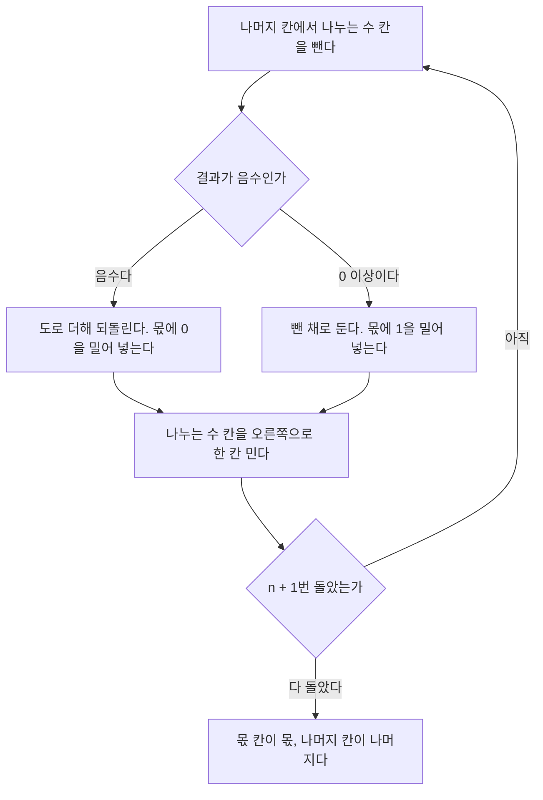


<div class="callout callout-summary" markdown="1">
<div class="callout-title callout-title--default" markdown="span">요약</div>

초등학교의 세로 나눗셈을 회로로 옮긴 것이다. 나누는 수를 큰 자리에 맞춰 놓고 "들어가나?" 물어본 뒤, 들어가면 빼고 몫에 1을 적고, 안 들어가면 몫에 0을 적는다. 그리고 나누는 수를 한 자리 낮춰 다시 묻는다. 회로는 들어가는지 미리 알 수 없어서 일단 빼 보고, 음수가 나오면 도로 더해 되돌린다. 곱셈과 같은 부품으로 만들 수 있지만 걸음마다 빼 보고 되돌리는 일이 있어 더 느리다. 그리고 0으로 나누는 일은 회로가 막아 주지 않는다.

</div>


## 예시로 보기

$$13 \div 5$$를 2진수 세로 나눗셈으로 한다. 13은 `1101`, 5는 `101`이다.

```
          10       몫 (2)
       ------
 101 ) 1101
       101         101이 110에 들어간다 → 몫에 1, 뺀다
       ---
        011        101이 011에 안 들어간다 → 몫에 0
       ---
         11        나머지 (3)
```

사람은 "101이 110에 들어가나"를 눈으로 본다. 회로는 눈이 없다. 견주려면 빼 봐야 한다. 그래서 회로는 일단 빼고, 결과가 음수면 "안 들어갔다"로 알고 뺀 것을 도로 더한다. 이렇게 되돌리는 방식을 복원 나눗셈이라 부른다.

4비트 회로가 걸음마다 갖는 값이다[^s1]. 나머지 칸은 처음에 나누어지는 수 13을 담고 있다가 끝에는 나머지가 된다.

| 걸음 | 한 일 | 몫 칸 | 나누는 수 칸 | 나머지 칸 |
|---|---|---|---|---|
| 0 | 처음 | `0000` | `0101 0000` (80) | `0000 1101` (13) |
| 1 | 13 − 80 < 0: 되돌리고 몫에 0 | `0000` | `0010 1000` (40) | `0000 1101` (13) |
| 2 | 13 − 40 < 0: 되돌리고 몫에 0 | `0000` | `0001 0100` (20) | `0000 1101` (13) |
| 3 | 13 − 20 < 0: 되돌리고 몫에 0 | `0000` | `0000 1010` (10) | `0000 1101` (13) |
| 4 | 13 − 10 = 3 ≥ 0: 그대로 두고 몫에 1 | `0001` | `0000 0101` (5) | `0000 0011` (3) |
| 5 | 3 − 5 < 0: 되돌리고 몫에 0 | `0010` | `0000 0010` | `0000 0011` (3) |

나누는 수 칸의 값은 그 걸음에서 뺀 뒤 한 칸 민 값이다. 끝나면 몫 칸이 `0010` = 2, 나머지 칸이 3이다. $$13 = 2 \times 5 + 3$$이 맞다.

<div class="callout callout-check" markdown="1">
<div class="callout-title" markdown="span">검증: 위 추적 표, 4비트와 8비트의 모든 쌍(나누는 수 0 제외, 240쌍과 65,280쌍)에서 몫과 나머지, 걸음마다 불변식, 부호 규칙 네 경우와 `div`의 Hi·Lo, 카드의 값 — [21_divider-circuit_impl.py](/Hongs_Blog/studies/computer-architecture/code/21_divider-circuit_impl/). 실제 회로가 아니라 레지스터 값을 파이썬으로 흉내 낸 것이다.</div>

</div>


## 알고리즘

**입력과 출력.** 입력은 부호 없는 $$n$$비트 정수 둘, 나누어지는 수 $$N$$과 나누는 수 $$D$$다. $$D \ne 0$$이어야 한다. 출력은 몫 $$Q$$와 나머지 $$R$$이고 다음을 만족한다.

$$N = Q \times D + R, \qquad 0 \le R < D$$


**칸.** 나머지 칸($$2n$$비트, 처음에 $$N$$), 나누는 수 칸($$2n$$비트, 처음에 위쪽 절반에 $$D$$. 곧 $$D \times 2^n$$), 몫 칸($$n$$비트, 처음에 0)[^1].

```
n + 1번 되풀이:
    나머지 = 나머지 - 나누는 수 칸
    나머지가 음수이면:
        나머지 = 나머지 + 나누는 수 칸        (되돌린다)
        몫 칸을 왼쪽으로 한 칸 밀고 맨 아래에 0을 넣는다
    아니면:
        몫 칸을 왼쪽으로 한 칸 밀고 맨 아래에 1을 넣는다
    나누는 수 칸을 오른쪽으로 한 칸 민다
```



비교는 뺄셈으로 한다. 뺀 결과의 부호를 보고, 음수면 나누는 수를 도로 더한다[^2].

### 정확성

**불변식.** $$i$$걸음을 마친 뒤의 몫 칸을 $$Q_i$$, 나머지 칸을 $$R_i$$라 하면 다음이 맞다.

$$N = Q_i \times D \times 2^{\,n+1-i} + R_i, \qquad 0 \le R_i < D \times 2^{\,n+1-i}, \qquad \text{나누는 수 칸} = D \times 2^{\,n-i}$$


마지막 걸음 뒤의 나누는 수 칸($$D$$를 반으로 민 값)은 다시 쓰이지 않는다. 말로 하면, 지금까지 얻은 몫 비트에 그 자릿값을 곱한 것과 남은 것을 더하면 늘 처음 수가 되고, 남은 것은 "다음에 뺄 값의 두 배"보다 작다.

<details class="callout callout-proof" markdown="1">
<summary class="callout-title" markdown="span">까닭 펼치기</summary>

걸음 수에 대한 수학적 귀납법이다.
1. **처음** ($$i = 0$$). $$Q_0 = 0$$, $$R_0 = N$$이라 등식이 맞다. $$N < 2^n \le D \times 2^n < D \times 2^{n+1}$$이므로($$D \ge 1$$) 범위도 맞다.
2. **한 걸음.** $$i$$걸음 뒤에 맞다고 하자. 나누는 수 칸의 값을 $$V = D \times 2^{n-i}$$라 쓴다. 가정은 $$N = Q_i \times 2V + R_i$$, $$0 \le R_i < 2V$$다.
3. $$R_i \ge V$$이면 빼고 몫에 1을 넣는다. $$Q_{i+1} = 2Q_i + 1$$, $$R_{i+1} = R_i - V$$. 그러면 $$Q_{i+1} V + R_{i+1} = 2Q_i V + V + R_i - V = N$$이고 $$0 \le R_{i+1} < V$$다. — 대입
4. $$R_i < V$$이면 되돌리고 몫에 0을 넣는다. $$Q_{i+1} = 2Q_i$$, $$R_{i+1} = R_i$$. 그러면 $$Q_{i+1} V + R_{i+1} = N$$이고 $$0 \le R_{i+1} < V$$다.
5. 두 경우 모두 $$V = D \times 2^{n+1-(i+1)}$$이므로 $$i + 1$$걸음 뒤의 식이 된다.
6. **끝.** $$n + 1$$걸음 뒤 $$N = Q_{n+1} \times D + R_{n+1}$$, $$0 \le R_{n+1} < D$$다. 몫과 나머지의 정의 그대로다. 첫 걸음은 1에서 본 대로 $$N < D \times 2^n$$이라 늘 0을 넣으므로 몫은 $$n$$비트에 들어간다. ∎

</details>


### 걸리는 시간

$$n$$비트 나눗셈은 $$n + 1$$걸음이다. 걸음마다 뺄셈 한 번을 하고, 안 들어갔으면 덧셈을 한 번 더 한다. 4비트 예에서는 다섯 걸음 가운데 네 번을 되돌렸다. 곱셈 회로처럼 칸을 아낀 꼴도 있다. 나누는 수를 미는 대신 나머지를 왼쪽으로 밀고, 몫과 나머지가 $$2n$$비트 칸 하나를 나눠 쓴다[^3].

## MIPS에서

나눗셈의 답은 몫과 나머지 둘이다. MIPS는 곱셈 때 쓰던 두 칸에 나눠 담는다. 몫이 Lo, 나머지가 Hi다[^4].

| 명령 | 하는 일 |
|---|---|
| `div $s2, $s3` | $$Lo = R[\$s2] \div R[\$s3]$$의 몫, $$Hi$$ = 나머지. 부호 있는 수로 |
| `divu $s2, $s3` | 같은 일을 부호 없는 수로 |
| `mflo $s0`, `mfhi $s1` | 몫과 나머지를 꺼낸다 |

**음수가 섞인 나눗셈.** 가장 쉬운 방법은 둘 다 양수로 바꿔 나눈 뒤 부호를 붙이는 것이다. 그런데 $$N = Q \times D + R$$을 만족하는 답이 하나가 아니다. $$-7 \div 2$$는 몫 −3에 나머지 −1도 되고, 몫 −4에 나머지 1도 된다. 그래서 규칙을 정한다. 나머지의 부호는 나누어지는 수의 부호를 따르고, 몫은 두 수의 부호가 다르면 음수다[^5].

| 나눗셈 | 몫 (Lo) | 나머지 (Hi) | 확인 |
|---|---|---|---|
| $$47 \div 5$$ | 9 | 2 | $$9 \times 5 + 2 = 47$$ |
| $$-47 \div 5$$ | −9 | −2 | $$-9 \times 5 - 2 = -47$$ |
| $$47 \div (-5)$$ | −9 | 2 | $$-9 \times (-5) + 2 = 47$$ |
| $$-47 \div (-5)$$ | 9 | −2 | $$9 \times (-5) - 2 = -47$$ |

**0으로 나누기.** MIPS의 나눗셈 명령은 나누는 수가 0인지 검사하지 않는다. 프로그램이 나누기 전에 직접 검사해야 한다[^6]. 위 알고리즘도 $$D \ne 0$$을 입력 조건으로 둔다. $$D = 0$$이면 걸음마다 0을 빼서 늘 "들어간다"가 되고, 몫 칸이 1로 가득 찬 뜻 없는 값이 나온다.

## 활용

- 구현: [21_divider-circuit_impl.py](/Hongs_Blog/studies/computer-architecture/code/21_divider-circuit_impl/)
- 2의 거듭제곱으로 나눌 때는 오른쪽으로 민다. 부호 없는 수는 `srl`, 부호 있는 수는 `sra`를 쓴다: [시프트 명령](/Hongs_Blog/studies/assembly-language/shift-instructions/). 다만 음수를 `sra`로 밀면 버림 방향이 `div`와 다르다. $$-3 \div 2$$는 `div`로 −1(0 쪽으로 버림)이고 `sra`로 −2(아래쪽으로 버림)다.
- 흔한 실수: 몫을 Hi에서, 나머지를 Lo에서 꺼내는 것. 몫이 Lo다.
- 나눗셈은 덧셈·곱셈보다 훨씬 느려서, 컴파일러는 상수로 나누는 코드를 곱셈과 밀기로 바꾸려 한다[^s1].

## 연결

- 선수: [곱셈 회로](/Hongs_Blog/studies/computer-architecture/multiplier-circuit/). 칸 셋과 덧셈기 하나라는 구성이 같다. 곱셈은 "더하고 민다", 나눗셈은 "빼 보고 민다"다.
- 걸음마다 쓰는 뺄셈: [가산기](/Hongs_Blog/studies/computer-architecture/adder-circuit/), [ALU](/Hongs_Blog/studies/computer-architecture/alu/)
- 음수의 표현: [정수의 2진 표현과 2의 보수](/Hongs_Blog/studies/data-and-information/twos-complement/)

## 확인 문제

<details class="callout callout-question" markdown="1">
<summary class="callout-title" markdown="span">**C1** 4비트 복원 나눗셈으로 $$11 \div 4$$를 한다. 다섯 걸음 각각을 마친 뒤 몫 칸의 값(2진수)과, 끝났을 때 나머지 칸의 값을 쓰라.</summary>

**답:** 몫 칸은 `0000`, `0000`, `0000`, `0001`, `0010`. 나머지는 3.<br>
**이유:** 나누는 수 칸은 64, 32, 16, 8, 4로 내려간다. 11에서 64, 32, 16은 못 빼고, 8은 빼서 3이 남고, 3에서 4는 못 뺀다. 몫 2, 나머지 3이고 $$2 \times 4 + 3 = 11$$이다.

</details>


<details class="callout callout-question" markdown="1">
<summary class="callout-title" markdown="span">**C2** 의사코드의 "나머지 = 나머지 + 나누는 수 칸 (되돌린다)" 줄이 하는 일을 한 문장으로 쓰라.</summary>

**답:** 들어가는지 알아보려고 빼 본 것이 음수가 되어 "안 들어간다"로 드러났으므로, 뺀 것을 도로 더해 빼기 전 값으로 돌려놓는다.

</details>


<details class="callout callout-question" markdown="1">
<summary class="callout-title" markdown="span">**C3** $$n$$비트 나눗셈인데 왜 $$n$$번이 아니라 $$n + 1$$번 도는가? 4비트 예의 나누는 수 칸으로 답하라.</summary>

**답:** 나누는 수는 위쪽 절반($$D \times 2^n$$)에서 시작해 한 걸음에 한 칸씩 내려온다. 몫의 맨 아랫자리를 정하려면 나누는 수가 원래 자리($$D \times 2^0$$)까지 와서 한 번 빼 봐야 한다. $$2^n$$에서 $$2^0$$까지는 $$n + 1$$개의 자리다. 4비트 예에서 나누는 수 칸은 80, 40, 20, 10, 5로 다섯 번 쓰였다.<br>
**이유:** 첫 걸음은 늘 0을 낸다($$N < D \times 2^n$$). 그래서 몫은 $$n$$비트에 들어간다.

</details>


<details class="callout callout-question" markdown="1">
<summary class="callout-title" markdown="span">**C4** `$s2` = −47, `$s3` = 5에서 `div $s2, $s3`를 한 뒤 `mflo`와 `mfhi`로 꺼낸 값은? 왜 나머지가 3이 아닌가?</summary>

**답:** Lo(몫) = −9, Hi(나머지) = −2.<br>
**이유:** 나머지는 나누어지는 수의 부호를 따른다. $$-9 \times 5 + (-2) = -47$$. 몫 −10에 나머지 3도 등식은 맞지만 MIPS의 규칙이 아니다. 크기끼리 나눈 답(9, 2)에 부호만 붙인다.

</details>


[^1]: University of Utah CS3810 (R. Balasubramonian), Lecture 8 "Binary Multiplication & Division", https://users.cs.utah.edu/~rajeev/cs3810/slides/3810-15-08.pdf, 슬라이드 8~11 (걸음마다 나누는 수를 오른쪽으로 밀고 견준다, 크면 몫에 0, 작으면 빼고 몫에 1. $$7 \div 2$$의 걸음별 표: Rem = Rem − Div, Rem < 0이면 +Div 하고 몫에 0, Div를 오른쪽으로). Patterson & Hennessy, *Computer Organization and Design* (MIPS Edition), 3장 "Arithmetic for Computers"
[^2]: 같은 자료, 슬라이드 12 (비교에는 뺄셈이 필요하다, 결과의 부호를 보고 음수면 나누는 수를 도로 더한다)
[^3]: 같은 자료, 슬라이드 13 (Efficient Division 그림). Patterson & Hennessy, 같은 책, 3장
[^4]: 같은 자료, 슬라이드 12 (곱셈처럼 결과가 Hi(나머지)와 Lo(몫)에 놓인다). MIPS Reference Data(Green Sheet), https://www.comp.nus.edu.sg/~cs2100/lect/MIPS_Reference_Data_page1.pdf (div: Lo = R[rs]/R[rt]; Hi = R[rs]%R[rt])
[^5]: University of Utah CS3810, Lecture 8, 같은 자료, 슬라이드 14~15 (양수로 바꿔 나누고 부호를 맞춘다, 등식의 답이 여럿이다, 나누어지는 수와 나머지의 부호가 같고 부호가 다르면 몫이 음수)
[^6]: Patterson & Hennessy, 같은 책, 3장 (MIPS의 나눗셈 명령은 넘침과 0으로 나누기를 검사하지 않으므로 소프트웨어가 검사해야 한다는 설명)
[^s1]: 예의 수치($$13 \div 5$$, $$47 \div 5$$)와 추적 표, 흐름 다이어그램, 불변식과 귀납 논증, $$D = 0$$일 때 알고리즘이 내는 값, `sra`와 `div`의 버림 방향 비교, 컴파일러가 상수 나눗셈을 바꾼다는 말, 카드는 위 자료에 그대로 있지 않다. 값은 구현 코드로 구하고 4비트·8비트 전수 검사로 확인했다.

