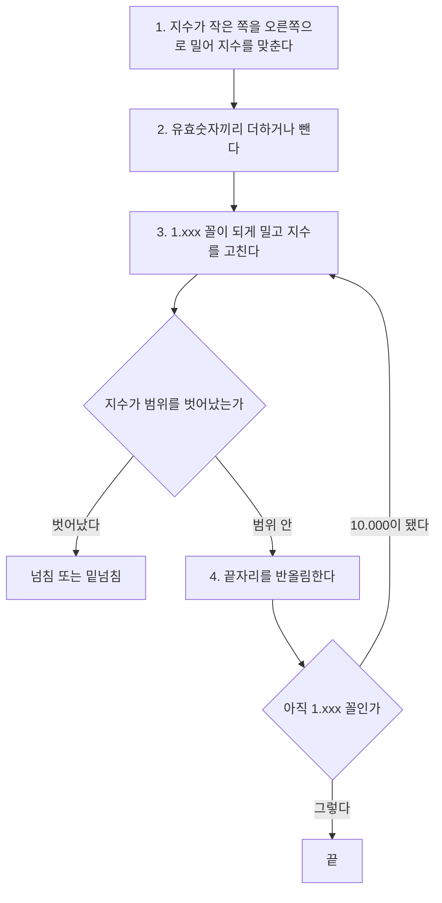


<div class="callout callout-summary" markdown="1">
<div class="callout-title callout-title--default" markdown="span">요약</div>

"몇 곱하기 10의 몇 제곱" 꼴로 적은 두 수를 더하려면 먼저 제곱 부분을 같게 맞춰야 한다. 작은 쪽의 소수점을 옮겨 맞추고, 앞자리 숫자끼리 더하고, 답을 다시 약속한 꼴로 고치고, 칸에 안 들어가는 끝자리를 반올림한다. 컴퓨터도 2진수로 똑같이 한다. 이 순서 덕분에 크기가 아주 다른 수도 같은 회로로 더한다. 대신 맞추느라 밀려난 끝자리가 반올림으로 사라지므로 답이 참값과 조금 어긋나고, 같은 수들을 더해도 더하는 순서에 따라 답이 달라질 수 있다.

</div>


## 예시로 보기

정수는 자리끼리 맞춰 놓고 바로 더한다. 소수점이 있는 수를 [부동소수점](/Hongs_Blog/studies/data-and-information/floating-point/) 꼴로 적어 두면 그렇게 못 한다. 두 수의 소수점 자리가 서로 다르기 때문이다.

10진수로 먼저 본다. 앞자리 숫자를 네 개만 적을 수 있는 기계가 $$9.987 \times 10^{1}$$과 $$2.640 \times 10^{-1}$$을 더한다[^s1].

1. *지수 맞추기:* 작은 쪽을 큰 쪽의 지수로 고친다. $$2.640 \times 10^{-1} = 0.02640 \times 10^{1}$$.
2. *앞자리 더하기:* $$9.987 + 0.02640 = 10.0134$$. 답은 $$10.0134 \times 10^{1}$$.
3. *꼴 고치기:* 소수점 앞에 한 자리만 오게 한다. $$1.00134 \times 10^{2}$$.
4. *반올림:* 네 자리만 남긴다. $$1.001 \times 10^{2}$$.

참값은 100.134인데 기계가 적은 답은 100.1이다. 0.034가 사라졌다.

2진수에서도 순서가 같다. 단정도(32비트)로 $$12.5 + 0.4375$$를 한다. 2진수로 $$12.5 = 1100.1 = 1.1001 \times 2^{3}$$, $$0.4375 = 0.0111 = 1.11 \times 2^{-2}$$다.

| 걸음 | 한 일 | 값 |
|---|---|---|
| 1 | 지수 맞추기. 차이가 5라 작은 쪽을 오른쪽으로 5칸 | $$1.11 \times 2^{-2} = 0.0000111 \times 2^{3}$$ |
| 2 | 앞자리 더하기 | $$1.1001000 + 0.0000111 = 1.1001111$$ |
| 3 | 꼴 고치기. 이미 `1.xxx` 꼴이다 | $$1.1001111 \times 2^{3}$$ |
| 4 | 반올림. 24비트 안에 다 들어간다 | $$1.1001111 \times 2^{3} = 1100.1111 = 12.9375$$ |

비트로는 `0x41480000` + `0x3EE00000` = `0x414F0000`이다.

<div class="callout callout-check" markdown="1">
<div class="callout-title" markdown="span">검증: 위 두 예와 아래 예들의 비트 값을 `struct`로 만든 실제 단정도 값과 대조, 덧셈 절차를 무작위 정규화 수 약 20만 쌍에서 `struct` 결과와 비트 단위로 대조, 곱셈 절차를 약 17만 쌍에서 대조, 더하는 순서에 따라 답이 달라지는 예, `0.1 + 0.2`의 단정도·배정도 값, 카드의 값 — [22_floating-point-arithmetic_impl.py](/Hongs_Blog/studies/computer-architecture/code/22_floating-point-arithmetic_impl/). 실제 회로가 아니라 비트열을 파이썬으로 다룬 것이다.</div>

</div>


## 덧셈 절차

**입력과 출력.** 입력은 단정도 부동소수점 수 둘이다. 여기서는 정규화된 수(지수 칸이 1~254인 수)만 다룬다. 출력은 참값의 합에 가장 가까운 단정도 수다.

용어를 정리한다. 부호 비트를 $$s$$, 지수 칸의 값을 $$E$$, 가수 칸 23비트 앞에 숨은 1을 붙인 24비트를 **유효숫자**라 부른다. 값은 $$(-1)^s \times \text{유효숫자} \times 2^{E-127}$$이다. 유효숫자는 `1.xxx…x` 꼴이다.

```
1. 지수 맞추기:   지수가 작은 쪽의 유효숫자를 지수 차이만큼 오른쪽으로 민다
2. 더하기:        부호가 같으면 유효숫자끼리 더하고, 다르면 큰 쪽에서 작은 쪽을 뺀다
3. 꼴 고치기:     결과가 10.xxx이면 오른쪽으로 한 칸 밀고 지수를 1 올린다
                  결과가 0.0…01xxx이면 1.xxx가 될 때까지 왼쪽으로 밀고 그만큼 지수를 내린다
4. 반올림:        24비트를 넘는 끝자리를 반올림한다
                  반올림으로 10.000이 되면 3으로 돌아가 한 번 더 고친다
5. 지수가 칸의 범위를 벗어났으면 넘침 또는 밑넘침이다
```



절차는 10진수 예의 네 걸음과 같다. 반올림 뒤에 꼴이 깨지면 한 번 더 고친다[^1].

3번의 꼴 고치기를 정규화라 부른다. 3번이 왼쪽으로 여러 칸 미는 경우는 뺄셈에서 생긴다. $$12.5 + (-12.0)$$을 한다.

| 걸음 | 한 일 | 값 |
|---|---|---|
| 1 | 지수가 둘 다 3이라 밀지 않는다 | $$1.1001 \times 2^{3}$$, $$1.1000 \times 2^{3}$$ |
| 2 | 부호가 달라 뺀다 | $$1.1001 - 1.1000 = 0.0001$$ |
| 3 | 왼쪽으로 4칸 밀고 지수를 4 내린다 | $$0.0001 \times 2^{3} = 1.0 \times 2^{-1}$$ |
| 4 | 반올림할 끝자리가 없다 | $$0.5$$ = `0x3F000000` |

**반올림 규칙.** 참값에 가까운 쪽으로 간다. 정확히 가운데면 마지막 비트가 0인 쪽으로 간다(가까운 짝수로 반올림). 늘 올리기만 하면 오차가 한쪽으로 쌓이기 때문이다[^s1].

$$2^{24} = 16{,}777{,}216$$ 근처에서는 단정도가 적을 수 있는 수가 2씩 떨어져 있다. 유효숫자 24비트의 마지막 비트가 2의 자리이기 때문이다.

| 덧셈 | 참값 | 양옆의 적을 수 있는 수 | 답 |
|---|---|---|---|
| $$16{,}777{,}216 + 1$$ | 16,777,217 | 16,777,216과 16,777,218의 정확히 가운데 | 16,777,216 (마지막 비트가 0인 쪽) |
| $$16{,}777{,}216 + 3$$ | 16,777,219 | 16,777,218과 16,777,220의 정확히 가운데 | 16,777,220 (마지막 비트가 0인 쪽) |

첫 줄에서는 1을 더했는데 답이 그대로다.

**밀려난 비트를 얼마나 기억하나.** 1번에서 오른쪽으로 밀려난 비트를 모두 버리면 4번에서 "정확히 가운데인지, 조금 넘는지"를 알 수 없다. 그렇다고 다 들고 있을 수도 없다. 회로는 24비트 아래로 여분 비트를 몇 개 두고, 그보다 더 밀려난 비트에 1이 하나라도 있었는지만 한 비트에 적어 둔다[^2]. 검증 코드는 여분 3비트(마지막은 "밀려난 것 중에 1이 있었다"는 표시)로 20만 쌍에서 맞는 답을 냈다.

### 걸리는 시간

정수 덧셈은 덧셈기를 한 번 지난다. 부동소수점 덧셈은 지수를 견주는 뺄셈, 미는 회로, 유효숫자 덧셈, 다시 미는 회로, 반올림용 덧셈을 차례로 지난다. 그래서 정수 덧셈보다 여러 배 오래 걸린다[^s1].

## 곱셈 절차

곱셈은 지수를 맞출 필요가 없다. $$(a \times 2^{x}) \times (b \times 2^{y}) = (a \times b) \times 2^{x+y}$$이기 때문이다[^3].

```
1. 지수 더하기:      새 지수 칸 = E1 + E2 - 127
2. 유효숫자 곱하기:  24비트 × 24비트 = 48비트
3. 꼴 고치기:        곱이 10.xxx 또는 11.xxx이면 오른쪽으로 한 칸 밀고 지수를 1 올린다
4. 반올림:           24비트만 남긴다. 10.000이 되면 한 번 더 고친다
5. 부호:             두 부호가 같으면 양수, 다르면 음수
```

1번에서 127을 빼는 까닭은 지수 칸이 "진짜 지수 + 127"을 담기 때문이다. 두 칸을 그냥 더하면 127이 두 번 들어가므로 한 번 뺀다.

$$12.5 \times 0.4375$$를 한다.

| 걸음 | 한 일 | 값 |
|---|---|---|
| 1 | 지수 칸 130과 125를 더하고 127을 뺀다 | $$130 + 125 - 127 = 128$$. 진짜 지수는 $$3 + (-2) = 1$$ |
| 2 | 유효숫자를 곱한다 | $$1.1001 \times 1.11 = 10.101111$$ |
| 3 | `10.xxx`라 한 칸 밀고 지수를 올린다 | $$1.0101111 \times 2^{2}$$. 지수 칸 129 |
| 4 | 24비트 안에 들어간다 | $$101.01111 = 5.46875$$ |
| 5 | 둘 다 양수 | `0x40AF0000` |

2번의 곱은 [곱셈 회로](/Hongs_Blog/studies/computer-architecture/multiplier-circuit/)가 한다. 유효숫자는 둘 다 1 이상 2 미만이라 곱은 1 이상 4 미만이다. 그래서 3번은 많아야 한 칸만 민다.

## MIPS에서

부동소수점 수는 정수 레지스터와 따로 있는 레지스터 `$f0`~`$f31`에 둔다[^4].

| 명령 | 하는 일 |
|---|---|
| `add.s $f2, $f4, $f6` | 단정도 덧셈. `sub.s`, `mul.s`, `div.s`도 같은 꼴이다 |
| `add.d $f2, $f4, $f6` | 배정도 덧셈. 배정도 값 하나가 레지스터 둘(`$f4`와 `$f5`)을 쓴다 |
| `lwc1 $f16, 8($sp)` | 메모리에서 꺼내 부동소수점 레지스터에 넣는다. `swc1`은 반대 방향 |
| `c.lt.s $f2, $f4` | 견준 결과를 숨은 비트 하나에 남긴다. `bc1t`, `bc1f`가 그 비트를 보고 분기한다 |

`.s`는 single(단정도), `.d`는 double(배정도)이다. `lwc1`과 `swc1`의 주소는 정수 레지스터로 계산한다.

## 활용

- 구현: [22_floating-point-arithmetic_impl.py](/Hongs_Blog/studies/computer-architecture/code/22_floating-point-arithmetic_impl/)
- **더하는 순서가 답을 바꾼다.** 단정도에서 $$(2^{24} + 1) + 1$$은 $$2^{24}$$이고 $$2^{24} + (1 + 1)$$은 $$2^{24} + 2$$다. 앞의 것은 1을 더할 때마다 반올림으로 사라진다. 뒤의 것은 작은 수끼리 먼저 더해 2가 되어 살아남는다. 정수 덧셈과 달리 묶는 순서를 바꾸면 안 된다[^5]. 작은 수부터 더하면 오차가 줄어든다.
- 크기가 비슷한 두 수를 빼면 앞자리가 서로 지워진다. $$12.5 - 12.0$$에서 유효숫자 다섯 비트 가운데 넷이 사라졌다. 입력에 이미 오차가 있었다면 남은 비트는 대부분 오차다.
- 흔한 실수: `0.1 + 0.2 == 0.3`을 기대하는 것. 0.1과 0.2는 2진수로 딱 떨어지지 않아 넣을 때 이미 반올림된다. 배정도에서 `0.1 + 0.2`는 0.30000000000000004다. 단정도에서는 반올림이 마침 같은 쪽으로 떨어져 두 쪽의 비트가 같지만(`0x3E99999A`), 그것을 믿고 `==`로 견주면 안 된다.

## 연결

- 선수: 비트 세 토막(부호, 지수, 가수)과 127을 빼는 까닭은 [부동소수점](/Hongs_Blog/studies/data-and-information/floating-point/)에 있다. 이 문서는 그 표현으로 계산하는 순서를 다룬다.
- 유효숫자를 더하고 곱하는 회로: [가산기](/Hongs_Blog/studies/computer-architecture/adder-circuit/), [곱셈 회로](/Hongs_Blog/studies/computer-architecture/multiplier-circuit/)
- 정수 명령과 견주기: [MIPS 산술·논리 명령](/Hongs_Blog/studies/computer-architecture/mips-arithmetic-logic/). 정수는 넘치면 예외를 내거나 위쪽 비트를 버린다. 부동소수점은 끝자리를 반올림한다.

## 확인 문제

<details class="callout callout-question" markdown="1">
<summary class="callout-title" markdown="span">**C1** 단정도로 $$5.0 + 0.375$$를 한다. 두 수를 `1.xxx × 2^e` 꼴로 쓰고, 지수를 맞춘 뒤의 두 유효숫자, 더한 결과, 답의 16진 비트를 구하라. $$5.0$$ = `0x40A00000`, $$0.375$$ = `0x3EC00000`이다.</summary>

**답:** $$5.0 = 1.01 \times 2^{2}$$, $$0.375 = 1.1 \times 2^{-2}$$. 지수 차이 4라 작은 쪽이 $$0.00011 \times 2^{2}$$. 더하면 $$1.01011 \times 2^{2} = 101.011 = 5.375$$. 비트는 `0x40AC0000`.<br>
**이유:** 지수 칸 $$2 + 127 = 129$$ = `10000001`, 가수 `01011000…`. 부호 0과 이으면 `0100 0000 1010 1100 …`이다.

</details>


<details class="callout callout-question" markdown="1">
<summary class="callout-title" markdown="span">**C2** 덧셈 절차의 1번에서 지수가 큰 쪽이 아니라 작은 쪽을 미는 까닭을 한 문장으로 쓰라.</summary>

**답:** 오른쪽으로 밀면 밀려나 사라지는 것이 값의 가장 작은 끝자리들인데, 큰 쪽을 왼쪽으로 밀어 맞추면 가장 큰 앞자리가 칸 밖으로 나가 답이 크게 틀리기 때문이다.

</details>


<details class="callout callout-question" markdown="1">
<summary class="callout-title" markdown="span">**C3** 단정도 변수 `x`에 16,777,216.0을 넣고 `x = x + 1.0`을 백 번 해도 `x`가 그대로인 까닭을 반올림 규칙으로 설명하라. 같은 일을 하려면 어떻게 고치는가?</summary>

**답:** 16,777,216 근처에서 단정도가 적을 수 있는 수는 2씩 떨어져 있다. 16,777,217은 16,777,216과 16,777,218의 정확히 가운데이고, 규칙에 따라 마지막 비트가 0인 16,777,216으로 간다. 매번 같은 일이 되풀이된다. 고치는 법: 더할 1.0들을 먼저 따로 모아 100.0을 만든 뒤 한 번에 더한다(답 16,777,316). 또는 배정도를 쓴다.<br>
**이유:** 덧셈의 순서를 바꾸면 답이 달라지는 예다. 작은 수끼리 먼저 더하면 반올림으로 사라지지 않는다.

</details>


<details class="callout callout-question" markdown="1">
<summary class="callout-title" markdown="span">**C4** 단정도 곱셈 $$6.0 \times 1.5$$를 절차대로 하라. $$6.0$$ = `0x40C00000`(지수 칸 129), $$1.5$$ = `0x3FC00000`(지수 칸 127)이다. 3번에서 미는가?</summary>

**답:** 지수 칸 $$129 + 127 - 127 = 129$$. 유효숫자 $$1.1 \times 1.1 = 10.01$$. `10.xxx`라 한 칸 밀어 $$1.001$$, 지수 칸 130. 답은 $$1.001 \times 2^{3} = 1001 = 9.0$$ = `0x41100000`.<br>
**이유:** 2진수 $$1.1$$은 1.5이고 $$1.5 \times 1.5 = 2.25 = 10.01$$이다. 2 이상이 되었으므로 꼴을 고친다.

</details>


[^1]: University of Utah CS3810 (R. Balasubramonian), Lecture 9 "Floating Point", https://users.cs.utah.edu/~rajeev/cs3810/slides/3810-15-09.pdf, 슬라이드 15~16 (10진수 네 자리 예로 본 덧셈: 큰 지수로 맞추기, 더하기, 정규화, 넘침·밑넘침 확인, 반올림, 다시 정규화). Patterson & Hennessy, *Computer Organization and Design* (MIPS Edition), 3장 "Arithmetic for Computers"
[^2]: Patterson & Hennessy, 같은 책, 3장 (보호 비트 guard, 반올림 비트 round, 점착 비트 sticky로 중간 계산의 정밀도를 지키는 설명)
[^3]: University of Utah CS3810, Lecture 9, 같은 자료, 슬라이드 17 (곱셈: 지수 계산, 유효숫자 곱하기, 정규화, 반올림, 부호), 12 (바이어스 127, 값 = (−1)^S × (1 + Fraction) × 2^(Exponent − Bias))
[^4]: 같은 자료, 슬라이드 18 (add.s·add.d·sub·mul·div, 비교가 숨은 비트를 세우고 bc1t·bc1f가 본다, `$f0`~`$f31`, 배정도는 레지스터 둘, lwc1·swc1의 주소는 정수 레지스터로). MIPS Reference Data(Green Sheet), https://www.comp.nus.edu.sg/~cs2100/lect/MIPS_Reference_Data_page1.pdf (ARITHMETIC CORE INSTRUCTION SET: add.s, add.d, mul.s, lwc1, swc1, c.x.s, bc1t, bc1f)
[^5]: University of Utah CS3810, Lecture 3 "MIPS Instruction Set", https://users.cs.utah.edu/~rajeev/cs3810/slides/3810-15-03.pdf, 슬라이드 8 (부동소수점 연산은 결합법칙·교환법칙이 꼭 맞지는 않아 계산 순서에 따라 결과가 다를 수 있다)
[^s1]: <span class="fn-tag" title="수업 자료에 없고 따로 보탠 내용">보충</span> 10진수 예의 수치(Utah 슬라이드의 예와 다른 수로 새로 만들었다), 2진수 예 넷의 걸음별 표, 흐름 다이어그램, 가까운 짝수로 반올림하는 까닭, $$2^{24}$$ 근처의 표, 걸리는 시간의 설명, 활용 절의 예, 카드는 위 자료에 그대로 있지 않다. 모든 비트 값은 구현 코드의 절차로 구하고 파이썬 `struct`가 만든 단정도 값과 대조했다. 반올림 규칙은 IEEE 754 표준의 기본 방식이다.

