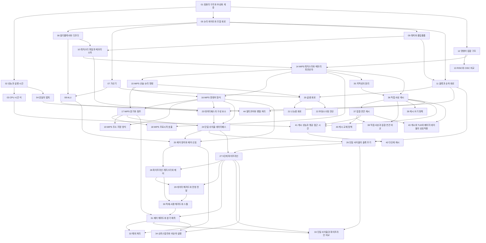


## 먼저 알아야 할 것
- [불 대수와 논리 회로](/Hongs_Blog/studies/discrete-math/boolean-algebra/) (공학수학 이산수학): AND·OR·NOT과 진리표. 1단원의 게이트와 가산기가 여기서 출발한다
- [정수의 2진 표현과 2의 보수](/Hongs_Blog/studies/data-and-information/twos-complement/), [부동소수점](/Hongs_Blog/studies/data-and-information/floating-point/) (2-1학기 자료와 정보): 음수와 실수를 비트로 적는 법. 가산기와 부동소수점 연산이 쓴다

> 자료 출처: 이 과목은 강의 자료가 남아 있지 않다. 모든 문서는 Patterson & Hennessy, *Computer Organization and Design*(MIPS판)의 장 구성을 따라, 공개된 대학 강의 자료(MIT 6.004, Utah CS 3810, Princeton COS 375, CS61C 계열 등)를 직접 열어 확인한 내용으로 새로 썼다. 그래서 단위가 강의 회차가 아니라 단원이고, 강조 표시와 시험 범위는 없다. 책은 장 수준으로만 인용했다. 명령어는 MIPS이고, 회로와 파이프라인·캐시의 동작은 실제 하드웨어가 아니라 파이썬 흉내기로 확인했다.

## 1단원 · 성능과 논리 회로

읽기 전에

1. 3 GHz 프로세서와 2 GHz 프로세서 가운데 2 GHz 쪽이 더 빨리 끝낼 수 있을까? 그렇다면 무엇 때문일까? → [CPU 시간 식](/Hongs_Blog/studies/computer-architecture/cpu-time-equation/)
2. 프로그램 시간의 4분의 3을 차지하는 부분을 끝없이 빠르게 만들면 전체는 몇 배까지 빨라질까? → [암달의 법칙](/Hongs_Blog/studies/computer-architecture/amdahls-law/)
3. 레지스터의 값에 수를 더해 다시 그 레지스터에 넣는 회로에서, 더한 값이 돌아와 또 더해지지 않게 막는 것은 무엇일까? → [클록과 순차 회로](/Hongs_Blog/studies/computer-architecture/clocked-sequential-logic/)

| 번호 | 개념 | 한 줄 | 개념 코드 | 연습 |
|---|---|---|---|---|
| 01 | [컴퓨터 구조와 추상화 계층](/Hongs_Blog/studies/computer-architecture/computer-abstraction-layers/) | 층마다 아래를 가리고, 명령어 집합이 소프트웨어와 하드웨어의 경계 | [verify](/Hongs_Blog/studies/computer-architecture/code/01_computer-abstraction-layers_verify/) | — |
| 02 | [성능과 실행 시간](/Hongs_Blog/studies/computer-architecture/cpu-performance/) | 성능 = 1 ÷ 실행 시간, 응답 시간과 처리량, 경과 시간과 CPU 시간 | [verify](/Hongs_Blog/studies/computer-architecture/code/02_cpu-performance_verify/) | — |
| 03 | [CPU 시간 식](/Hongs_Blog/studies/computer-architecture/cpu-time-equation/) | CPU 시간 = 명령어 수 × CPI × 클록 주기 | [verify](/Hongs_Blog/studies/computer-architecture/code/03_cpu-time-equation_verify/) | [CPU 시간 계산 예제 사다리](/Hongs_Blog/studies/computer-architecture/cpu-time-ladder/) · [문제 코드](/Hongs_Blog/studies/computer-architecture/code/03_cpu-time-ladder_p4/) |
| 04 | [암달의 법칙](/Hongs_Blog/studies/computer-architecture/amdahls-law/) | 일부만 $$s$$배 빨라지면 전체는 $$1/((1-p)+p/s)$$배, 한계는 $$1/(1-p)$$ | [verify](/Hongs_Blog/studies/computer-architecture/code/04_amdahls-law_verify/) | — |
| 05 | [논리 게이트와 조합 회로](/Hongs_Blog/studies/computer-architecture/combinational-logic/) | 진리표에서 곱의 합으로 회로 만들기, 지연은 가장 긴 길이 정한다 | [verify](/Hongs_Blog/studies/computer-architecture/code/05_combinational-logic_verify/) | — |
| 06 | [멀티플렉서와 디코더](/Hongs_Blog/studies/computer-architecture/mux-decoder/) | 여럿 가운데 하나를 고르는 회로와 번호를 선 하나로 바꾸는 회로 | [verify](/Hongs_Blog/studies/computer-architecture/code/06_mux-decoder_verify/) | — |
| 07 | [가산기](/Hongs_Blog/studies/computer-architecture/adder-circuit/) | 전가산기를 줄지어 세운 덧셈·뺄셈 회로, 넘침, 올림 예측 $$c_{i+1} = g_i + p_i c_i$$ | [verify](/Hongs_Blog/studies/computer-architecture/code/07_adder-circuit_verify/) | — |
| 08 | [ALU](/Hongs_Blog/studies/computer-architecture/alu/) | 1비트 ALU를 이어 붙여 제어선 4비트로 AND·OR·덧셈·뺄셈·slt·NOR를 고른다 | [verify](/Hongs_Blog/studies/computer-architecture/code/08_alu_verify/) | — |
| 09 | [래치와 플립플롭](/Hongs_Blog/studies/computer-architecture/latch-flip-flop/) | 열린 동안 따라가는 래치와 에지 한순간만 찍는 플립플롭 | [verify](/Hongs_Blog/studies/computer-architecture/code/09_latch-flip-flop_verify/) | — |
| 10 | [레지스터 파일과 메모리 소자](/Hongs_Blog/studies/computer-architecture/register-file/) | 읽기는 멀티플렉서 둘, 쓰기는 디코더와 쓰기 허용, 쓰기는 에지에서만 | [verify](/Hongs_Blog/studies/computer-architecture/code/10_register-file_verify/) | — |
| 11 | [클록과 순차 회로](/Hongs_Blog/studies/computer-architecture/clocked-sequential-logic/) | 상태 소자 사이에 조합 회로, 주기 ≥ clk-to-q + 가장 긴 조합 지연 + 준비 시간 | [verify](/Hongs_Blog/studies/computer-architecture/code/11_clocked-sequential-logic_verify/) | — |

자료: 
필기: 아직 없다.
떠올려 보기: 노트를 닫고 CPU 시간 식의 세 수를 쓴 뒤, 게이트에서 출발해 가산기·ALU·레지스터 파일까지 무엇을 이어 무엇을 만드는지 차례로 적고, 클록 주기가 그 가운데 어디서 정해지는지 적어 본다.

## 2단원 · 명령어 집합과 산술

읽기 전에

1. `add $t0, $s1, $s2`라는 글자는 프로세서에 어떤 수로 들어갈까? 그 32비트의 어디가 "더하라"이고 어디가 "$s1"일까? → [MIPS 명령어 형식](/Hongs_Blog/studies/computer-architecture/mips-instruction-formats/)
2. 함수가 끝나면 부른 자리로 돌아와야 한다. 돌아갈 주소를 칸 하나에만 적어 둔다면, 함수가 또 함수를 부를 때 무슨 일이 생길까? → [MIPS 프로시저 호출](/Hongs_Blog/studies/computer-architecture/mips-procedure-call/)
3. 단정도 실수 16,777,216.0에 1.0을 백 번 더하면 얼마가 될까? → [부동소수점 연산](/Hongs_Blog/studies/computer-architecture/floating-point-arithmetic/)

| 번호 | 개념 | 한 줄 | 개념 코드 | 연습 |
|---|---|---|---|---|
| 12 | [명령어 집합 구조](/Hongs_Blog/studies/computer-architecture/instruction-set-architecture/) | 프로그램과 프로세서 사이의 약속. 명령도 수로 적어 데이터와 같은 메모리에 둔다 | [verify](/Hongs_Blog/studies/computer-architecture/code/12_instruction-set-architecture_verify/) | — |
| 13 | [RISC와 CISC 비교](/Hongs_Blog/studies/computer-architecture/risc-vs-cisc/) | 계산 명령이 메모리를 만지는가, 길이가 같은가로 갈리는 두 설계 (MIPS와 x86) | [verify](/Hongs_Blog/studies/computer-architecture/code/13_risc-vs-cisc_verify/) | — |
| 14 | [MIPS 레지스터와 메모리 피연산자](/Hongs_Blog/studies/computer-architecture/mips-operands/) | 레지스터 32개에서만 계산하고 `lw`·`sw`로만 메모리를 오간다. 원소 번호 × 4 | [verify](/Hongs_Blog/studies/computer-architecture/code/14_mips-operands_verify/) | — |
| 15 | [MIPS 산술·논리 명령](/Hongs_Blog/studies/computer-architecture/mips-arithmetic-logic/) | 재료 둘, 결과 하나. 즉시값 16비트는 명령에 따라 부호 확장 또는 제로 확장 | [verify](/Hongs_Blog/studies/computer-architecture/code/15_mips-arithmetic-logic_verify/) | — |
| 16 | [MIPS 명령어 형식](/Hongs_Blog/studies/computer-architecture/mips-instruction-formats/) | 32비트를 R·I·J 세 가지로 자른다. op가 형식을, funct가 R형식의 명령을 정한다 | [impl](/Hongs_Blog/studies/computer-architecture/code/16_mips-instruction-formats_impl/) | [명령어 인코딩 예제 사다리](/Hongs_Blog/studies/computer-architecture/mips-encoding-ladder/) · [문제 코드](/Hongs_Blog/studies/computer-architecture/code/16_mips-encoding-ladder_p4/) |
| 17 | [MIPS 분기와 점프](/Hongs_Blog/studies/computer-architecture/mips-branch-jump/) | `beq`·`bne`·`j`로 갈림과 되풀이를 만든다. 크기 비교는 `slt`를 앞에 둔다 | [verify](/Hongs_Blog/studies/computer-architecture/code/17_mips-branch-jump_verify/) | — |
| 18 | [MIPS 프로시저 호출](/Hongs_Blog/studies/computer-architecture/mips-procedure-call/) | `jal`이 `$ra`에 돌아갈 주소를 넣고, 지킬 레지스터와 스택 쓰는 법은 약속이 정한다 | [verify](/Hongs_Blog/studies/computer-architecture/code/18_mips-procedure-call_verify/) | — |
| 19 | [MIPS 주소 지정 방식](/Hongs_Blog/studies/computer-architecture/mips-addressing-modes/) | 다섯 가지 가리키는 법. 분기는 $$(\mathrm{PC}+4) + imm \times 4$$, 점프는 위 4비트 + 26비트 + 00 | [verify](/Hongs_Blog/studies/computer-architecture/code/19_mips-addressing-modes_verify/) | — |
| 20 | [곱셈 회로](/Hongs_Blog/studies/computer-architecture/multiplier-circuit/) | 맨 아랫비트가 1이면 더하고 민다를 $$n$$번. 답은 $$2n$$비트라 Hi·Lo에 담는다 | [impl](/Hongs_Blog/studies/computer-architecture/code/20_multiplier-circuit_impl/) | — |
| 21 | [나눗셈 회로](/Hongs_Blog/studies/computer-architecture/divider-circuit/) | 빼 보고 음수면 되돌린다를 $$n+1$$번. 몫은 Lo, 나머지는 Hi | [impl](/Hongs_Blog/studies/computer-architecture/code/21_divider-circuit_impl/) | — |
| 22 | [부동소수점 연산](/Hongs_Blog/studies/computer-architecture/floating-point-arithmetic/) | 지수 맞추기 → 더하기 → 꼴 고치기 → 반올림. 더하는 순서가 답을 바꾼다 | [impl](/Hongs_Blog/studies/computer-architecture/code/22_floating-point-arithmetic_impl/) | — |

자료: 
필기: 아직 없다.
떠올려 보기: 노트를 닫고 C의 `sum += A[i]` 한 줄이 MIPS 명령 몇 줄로, 다시 32비트 수로 바뀌는 길을 적고, 그 길에서 "16비트 칸"이 만드는 제약 세 가지(상수, 분기 거리, 오프셋)를 써 본다.

## 3단원 · 프로세서

읽기 전에

1. 명령어 하나를 한 사이클에 끝내는 프로세서의 클록은 왜 가장 느린 명령어에 맞춰야 할까? 어느 명령어가 가장 느릴까? → [단일 사이클의 클록 주기](/Hongs_Blog/studies/computer-architecture/single-cycle-timing/)
2. 명령어를 다섯 걸음으로 나눠 겹쳐 흘리면 명령어 하나가 끝나는 시간도 5분의 1로 줄까? → [5단계 파이프라인](/Hongs_Blog/studies/computer-architecture/mips-pipeline/)
3. 바로 앞 명령어가 계산한 값이 아직 레지스터에 적히지 않았는데 뒤 명령어가 그 값을 써야 한다. 기다리지 않고 풀 방법이 있을까, 그리고 그 방법이 안 통하는 경우는? → [데이터 해저드와 전방 전달](/Hongs_Blog/studies/computer-architecture/data-hazard-forwarding/)

| 번호 | 개념 | 한 줄 | 개념 코드 | 연습 |
|---|---|---|---|---|
| 23 | [데이터패스의 구성 요소](/Hongs_Blog/studies/computer-architecture/datapath-elements/) | 값이 흐르는 길 위의 부품들. 기억하는 부품(PC, 레지스터 파일, 데이터 메모리)과 계산하는 부품(ALU, 가산기, 부호 확장, 멀티플렉서) | [verify](/Hongs_Blog/studies/computer-architecture/code/23_datapath-elements_verify/) | — |
| 24 | [단일 사이클 데이터패스](/Hongs_Blog/studies/computer-architecture/single-cycle-datapath/) | 한 사이클에 명령어 하나를 끝내는 회로. R형·`lw`·`sw`·`beq`·`j`가 지나는 길 | [impl](/Hongs_Blog/studies/computer-architecture/code/24_single-cycle-datapath_impl/) | — |
| 25 | [제어 장치와 제어 신호](/Hongs_Blog/studies/computer-architecture/control-unit/) | opcode를 보고 갈림길과 쓰기 스위치를 정하는 표. PCSrc = Branch · Zero, ALUOp와 funct로 ALU 제어 4비트 | [verify](/Hongs_Blog/studies/computer-architecture/code/25_control-unit_verify/) | [데이터패스 추적 예제 사다리](/Hongs_Blog/studies/computer-architecture/datapath-tracing-ladder/) |
| 26 | [단일 사이클의 클록 주기](/Hongs_Blog/studies/computer-architecture/single-cycle-timing/) | 클록 주기는 가장 긴 길(`lw`)의 부품 시간 합. $$T_c \ge \max(\sum t)$$ | [verify](/Hongs_Blog/studies/computer-architecture/code/26_single-cycle-timing_verify/) | — |
| 27 | [5단계 파이프라인](/Hongs_Blog/studies/computer-architecture/mips-pipeline/) | IF·ID·EX·MEM·WB로 잘라 겹쳐 흘리기. $$n$$개에 $$n + 4$$사이클, 주기는 가장 긴 단계 | [impl](/Hongs_Blog/studies/computer-architecture/code/27_mips-pipeline_impl/) | — |
| 28 | [파이프라인 레지스터와 제어](/Hongs_Blog/studies/computer-architecture/pipeline-registers/) | 단계 사이에서 값과 제어 신호(9 → 5 → 2비트)를 실어 나르는 IF/ID, ID/EX, EX/MEM, MEM/WB | [verify](/Hongs_Blog/studies/computer-architecture/code/28_pipeline-registers_verify/) | — |
| 29 | [데이터 해저드와 전방 전달](/Hongs_Blog/studies/computer-architecture/data-hazard-forwarding/) | 아직 레지스터에 안 적힌 결과를 EX/MEM(10)·MEM/WB(01)에서 당겨 쓰는 조건 | — | — |
| 30 | [적재-사용 해저드와 스톨](/Hongs_Blog/studies/computer-architecture/load-use-stall/) | `lw` 바로 뒤에서 그 값을 쓰면 한 사이클 쉬고 거품을 넣는다 | — | — |
| 31 | [제어 해저드와 분기 예측](/Hongs_Blog/studies/computer-architecture/control-hazard-branch-prediction/) | 분기가 정해지기 전에 가져온 명령어를 버리기(MEM 판정 3개, ID 판정 1개)와 1비트·2비트 예측기 | [verify](/Hongs_Blog/studies/computer-architecture/code/31_control-hazard-branch-prediction_verify/) | [파이프라인 해저드 예제 사다리](/Hongs_Blog/studies/computer-architecture/pipeline-hazard-ladder/) |
| 32 | [예외 처리](/Hongs_Blog/studies/computer-architecture/processor-exceptions/) | 넘침·정의 안 된 명령어가 나면 EPC와 Cause를 적고 처리기로. 앞선 것은 끝내고 뒤는 버린다 | — | — |
| 33 | [단일 사이클과 파이프라인 비교](/Hongs_Blog/studies/computer-architecture/single-cycle-vs-pipeline/) | CPI 1에 긴 주기 대 CPI 1 + 손실에 짧은 주기. CPU 시간 식으로 견주기 | — | — |
| 34 | [슈퍼스칼라와 비순차 실행](/Hongs_Blog/studies/computer-architecture/superscalar-out-of-order/) | 한 사이클에 여러 명령어를 시작하고 준비된 것부터 실행하되 확정은 순서대로 | [verify](/Hongs_Blog/studies/computer-architecture/code/34_superscalar-out-of-order_verify/) | — |

자료: 
필기: 아직 없다.
떠올려 보기: 노트를 닫고 `lw` 하나가 단일 사이클 데이터패스에서 지나는 부품을 차례로 적은 뒤, 그 길을 다섯 단계로 자르면 어떤 해저드 세 가지가 생기고 각각 어떻게 푸는지 써 본다.

## 4단원 · 메모리 계층과 병렬

읽기 전에

1. 16 × 16 배열을 행 순서로 읽을 때와 열 순서로 읽을 때, 하는 일은 같은데 왜 한쪽만 캐시에서 매번 실패할까? → [지역성의 원리](/Hongs_Blog/studies/computer-architecture/locality-principle/)
2. 캐시의 절반이 비어 있는데도 두 블록이 서로를 계속 쫓아내는 일이 왜 생기고, 무엇을 바꾸면 없어질까? → [직접 사상 캐시](/Hongs_Blog/studies/computer-architecture/direct-mapped-cache/)
3. 적중률 99%인 캐시와 97%인 캐시는 속도가 얼마나 다를까? → [캐시 성능과 평균 접근 시간](/Hongs_Blog/studies/computer-architecture/cache-performance-amat/)

| 번호 | 개념 | 한 줄 | 개념 코드 | 연습 |
|---|---|---|---|---|
| 35 | [지역성의 원리](/Hongs_Blog/studies/computer-architecture/locality-principle/) | 방금 쓴 곳과 그 옆을 곧 다시 쓰는 프로그램의 버릇 | [verify](/Hongs_Blog/studies/computer-architecture/code/35_locality-principle_verify/) | — |
| 36 | [직접 사상 캐시](/Hongs_Blog/studies/computer-architecture/direct-mapped-cache/) | 주소를 태그·인덱스·오프셋으로 잘라 블록마다 줄 하나를 정해 주는 캐시 | [impl](/Hongs_Blog/studies/computer-architecture/code/36_direct-mapped-cache_impl/) | — |
| 37 | [집합 연관 캐시](/Hongs_Blog/studies/computer-architecture/set-associative-cache/) | 블록이 갈 자리를 $$n$$개 묶음으로 정해 서로 쫓아내는 일을 줄이는 캐시 | [impl](/Hongs_Blog/studies/computer-architecture/code/37_set-associative-cache_impl/) | [캐시 적중과 실패 추적 예제 사다리](/Hongs_Blog/studies/computer-architecture/cache-tracing-ladder/) · [문제 코드](/Hongs_Blog/studies/computer-architecture/code/37_cache-tracing-ladder_p4/) |
| 38 | [직접 사상과 집합 연관 비교](/Hongs_Blog/studies/computer-architecture/direct-vs-associative-cache/) | 볼 곳에 자리가 하나인가 여럿인가, 적중 시간과 충돌 실패의 맞바꿈 | — | — |
| 39 | [캐시 쓰기 정책](/Hongs_Blog/studies/computer-architecture/cache-write-policy/) | 고친 사본을 언제 메모리에 쓸지: 고칠 때마다 또는 내보낼 때, 더티 비트와 쓰기 버퍼 | [verify](/Hongs_Blog/studies/computer-architecture/code/39_cache-write-policy_verify/) | — |
| 40 | [캐시 교체 정책](/Hongs_Blog/studies/computer-architecture/cache-replacement/) | 자리가 찼을 때 내보낼 블록 고르기: LRU, FIFO, 무작위 | [verify](/Hongs_Blog/studies/computer-architecture/code/40_cache-replacement_verify/) | — |
| 41 | [캐시 성능과 평균 접근 시간](/Hongs_Blog/studies/computer-architecture/cache-performance-amat/) | 평균 접근 시간 = 적중 시간 + 실패율 × 실패 손실, 실패의 세 원인(강제·용량·충돌) | [verify](/Hongs_Blog/studies/computer-architecture/code/41_cache-performance-amat_verify/) | — |
| 42 | [다단계 캐시](/Hongs_Blog/studies/computer-architecture/multilevel-cache/) | 작고 빠른 캐시 뒤에 큰 캐시를 두는 구성, 지역 실패율과 전역 실패율 | [verify](/Hongs_Blog/studies/computer-architecture/code/42_multilevel-cache_verify/) | — |
| 43 | [캐시와 TLB와 페이지 테이블의 상호작용](/Hongs_Blog/studies/computer-architecture/cache-tlb-interaction/) | 한 번의 메모리 접근이 TLB, 페이지 표, 캐시를 거치는 길과 일어날 수 없는 조합 | [verify](/Hongs_Blog/studies/computer-architecture/code/43_cache-tlb-interaction_verify/) | — |
| 44 | [멀티코어와 병렬 처리](/Hongs_Blog/studies/computer-architecture/multicore-parallelism/) | 코어 여럿에 일 나누기, 플린 분류, 나눌 수 없는 부분이 정하는 천장 $$1/(1-F)$$ | [verify](/Hongs_Blog/studies/computer-architecture/code/44_multicore-parallelism_verify/) | — |

자료: 
필기: 아직 없다.
떠올려 보기: 노트를 닫고 주소 하나가 캐시에서 적중인지 실패인지 정해지기까지의 순서(자르기, 줄 고르기, 태그 비교)를 쓰고, 실패를 줄이는 손잡이 세 가지(캐시 크기, way 수, 블록 크기)가 평균 접근 시간의 어느 항을 바꾸는지 적어 본다.

## 다른 과목과의 연결
- [MIPS 레지스터와 메모리 피연산자](/Hongs_Blog/studies/computer-architecture/mips-operands/), [RISC와 CISC 비교](/Hongs_Blog/studies/computer-architecture/risc-vs-cisc/) ↔ [x86 레지스터](/Hongs_Blog/studies/assembly-language/x86-registers/) (2-1학기 어셈블리어): 레지스터 32개에 길이가 같은 명령과, 레지스터 8개에 길이가 제각각인 명령
- [5단계 파이프라인](/Hongs_Blog/studies/computer-architecture/mips-pipeline/), [슈퍼스칼라와 비순차 실행](/Hongs_Blog/studies/computer-architecture/superscalar-out-of-order/) ↔ [파이프라인과 슈퍼스칼라](/Hongs_Blog/studies/assembly-language/instruction-pipeline/) (2-1학기 어셈블리어): 그쪽이 뺀 '기다림'이 여기서는 해저드다
- [MIPS 산술·논리 명령](/Hongs_Blog/studies/computer-architecture/mips-arithmetic-logic/), [MIPS 프로시저 호출](/Hongs_Blog/studies/computer-architecture/mips-procedure-call/) ↔ [수업용 MIPS 명령어](/Hongs_Blog/studies/compilers/mips-instructions/) (3-2학기 컴파일러): 컴파일러 수업의 줄인 표기와 실제 MIPS 문법
- [단일 사이클 데이터패스](/Hongs_Blog/studies/computer-architecture/single-cycle-datapath/) ↔ [명령어 사이클](/Hongs_Blog/studies/operating-systems/instruction-cycle/) (3-1학기 운영체제): 인출과 실행을 부품으로 그린 것
- [지역성의 원리](/Hongs_Blog/studies/computer-architecture/locality-principle/), [직접 사상 캐시](/Hongs_Blog/studies/computer-architecture/direct-mapped-cache/), [캐시와 TLB와 페이지 테이블의 상호작용](/Hongs_Blog/studies/computer-architecture/cache-tlb-interaction/) ↔ [메모리 계층](/Hongs_Blog/studies/operating-systems/memory-hierarchy/), [캐시 메모리](/Hongs_Blog/studies/operating-systems/cache-memory/), [TLB](/Hongs_Blog/studies/operating-systems/tlb/) (3-1학기 운영체제): 운영체제가 겉에서 본 캐시의 속 구조

## 흐름


