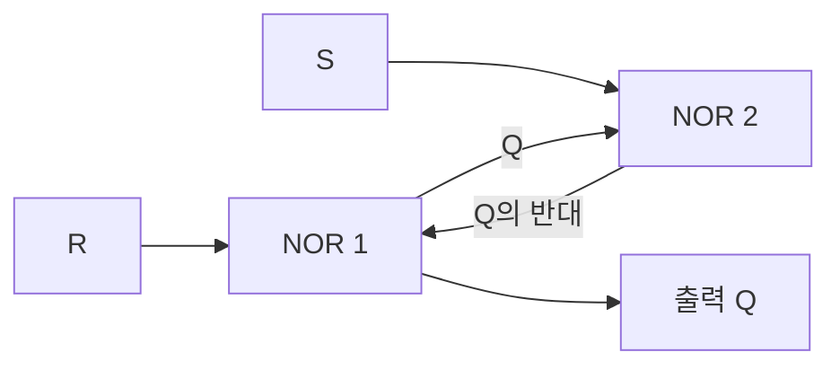
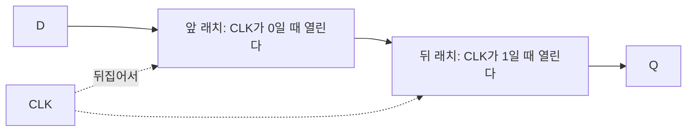



요약

비트 하나를 붙들고 있는 회로다. 작은 부품 두 개의 출력을 서로의 입력에 물려 놓으면, 한 번 들어온 값이 고리를 돌며 계속 남는다. 래치는 문이 열려 있는 동안 들어오는 값을 계속 따라가고, 문이 닫히면 마지막 값을 붙든다. 플립플롭은 박자가 오는 그 순간에 들어와 있던 값만 찍는 카메라 셔터와 같다. 프로세서는 값이 바뀌는 때를 한순간으로 모을 수 있는 플립플롭을 쓴다. 다만 찍는 순간 앞뒤로 잠깐은 입력이 가만히 있어야 하고, 그러지 않으면 무슨 값이 찍힐지 알 수 없다.

## 예시로 보기

게이트를 고리 없이 이은 회로는 입력이 사라지면 출력도 사라진다. 프로세서는 계산한 값을 다음 명령까지 들고 있어야 하므로, 값을 붙드는 부품이 따로 필요하다.

같은 입력 $$D$$를 래치와 플립플롭에 함께 넣고 박자 신호 CLK를 올렸다 내렸다 한다. 래치는 CLK가 1인 동안 열리고, 플립플롭은 CLK가 0에서 1로 오르는 순간에 찍는다. 두 출력은 처음에 0이다.

| 시각 | CLK | $$D$$ | 래치의 출력 | 플립플롭의 출력 | 무슨 일 |
|---|---|---|---|---|---|
| 1 | 0 | 0 | 0 | 0 | |
| 2 | 0 | 1 | 0 | 0 | 래치는 닫혀 있어 $$D$$를 못 본다 |
| 3 | 1 | 1 | 1 | 1 | CLK가 올랐다. 플립플롭이 $$D = 1$$을 찍는다 |
| 4 | 1 | 0 | 0 | 1 | 래치만 따라 내려간다 |
| 5 | 1 | 1 | 1 | 1 | 래치만 따라 올라간다 |
| 6 | 0 | 1 | 1 | 1 | 래치가 닫히며 1을 붙든다 |
| 7 | 0 | 0 | 1 | 1 | 둘 다 그대로다 |
| 8 | 1 | 0 | 0 | 0 | CLK가 올랐다. 플립플롭이 $$D = 0$$을 찍는다 |
| 9 | 1 | 1 | 1 | 0 | 래치만 따라 올라간다 |
| 10 | 0 | 1 | 1 | 0 | |
| 11 | 1 | 1 | 1 | 1 | CLK가 올랐다. 플립플롭이 $$D = 1$$을 찍는다 |
| 12 | 0 | 0 | 1 | 1 | |

플립플롭의 출력은 시각 3, 8, 11에서만 바뀐다. CLK가 오르는 순간이다. 시각 4, 5, 9처럼 CLK가 1인 동안 $$D$$가 흔들려도 플립플롭은 꿈쩍하지 않고, 래치는 그대로 따라 흔들린다.

검증: NOR 두 개로 만든 SR 래치, 그 위에 만든 D 래치와 D 플립플롭을 흉내 내어 위 표 12줄, 무작위 5,000걸음에서 "래치는 열린 동안 따라가고 닫히면 붙든다"와 "플립플롭은 오르는 순간의 값만 찍는다", 카드 C2 — [09_latch-flip-flop_verify.py](/Hongs_Blog/studies/computer-architecture/code/09_latch-flip-flop_verify/) (실제 하드웨어가 아니라 파이썬 흉내. 게이트 지연과 준비·유지 시간은 다루지 않고 값이 가라앉은 뒤의 상태만 계산한다)

## 구조

**고리로 붙들기: SR 래치.** NOR 게이트 두 개를 서로의 입력에 물린다[^1].

$$Q = \overline{R + \bar Q}$$, $$\bar Q = \overline{S + Q}$$다. 두 게이트가 서로의 출력을 받아 고리를 이룬다[^s1].

| $$S$$ | $$R$$ | $$Q$$ |
|---|---|---|
| 1 | 0 | 1이 된다 (set) |
| 0 | 1 | 0이 된다 (reset) |
| 0 | 0 | 앞의 값 그대로 |
| 1 | 1 | 쓰지 않는다 |

$$S$$와 $$R$$이 둘 다 0이면 NOR는 남은 입력을 뒤집는 인버터처럼 움직인다. 인버터 둘이 고리를 이루니 값이 돌며 그대로 남는다. 둘을 함께 1로 하면 $$Q$$와 $$\bar Q$$가 둘 다 0이 되어 서로 반대라는 약속이 깨지고, 둘을 어떤 순서로 내리느냐에 따라 회로가 흔들리거나 어중간한 상태에 머물 수 있다[^1].

**문 달기: D 래치.** 입력을 자료 $$D$$와 문 신호 $$C$$로 바꾼다. 게이트 두 개를 앞에 달아 $$S = D \cdot C$$, $$R = \bar D \cdot C$$로 만든다[^1]. $$S$$와 $$R$$이 함께 1이 될 수 없다.

- $$C = 1$$이면 문이 열려 $$Q$$가 $$D$$를 그대로 따라간다. 안이 들여다보인다고 해서 투명 래치라고도 부른다.
- $$C = 0$$이면 $$S = R = 0$$이라 문이 닫히고, 마지막으로 열려 있을 때의 값을 붙든다.

**한순간만 찍기: D 플립플롭.** D 래치 둘을 앞뒤로 잇고 문 신호를 반대로 준다[^1][^2].

두 래치는 한 번에 하나만 열린다[^s1].

1. CLK가 0인 동안 앞 래치가 열려 $$D$$를 따라가고, 뒤 래치는 닫혀 $$Q$$를 붙든다.
2. CLK가 1로 오르는 순간 앞 래치가 닫히며 그때의 $$D$$를 붙든다. 동시에 뒤 래치가 열려 그 값을 $$Q$$로 내보낸다.
3. CLK가 1인 동안 $$D$$가 바뀌어도 앞 래치가 닫혀 있어 들어오지 못한다.

그래서 $$D$$에서 $$Q$$까지 뚫린 길이 어느 순간에도 없고, $$Q$$는 CLK가 오르는 순간(상승 에지)에만 바뀐다. 이렇게 움직이는 것을 에지 트리거라 한다. 문 신호를 반대로 주면 내리는 순간에 찍는 플립플롭이 된다. 책의 그림은 내리는 순간에 찍는 쪽이다[^1].

**찍는 순간 앞뒤.** 플립플롭이 값을 제대로 찍으려면 $$D$$가 에지 앞뒤로 가만히 있어야 한다[^1].

- 에지 전에 $$D$$가 미리 자리 잡고 있어야 하는 가장 짧은 시간(준비 시간, setup time).
- 에지 뒤에 $$D$$가 그대로 버텨야 하는 가장 짧은 시간(유지 시간, hold time).
- 에지 뒤 새 값이 $$Q$$에 나타날 때까지 걸리는 시간(clk-to-q 지연)[^3].

## 보장하는 것과 보장하지 않는 것

**보장하는 것.** 준비 시간과 유지 시간을 지키면, 플립플롭의 $$Q$$는 에지에서 본 $$D$$와 같아지고 다음 에지까지 바뀌지 않는다.

**보장하지 않는 것.**

- 에지 가까이에서 $$D$$가 바뀌면 출력을 예측할 수 없다. 0도 1도 아닌 어중간한 전압에 한동안 머물 수 있다(준안정 상태)[^1].
- 래치는 열려 있는 동안 입력에서 출력까지 길이 뚫려 있다. 출력이 회로를 돌아 자기 입력으로 돌아오면 한 박자 안에 값이 여러 번 바뀔 수 있다: [클록과 순차 회로](/Hongs_Blog/studies/computer-architecture/clocked-sequential-logic/)의 예제.
- 전원이 꺼지면 값이 사라진다.

## 활용

- 플립플롭 32개를 나란히 놓고 CLK를 함께 주면 32비트 레지스터다: [레지스터 파일과 메모리 소자](/Hongs_Blog/studies/computer-architecture/register-file/). 프로그램 카운터도, 파이프라인 단계 사이의 레지스터도 이것이다.
- 책은 프로세서를 만들 때 플립플롭만 쓴다. 값이 바뀌는 때가 에지 한순간이라 규칙이 간단하기 때문이다[^1].
- **흔한 실수.** 플립플롭이 "CLK가 1인 동안" 값을 받는다고 생각하는 것. 그것은 래치다. 플립플롭은 오르는 순간만 본다.

## 연결

- 선수: [논리 게이트와 조합 회로](/Hongs_Blog/studies/computer-architecture/combinational-logic/). 조합 회로에서 금지한 고리를 일부러 만든 것이 래치다.
- 운영체제 과목이 말하는 레지스터의 속: [프로세서 레지스터](/Hongs_Blog/studies/operating-systems/processor-registers/)
- 박자 한 번의 길이를 정하는 식: [클록과 순차 회로](/Hongs_Blog/studies/computer-architecture/clocked-sequential-logic/)

## 확인 문제

**C1** D 래치와 D 플립플롭은 둘 다 비트 하나를 붙든다. 값이 바뀔 수 있는 때가 어떻게 다른가? 프로세서가 플립플롭을 쓰는 까닭은?

**답:** 래치는 문 신호가 1인 동안 내내 $$D$$를 따라가고, 플립플롭은 CLK가 오르는 순간의 $$D$$만 찍는다. 플립플롭을 쓰면 모든 값이 에지 한순간에만 바뀌므로, 한 박자 동안 입력이 가만히 있다고 믿고 회로를 짤 수 있다. 
**흔한 오답:** "플립플롭은 CLK가 1일 때 값을 받는다." 그것은 래치의 동작이다.

**C2** 처음 출력이 둘 다 0이다. (CLK, D)가 차례로 (0, 1), (1, 1), (1, 0), (0, 0), (0, 1), (1, 1)일 때 래치(CLK가 1이면 열린다)와 플립플롭(오를 때 찍는다)의 출력을 걸음마다 쓰라.

**답:** 래치: 0, 1, 0, 0, 0, 1. 플립플롭: 0, 1, 1, 1, 1, 1. 
**이유:** 셋째 걸음에서 CLK가 1인 채 $$D$$가 0으로 내려가자 래치는 따라 내려가지만 플립플롭은 그대로다. 플립플롭이 바뀔 수 있는 때는 둘째와 여섯째 걸음뿐이고, 두 번 다 $$D = 1$$이었다.

**C3** D 플립플롭은 래치 둘의 문 신호를 서로 반대로 준다. 둘을 같은 신호로 열면 어떻게 되는가?

**답:** 두 래치가 함께 열리는 동안 $$D$$에서 $$Q$$까지 길이 뚫려 래치 하나와 다를 바 없다. $$Q$$가 CLK가 1인 동안 내내 $$D$$를 따라간다. 
**이유:** 플립플롭의 요점은 어느 순간에도 두 문 가운데 하나는 닫혀 있다는 것이다. 앞문이 닫히는 순간과 뒷문이 열리는 순간이 같아서, 그 한순간의 값만 건너간다.

[^1]: Patterson & Hennessy, *Computer Organization and Design*, 부록 "The Basics of Logic Design"의 B.8절 "Memory Elements: Flip-flops, Latches, and Registers" (NOR를 맞물린 S-R 래치와 S·R을 함께 올리면 안 되는 까닭, 게이트 둘을 더한 D 래치와 투명 래치라는 이름, 래치 한 쌍으로 만든 내리는 에지 D 플립플롭, 준비 시간과 유지 시간의 정의, 이 책은 플립플롭만 쓴다는 말), B.11절 "Timing Methodologies" (준안정 상태). 절 번호는 공개된 PDF 기준이고 판에 따라 부록 문자가 다를 수 있다. https://www.doc.ic.ac.uk/~wl/teachlocal/arch/HP05/HP_AppB.pdf
[^2]: MIT 6.004 Computation Structures 강의 노트 "Sequential Logic" (문 신호 G가 1이면 투명하고 0이면 붙드는 D 래치, 문 신호가 반대인 래치 둘을 이어 오르는 에지에서 찍는 플립플롭, 한 번에 하나만 투명하다는 것), https://computationstructures.org/notes/sequential_logic/notes.html
[^3]: UC Berkeley CS61C 강의 노트 "The Register" (오르는 에지에서만 d를 q로 옮기고 그 밖에는 d를 무시한다는 것, 에지 뒤 짧은 clk-to-q 지연), https://notes.cs61c.org/content/sds-state/register
[^s1]: 추적 표와 다이어그램 2개는 직접 만들었다. 오르는 에지에서 찍도록 문 신호를 정한 것은 [^2]를 따랐고, 표는 흉내기로 확인했다.

