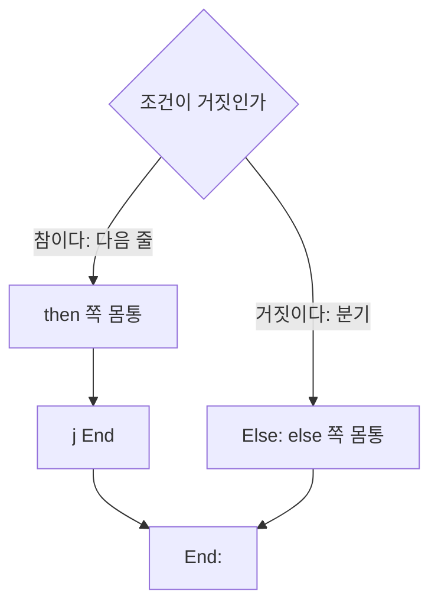


<div class="callout callout-summary" markdown="1">
<div class="callout-title callout-title--default" markdown="span">요약</div>

명령은 적힌 순서대로 한 줄씩 실행된다. 이 순서를 바꾸는 명령이 셋 있다. 두 칸의 값이 같으면 다른 줄로 가는 것, 다르면 가는 것, 묻지 않고 가는 것이다. 이 셋만으로 갈림과 되풀이를 모두 만든다. 다만 "같다"와 "다르다"만 물을 수 있어서, "작다"를 물으려면 먼저 작은지를 0이나 1로 받아 두는 명령을 한 줄 더 써야 한다. 그리고 갈림을 옮길 때는 조건을 뒤집어 "아니면 건너뛴다"로 적어야 줄이 짧아진다.

</div>


## 예시로 보기

지금까지의 명령은 계산만 한다. `if`도 `while`도 못 만든다. 값을 보고 다음에 실행할 줄을 고르는 명령이 있어야 한다.

C의 `if`-`else`를 옮긴다. `a`가 `$s0`, `b`가 `$s1`, `m`이 `$s2`에 있다[^s1].

```c
if (a < b) m = a;
else       m = b;
```

```asm
      slt $t0, $s0, $s1        # a < b이면 $t0 = 1, 아니면 0
      beq $t0, $zero, Else     # $t0이 0이면(a < b가 아니면) Else로
      add $s2, $s0, $zero      # m = a
      j   End                  # else 쪽을 건너뛴다
Else: add $s2, $s1, $zero      # m = b
End:
```

`Else`와 `End`는 줄에 붙인 이름이다. 이런 이름을 라벨이라 부른다. 어셈블러가 라벨을 그 줄의 주소로 바꾼다.

두 가지를 눈여겨본다. 첫째, C의 조건은 "`a < b`이면 한다"인데 옮긴 코드는 "`a < b`가 아니면 건너뛴다"다. 조건을 뒤집었다. 둘째, `m = a` 뒤에 `j End`가 있다. 이 줄이 없으면 `m = a`를 하고 바로 아래의 `m = b`까지 실행해 버린다.

`a` = 3, `b` = 9이면 네 줄(`slt`, `beq`, `add`, `j`)을 실행해 `m` = 3이 된다. `a` = 9, `b` = 3이면 세 줄(`slt`, `beq`, `Else`의 `add`)을 실행해 `m` = 3이 된다.

<div class="callout callout-check" markdown="1">
<div class="callout-title" markdown="span">검증: `if`-`else`의 결과와 실행한 줄 수(−20~20의 모든 쌍에서 둘 중 작은 값), 반복문의 추적 표와 합 15, 실행한 명령 36개, `slt`·`beq`로 만든 네 가지 크기 비교(−5~5의 모든 쌍), 카드의 값 — [17_mips-branch-jump_verify.py](/Hongs_Blog/studies/computer-architecture/code/17_mips-branch-jump_verify/). 실제 하드웨어가 아니라 파이썬 흉내로 확인했다.</div>

</div>


## 정의

순서를 바꾸는 명령은 셋이다[^1].

| 명령 | 하는 일 |
|---|---|
| `beq rs, rt, L` | $$R[rs] = R[rt]$$이면 `L`로 간다 (branch if equal) |
| `bne rs, rt, L` | $$R[rs] \ne R[rt]$$이면 `L`로 간다 (branch if not equal) |
| `j L` | 묻지 않고 `L`로 간다 (jump) |

조건이 맞지 않으면 `beq`와 `bne`는 바로 다음 줄로 넘어간다. 조건을 보고 가는 앞의 둘을 조건 분기, 늘 가는 `j`를 무조건 점프라 부른다.

**크기 비교.** "작으면 간다"는 명령은 기계어에 없다. `slt`로 답을 0이나 1로 받고, 그 답을 `$zero`와 견줘 분기한다[^1].

| 하고 싶은 것 | 두 줄 |
|---|---|
| `a < b`이면 `L`로 | `slt $t0, a, b` / `bne $t0, $zero, L` |
| `a >= b`이면 `L`로 | `slt $t0, a, b` / `beq $t0, $zero, L` |
| `a > b`이면 `L`로 | `slt $t0, b, a` / `bne $t0, $zero, L` |
| `a <= b`이면 `L`로 | `slt $t0, b, a` / `beq $t0, $zero, L` |

`a > b`는 `b < a`와 같으므로 `slt`의 재료 순서를 바꾼다. `a >= b`는 `a < b`가 아니라는 뜻이므로 답이 0일 때 간다.

어셈블리어에서는 `blt`(작으면), `bgt`(크면), `ble`(작거나 같으면), `bge`(크거나 같으면)를 적을 수 있다. 기계어에 없는 명령이지만 어셈블러가 위의 두 줄로 바꿔 준다. 이런 명령을 의사 명령이라 부른다. 가짜 명령이라는 뜻이다[^2].

## 옮기는 법

**이 기법을 쓸 자리.** C 코드에 `if`, `else`, `while`, `for`가 보이거나, 어셈블리어에서 라벨로 되돌아가는 줄이 보이면 이 틀을 쓴다.

**`if`-`else`의 틀.** 조건을 뒤집어 `else` 쪽으로 건너뛴다.



분기는 조건이 거짓일 때 일어난다. then 쪽 끝의 `j End`가 else 쪽을 건너뛴다[^s1].

**`while`의 틀.** 맨 위에서 조건을 보고 거짓이면 밖으로 나간다. 몸통 끝에서 맨 위로 돌아간다.

배열 `A`의 앞 `n`개를 더하는 반복문이다. `i`가 `$s0`, `sum`이 `$s1`, `n`이 `$s2`, `A`의 시작 주소가 `$s3`에 있다[^s1].

```c
sum = 0; i = 0;
while (i < n) { sum += A[i]; i++; }
```

```asm
      add  $s1, $zero, $zero    # sum = 0
      add  $s0, $zero, $zero    # i = 0
Loop: slt  $t0, $s0, $s2        # i < n ?
      beq  $t0, $zero, Exit     # 아니면 나간다
      sll  $t1, $s0, 2          # $t1 = i * 4
      add  $t1, $t1, $s3        # $t1 = A[i]의 주소
      lw   $t2, 0($t1)          # $t2 = A[i]
      add  $s1, $s1, $t2        # sum += A[i]
      addi $s0, $s0, 1          # i++
      j    Loop                 # 맨 위로
Exit:
```

`A[i]`의 `i`가 변수라서 오프셋을 명령에 적을 수 없다. `i`를 4배 해 배열 주소에 더한 뒤 오프셋 0으로 읽는다.

`A` = {3, 8, −2, 6}, `n` = 4, `A`의 주소가 `0x10000000`일 때 몸통이 한 번 끝날 때마다의 값이다.

| 몸통을 돈 횟수 | `$t1` (읽은 주소) | `$t2` (읽은 값) | `sum` | `i` |
|---|---|---|---|---|
| 1 | `0x10000000` | 3 | 3 | 1 |
| 2 | `0x10000004` | 8 | 11 | 2 |
| 3 | `0x10000008` | −2 | 9 | 3 |
| 4 | `0x1000000C` | 6 | 15 | 4 |

다섯 번째로 `Loop`에 오면 `i` = 4, `n` = 4라 `slt`가 0을 내고 `beq`가 `Exit`로 보낸다. 실행한 명령은 모두 36개다. 처음 두 줄, 몸통 8줄씩 네 번, 마지막 `slt`와 `beq`다.

## 활용

- 컴파일러가 `if`와 `while`을 옮기는 규칙이 바로 이 틀이다: [단순 연산과 분기의 코드 생성](/Hongs_Blog/studies/compilers/codegen-simple-operations/). 그 문서의 `bnez`, `beqz`, `blt`는 수업용 표기이고, 실제 MIPS 기계어에서는 `bne`·`beq`에 `$zero`를 넣거나 `slt`를 앞에 둔다.
- 반복문 한 바퀴에 분기와 점프가 하나씩 들어간다. 조건 검사를 몸통 끝으로 옮기면 한 바퀴에 분기 하나로 줄어든다[^s1].
- 분기는 [5단계 파이프라인](/Hongs_Blog/studies/computer-architecture/mips-pipeline/)에서 비싸다. 어디로 갈지 알기 전에 다음 명령을 미리 읽어 오기 때문이다: [제어 해저드와 분기 예측](/Hongs_Blog/studies/computer-architecture/control-hazard-branch-prediction/).
- 흔한 실수: then 쪽 끝의 `j End`를 빼먹는 것. then과 else를 둘 다 실행한다.
- 흔한 실수: 조건을 뒤집지 않고 `bne $t0, $zero, Else`로 적는 것. 조건이 참일 때 else 쪽으로 간다.

## 연결

- 선수: [MIPS 산술·논리 명령](/Hongs_Blog/studies/computer-architecture/mips-arithmetic-logic/)(`slt`), [MIPS 명령어 형식](/Hongs_Blog/studies/computer-architecture/mips-instruction-formats/)
- 라벨이 기계어에서 어떤 수가 되는지: [MIPS 주소 지정 방식](/Hongs_Blog/studies/computer-architecture/mips-addressing-modes/)
- x86과 견주기: x86은 `cmp`가 견준 결과를 플래그에 남기고 `jl`, `ja` 같은 점프가 그 플래그를 읽는다([조건 점프](/Hongs_Blog/studies/assembly-language/conditional-jumps/)). MIPS는 플래그가 없어서 `beq`·`bne`가 직접 두 레지스터를 견주고, 크기 비교의 답은 `slt`가 보통 레지스터에 적는다. 조건을 뒤집어 건너뛰는 틀은 두 기계에서 같다: [조건 구조를 점프로 옮기기](/Hongs_Blog/studies/assembly-language/conditional-structures/).
- 함수를 부르고 돌아오는 점프(`jal`, `jr`): [MIPS 프로시저 호출](/Hongs_Blog/studies/computer-architecture/mips-procedure-call/)

## 확인 문제

<details class="callout callout-question" markdown="1">
<summary class="callout-title" markdown="span">**C1** `x`가 `$s0`, `y`가 `$s1`에 있다. `if (x >= y) x = x - y;`를 MIPS로 옮겨라. 잠깐 쓰는 칸은 `$t0`, 라벨은 `Skip`을 쓴다.</summary>

**답:** `slt $t0, $s0, $s1` / `bne $t0, $zero, Skip` / `sub $s0, $s0, $s1` / `Skip:`<br>
**이유:** 조건을 뒤집으면 "`x < y`이면 건너뛴다"다. `slt`가 1을 내면(`x < y`) `bne`가 `Skip`으로 보낸다. `x` = 10, `y` = 4이면 `x` = 6이 되고, `x` = 4, `y` = 10이면 그대로 4다. 흔한 오답은 `beq`를 써서 조건이 참일 때 건너뛰는 것이다.

</details>


<details class="callout callout-question" markdown="1">
<summary class="callout-title" markdown="span">**C2** 위의 반복문을 `A` = {5, −1, 7}, `n` = 3으로 돌린다. 끝났을 때 `sum`과 `i`는? 실행한 명령은 모두 몇 개인가?</summary>

**답:** `sum` = 11, `i` = 3. 명령 28개.<br>
**이유:** 합은 5, 4, 11로 바뀐다. 명령 수는 처음 2줄 + 몸통 8줄 × 3번 + 마지막 `slt`와 `beq` 2줄 = 28.

</details>


<details class="callout callout-question" markdown="1">
<summary class="callout-title" markdown="span">**C3** MIPS 기계어에는 `beq`와 `bne`만 있고 "작으면 분기"가 없다. `slt`와 `bne` 두 줄로 나눠 놓은 까닭은 무엇이겠는가?</summary>

**답:** 같은지 다른지는 비트끼리 견주면 바로 나오지만, 크기를 견주려면 빼기를 해야 해서 더 오래 걸린다. 분기 명령 하나에 빼기까지 넣으면 그 명령이 느려지고, 느린 명령 하나가 클록 전체를 늦춘다. 그래서 빠른 명령 두 개로 나눴다[^3].<br>
**이유:** 설계 원칙 "자주 생기는 일을 빠르게"와 같은 생각이다. 명령 하나가 늘어도 모든 명령이 빨라지는 쪽을 골랐다.

</details>


[^1]: University of Utah CS3810 (R. Balasubramonian), Lecture 4 "MIPS Instruction Set", https://users.cs.utah.edu/~rajeev/cs3810/slides/3810-15-04.pdf, 슬라이드 11~14 (beq·bne·slt, j, if-else를 bne와 j로 옮긴 예, while을 옮긴 예). MIPS Reference Data(Green Sheet), https://www.comp.nus.edu.sg/~cs2100/lect/MIPS_Reference_Data_page1.pdf (beq·bne·j의 동작 식)
[^2]: Green Sheet, 같은 자료 (PSEUDOINSTRUCTION SET: blt, bgt, ble, bge, li, move). University of Utah CS3810, Lecture 5 "Procedure Calls", https://users.cs.utah.edu/~rajeev/cs3810/slides/3810-15-05.pdf, 슬라이드 15 (어셈블러가 의사 명령을 실제 명령으로 바꾼다), 19 (bge는 뒤에 slt와 beq로 바뀐다)
[^3]: Patterson & Hennessy, *Computer Organization and Design* (MIPS Edition), 2장 "Instructions: Language of the Computer" (작으면 분기하는 명령을 두지 않고 빠른 명령 둘로 나눈 까닭)
[^s1]: <span class="fn-tag" title="수업 자료에 없고 따로 보탠 내용">보충</span> 두 예의 C 코드와 수치, 다이어그램, 추적 표, 크기 비교 네 줄의 표, 활용 절, 카드는 위 자료에 그대로 있지 않다. 틀은 Utah 슬라이드 12·14의 예와 같고 수치는 검증 코드의 흉내기로 구했다.

