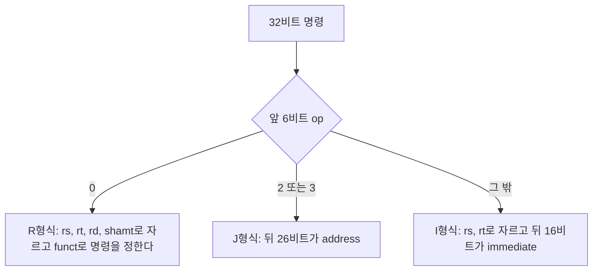


<div class="callout callout-summary" markdown="1">
<div class="callout-title callout-title--default" markdown="span">요약</div>

택배 송장에는 받는 사람, 주소, 전화번호를 적는 칸이 정해져 있어서 기계가 정해진 자리만 읽으면 된다. MIPS 명령도 서른두 비트짜리 송장이다. 맨 앞 여섯 비트에 무슨 명령인지를 적고, 그 뒤 칸에 어느 저장 칸을 쓰는지와 상수를 적는다. 칸을 나누는 방법은 세 가지뿐이라 회로가 단순하다. 대신 칸의 폭이 좁아 상수는 열여섯 비트까지만 들어가고, 어셈블리어에 적는 순서와 칸의 순서가 달라서 손으로 옮길 때 자주 틀린다.

</div>


## 예시로 보기

프로세서는 `add $t0, $s1, $s2`라는 글자를 읽지 못한다. 32비트 수 하나를 받을 뿐이다. 그 32비트의 어디가 "더하라"이고 어디가 "`$s1`"인지 미리 정해 두지 않으면 회로가 명령을 풀 수 없다.

`add $t0, $s1, $s2`를 32비트로 옮긴다[^1]. 32비트를 여섯 칸으로 자른다.

| 칸 | op | rs | rt | rd | shamt | funct |
|---|---|---|---|---|---|---|
| 폭 | 6비트 | 5비트 | 5비트 | 5비트 | 5비트 | 6비트 |
| 적을 것 | 0 | `$s1` = 17 | `$s2` = 18 | `$t0` = 8 | 0 | 32 |
| 2진수 | `000000` | `10001` | `10010` | `01000` | `00000` | `100000` |

레지스터 번호는 [MIPS 레지스터와 메모리 피연산자](/Hongs_Blog/studies/computer-architecture/mips-operands/)의 표에서 찾는다. 여섯 칸을 이어 붙여 4비트씩 끊어 읽으면 16진수가 된다.

```
000000 10001 10010 01000 00000 100000
→ 0000 0010 0011 0010 0100 0000 0010 0000
→    0    2    3    2    4    0    2    0     = 0x02324020
```

어셈블리어에서는 결과 자리 `$t0`을 맨 앞에 적었는데, 칸에서는 세 번째 레지스터 칸(rd)에 들어갔다. 순서가 다르다.

<div class="callout callout-check" markdown="1">
<div class="callout-title" markdown="span">검증: 이 문서의 모든 기계어 값, 명령 37가지의 무작위 왕복(어셈블리어 → 기계어 → 어셈블리어, 2,000회), 범위를 벗어난 상수를 막는 것 — [16_mips-instruction-formats_impl.py](/Hongs_Blog/studies/computer-architecture/code/16_mips-instruction-formats_impl/). 실제 어셈블러가 아니라 파이썬으로 짠 인코더·디코더다.</div>

</div>


## 세 가지 형식

모든 MIPS 명령은 32비트이고 아래 세 형식 가운데 하나다. 숫자는 비트 번호다. 맨 왼쪽이 31번, 맨 오른쪽이 0번이다[^2].

```
        31     26 25   21 20   16 15   11 10    6 5      0
       +---------+-------+-------+-------+-------+--------+
 R형식 |   op    |  rs   |  rt   |  rd   | shamt | funct  |
       +---------+-------+-------+-------+-------+--------+
            6        5       5       5       5       6

        31     26 25   21 20   16 15                     0
       +---------+-------+-------+------------------------+
 I형식 |   op    |  rs   |  rt   |       immediate        |
       +---------+-------+-------+------------------------+
            6        5       5              16

        31     26 25                                     0
       +---------+----------------------------------------+
 J형식 |   op    |                address                 |
       +---------+----------------------------------------+
            6                       26
```

| 칸 | 이름의 뜻 | 담는 것 |
|---|---|---|
| op | opcode. 연산 코드 | 무슨 명령인지 |
| rs | register source | 첫째 재료 레지스터의 번호 |
| rt | register target | 둘째 재료 레지스터의 번호. I형식에서는 결과 자리가 되기도 한다 |
| rd | register destination | 결과를 넣을 레지스터의 번호 |
| shamt | shift amount | 몇 칸 밀지. 밀기 명령이 아니면 0 |
| funct | function | op가 0인 명령들 가운데 어느 것인지 |
| immediate | 즉시값 | 16비트 상수. 오프셋이나 분기 거리로도 쓴다 |
| address | 주소 | 점프할 곳을 적는 26비트 |

레지스터 칸이 5비트인 까닭은 레지스터가 32개이기 때문이다. $$2^5 = 32$$라 5비트면 0~31을 모두 적는다.

- **R형식** (register). 레지스터끼리 계산하는 명령이다. op는 모두 0이고, funct가 명령을 가른다.
- **I형식** (immediate). 상수가 들어가는 명령이다. 즉시값 계산, `lw`·`sw`, 조건 분기가 여기에 든다.
- **J형식** (jump). 먼 곳으로 건너뛰는 `j`와 `jal`이다.

**어셈블리어의 순서와 칸의 순서.** 어셈블리어는 결과를 맨 앞에 적지만 칸은 재료가 앞이다[^3].

| 어셈블리어 | rs | rt | rd | 나머지 |
|---|---|---|---|---|
| `add rd, rs, rt` | 둘째로 적은 것 | 셋째로 적은 것 | 첫째로 적은 것 | shamt = 0 |
| `sll rd, rt, shamt` | 0 | 둘째로 적은 것 | 첫째로 적은 것 | shamt = 셋째로 적은 것 |
| `addi rt, rs, imm` | 둘째로 적은 것 | 첫째로 적은 것 | 없음 | immediate = 셋째 |
| `lw rt, imm(rs)` | 괄호 안 | 첫째로 적은 것 | 없음 | immediate = 괄호 밖 |
| `beq rs, rt, label` | 첫째로 적은 것 | 둘째로 적은 것 | 없음 | immediate = 분기 거리 |

**opcode와 funct 값.** 16진수다[^4].

| R형식 | op / funct | I형식 | op | J형식 | op |
|---|---|---|---|---|---|
| `sll` | 0 / 00 | `beq` | 04 | `j` | 02 |
| `srl` | 0 / 02 | `bne` | 05 | `jal` | 03 |
| `jr` | 0 / 08 | `addi` | 08 | | |
| `add` | 0 / 20 | `slti` | 0A | | |
| `sub` | 0 / 22 | `andi` | 0C | | |
| `and` | 0 / 24 | `ori` | 0D | | |
| `or` | 0 / 25 | `lui` | 0F | | |
| `nor` | 0 / 27 | `lw` | 23 | | |
| `slt` | 0 / 2A | `sw` | 2B | | |

**기계어를 읽는 법.** 맨 앞 6비트(op)부터 읽는다. op가 나머지를 어떻게 자를지 알려 준다. op가 0이면 R형식이고 맨 뒤 6비트(funct)가 명령을 정한다. 0이 아니면 op가 곧 명령이다[^5].



op를 먼저 보고 나머지 26비트를 자르는 법을 고른다[^s1].

### 설계 이유

- **왜 형식이 하나가 아닌가.** R형식 하나로는 상수를 넣을 자리가 5비트(shamt)뿐이다. `lw $t0, 32($s3)`의 32도 못 적는다. 그래서 rd·shamt·funct 세 칸을 합쳐 16비트 상수 칸으로 쓰는 I형식을 따로 둔다. 모든 명령을 같은 길이로 두는 것과 형식을 하나로 두는 것이 부딪쳤고, 길이를 지키는 쪽을 골랐다. 설계 원칙 "좋은 설계에는 좋은 절충이 필요하다"의 예다[^6].
- **왜 앞쪽 칸의 자리가 형식마다 같은가.** op는 세 형식 모두 같은 자리에 있고, rs와 rt는 R형식과 I형식에서 같은 자리에 있다. 회로는 명령이 어느 형식인지 알기 전에 그 자리의 비트를 꺼내 레지스터를 미리 읽어 둘 수 있다: [단일 사이클 데이터패스](/Hongs_Blog/studies/computer-architecture/single-cycle-datapath/)[^s1].
- **왜 R형식은 op가 모두 0인가.** op는 6비트라 64가지만 가른다. 레지스터끼리 계산하는 명령은 상수 칸이 필요 없어 6비트가 남는다. 그 남는 칸(funct)에 종류를 적으면 op 한 가지로 명령 64가지를 더 얻는다[^s1].

## 예제

**I형식: `lw $t0, 32($s3)`.**

1. *형식과 op 찾기:* `lw`는 I형식, op = `0x23` = `100011`.
2. *레지스터 칸 채우기:* 괄호 안 `$s3` = 19가 rs, 앞에 적은 `$t0` = 8이 rt. `10011`, `01000`.
3. *상수 칸 채우기:* 32 = `0000 0000 0010 0000`.
4. *이어 붙이기:* `100011 10011 01000 0000000000100000` = `0x8E680020`.

**음수 상수: `addi $s1, $s2, -5`.**

1. *형식과 op 찾기:* I형식, op = `0x08` = `001000`.
2. *레지스터 칸 채우기:* 둘째로 적은 `$s2` = 18이 rs, 첫째로 적은 `$s1` = 17이 rt. `10010`, `10001`.
3. *상수 칸 채우기:* −5를 16비트 2의 보수로 적는다. 5 = `0x0005`, 뒤집어 1을 더하면 `0xFFFB`.
4. *이어 붙이기:* `001000 10010 10001 1111111111111011` = `0x2251FFFB`.

**밀기: `sll $t2, $s0, 4`.**

1. *형식과 op 찾기:* R형식, op = 0, funct = `0x00`.
2. *레지스터 칸 채우기:* 밀기는 재료가 하나라 rs = 0. 재료 `$s0` = 16이 rt, 결과 `$t2` = 10이 rd.
3. *shamt 채우기:* 4 = `00100`.
4. *이어 붙이기:* `000000 00000 10000 01010 00100 000000` = `0x00105100`.

**거꾸로: `0x016D8022`는 무슨 명령인가.**

1. *2진수로 풀기:* `0000 0001 0110 1101 1000 0000 0010 0010`.
2. *앞 6비트 보기:* `000000`. op = 0이라 R형식이다.
3. *R형식으로 자르기:* `000000 01011 01101 10000 00000 100010`.
4. *칸 읽기:* rs = 11(`$t3`), rt = 13(`$t5`), rd = 16(`$s0`), shamt = 0, funct = `0x22`(`sub`).
5. *어셈블리어 순서로 적기:* `sub $s0, $t3, $t5`.

**형식에 들어가지 않는 것.**

- `add $t0, $s1, 5`: R형식에는 상수 칸이 없다. `addi $t0, $s1, 5`로 적어야 한다.
- `lw $t0, 40000($s3)`: 오프셋이 16비트 부호 있는 수의 범위(−32,768~32,767)를 넘는다. 주소를 다른 레지스터에 먼저 계산해 두어야 한다.
- `sll $t0, $t1, 32`: shamt는 5비트라 0~31만 적는다.

### 스스로 설명해 보기

`0x016D8022`를 푸는 다섯 줄에서 각 줄이 무엇에 기대는지 답한다.

<details class="callout callout-question" markdown="1">
<summary class="callout-title" markdown="span">1. 2단계에서 앞 6비트만 보고 형식을 정할 수 있는 까닭</summary>

op 칸이 세 형식 모두 31~26번 비트에 있기 때문이다. 형식을 모르는 상태에서도 그 자리는 늘 op다.

</details>


<details class="callout callout-question" markdown="1">
<summary class="callout-title" markdown="span">2. 3단계에서 뒤 26비트를 5·5·5·5·6으로 자른 까닭</summary>

op가 0이면 R형식이라는 규칙과 R형식의 칸 폭 때문이다. op가 `0x23`이었다면 5·5·16으로 잘랐을 것이다.

</details>


<details class="callout callout-question" markdown="1">
<summary class="callout-title" markdown="span">3. 4단계에서 funct를 본 까닭</summary>

R형식 명령은 op가 모두 0이라 op로는 `add`인지 `sub`인지 모른다. funct `0x22`가 `sub`를 가리킨다.

</details>


<details class="callout callout-question" markdown="1">
<summary class="callout-title" markdown="span">4. 5단계에서 rd를 맨 앞에 적은 까닭</summary>

어셈블리어는 `sub rd, rs, rt` 순서로 적는다. 칸의 순서(rs, rt, rd)와 다르다.

</details>


<details class="callout callout-question" markdown="1">
<summary class="callout-title" markdown="span">이 풀이의 핵심 생각은?</summary>

앞에서부터 읽으며 다음 칸을 어떻게 자를지 정한다. op가 형식을 정하고, 형식이 칸을 정하고, R형식이면 funct가 명령을 정한다.

</details>


<details class="callout callout-question" markdown="1">
<summary class="callout-title" markdown="span">이 방법을 쓸 수 있는 다른 상황은?</summary>

정해진 자리에 종류 표시를 두고 그 표시에 따라 나머지를 다르게 읽는 모든 형식. 네트워크 패킷의 머리 칸(종류 칸을 보고 뒤를 푼다), [부동소수점](/Hongs_Blog/studies/data-and-information/floating-point/)의 부호·지수·가수 칸이 그렇다.

</details>


## 활용

- 손으로 옮기는 연습: [명령어 인코딩 예제 사다리](/Hongs_Blog/studies/computer-architecture/mips-encoding-ladder/)
- 인코더·디코더: [16_mips-instruction-formats_impl.py](/Hongs_Blog/studies/computer-architecture/code/16_mips-instruction-formats_impl/)
- 프로세서 안에서는 op와 funct가 제어 장치로 들어가 나머지 회로가 할 일을 정한다: [제어 장치와 제어 신호](/Hongs_Blog/studies/computer-architecture/control-unit/)
- 분기 명령의 immediate와 점프 명령의 address에 무엇을 적는지는 [MIPS 주소 지정 방식](/Hongs_Blog/studies/computer-architecture/mips-addressing-modes/)에서 다룬다.

## 연결

- 선수: [MIPS 레지스터와 메모리 피연산자](/Hongs_Blog/studies/computer-architecture/mips-operands/)(레지스터 번호), [MIPS 산술·논리 명령](/Hongs_Blog/studies/computer-architecture/mips-arithmetic-logic/)(명령의 뜻)
- 명령을 수로 적어 메모리에 둔다는 생각: [명령어 집합 구조](/Hongs_Blog/studies/computer-architecture/instruction-set-architecture/)
- x86의 기계어는 길이가 제각각이다: [어셈블리어와 기계어](/Hongs_Blog/studies/assembly-language/assembly-language/), [RISC와 CISC 비교](/Hongs_Blog/studies/computer-architecture/risc-vs-cisc/)

## 자주 하는 오해

<div class="callout callout-misconception" markdown="1">
<div class="callout-title" markdown="span">"어셈블리어에 적은 순서대로 칸에 넣으면 된다"</div>

틀렸다. `add $t0, $s1, $s2`를 적은 순서대로 넣으면 rs = 8, rt = 17, rd = 18이 되어 `0x01119020`이 나온다. 이 수를 다시 풀면 `add $s2, $t0, $s1`이다. 전혀 다른 레지스터에 결과를 쓰는 명령이다. 그럴듯해 보이는 까닭은 어셈블리어가 C의 `a = b + c`처럼 결과를 앞에 적어 읽기 쉽게 만든 표기이기 때문이다. 칸은 회로에 맞춘 순서라 재료(rs, rt)가 앞이고 결과(rd)가 뒤다. I형식에서는 결과가 rt로 들어가 또 다르다. 확인하는 법: 옮긴 수를 거꾸로 풀어 처음 줄이 나오는지 본다.

</div>


## 확인 문제

<details class="callout callout-question" markdown="1">
<summary class="callout-title" markdown="span">**C1** MIPS의 세 형식을 칸 이름과 폭까지 쓰라.</summary>

**답:** R형식: op 6, rs 5, rt 5, rd 5, shamt 5, funct 6. I형식: op 6, rs 5, rt 5, immediate 16. J형식: op 6, address 26. 모두 더하면 32다.<br>
**흔한 오답:** funct를 5비트로, shamt를 6비트로 바꿔 적는 것. 양 끝의 op와 funct가 6비트이고 가운데 넷이 5비트다.

</details>


<details class="callout callout-question" markdown="1">
<summary class="callout-title" markdown="span">**C2** `or $v0, $a0, $a1`을 16진수 기계어로 옮겨라.</summary>

**답:** `0x00851025`.<br>
**이유:** R형식, op = 0, funct = `0x25`. rs = `$a0` = 4, rt = `$a1` = 5, rd = `$v0` = 2, shamt = 0. `000000 00100 00101 00010 00000 100101`. 흔한 오답은 rd를 맨 앞 레지스터 칸에 넣는 것이다.

</details>


<details class="callout callout-question" markdown="1">
<summary class="callout-title" markdown="span">**C3** `0x8D2A0010`을 어셈블리어로 되돌려라.</summary>

**답:** `lw $t2, 16($t1)`.<br>
**이유:** 2진수 `1000 1101 0010 1010 0000 0000 0001 0000`. 앞 6비트 `100011` = `0x23`이라 `lw`(I형식). rs = `01001` = 9(`$t1`), rt = `01010` = 10(`$t2`), immediate = 16.

</details>


<details class="callout callout-question" markdown="1">
<summary class="callout-title" markdown="span">**C4** `add`와 `sub`는 op가 둘 다 0이다. 프로세서는 둘을 어떻게 가르는가? 왜 op를 다르게 주지 않았는가?</summary>

**답:** 맨 뒤 6비트 funct로 가른다(`add`는 `0x20`, `sub`는 `0x22`). op는 6비트라 64가지뿐이다. 레지스터끼리 계산하는 명령은 상수 칸을 쓰지 않아 뒤쪽 6비트가 남으므로, 그 칸에 종류를 적어 op 값을 아낀다.

</details>


<details class="callout callout-question" markdown="1">
<summary class="callout-title" markdown="span">**C5** `addi $s1, $s2, -5`의 immediate 칸이 `0xFFFB`인 까닭을 대라. 프로세서는 이 16비트를 어떻게 −5로 되돌리는가?</summary>

**답:** −5를 16비트 2의 보수로 적은 것이다. $$2^{16} - 5 = 65{,}531$$ = `0xFFFB`. 프로세서는 맨 윗비트(1)를 위쪽 16비트에 복사해 `0xFFFFFFFB`로 늘린다(부호 확장). 이 32비트 수가 −5다.

</details>


[^1]: University of Utah CS3810 (R. Balasubramonian), Lecture 4 "MIPS Instruction Set", https://users.cs.utah.edu/~rajeev/cs3810/slides/3810-15-04.pdf, 슬라이드 9 (R형식 `add $t0, $s1, $s2`의 여섯 칸과 비트, I형식 `lw $t0, 32($s3)`의 네 칸). Patterson & Hennessy, *Computer Organization and Design* (MIPS Edition), 2장 "Instructions: Language of the Computer"
[^2]: MIPS Reference Data(Green Sheet), Patterson & Hennessy 교재의 참조표, NUS CS2100 공개본 https://www.comp.nus.edu.sg/~cs2100/lect/MIPS_Reference_Data_page1.pdf (BASIC INSTRUCTION FORMATS: R·I·J의 칸과 비트 번호)
[^3]: Cornell CS3410 MIPS Reference Sheet, https://www.cs.cornell.edu/courses/cs3410/2018fa/resources/3410_MIPS.pdf (명령마다 적는 순서: `ADD rd, rs, rt`, `SLL rd, rt, shamt`, `LW rt, offset(rs)`, `BEQ rs, rt, offset`, `ADDIU rt, rs, imm`)
[^4]: Green Sheet, 같은 자료 (CORE INSTRUCTION SET 표의 OPCODE / FUNCT (Hex) 열)
[^5]: Harris & Harris, *Digital Design and Computer Architecture* 2판 6장 강의 슬라이드, https://www.esa.informatik.tu-darmstadt.de/archive/twiki/pub/Lectures/Prozessorarchitektur16De/DDCA_Ch6.pdf, 슬라이드 43 (opcode부터 본다. 모두 0이면 R형식이고 function 비트가 연산을 정한다. 아니면 opcode가 연산을 정한다)
[^6]: 같은 슬라이드, 32 (Design Principle 4: 형식을 여럿 두어 유연하게 하되, 원칙 1과 3을 지키려고 수를 적게 둔다)
[^s1]: 모든 기계어 값은 검증 코드의 인코더·디코더로 구하고 왕복으로 확인했다. rs·rt의 자리가 같아 레지스터를 미리 읽을 수 있다는 설명은 Patterson & Hennessy, 같은 책, 4장 "The Processor"의 내용이다.

