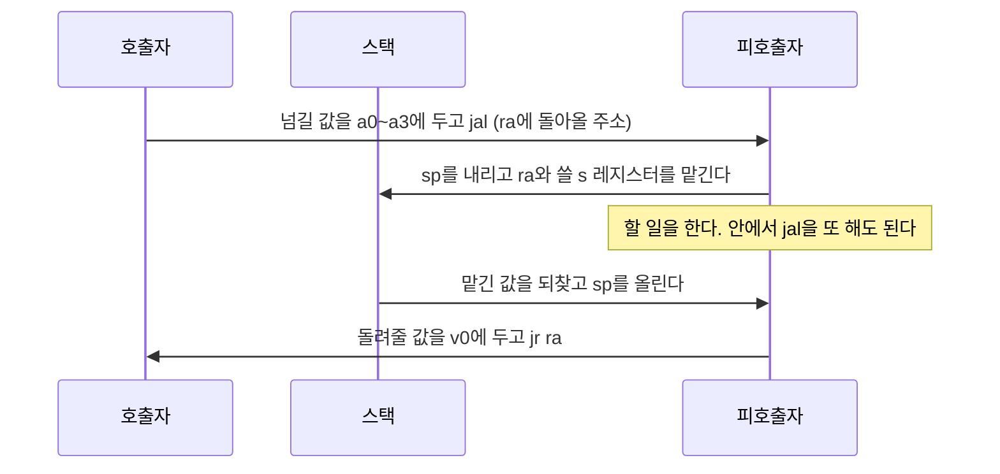


<div class="callout callout-summary" markdown="1">
<div class="callout-title callout-title--default" markdown="span">요약</div>

일하다가 다른 방에 심부름을 갈 때, 돌아올 자리를 손바닥에 적고 간다. 심부름이 끝나면 손바닥을 보고 돌아온다. MIPS도 함수를 부를 때 돌아올 주소를 정해진 칸 하나에 적고 건너뛴다. 메모리에 쓰지 않아서 빠르다. 하지만 손바닥은 하나뿐이다. 심부름 간 곳에서 또 심부름을 가면 앞의 주소가 지워지므로, 그 전에 수첩(스택)에 옮겨 적어 두어야 한다. 어느 칸을 누가 옮겨 적어 지킬지는 기계가 아니라 프로그래머끼리의 약속이 정하고, 한쪽이 약속을 어기면 기계는 막지 않는다.

</div>


## 예시로 보기

같은 코드를 여러 곳에서 불러 쓰려면 두 가지가 필요하다. 그 코드로 건너뛰는 일과, 끝나면 부른 자리로 돌아오는 일이다. `j`로는 건너뛰기만 된다. 부른 자리가 여러 곳이라 돌아갈 주소를 코드에 못 박을 수 없다.

네 수를 받아 `(a + b) - (c + d)`를 돌려주는 `diff`를 부른다. 왼쪽 숫자는 명령이 놓인 주소다[^s1].

```asm
0x00400000  main: addi $s0, $zero, 99     # main이 오래 쓸 값
0x00400004        addi $a0, $zero, 10     # 넘길 값 넷
0x00400008        addi $a1, $zero, 7
0x0040000C        addi $a2, $zero, 4
0x00400010        addi $a3, $zero, 2
0x00400014        jal  diff               # $ra = 0x00400018, diff로 간다
0x00400018        add  $s1, $v0, $zero    # 돌려받은 값을 $s1에
0x0040001C        j    Done

0x00400020  diff: addi $sp, $sp, -4       # 스택에 한 칸 마련
0x00400024        sw   $s0, 0($sp)        # 부른 쪽의 $s0을 맡겨 둔다
0x00400028        add  $t0, $a0, $a1      # a + b
0x0040002C        add  $t1, $a2, $a3      # c + d
0x00400030        sub  $s0, $t0, $t1      # 계산에 $s0을 쓴다
0x00400034        add  $v0, $s0, $zero    # 돌려줄 값
0x00400038        lw   $s0, 0($sp)        # 맡겨 둔 $s0을 되돌린다
0x0040003C        addi $sp, $sp, 4        # 스택 한 칸 반납
0x00400040        jr   $ra                # $ra에 적힌 곳으로 돌아간다
0x00400044  Done:
```

`jal diff`는 두 가지를 한다. 바로 다음 명령의 주소 `0x00400018`을 `$ra`에 넣고, `diff`가 있는 `0x00400020`으로 건너뛴다. `diff`의 마지막 줄 `jr $ra`는 `$ra`에 든 주소로 건너뛴다. 그래서 `jal` 바로 다음 줄로 돌아온다.

끝나면 `$s1` = 11이다. (10 + 7) − (4 + 2)다. `$s0`은 `diff`가 중간에 11로 바꿨지만 돌아오기 전에 되돌려서 99 그대로다. `$sp`도 처음 값으로 돌아온다.

<div class="callout callout-check" markdown="1">
<div class="callout-title" markdown="span">검증: 위 코드의 주소와 결과(`$s1` = 11, `$s0` = 99, `$ra` = `0x00400018`, `$sp` 복구), 재귀 `sum`의 추적 표와 스택 내용, `n` = 0~7에서 결과와 `$sp` 복구, 두 실패 시나리오, 카드의 값 — [18_mips-procedure-call_verify.py](/Hongs_Blog/studies/computer-architecture/code/18_mips-procedure-call_verify/). 실제 하드웨어가 아니라 파이썬 흉내로 확인했다. 흉내기는 `jal`이 PC + 4를 `$ra`에 넣는 것으로 친다.</div>

</div>


## 정의

프로시저는 이름을 붙여 불러 쓰는 코드 덩어리다. C의 함수다. 부르는 쪽을 호출자, 불리는 쪽을 피호출자라 부른다.

**부르고 돌아오는 명령**[^1].

| 명령 | 하는 일 |
|---|---|
| `jal L` | 다음 명령의 주소를 `$ra`에 넣고 `L`로 간다 (jump and link) |
| `jr $ra` | `$ra`에 든 주소로 간다 (jump register) |

`$ra`는 31번 레지스터다. return address, 돌아갈 주소라는 뜻이다.

<details class="callout callout-note" markdown="1">
<summary class="callout-title" markdown="span">`jal`이 넣는 주소: PC + 4인가 PC + 8인가</summary>

참조표는 `jal`의 동작을 R[31] = PC + 8로 적는다[^2]. 실제 MIPS 프로세서는 점프 명령 바로 다음 줄을 점프하기 전에 먼저 실행하도록 만들어졌고, 그래서 돌아올 곳이 두 줄 뒤다. 교재 본문과 강의는 이 사정을 빼고 "PC + 4를 넣는다"로 설명한다[^1]. 이 문서와 검증 코드도 PC + 4로 적는다.

</details>


**호출의 여섯 걸음**[^3].

1. 호출자가 넘길 값을 피호출자가 볼 수 있는 곳에 둔다 (`$a0`~`$a3`).
2. 피호출자로 건너뛴다 (`jal`).
3. 피호출자가 쓸 자리를 마련한다 (`$sp`를 내린다).
4. 피호출자가 할 일을 한다.
5. 돌려줄 값을 호출자가 볼 수 있는 곳에 둔다 (`$v0`~`$v1`).
6. 호출자에게 돌아간다 (`jr $ra`).

**레지스터 약속.** 레지스터는 32개뿐이고 호출자와 피호출자가 같은 칸을 쓴다. 그래서 누가 어느 칸을 지킬지 정해 둔다[^4].

| 레지스터 | 호출 뒤에도 값이 그대로인가 | 지키는 쪽 |
|---|---|---|
| `$s0`~`$s7`, `$sp`, `$fp`, `$gp`, `$ra` | 그렇다 | 피호출자. 쓰려면 먼저 스택에 맡기고, 돌아가기 전에 되돌린다 |
| `$t0`~`$t9`, `$a0`~`$a3`, `$v0`~`$v1` | 아니다 | 호출자. 호출 뒤에도 필요하면 부르기 전에 스택에 맡긴다 |

앞줄을 피호출자 저장(callee-saved), 뒷줄을 호출자 저장(caller-saved) 레지스터라 부른다. `$ra`가 앞줄에 있다는 말은, 프로시저가 `jr $ra`를 할 때 `$ra`가 들어올 때의 값이어야 한다는 뜻이다. 안에서 `jal`을 또 하는 프로시저는 `$ra`가 덮어써지므로 먼저 스택에 맡겨야 한다.

**스택.** 프로시저가 값을 맡겨 두는 메모리 구역이다. 높은 주소에서 낮은 주소 쪽으로 자란다. `$sp`(stack pointer, 29번)가 스택의 꼭대기, 곧 가장 최근에 쓴 칸을 가리킨다[^5].

- 한 칸 마련하기: `addi $sp, $sp, -4`
- 맡기기: `sw $s0, 0($sp)`. 되찾기: `lw $s0, 0($sp)`
- 반납하기: `addi $sp, $sp, 4`

프로시저 한 번의 호출이 스택에 마련한 칸들을 그 호출의 **스택 프레임**이라 부른다.

기호로 쓰면, $$R[x]$$가 레지스터 $$x$$의 값이고 PC가 지금 명령의 주소일 때 다음과 같다.

$$\texttt{jal}\ L:\quad R[31] \leftarrow \mathrm{PC} + 4,\quad \mathrm{PC} \leftarrow L \qquad\qquad \texttt{jr}\ rs:\quad \mathrm{PC} \leftarrow R[rs]$$


## 재귀 호출 추적

자기 자신을 부르는 프로시저는 `$ra`와 인수를 스택에 맡겨야 한다. 0부터 `n`까지 더하는 `sum`이다[^s1].

```c
int sum(int n) { if (n < 1) return 0; else return n + sum(n - 1); }
```

```asm
0x00400000  main: addi $a0, $zero, 3
0x00400004        jal  sum
0x00400008        add  $s0, $v0, $zero
0x0040000C        j    Done
0x00400010  sum:  addi $sp, $sp, -8       # 두 칸 마련
0x00400014        sw   $ra, 4($sp)        # 돌아갈 주소를 맡긴다
0x00400018        sw   $a0, 0($sp)        # n을 맡긴다
0x0040001C        slti $t0, $a0, 1        # n < 1 ?
0x00400020        beq  $t0, $zero, Rec    # 아니면 Rec로
0x00400024        add  $v0, $zero, $zero  # 0을 돌려준다
0x00400028        addi $sp, $sp, 8
0x0040002C        jr   $ra
0x00400030  Rec:  addi $a0, $a0, -1       # n - 1을 넘긴다
0x00400034        jal  sum                # $ra가 0x00400038로 바뀐다
0x00400038        lw   $a0, 0($sp)        # 내 n을 되찾는다
0x0040003C        lw   $ra, 4($sp)        # 내 돌아갈 주소를 되찾는다
0x00400040        addi $sp, $sp, 8
0x00400044        add  $v0, $a0, $v0      # n + sum(n - 1)
0x00400048        jr   $ra
0x0040004C  Done:
```

`$sp` = `0x7FFFFFFC`에서 시작해 `sum(3)`을 부르면 이렇게 흘러간다.

| 일어난 일 | `$a0` | `$ra` | `$sp` | `$v0` |
|---|---|---|---|---|
| main이 `jal sum` | 3 | `0x00400008` | `0x7FFFFFFC` | |
| `sum(3)`이 두 칸에 맡김 | 3 | `0x00400008` | `0x7FFFFFF4` | |
| `sum(3)`이 `jal sum` | 2 | `0x00400038` | `0x7FFFFFF4` | |
| `sum(2)`가 맡기고 `jal sum` | 1 | `0x00400038` | `0x7FFFFFEC` | |
| `sum(1)`이 맡기고 `jal sum` | 0 | `0x00400038` | `0x7FFFFFE4` | |
| `sum(0)`이 맡김. `n < 1`이라 0을 돌려줌 | 0 | `0x00400038` | `0x7FFFFFDC` → `0x7FFFFFE4` | 0 |
| `sum(1)`이 되찾고 더해 돌려줌 | 1 | `0x00400038` | `0x7FFFFFEC` | 1 |
| `sum(2)`가 되찾고 더해 돌려줌 | 2 | `0x00400038` | `0x7FFFFFF4` | 3 |
| `sum(3)`이 되찾고 더해 돌려줌 | 3 | `0x00400008` | `0x7FFFFFFC` | 6 |

가장 깊이 들어갔을 때(`sum(0)`이 맡긴 직후) 스택은 이렇다.

```
 주소           들어 있는 값     누가 맡겼나
 0x7FFFFFF8     0x00400008       sum(3)의 $ra  (main으로 돌아갈 곳)
 0x7FFFFFF4     3                sum(3)의 n
 0x7FFFFFF0     0x00400038       sum(2)의 $ra
 0x7FFFFFEC     2                sum(2)의 n
 0x7FFFFFE8     0x00400038       sum(1)의 $ra
 0x7FFFFFE4     1                sum(1)의 n
 0x7FFFFFE0     0x00400038       sum(0)의 $ra
 0x7FFFFFDC     0                sum(0)의 n        ← $sp
```

`$ra` 레지스터는 하나인데 돌아갈 주소는 넷이다. 셋은 스택에 있다. 호출마다 두 칸(8바이트)씩 쌓여 네 겹이 32바이트다. 끝나면 `$s0` = 6이고 `$sp`는 `0x7FFFFFFC`로 돌아온다. 실행한 명령은 48개다.



피호출자가 스택에 맡긴 것은 돌아가기 전에 모두 되찾는다[^s1].

### 지키는 것과 지키지 못하는 것

모든 프로시저가 다음 세 가지를 지킨다고 하자. ① `$sp`를 내린 만큼 올린다. ② `$s0`~`$s7`과 `$ra`를 바꿨으면 돌아가기 전에 되돌린다. ③ 자기가 마련한 칸보다 높은 주소의 스택에 쓰지 않는다.

**지키는 것.** 호출이 끝나고 돌아왔을 때 `$sp`, `$s0`~`$s7`, 그리고 호출 전에 스택에 있던 값이 호출 전과 같다. 호출이 몇 겹이든 그렇다.

<details class="callout callout-proof" markdown="1">
<summary class="callout-title" markdown="span">까닭 펼치기</summary>

호출이 겹친 깊이에 대한 수학적 귀납법이다.
1. **깊이 0** (안에서 다른 프로시저를 부르지 않는 프로시저). `$sp`와 `$s`를 바꾸는 것은 자기 코드뿐이다. ①과 ②에 따라 돌아갈 때 처음 값이다. 쓴 스택 칸은 자기가 마련한 칸뿐이라(③) 그 위의 값은 그대로다.
2. **깊이 $$k$$까지 맞다고 하자.** 깊이 $$k + 1$$인 프로시저 P가 안에서 Q를 부른다. Q의 깊이는 $$k$$ 이하이므로 가정에 따라 Q가 돌아온 뒤 `$sp`, `$s`, P가 맡겨 둔 스택 값이 Q를 부르기 전과 같다.
3. 그러면 P가 맡겨 둔 `$ra`와 `$s`가 스택에 그대로 있다. P는 그것을 되찾고(②) `$sp`를 올린다(①). 그래서 P가 돌아갈 때도 처음 값이다. ∎

</details>


**지키지 못하는 것.**

- `$t0`~`$t9`, `$a0`~`$a3`, `$v0`~`$v1`은 호출 뒤에 어떤 값이 들어 있을지 모른다.
- 반납한 스택 칸의 값은 다음 호출이 덮어쓴다. 지역 변수의 주소를 돌려주면 안 되는 까닭이다.
- 약속을 지켰는지 기계는 검사하지 않는다. 하드웨어가 하는 일은 `jal`이 `$ra`에 주소를 넣는 것뿐이다.
- 스택이 얼마나 깊어져도 되는지는 정해 주지 않는다. 재귀가 멈추지 않으면 스택이 다른 구역을 침범한다.

### 실패 시나리오

**`$ra`를 맡기지 않은 재귀.** `sum`에서 `sw $ra, 4($sp)`와 `lw $ra, 4($sp)` 두 줄을 뺀다. 줄이 빠져 뒤의 주소가 당겨지므로 안쪽 `jal sum`의 다음 줄은 `0x00400034`가 된다. `sum(3)`을 부르면 안쪽의 `jal`이 `$ra`를 `0x00400034`로 덮어쓰고, 그 뒤로 아무도 되돌리지 않는다. 안쪽 호출들은 `0x00400034`로 잘 돌아가고 `$v0`도 0, 1, 3, 6으로 맞게 쌓인다. 그런데 맨 바깥 `sum(3)`의 `jr $ra`도 `0x00400034`로 간다. main으로 돌아갈 주소 `0x00400008`은 어디에도 남아 있지 않다. 프로그램은 스택 바깥의 메모리를 인수인 줄 알고 읽고 `$sp`를 또 8 올리려 한다. 이 예에서는 그 덧셈이 32비트를 넘어 넘침 예외로 멈춘다. main의 `add $s0, $v0, $zero`는 끝내 실행되지 않는다.

**`$s0`을 맡기지 않은 피호출자.** 첫 예의 `diff`에서 `sw $s0, 0($sp)`와 `lw $s0, 0($sp)`를 뺀다. `diff`는 여전히 11을 돌려준다. 하지만 돌아온 main의 `$s0`은 99가 아니라 11이다. 틀린 값이 조용히 남고, main이 나중에 `$s0`을 쓸 때에야 드러난다.

### 스스로 설명해 보기

<details class="callout callout-question" markdown="1">
<summary class="callout-title" markdown="span">1. 까닭의 1단계에서 "쓴 스택 칸은 자기가 마련한 칸뿐"이 왜 필요한가</summary>

호출자가 맡겨 둔 값이 스택의 더 높은 주소에 있기 때문이다. 피호출자가 거기에 쓰면 `$sp`와 `$s`를 되돌려도 호출자가 되찾을 값이 망가져 있다.

</details>


<details class="callout callout-question" markdown="1">
<summary class="callout-title" markdown="span">2. 2단계에서 귀납 가정을 Q에 쓸 수 있는 까닭</summary>

Q 안에서 겹치는 호출의 깊이가 P보다 하나 이상 얕기 때문이다. 가정은 깊이 $$k$$ 이하인 모든 프로시저에 대한 것이다.

</details>


<details class="callout callout-question" markdown="1">
<summary class="callout-title" markdown="span">3. 3단계에서 P가 `$ra`를 되찾을 수 있는 까닭</summary>

P가 `$ra`를 맡긴 칸은 P의 프레임 안에 있고, Q는 자기 프레임보다 높은 주소에 쓰지 않는다(③). 그래서 Q가 무슨 일을 해도 그 칸은 그대로다.

</details>


<details class="callout callout-question" markdown="1">
<summary class="callout-title" markdown="span">이 논증의 핵심 생각은?</summary>

각 프로시저가 자기 몫만 지키면 전체가 지켜진다. 부르는 쪽은 불리는 쪽의 안을 몰라도 약속만 믿으면 된다.

</details>


<details class="callout callout-question" markdown="1">
<summary class="callout-title" markdown="span">이 방법을 쓸 수 있는 다른 상황은?</summary>

재귀 함수가 맞는지 보일 때("더 작은 입력에서 맞다면 이 입력에서도 맞다"), 괄호가 올바로 짝지어졌는지 볼 때(여는 만큼 닫으면 안쪽이 무엇이든 바깥 균형이 맞다).

</details>


## 활용

- 안에서 다른 프로시저를 부르지 않는 프로시저를 말단 프로시저라 부른다. `$ra`가 덮어써질 일이 없어 맡기지 않아도 된다. `$t` 레지스터만 쓰면 스택을 아예 안 써도 된다[^6].
- 넘길 값이 넷을 넘으면 다섯째부터는 스택에 둔다[^7].
- 흔한 실수: 맡긴 순서와 되찾는 오프셋이 어긋나는 것. `sw $ra, 4($sp)`로 맡기고 `lw $ra, 0($sp)`로 되찾으면 인수를 주소로 알고 건너뛴다.
- 흔한 실수: 호출 뒤에도 `$t0`에 값이 남아 있으리라 믿는 것. 피호출자는 `$t0`을 마음대로 써도 된다.

## 연결

- 선수: [MIPS 레지스터와 메모리 피연산자](/Hongs_Blog/studies/computer-architecture/mips-operands/), [MIPS 분기와 점프](/Hongs_Blog/studies/computer-architecture/mips-branch-jump/)
- x86과 견주기. x86의 `call`은 돌아갈 주소를 스택에 넣고 `ret`이 스택에서 꺼낸다([프로시저와 CALL·RET](/Hongs_Blog/studies/assembly-language/call-ret/)). MIPS의 `jal`은 레지스터에 넣는다. 그래서 말단 프로시저는 메모리에 한 번도 닿지 않고 불렸다 돌아간다. x86은 인수를 스택에 쌓아 넘기고 EBP를 말뚝으로 삼아 찾는다([스택 프레임](/Hongs_Blog/studies/assembly-language/stack-frame/)). MIPS는 넷까지 `$a0`~`$a3`에 담는다. x86에서 쌓은 인수를 누가 치우는지의 약속([호출 규약](/Hongs_Blog/studies/assembly-language/calling-convention/))은 MIPS에서 "어느 레지스터를 누가 지키는지"의 약속이 된다. 둘 다 양쪽이 같은 약속을 믿어야 하고 기계가 검사하지 않는다는 점이 같다.
- 컴파일러 과목의 [함수 호출의 코드 생성](/Hongs_Blog/studies/compilers/codegen-function-call/)은 돌려받을 값, 인수, 돌아갈 주소를 모두 스택에 쌓는 단순한 방식을 쓴다. 그 스택 한 덩어리가 [활성 레코드](/Hongs_Blog/studies/compilers/activation-record/)이고, 이 문서의 스택 프레임과 같은 것이다. 실제 MIPS 약속은 레지스터를 먼저 쓰고 모자랄 때만 스택을 쓴다.
- 재귀가 스택을 먹는 모습: [재귀 프로시저](/Hongs_Blog/studies/assembly-language/recursive-procedure/)
- `jal`의 주소 칸에 적는 값: [MIPS 주소 지정 방식](/Hongs_Blog/studies/computer-architecture/mips-addressing-modes/)

## 자주 하는 오해

<div class="callout callout-misconception" markdown="1">
<div class="callout-title" markdown="span">"`jal`이 돌아갈 주소를 스택에 넣어 준다"</div>

틀렸다. `jal`은 돌아갈 주소를 `$ra` 레지스터 하나에 넣을 뿐이고 스택은 건드리지 않는다. x86의 `call`이 스택에 넣어 주기 때문에 그럴듯해 보인다. MIPS에서는 스택에 맡기는 일을 프로그래머(또는 컴파일러)가 `sw $ra, …`로 직접 적어야 한다. 확인하는 법: 위의 `sum`에서 `sw $ra`와 `lw $ra` 두 줄을 빼고 돌려 본다. 스택에 주소가 저절로 쌓인다면 잘 돌아야 하지만, 실제로는 맨 바깥 호출이 main으로 돌아오지 못한다.

</div>


## 확인 문제

<details class="callout callout-question" markdown="1">
<summary class="callout-title" markdown="span">**C1** `jal L`과 `jr $ra`가 하는 일을 쓰라. 호출 뒤에도 값이 그대로여야 하는 레지스터와 그렇지 않은 레지스터를 나눠 쓰라.</summary>

**답:** `jal L`: 다음 명령의 주소를 `$ra`에 넣고 `L`로 간다. `jr $ra`: `$ra`에 든 주소로 간다. 그대로여야 하는 것: `$s0`~`$s7`, `$sp`, `$fp`, `$gp`, `$ra`. 그렇지 않은 것: `$t0`~`$t9`, `$a0`~`$a3`, `$v0`~`$v1`.<br>
**흔한 오답:** `$a0`~`$a3`을 "그대로"에 넣는 것. 피호출자가 다음 호출의 인수를 담느라 바꾼다.

</details>


<details class="callout callout-question" markdown="1">
<summary class="callout-title" markdown="span">**C2** 위의 `sum`을 `$sp` = `0x7FFFFFFC`에서 `sum(2)`로 부른다(main의 첫 줄만 `addi $a0, $zero, 2`로 바꾼다). `$sp`가 가장 낮아졌을 때의 값은? 그때 `0x7FFFFFF8`번지와 `0x7FFFFFF0`번지에 든 값은? 돌려주는 값은?</summary>

**답:** `$sp`의 최저값은 `0x7FFFFFE4`. `0x7FFFFFF8`에는 `0x00400008`, `0x7FFFFFF0`에는 `0x00400038`. 돌려주는 값은 3.<br>
**이유:** `sum(2)`, `sum(1)`, `sum(0)` 세 겹이 8바이트씩 24바이트를 쓴다. 맨 위 프레임의 `$ra`는 main의 `jal` 다음 줄이고, 그 아래 프레임들의 `$ra`는 `sum` 안의 `jal` 다음 줄이다.

</details>


<details class="callout callout-question" markdown="1">
<summary class="callout-title" markdown="span">**C3** 말단 프로시저는 `$ra`를 스택에 맡기지 않아도 되는데, 안에서 `jal`을 하는 프로시저는 왜 반드시 맡겨야 하는가?</summary>

**답:** `jal`은 늘 `$ra`에 새 주소를 쓴다. 안에서 `jal`을 하면 자기가 돌아갈 주소가 덮어써진다. 말단 프로시저는 `jal`을 하지 않으니 `$ra`가 들어올 때 값 그대로다.

</details>


<details class="callout callout-question" markdown="1">
<summary class="callout-title" markdown="span">**C4** "피호출자가 돌려주는 값만 맞으면 프로그램은 맞다"가 틀리는 예를 첫 예의 `diff`로 만들어라.</summary>

**답:** `diff`에서 `sw $s0, 0($sp)`와 `lw $s0, 0($sp)`를 뺀다. `diff`는 11을 맞게 돌려준다. 그러나 main이 `$s0`에 두었던 99가 11로 바뀐 채 돌아온다.<br>
**이유:** `$s0`은 피호출자가 지켜야 하는 칸이다. 돌려주는 값은 약속의 일부일 뿐이고, 건드린 `$s` 레지스터를 되돌리는 것도 약속이다.

</details>


<details class="callout callout-question" markdown="1">
<summary class="callout-title" markdown="span">**C5** 프로시저 `f`가 `g`를 부른다. `f`는 `g`를 부른 뒤에도 `$t3`과 `$s2`의 값이 필요하다. 각각을 스택에 맡기는 일은 `f`와 `g` 중 누구의 몫인가?</summary>

**답:** `$t3`은 `f`(호출자)의 몫이다. 부르기 전에 맡기고 돌아온 뒤 되찾는다. `$s2`는 `g`(피호출자)의 몫이다. `g`가 `$s2`를 쓰지 않으면 아무도 맡기지 않아도 된다.<br>
**이유:** 호출자 저장 레지스터는 "필요한 사람이 지킨다", 피호출자 저장 레지스터는 "건드리는 사람이 되돌린다"다.

</details>


[^1]: University of Utah CS3810 (R. Balasubramonian), Lecture 5 "Procedure Calls", https://users.cs.utah.edu/~rajeev/cs3810/slides/3810-15-05.pdf, 슬라이드 5 (프로그램 카운터, jal은 PC + 4를 `$ra`에 넣고 프로시저의 주소로 간다, jal이 `$ra`를 덮어쓰므로 그 전에 어딘가에 맡겨야 한다). Patterson & Hennessy, *Computer Organization and Design* (MIPS Edition), 2장 "Instructions: Language of the Computer"
[^2]: MIPS Reference Data(Green Sheet), NUS CS2100 공개본 https://www.comp.nus.edu.sg/~cs2100/lect/MIPS_Reference_Data_page1.pdf (`jal`: R[31] = PC + 8; PC = JumpAddr. `jr`: PC = R[rs]). 점프 다음 줄을 먼저 실행하는 방식(지연 분기)은 Patterson & Hennessy, 같은 책, 4장 "The Processor"가 다룬다.
[^3]: University of Utah CS3810, Lecture 5, 같은 자료, 슬라이드 3 (호출의 여섯 걸음)
[^4]: Harris & Harris, *Digital Design and Computer Architecture* 2판 6장 강의 슬라이드, https://www.esa.informatik.tu-darmstadt.de/archive/twiki/pub/Lectures/Prozessorarchitektur16De/DDCA_Ch6.pdf, 슬라이드 96 (Preserved / Callee-Saved: `$s0`~`$s7`, `$ra`, `$sp`, `$sp` 위의 스택. Nonpreserved / Caller-Saved: `$t0`~`$t9`, `$a0`~`$a3`, `$v0`~`$v1`, `$sp` 아래의 스택). Green Sheet의 PRESERVED ACROSS A CALL? 열 (`$gp`, `$fp`도 Yes)
[^5]: University of Utah CS3810, Lecture 5, 같은 자료, 슬라이드 6 (스택은 높은 주소에서 낮은 주소로 자란다), 7 (호출과 복귀 때 스택 칸을 마련하고 반납한다)
[^6]: 같은 자료, 슬라이드 8 (말단 프로시저 예: 스택을 아예 쓰지 않을 수도 있었다), 12 (Saving Conventions)
[^7]: KFUPM ICS 233 (A. R. Naseer), Lecture 4, https://faculty.kfupm.edu.sa/coe/arnaseer/ICS233_Lecture4%20Slides.pdf, 슬라이드 7 (`$a0`~`$a3`은 처음 네 인수를 넘기고 나머지는 스택으로 넘긴다)
[^s1]: <span class="fn-tag" title="수업 자료에 없고 따로 보탠 내용">보충</span> 두 예(`diff`, `sum`)의 코드와 주소·수치, 추적 표, 스택 그림, 순서 다이어그램, "지키는 것"의 주장과 귀납 논증, 두 실패 시나리오, 스스로 설명해 보기, 오해 항목, x86·컴파일러 과목과의 비교, 카드는 위 자료에 그대로 있지 않다. 코드의 틀은 Utah 슬라이드 8~9의 말단 프로시저와 재귀 예를 따랐고 수치는 검증 코드의 흉내기로 구했다. 스택이 `0x7FFFFFFC`에서 시작한다는 것은 Patterson & Hennessy 2장의 메모리 배치 관례를 따른 예시 값이다.

