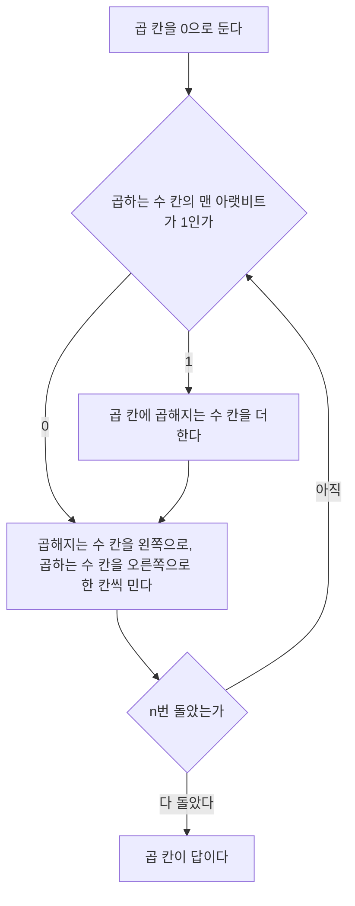


<div class="callout callout-summary" markdown="1">
<div class="callout-title callout-title--default" markdown="span">요약</div>

초등학교에서 배운 세로 곱셈을 그대로 회로로 옮긴 것이다. 2진수에서는 곱하는 수의 자리마다 0 아니면 1뿐이라, 자리마다 할 일이 "곱해지는 수를 더한다" 아니면 "안 더한다" 둘 중 하나다. 한 자리를 볼 때마다 곱해지는 수를 왼쪽으로 한 칸 밀어 자릿값을 맞춘다. 덧셈 회로 하나와 미는 칸만 있으면 되어 단순하다. 대신 자릿수만큼 걸음을 되풀이해야 해서 덧셈보다 훨씬 느리고, 답이 재료의 두 배 자릿수까지 커지므로 답을 담을 칸도 두 배여야 한다.

</div>


## 예시로 보기

덧셈은 회로 하나를 한 번 지나면 끝난다. 곱셈은 그렇지 않다. $$13 \times 11$$을 손으로 2진수 세로 곱셈을 하면 덧셈을 여러 번 해야 한다.

```
        1101      곱해지는 수 (13)
      × 1011      곱하는 수 (11)
      ------
        1101      1 × 1101          (곱하는 수의 맨 아랫자리가 1)
       1101       1 × 1101, 한 칸 왼쪽
      0000        0 × 1101, 두 칸 왼쪽
     1101         1 × 1101, 세 칸 왼쪽
    --------
    10001111      = 143
```

10진수 곱셈에서는 자리마다 구구단을 써야 했다. 2진수에서는 자리가 1이면 곱해지는 수를 그대로 적고, 0이면 0을 적는다. 그래서 곱셈이 "밀고, 더할지 말지 정하기"의 되풀이가 된다. 4비트 둘을 곱했는데 답은 8비트다.

회로는 이 줄들을 한꺼번에 더하지 않고 한 줄씩 차례로 더해 간다. 걸음마다 칸에 든 값은 아래와 같다[^s1].

| 걸음 | 한 일 | 곱하는 수 칸 | 곱해지는 수 칸 | 곱 칸 |
|---|---|---|---|---|
| 0 | 처음 | `1011` | `0000 1101` | `0000 0000` |
| 1 | 맨 아랫비트 1: 더한다. 민다 | `0101` | `0001 1010` | `0000 1101` (13) |
| 2 | 맨 아랫비트 1: 더한다. 민다 | `0010` | `0011 0100` | `0010 0111` (39) |
| 3 | 맨 아랫비트 0: 안 더한다. 민다 | `0001` | `0110 1000` | `0010 0111` (39) |
| 4 | 맨 아랫비트 1: 더한다. 민다 | `0000` | `1101 0000` | `1000 1111` (143) |

"맨 아랫비트"는 그 걸음을 시작할 때 곱하는 수 칸의 맨 오른쪽 비트다. 2걸음에서는 13의 두 배인 26을 더해 13 + 26 = 39가 되고, 4걸음에서는 13의 여덟 배인 104를 더해 39 + 104 = 143이 된다.

<div class="callout callout-check" markdown="1">
<div class="callout-title" markdown="span">검증: 위 추적 표, 아래 고친 회로의 추적 표, 두 회로 모두 4비트와 8비트의 모든 쌍(각각 256쌍, 65,536쌍)에서 답이 맞는 것, 걸음마다 불변식이 맞는 것, `mult`의 Hi·Lo 값, 카드의 값 — [20_multiplier-circuit_impl.py](/Hongs_Blog/studies/computer-architecture/code/20_multiplier-circuit_impl/). 실제 회로가 아니라 레지스터 값을 파이썬으로 흉내 낸 것이다.</div>

</div>


## 알고리즘

**입력과 출력.** 입력은 부호 없는 $$n$$비트 정수 둘, 곱해지는 수 $$M$$과 곱하는 수 $$Q$$다. 출력은 $$2n$$비트 정수 $$P = M \times Q$$다. $$n$$비트 수의 가장 큰 값은 $$2^n - 1$$이고 $$(2^n - 1)^2 < 2^{2n}$$이므로 답은 늘 $$2n$$비트에 들어간다.

**칸.** 곱해지는 수 칸($$2n$$비트, 처음에 아래쪽 절반에 $$M$$), 곱하는 수 칸($$n$$비트, 처음에 $$Q$$), 곱 칸($$2n$$비트, 처음에 0)[^1].

```
곱 = 0
n번 되풀이:
    곱하는 수 칸의 맨 아랫비트가 1이면  곱 = 곱 + 곱해지는 수 칸
    곱해지는 수 칸을 왼쪽으로 한 칸 민다
    곱하는 수 칸을 오른쪽으로 한 칸 민다
```



곱하는 수 칸을 오른쪽으로 밀면 다음 자리가 맨 아랫비트 자리로 내려온다. 그래서 회로는 늘 같은 자리 하나만 보면 된다[^s1].

### 정확성

**불변식.** $$i$$걸음을 마친 뒤 다음 둘이 맞다. $$Q_{[i]}$$는 $$Q$$의 아래 $$i$$비트만 남긴 수다($$Q \bmod 2^i$$).

$$\text{곱 칸} = M \times Q_{[i]}, \qquad \text{곱해지는 수 칸} = M \times 2^i$$


<details class="callout callout-proof" markdown="1">
<summary class="callout-title" markdown="span">까닭 펼치기</summary>

걸음 수에 대한 수학적 귀납법이다. $$q_i$$는 $$Q$$의 $$i$$번 비트(맨 아래가 0번)다.
1. **처음** ($$i = 0$$). 곱 칸 = 0 = $$M \times 0$$, 곱해지는 수 칸 = $$M = M \times 2^0$$. $$Q_{[0]} = 0$$이므로 맞다.
2. **한 걸음.** $$i$$걸음 뒤에 맞다고 하자. 곱하는 수 칸은 $$i$$번 밀렸으므로 맨 아랫비트가 $$q_i$$다. $$q_i = 1$$이면 곱 칸에 $$M \times 2^i$$가 더해지고, 0이면 그대로다. 두 경우를 한 식으로 쓰면 곱 칸 $$= M \times Q_{[i]} + q_i \times M \times 2^i = M \times (Q_{[i]} + q_i 2^i) = M \times Q_{[i+1]}$$이다. — 2진수의 자릿값
3. 곱해지는 수 칸은 한 칸 밀려 $$M \times 2^{i+1}$$이 된다. $$i < n$$이면 $$M \times 2^{i+1} < 2^{2n}$$이라 칸을 넘치지 않는다($$n$$걸음째의 밀기는 넘칠 수 있지만 그 값은 다시 쓰이지 않는다).
4. **끝.** $$n$$걸음 뒤 곱 칸 $$= M \times Q_{[n]} = M \times Q$$다. $$Q$$가 $$n$$비트 수이기 때문이다. ∎

</details>


### 걸리는 시간

$$n$$비트 곱셈은 $$n$$걸음이고, 걸음마다 덧셈 한 번과 밀기를 한다. 32비트면 32걸음이다. 걸음마다 클록 한 번이 필요하므로, 덧셈이 클록 한 번에 끝난다면 곱셈은 서른 배쯤 오래 걸린다[^s1].

**칸을 아낀 회로.** 위 회로는 곱해지는 수 칸과 덧셈기가 $$2n$$비트다. 그런데 걸음마다 실제로 바뀌는 곱 칸의 비트는 $$n$$개 남짓이다. 곱해지는 수를 왼쪽으로 미는 대신 곱을 오른쪽으로 밀면 덧셈기가 $$n$$비트로 줄어든다. 또 곱하는 수는 한 걸음에 한 비트씩 쓸모가 없어지고 곱은 한 비트씩 늘어나므로, 둘이 $$2n$$비트 칸 하나를 나눠 쓸 수 있다[^2].

$$13 \times 11$$을 이 회로로 돌린 것이다. 칸의 위쪽 절반에 곱이 자라고, 아래쪽 절반에 아직 안 본 곱하는 수 비트가 남는다. 덧셈의 올림이 한 비트 생길 수 있어 위쪽을 5비트로 적었다.

| 걸음 | 한 일 | 위쪽 (곱) | 아래쪽 (곱하는 수) |
|---|---|---|---|
| 0 | 처음 | `0 0000` | `1011` |
| 1 | 맨 아랫비트 1: 위쪽에 `1101`을 더하고 전체를 오른쪽으로 | `0 0110` | `1101` |
| 2 | 맨 아랫비트 1: 더하고 오른쪽으로 | `0 1001` | `1110` |
| 3 | 맨 아랫비트 0: 오른쪽으로만 | `0 0100` | `1111` |
| 4 | 맨 아랫비트 1: 더하고 오른쪽으로 | `0 1000` | `1111` |

끝난 뒤 위쪽 4비트 `1000`과 아래쪽 `1111`을 이으면 `1000 1111` = 143이다.

실제 프로세서는 이보다 빠른 회로를 쓴다. 덧셈기를 여러 개 나란히 놓아 걸음을 되풀이하지 않고 한 번에 더한다. 클록을 기다리지 않아 빠르지만 트랜지스터가 많이 든다[^3].

## MIPS에서

32비트 둘을 곱하면 답이 64비트라 레지스터 하나에 안 들어간다. MIPS는 곱셈 전용 칸 둘을 따로 둔다. 위쪽 32비트가 Hi, 아래쪽 32비트가 Lo에 들어간다[^4].

| 명령 | 하는 일 |
|---|---|
| `mult $s2, $s3` | $$\{Hi, Lo\} = R[\$s2] \times R[\$s3]$$. 부호 있는 수로 곱한다 |
| `multu $s2, $s3` | 같은 일을 부호 없는 수로 한다 |
| `mfhi $s0` | Hi의 값을 `$s0`으로 옮긴다 (move from Hi) |
| `mflo $s1` | Lo의 값을 `$s1`로 옮긴다 (move from Lo) |

$$100{,}000 \times 100{,}000 = 10^{10}$$은 16진수로 `0x2 540BE400`이다. `mult` 뒤 Hi = `0x00000002`, Lo = `0x540BE400`이다. Lo만 꺼내 쓰면 1,410,065,408이라는 틀린 값을 얻는다. 답이 32비트에 들어가는지는 Hi를 봐야 안다[^s1].

**부호 있는 곱셈.** 가장 쉬운 방법은 두 수를 양수로 바꿔 크기끼리 곱하고, 두 수의 부호가 다르면 답의 부호를 뒤집는 것이다[^5].

## 활용

- 구현: [20_multiplier-circuit_impl.py](/Hongs_Blog/studies/computer-architecture/code/20_multiplier-circuit_impl/)
- 2의 거듭제곱을 곱할 때는 곱셈기를 쓰지 않고 왼쪽으로 민다. `sll $t0, $s0, 3`이 8을 곱하는 것이다: [시프트 명령](/Hongs_Blog/studies/assembly-language/shift-instructions/).
- 흔한 실수: 곱하는 수를 왼쪽 비트부터 보는 것. 이 회로는 맨 아랫비트부터 본다. 곱해지는 수가 걸음마다 두 배가 되는 것과 짝이 맞아야 한다.

## 연결

- 선수: 걸음마다 쓰는 덧셈 회로는 [가산기](/Hongs_Blog/studies/computer-architecture/adder-circuit/), 걸음을 세고 칸을 미는 것은 [클록과 순차 회로](/Hongs_Blog/studies/computer-architecture/clocked-sequential-logic/)
- 같은 칸 구성을 거꾸로 돌린 것: [나눗셈 회로](/Hongs_Blog/studies/computer-architecture/divider-circuit/)
- 소수점이 있는 수의 곱셈에서도 앞자리 숫자끼리의 곱에 이 회로가 쓰인다: [부동소수점 연산](/Hongs_Blog/studies/computer-architecture/floating-point-arithmetic/)

## 확인 문제

<details class="callout callout-question" markdown="1">
<summary class="callout-title" markdown="span">**C1** 4비트 곱셈 $$6 \times 5$$(`0110` × `0101`)를 첫 번째 회로로 돌린다. 네 걸음 각각을 마친 뒤 곱 칸의 값을 10진수로 쓰라.</summary>

**답:** 6, 6, 30, 30.<br>
**이유:** 곱하는 수 `0101`을 아랫비트부터 보면 1, 0, 1, 0이다. 1걸음에 6을 더하고, 2걸음은 안 더하고, 3걸음에 $$6 \times 4 = 24$$를 더해 30, 4걸음은 안 더한다.

</details>


<details class="callout callout-question" markdown="1">
<summary class="callout-title" markdown="span">**C2** 의사코드의 "곱해지는 수 칸을 왼쪽으로 한 칸 민다"가 하는 일을 한 문장으로 쓰라.</summary>

**답:** 다음 걸음에서 볼 곱하는 수의 자리가 한 자리 높아지므로, 더할 값을 그 자릿값에 맞게 두 배로 만들어 둔다.

</details>


<details class="callout callout-question" markdown="1">
<summary class="callout-title" markdown="span">**C3** $$n$$비트 둘을 곱하는 회로에서 곱 칸이 $$2n$$비트여야 하는 까닭을 4비트의 가장 큰 예로 보여라. MIPS는 이 문제를 어떻게 푸는가?</summary>

**답:** $$15 \times 15 = 225$$ = `1110 0001`로 8비트가 다 필요하다. 일반적으로 $$(2^n - 1)^2 = 2^{2n} - 2^{n+1} + 1$$은 $$2^{2n-1}$$ 이상($$n \ge 2$$)이라 $$2n$$비트가 필요하다. MIPS는 64비트 답을 Hi와 Lo 두 칸에 나눠 담고 `mfhi`, `mflo`로 꺼낸다.

</details>


<details class="callout callout-question" markdown="1">
<summary class="callout-title" markdown="span">**C4** `$s2` = 70,000, `$s3` = 70,000에서 `mult $s2, $s3` 뒤 Hi와 Lo는 얼마인가? `mflo`만 써서 답을 꺼내면 무엇이 잘못되는가?</summary>

**답:** $$70{,}000^2 = 4{,}900{,}000{,}000$$ = `0x1 24101100`. Hi = `0x00000001`, Lo = `0x24101100`. Lo만 보면 605,032,704라는 틀린 값이다.<br>
**이유:** 32비트로 적을 수 있는 가장 큰 부호 없는 수가 약 43억이다. 49억은 넘친다. 넘친 몫이 Hi에 있다.

</details>


[^1]: University of Utah CS3810 (R. Balasubramonian), Lecture 8 "Binary Multiplication & Division", https://users.cs.utah.edu/~rajeev/cs3810/slides/3810-15-08.pdf, 슬라이드 2~3 (걸음마다 곱해지는 수를 밀고, 곱하는 수의 다음 비트를 보고, 1이면 민 값을 곱에 더한다). Patterson & Hennessy, *Computer Organization and Design* (MIPS Edition), 3장 "Arithmetic for Computers"
[^2]: 같은 자료, 슬라이드 4 (32비트 덧셈기, 곱해지는 수는 그대로, 합이 오른쪽으로 밀린다, 곱과 곱하는 수의 비트 수 합이 늘 64라 64비트 칸 하나를 나눠 쓴다)
[^3]: 같은 자료, 슬라이드 7 (빠른 곱셈: 클록 없이 덧셈 결과가 차례로 내려가길 기다린다, 트랜지스터 비용이 크다)
[^4]: 같은 자료, 슬라이드 5~6 (32비트 둘의 곱은 64비트일 수 있어 32비트 칸 둘에 담는다, mult·mfhi·mflo·multu). MIPS Reference Data(Green Sheet), https://www.comp.nus.edu.sg/~cs2100/lect/MIPS_Reference_Data_page1.pdf (mult: {Hi,Lo} = R[rs] * R[rt]. mfhi: R[rd] = Hi. mflo: R[rd] = Lo)
[^5]: University of Utah CS3810, Lecture 8, 같은 자료, 슬라이드 5 (음수는 양수로 바꿔 크기를 곱하고 부호가 다르면 음수로 바꾼다)
[^s1]: <span class="fn-tag" title="수업 자료에 없고 따로 보탠 내용">보충</span> 예의 수치($$13 \times 11$$)와 두 추적 표, 흐름 다이어그램, 불변식과 귀납 논증, "서른 배쯤"이라는 어림, Hi·Lo 예의 수치, 카드는 위 자료에 그대로 있지 않다. 값은 구현 코드로 구하고 4비트·8비트 전수 검사로 확인했다.

