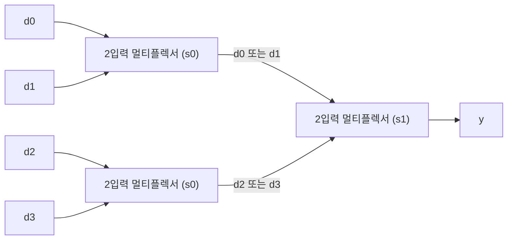



요약

멀티플렉서는 여러 입력 가운데 하나를 골라 그대로 내보내는 회로다. 선로가 갈리는 곳에서 어느 선로의 기차를 보낼지 정하는 전환기와 같다. 디코더는 반대로, 번호를 받아 그 번호가 붙은 선 하나만 켠다. 번호를 누르면 그 층 버튼에만 불이 들어오는 엘리베이터와 같다. 둘 다 값을 계산하지 않고 길만 고른다. 고를 것이 두 배가 되면 번호에 쓸 선은 하나만 늘지만, 회로 자체는 두 배로 커진다.

## 예시로 보기

프로세서에는 "이번에는 이 값을, 다음에는 저 값을 써야 하는" 자리가 많다. 덧셈 회로의 둘째 입력이 어떤 명령에서는 레지스터 값이고 어떤 명령에서는 명령 안에 적힌 수다. 선을 뽑아 다시 꽂을 수는 없으므로 두 값을 다 이어 놓고 하나를 고르는 부품이 필요하다.

8비트 값 둘 $$a = 0010\,1101$$, $$b = 1111\,0000$$과 고르는 신호 $$s$$가 있다.

| $$s$$ | 출력 $$y$$ |
|---|---|
| 0 | $$0010\,1101$$ ($$a$$ 그대로) |
| 1 | $$1111\,0000$$ ($$b$$ 그대로) |

비트 하나를 고르는 회로를 8개 나란히 놓고 $$s$$ 하나를 여덟 군데에 다 이은 것이다.

검증: 2입력 멀티플렉서 8줄, 4입력 64가지(2입력 셋으로 만든 것, 디코더로 만든 것, 식이 모두 같음), 8비트 너비 전수 131,072가지, 디코더가 늘 하나만 켜는 것(1·2·3·5비트), 카드 C2·C3 — [06_mux-decoder_verify.py](/Hongs_Blog/studies/computer-architecture/code/06_mux-decoder_verify/) (실제 하드웨어가 아니라 파이썬으로 게이트를 흉내 낸 것)

## 정의

**멀티플렉서.** 자료 입력 여러 개와 선택 신호를 받아, 선택 신호가 가리키는 자료 입력 하나를 출력으로 내보내는 조합 회로다[^1]. 입력이 둘인 1비트 멀티플렉서는 $$s$$가 0이면 $$a$$를, 1이면 $$b$$를 낸다.

$$y = \bar s\, a + s\, b$$

$$s = 0$$이면 $$\bar s = 1$$이라 앞 항이 $$a$$가 되고 뒤 항은 0이다. $$s = 1$$이면 반대다[^2]. AND 2개, NOT 1개, OR 1개로 만든다.

자료 입력이 $$n$$개면 선택 신호는 $$\log_2 n$$개가 필요하다[^1]. 넷이면 2개, 서른둘이면 5개다. 입력이 넷인 멀티플렉서의 식은 다음과 같다[^2].

$$y = \bar s_1 \bar s_0\, d_0 + \bar s_1 s_0\, d_1 + s_1 \bar s_0\, d_2 + s_1 s_0\, d_3$$

$$d_0$$부터 $$d_3$$까지가 자료 입력이고, $$s_1 s_0$$을 2진수로 읽은 번호의 입력이 나온다. $$s_1 s_0 = 10$$이면 2번인 $$d_2$$다. 만드는 방법은 두 가지다.

- 2입력 멀티플렉서 셋을 두 층으로 쌓는다. 아래층 둘이 $$s_0$$으로 한 번 고르고, 위층 하나가 $$s_1$$로 한 번 더 고른다[^2].
- 디코더로 번호를 선 하나로 바꾸고, 자료 입력마다 그 선과 AND한 뒤, 큰 OR 하나로 모은다[^1].

아래층은 짝 안에서 고르고 위층은 어느 짝인지 고른다. 층이 하나 늘 때마다 고를 수 있는 입력이 두 배가 된다[^s1].

**너비.** 32비트 값을 고를 때는 1비트 멀티플렉서 32개를 나란히 놓고 선택 신호를 함께 쓴다. 그림에서는 굵은 선 하나와 멀티플렉서 하나로 줄여 그린다[^1].

**디코더.** $$n$$비트 입력을 받아 출력 $$2^n$$개 가운데 입력을 2진수로 읽은 번호의 출력 하나만 1로 하고 나머지는 0으로 하는 조합 회로다[^1]. 이렇게 하나만 1인 모양을 원-핫이라 부른다[^3].

| 입력 $$i_2 i_1 i_0$$ | Out0 | Out1 | Out2 | Out3 | Out4 | Out5 | Out6 | Out7 |
|---|---|---|---|---|---|---|---|---|
| 000 | 1 | 0 | 0 | 0 | 0 | 0 | 0 | 0 |
| 001 | 0 | 1 | 0 | 0 | 0 | 0 | 0 | 0 |
| 101 | 0 | 0 | 0 | 0 | 0 | 1 | 0 | 0 |
| 111 | 0 | 0 | 0 | 0 | 0 | 0 | 0 | 1 |

출력마다 AND 게이트 하나다. Out5는 $$i_2\, \bar i_1\, i_0$$이다. 입력이 101일 때만 셋이 모두 1이 된다. 표에서 회로를 만들 때 쓰는 AND 항과 똑같다([논리 게이트와 조합 회로](/Hongs_Blog/studies/computer-architecture/combinational-logic/)).

## 활용

- [ALU](/Hongs_Blog/studies/computer-architecture/alu/)는 AND, OR, 덧셈을 모두 계산해 놓고 멀티플렉서로 하나를 고른다.
- [레지스터 파일](/Hongs_Blog/studies/computer-architecture/register-file/)은 읽을 때 32입력 멀티플렉서로 레지스터 하나의 값을 고르고, 쓸 때 5비트 번호를 디코더에 넣어 레지스터 32개 가운데 하나만 쓰게 한다.
- 데이터패스 그림에서 선이 둘로 갈렸다가 사다리꼴 하나로 모이는 자리는 모두 멀티플렉서고, 거기 붙은 선택 신호가 제어 신호다: [데이터패스의 구성 요소](/Hongs_Blog/studies/computer-architecture/datapath-elements/), [제어 장치와 제어 신호](/Hongs_Blog/studies/computer-architecture/control-unit/).
- **표 찾기로 쓰기.** 4입력 멀티플렉서의 자료 입력에 0, 1, 1, 0을 고정해 꽂고 선택 신호에 $$a$$, $$b$$를 넣으면 출력은 $$a \oplus b$$다. 자료 입력에 진리표를 꽂으면 아무 함수나 된다[^3].
- **흔한 실수.** 멀티플렉서가 고르지 않은 입력을 "계산하지 않는다"고 생각하는 것. 고르지 않은 쪽 회로도 늘 계산하고 있고, 그 결과를 버릴 뿐이다.

## 연결

- 선수: [논리 게이트와 조합 회로](/Hongs_Blog/studies/computer-architecture/combinational-logic/)
- 어셈블리어 과목의 슬라이드에 나온 식 $$(Y \wedge S) \vee (X \wedge \neg S)$$가 2입력 멀티플렉서다: [불 대수와 논리 회로](/Hongs_Blog/studies/discrete-math/boolean-algebra/)의 과목별 관점

## 확인 문제

**C1** 1비트 2입력 멀티플렉서의 식을 쓰고, 자료 입력이 32개면 선택 신호가 몇 개 필요한지 말하라.

**답:** $$y = \bar s\, a + s\, b$$. 선택 신호는 $$\log_2 32 = 5$$개. 
**이유:** 선택 신호 $$k$$개로 가리킬 수 있는 번호가 $$2^k$$가지다.

**C2** 4입력 멀티플렉서에 $$d_0 d_1 d_2 d_3 = 1, 0, 1, 1$$이 들어오고 $$s_1 s_0 = 10$$이다. 2입력 멀티플렉서 셋으로 만든 회로에서 아래층 둘의 출력과 최종 출력은?

**답:** $$s_0 = 0$$이므로 아래층은 각 짝의 앞쪽을 고른다: $$d_0 = 1$$, $$d_2 = 1$$. $$s_1 = 1$$이므로 위층은 둘째 짝을 고른다. 출력은 $$d_2 = 1$$. 
**흔한 오답:** $$s_1 s_0 = 10$$을 "1번"으로 읽어 $$d_1 = 0$$이라 답하는 것. 2진수 10은 2다.

**C3** 3비트 입력 110이 있다. 이것을 디코더에 넣을 때와 8입력 멀티플렉서의 선택 신호에 넣을 때 나오는 것은 각각 무엇인가?

**답:** 디코더는 출력 8개 가운데 Out6만 1로 켠다. 멀티플렉서는 자료 입력 8개 가운데 6번에 들어온 값을 그대로 내보낸다. 
**이유:** 디코더는 번호를 "어느 선인지"로 바꿀 뿐이고 자료가 지나가지 않는다. 멀티플렉서는 번호로 자료가 지나갈 길을 고른다. 디코더 출력으로 자료 입력을 AND하고 OR로 모으면 멀티플렉서가 된다.

[^1]: Patterson & Hennessy, *Computer Organization and Design*, 부록 "The Basics of Logic Design"의 B.3절 "Combinational Logic" (디코더: 입력 $$n$$비트에 출력 $$2^n$$개, 3비트 디코더의 진리표. 멀티플렉서: 선택 입력 $$\log_2 n$$개, 디코더와 AND 줄과 OR 하나로 만드는 법, 32비트 너비로 늘어놓기). 절 번호는 공개된 PDF 기준이고 판에 따라 부록 문자가 다를 수 있다. https://www.doc.ic.ac.uk/~wl/teachlocal/arch/HP05/HP_AppB.pdf
[^2]: UC Berkeley CS61C 강의 노트 "Data Multiplexors" (1비트 2입력 멀티플렉서의 식, 4입력 멀티플렉서의 식과 2입력 셋으로 만드는 법), https://notes.cs61c.org/content/sds-blocks/
[^3]: MIT 6.004 Computation Structures 강의 노트 "Combinational Logic" (디코더의 원-핫 출력, 멀티플렉서를 표 찾기로 써서 아무 함수나 만드는 법), https://computationstructures.org/notes/combinational_logic/notes.html
[^s1]: 보충 8비트 예와 다이어그램 1개는 직접 만들었다. 검증 코드로 확인했다.

